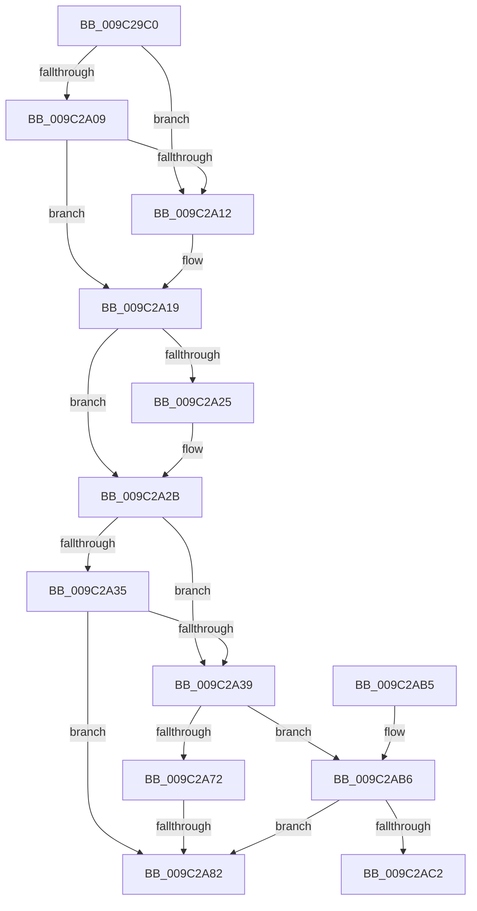

# PiUEventDequeuePendingEventWorker

- RVA: `0x009C29C0`–`0x009C2AC7` (길이 `263` bytes)
- VA: `0x00000001409C29C0`
- 실행 섹션: `PAGE`
- PDB 이름 있음: `예`; PDB Function 태그: `예`
- unwind 정보 RVA: `0x0009F75C`
- 디코드: `71`개 명령, `263/263` bytes 표시
- 미해석 바이트: `0` (있으면 어셈블리에 `.byte`로 보존)

> 이 문서는 커널 이미지의 기계어와 PDB 기호를 분석해 생성했습니다. 4번과 5번은 함수 원형과 자료형을 바이너리 사용 방식에서 추정한 C 해석이며 원본 소스 복구 결과는 아닙니다.

## 1. Dependencies

- 직접 호출 지점: **2**; 고유 호출 대상: **2**
- 직접 호출자로 확인된 함수: **3**
- RIP 상대 이미지 참조: **3**

### Outgoing calls
- `0x009C2A86` → [PiUEventDereferenceEventEntry](PiUEventDereferenceEventEntry_function_009C3244.md) (function, `0x009C3244`)
- `0x009C2A93` → [ExFreePoolWithTag](../../poolcode/B8/ExFreePoolWithTag_function_00B82870.md) (function, `0x00B82870`)

### Direct callers
- [PiUEventNotifyClient](../8E/PiUEventNotifyClient_function_008E6BEC.md) at `0x008E6D10`
- [PiUEventHandleVetoEvent](PiUEventHandleVetoEvent_function_009C2744.md) at `0x009C27D4`
- [PiUEventFreeClientRegistrationContext](PiUEventFreeClientRegistrationContext_function_009C3A2C.md) at `0x009C3B79`
- [PiUEventFreeClientRegistrationContext](PiUEventFreeClientRegistrationContext_function_009C3A2C.md) at `0x009C3B92`

### Static image references
- `0x009C2A2B` → RVA `0x00EF012C` (`.data`; read)
- `0x009C2A72` → RVA `0x00E0AA0C` (`.data`; read)
- `0x009C2AB6` → RVA `0x00E0AA04` (`.data`; read)

## 2. Other-region calls and transfers

- 다른 실행 섹션으로 향하는 call: **1**
  - `0x009C2A93` → [ExFreePoolWithTag](../../poolcode/B8/ExFreePoolWithTag_function_00B82870.md) (`PAGE` → `POOLCODE`)
- call이 아닌 외부 분기/꼬리 이동: **2**
  - `0x009C2A7C` → [sub_00B2EF58](../B2/Unknown_function_00B2EF58.md) (`tail-transfer`)
  - `0x009C2AC2` → [sub_00B2EF58 + 0x7B](../B2/Unknown_function_00B2EF58.md) (`tail-transfer`)

## 3. Assembly (complete function range)

```asm
009C29C0  48 8B C4                        mov rax, rsp
009C29C3  48 89 58 08                     mov qword ptr [rax + 8], rbx
009C29C7  48 89 70 18                     mov qword ptr [rax + 0x18], rsi
009C29CB  48 89 78 20                     mov qword ptr [rax + 0x20], rdi
009C29CF  55                              push rbp
009C29D0  41 56                           push r14
009C29D2  41 57                           push r15
009C29D4  48 8D 68 A1                     lea rbp, [rax - 0x5f]
009C29D8  48 81 EC B0 00 00 00            sub rsp, 0xb0
009C29DF  48 8B F9                        mov rdi, rcx
009C29E2  45 0F B6 F0                     movzx r14d, r8b
009C29E6  48 8B 0A                        mov rcx, qword ptr [rdx]
009C29E9  45 33 C0                        xor r8d, r8d
009C29EC  45 0F B6 F9                     movzx r15d, r9b
009C29F0  48 8B DA                        mov rbx, rdx
009C29F3  4C 89 45 37                     mov qword ptr [rbp + 0x37], r8
009C29F7  4C 89 45 2F                     mov qword ptr [rbp + 0x2f], r8
009C29FB  4C 89 45 27                     mov qword ptr [rbp + 0x27], r8
009C29FF  4C 89 45 6F                     mov qword ptr [rbp + 0x6f], r8
009C2A03  48 39 51 08                     cmp qword ptr [rcx + 8], rdx
009C2A07  75 09                           jne 0x1409c2a12
009C2A09  48 8B 42 08                     mov rax, qword ptr [rdx + 8]
009C2A0D  48 39 10                        cmp qword ptr [rax], rdx
009C2A10  74 07                           je 0x1409c2a19
009C2A12  B9 03 00 00 00                  mov ecx, 3
009C2A17  CD 29                           int 0x29
009C2A19  48 89 08                        mov qword ptr [rax], rcx
009C2A1C  48 89 41 08                     mov qword ptr [rcx + 8], rax
009C2A20  45 84 F6                        test r14b, r14b
009C2A23  75 06                           jne 0x1409c2a2b
009C2A25  FF 8F 80 00 00 00               dec dword ptr [rdi + 0x80]
009C2A2B  8A 05 FB D6 52 00               mov al, byte ptr [rip + 0x52d6fb]
009C2A31  84 C0                           test al, al
009C2A33  78 04                           js 0x1409c2a39
009C2A35  A8 02                           test al, 2
009C2A37  74 49                           je 0x1409c2a82
009C2A39  48 B9 14 00 00 00 80 F7 FF FF   movabs rcx, 0xfffff78000000014
009C2A43  48 B8 4B 59 86 38 D6 C5 6D 34   movabs rax, 0x346dc5d63886594b
009C2A4D  48 8B 09                        mov rcx, qword ptr [rcx]
009C2A50  48 2B 4A 10                     sub rcx, qword ptr [rdx + 0x10]
009C2A54  48 F7 E9                        imul rcx
009C2A57  48 8B 4B 18                     mov rcx, qword ptr [rbx + 0x18]
009C2A5B  48 8B F2                        mov rsi, rdx
009C2A5E  48 C1 FE 0B                     sar rsi, 0xb
009C2A62  48 8B C6                        mov rax, rsi
009C2A65  48 C1 E8 3F                     shr rax, 0x3f
009C2A69  48 03 F0                        add rsi, rax
009C2A6C  44 38 41 4C                     cmp byte ptr [rcx + 0x4c], r8b
009C2A70  75 44                           jne 0x1409c2ab6
009C2A72  0F B7 05 93 7F 44 00            movzx eax, word ptr [rip + 0x447f93]
009C2A79  48 3B F0                        cmp rsi, rax
009C2A7C  0F 8F D6 C4 16 00               jg 0x140b2ef58
009C2A82  48 8B 4B 18                     mov rcx, qword ptr [rbx + 0x18]
009C2A86  E8 B9 07 00 00                  call 0x1409c3244
009C2A8B  BA 50 6E 70 59                  mov edx, 0x59706e50
009C2A90  48 8B CB                        mov rcx, rbx
009C2A93  E8 D8 FD 1B 00                  call 0x140b82870
009C2A98  4C 8D 9C 24 B0 00 00 00         lea r11, [rsp + 0xb0]
009C2AA0  49 8B 5B 20                     mov rbx, qword ptr [r11 + 0x20]
009C2AA4  49 8B 73 30                     mov rsi, qword ptr [r11 + 0x30]
009C2AA8  49 8B 7B 38                     mov rdi, qword ptr [r11 + 0x38]
009C2AAC  49 8B E3                        mov rsp, r11
009C2AAF  41 5F                           pop r15
009C2AB1  41 5E                           pop r14
009C2AB3  5D                              pop rbp
009C2AB4  C3                              ret
009C2AB5  CC                              int3
009C2AB6  0F B7 05 47 7F 44 00            movzx eax, word ptr [rip + 0x447f47]
009C2ABD  48 3B F0                        cmp rsi, rax
009C2AC0  7E C0                           jle 0x1409c2a82
009C2AC2  E9 0C C5 16 00                  jmp 0x140b2efd3
```

## 4. C-style interpretation (structured pseudocode)

```c
__int64 __fastcall PiUEventDequeuePendingEventWorker(__int64 a1, __int64 a2, int a3, unsigned __int8 a4)
{
    __int64 result;
    __int64 v_rsi;
    __int64 v_rsp;
    unsigned __int64 v_stack_m18;

    *(unsigned __int64 *)(v_rsp + 8) = v_rbx;
    *(unsigned __int64 *)(v_rsp + 24) = v_rsi;
    *(unsigned __int64 *)(v_rsp + 32) = v_rdi;
    v_rsp = (v_rsp) - (176);
    a3 = 0;
    *(unsigned __int64 *)(v_rsp - 95 + 55) = 0;
    *(unsigned __int64 *)(v_rsp - 95 + 47) = 0;
    *(unsigned __int64 *)(v_rsp - 95 + 39) = 0;
    *(unsigned __int64 *)(v_rsp - 95 + 111) = 0;
    if ((*(unsigned __int64 *)(*(unsigned __int64 *)(a2) + 8)) != a2) goto loc_009C2A12;
    if ((*(unsigned __int64 *)(*(unsigned __int64 *)(a2 + 8))) != a2) {
        a1 = 3;
    }
    *(unsigned __int64 *)(*(unsigned __int64 *)(a2 + 8)) = a1;
    *(unsigned __int64 *)(a1 + 8) = *(unsigned __int64 *)(a2 + 8);
    if ((unsigned __int8)((unsigned __int8)(a3)) == 0) {
    }
    if (sign_flag) goto loc_009C2A39;
    if ((((unsigned __int8)(*(unsigned __int8 *)(v_rip + 5428987))) & (2)) == 0) goto loc_009C2A82;
loc_009C2A39:
    a1 = (*(unsigned __int64 *)(a1)) - (*(unsigned __int64 *)(a2 + 16));
    v_rsi = (a2) >> (11);
    result = (v_rsi) >> (63);
    v_rsi = (v_rsi) + (result);
    if ((*(unsigned __int8 *)(*(unsigned __int64 *)(a2 + 24) + 76)) != 0) goto loc_009C2AB6;
loc_009C2A82:
    result = PiUEventDereferenceEventEntry(*(unsigned __int64 *)(a2 + 24), a2, a3, a4);
    result = ExFreePoolWithTag(a2, (unsigned int)(0x59706E50ULL), a3, a4);
    return result;
loc_009C2AB6:
    if ((*(unsigned __int64 *)(v_stack_m18 + 48)) <= (*(unsigned __int16 *)(v_rip + 4489031))) goto loc_009C2A82;
}
```

## 5. (Beta) C Style

```c
int64_t PiUEventDequeuePendingEventWorker(void *Arg1, void *Arg2, int32_t Arg3, uint8_t Arg4)
{
    uint8_t *arg1 = (uint8_t *)Arg1;
    uint8_t *arg2 = (uint8_t *)Arg2;

    int64_t result;
    int64_t local_rsi;
    int64_t local_rsp;
    uint64_t v_stack_m18;

    *(uint64_t *)(local_rsp + 0x8) = local_rbx;
    *(uint64_t *)(local_rsp + 0x18) = local_rsi;
    *(uint64_t *)(local_rsp + 0x20) = local_rdi;
    local_rsp = (local_rsp) - (176);
    Arg3 = 0;
    *(uint64_t *)(local_rsp - 0x5F + 0x37) = 0;
    *(uint64_t *)(local_rsp - 0x5F + 0x2F) = 0;
    *(uint64_t *)(local_rsp - 0x5F + 0x27) = 0;
    *(uint64_t *)(local_rsp - 0x5F + 0x6F) = 0;
    if ((*(uint64_t *)(*(uint64_t *)(arg2) + 0x8)) != Arg2) goto loc_009C2A12;
    if ((*(uint64_t *)(*(uint64_t *)(arg2 + 0x8))) != Arg2) {
        Arg1 = 3;
    }
    *(void **)(*(uint64_t *)(arg2 + 0x8)) = Arg1;
    *(uint64_t *)(arg1 + 0x8) = *(uint64_t *)(arg2 + 0x8);
    if ((uint8_t)((uint8_t)(Arg3)) == 0) {
    }
    if (sign_flag) goto loc_009C2A39;
    if ((((uint8_t)(*(uint8_t *)(v_rip + 0x52D6FB))) & (2)) == 0) goto loc_009C2A82;
loc_009C2A39:
    Arg1 = (*(uint64_t *)(arg1)) - (*(uint64_t *)(arg2 + 0x10));
    local_rsi = (Arg2) >> (11);
    result = (local_rsi) >> (63);
    local_rsi = (local_rsi) + (result);
    if ((*(uint8_t *)(*(uint64_t *)(arg2 + 0x18) + 0x4C)) != 0) goto loc_009C2AB6;
loc_009C2A82:
    result = PiUEventDereferenceEventEntry(*(uint64_t *)(arg2 + 0x18), Arg2, Arg3, Arg4);
    result = ExFreePoolWithTag(Arg2, (uint32_t)(0x59706E50ULL), Arg3, Arg4);
    return result;
loc_009C2AB6:
    if ((*(uint64_t *)(v_stack_m18 + 0x30)) <= (*(uint16_t *)(v_rip + 0x447F47))) goto loc_009C2A82;
}
```

### 관측된 메모리 오프셋

구조체 형식이 확인되지 않은 접근은 인자 기준의 오프셋으로만 기록했습니다.

| 기준 인자 | 오프셋 표현 | 폭 (bit) | 접근 |
|---|---:|---:|---|
| `Arg1` | `+ 0x80` | `32` | `R/W` |
| `Arg2` | `+ 0x0` | `64` | `R` |
| `Arg2` | `+ 0x8` | `64` | `R` |
| `Arg2` | `+ 0x10` | `64` | `R` |
| `Arg2` | `+ 0x18` | `64` | `R` |

## 6. Execution-region graph

[열기: 2D/3D 그래프와 함수 탐색 컨트롤 패널](../../../control-panel.html?section=page&rva=0x009C29C0&view=graph)

- 2D 그래프는 위에서 아래로 흐르고, 3D 그래프는 빈 공간을 드래그해 회전합니다. Shift+드래그는 이동, 휠은 확대·축소, 함수 노드 선택은 대상 보고서 이동입니다.

### Static fallback


