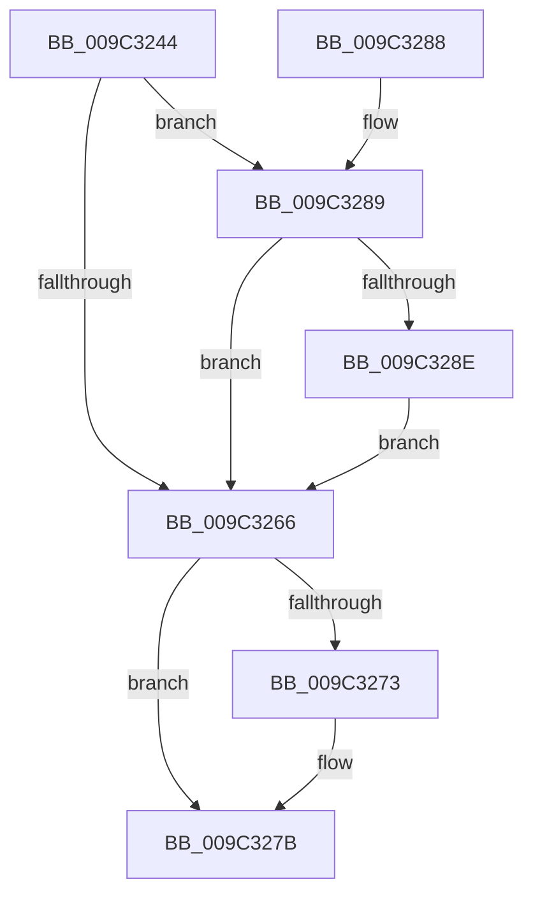

# PiUEventDereferenceEventEntry

- RVA: `0x009C3244`–`0x009C329E` (길이 `90` bytes)
- VA: `0x00000001409C3244`
- 실행 섹션: `PAGE`
- PDB 이름 있음: `예`; PDB Function 태그: `아니요`
- unwind 정보 RVA: `0x0009F34C`
- 디코드: `29`개 명령, `90/90` bytes 표시
- 미해석 바이트: `0` (있으면 어셈블리에 `.byte`로 보존)

> 이 문서는 커널 이미지의 기계어와 PDB 기호를 분석해 생성했습니다. 4번과 5번은 함수 원형과 자료형을 바이너리 사용 방식에서 추정한 C 해석이며 원본 소스 복구 결과는 아닙니다.

## 1. Dependencies

- 직접 호출 지점: **4**; 고유 호출 대상: **4**
- 직접 호출자로 확인된 함수: **4**
- RIP 상대 이미지 참조: **0**

### Outgoing calls
- `0x009C3255` → [ExAcquireFastMutex](../../text/20/ExAcquireFastMutex_function_0020E5A0.md) (function, `0x0020E5A0`)
- `0x009C326A` → [ExReleaseFastMutex](../../text/25/ExReleaseFastMutex_function_002519C0.md) (function, `0x002519C0`)
- `0x009C3276` → [PiUEventFreeEventEntry](PiUEventFreeEventEntry_function_009C32A4.md) (function, `0x009C32A4`)
- `0x009C3297` → [KeSetEvent](../../text/33/KeSetEvent_function_0033F310.md) (function, `0x0033F310`)

### Direct callers
- [PiUEventNotifyUserMode](../95/PiUEventNotifyUserMode_function_00954CB4.md) at `0x009551F9`
- [PiUEventNotifyUserMode](../95/PiUEventNotifyUserMode_function_00954CB4.md) at `0x00955263`
- [PiUEventProcessEventWorker](PiUEventProcessEventWorker_function_009C2870.md) at `0x009C294D`
- [PiUEventDequeuePendingEventWorker](PiUEventDequeuePendingEventWorker_function_009C29C0.md) at `0x009C2A86`
- [PiUEventHandleGetEvent](PiUEventHandleGetEvent_function_009C2C30.md) at `0x009C2E09`

### Static image references
- 디코드된 RIP-relative 메모리 참조가 없습니다.

## 2. Other-region calls and transfers

- 다른 실행 섹션으로 향하는 call: **3**
  - `0x009C3255` → [ExAcquireFastMutex](../../text/20/ExAcquireFastMutex_function_0020E5A0.md) (`PAGE` → `.text`)
  - `0x009C326A` → [ExReleaseFastMutex](../../text/25/ExReleaseFastMutex_function_002519C0.md) (`PAGE` → `.text`)
  - `0x009C3297` → [KeSetEvent](../../text/33/KeSetEvent_function_0033F310.md) (`PAGE` → `.text`)
- 별도 외부 분기/꼬리 이동을 확인하지 못했습니다.

## 3. Assembly (complete function range)

```asm
009C3244  48 89 5C 24 08                  mov qword ptr [rsp + 8], rbx
009C3249  57                              push rdi
009C324A  48 83 EC 20                     sub rsp, 0x20
009C324E  48 8B D9                        mov rbx, rcx
009C3251  48 8B 49 10                     mov rcx, qword ptr [rcx + 0x10]
009C3255  E8 46 B3 84 FF                  call 0x14020e5a0
009C325A  FF 4B 38                        dec dword ptr [rbx + 0x38]
009C325D  80 7B 4C 00                     cmp byte ptr [rbx + 0x4c], 0
009C3261  8B 7B 38                        mov edi, dword ptr [rbx + 0x38]
009C3264  75 23                           jne 0x1409c3289
009C3266  48 8B 4B 10                     mov rcx, qword ptr [rbx + 0x10]
009C326A  E8 51 E7 88 FF                  call 0x1402519c0
009C326F  85 FF                           test edi, edi
009C3271  75 08                           jne 0x1409c327b
009C3273  48 8B CB                        mov rcx, rbx
009C3276  E8 29 00 00 00                  call 0x1409c32a4
009C327B  48 8B 5C 24 30                  mov rbx, qword ptr [rsp + 0x30]
009C3280  8B C7                           mov eax, edi
009C3282  48 83 C4 20                     add rsp, 0x20
009C3286  5F                              pop rdi
009C3287  C3                              ret
009C3288  CC                              int3
009C3289  83 FF 01                        cmp edi, 1
009C328C  75 D8                           jne 0x1409c3266
009C328E  48 8B 4B 18                     mov rcx, qword ptr [rbx + 0x18]
009C3292  45 33 C0                        xor r8d, r8d
009C3295  33 D2                           xor edx, edx
009C3297  E8 74 C0 97 FF                  call 0x14033f310
009C329C  EB C8                           jmp 0x1409c3266
```

## 4. C-style interpretation (structured pseudocode)

```c
__int64 __fastcall PiUEventDereferenceEventEntry(__int64 a1, int a2, int a3)
{
    __int64 result;
    __int64 v_rsp;
    unsigned __int64 v_stack_p8;

    v_stack_p8 = v_rbx;
    v_rsp = (v_rsp) - (32);
    result = ExAcquireFastMutex(*(unsigned __int64 *)(a1 + 16), a2, a3, a4);
    if ((*(unsigned __int8 *)(a1 + 76)) != 0) goto loc_009C3289;
loc_009C3266:
    result = ExReleaseFastMutex(*(unsigned __int64 *)(a1 + 16), a2, a3, a4);
    if ((unsigned int)((unsigned int)(*(unsigned int *)(a1 + 56))) == 0) {
        a1 = a1;
        result = PiUEventFreeEventEntry(a1, a2, a3, a4);
    }
    v_rsp = (v_rsp) + (32);
    return (unsigned int)((unsigned int)((unsigned int)(*(unsigned int *)(a1 + 56))));
loc_009C3289:
    if (((unsigned int)((unsigned int)(*(unsigned int *)(a1 + 56)))) != 1) goto loc_009C3266;
    a3 = 0;
    a2 = 0;
    result = KeSetEvent(*(unsigned __int64 *)(v_stack_p8 + 24), a2, a3, a4);
    goto loc_009C3266;
}
```

## 5. (Beta) C Style

```c
int64_t PiUEventDereferenceEventEntry(void *Arg1, int32_t Arg2, int32_t Arg3)
{
    uint8_t *arg1 = (uint8_t *)Arg1;

    int64_t result;
    int64_t local_rsp;
    uint64_t v_stack_p8;

    v_stack_p8 = local_rbx;
    local_rsp = (local_rsp) - (32);
    result = ExAcquireFastMutex(*(uint64_t *)(arg1 + 0x10), Arg2, Arg3, a4);
    if ((*(uint8_t *)(arg1 + 0x4C)) != 0) goto loc_009C3289;
loc_009C3266:
    result = ExReleaseFastMutex(*(uint64_t *)(arg1 + 0x10), Arg2, Arg3, a4);
    if ((uint32_t)((uint32_t)(*(uint32_t *)(arg1 + 0x38))) == 0) {
        Arg1 = Arg1;
        result = PiUEventFreeEventEntry(Arg1, Arg2, Arg3, a4);
    }
    local_rsp = (local_rsp) + (32);
    return (uint32_t)((uint32_t)((uint32_t)(*(uint32_t *)(arg1 + 0x38))));
loc_009C3289:
    if (((uint32_t)((uint32_t)(*(uint32_t *)(arg1 + 0x38)))) != 1) goto loc_009C3266;
    Arg3 = 0;
    Arg2 = 0;
    result = KeSetEvent(*(uint64_t *)(v_stack_p8 + 0x18), Arg2, Arg3, a4);
    goto loc_009C3266;
}
```

### 관측된 메모리 오프셋

구조체 형식이 확인되지 않은 접근은 인자 기준의 오프셋으로만 기록했습니다.

| 기준 인자 | 오프셋 표현 | 폭 (bit) | 접근 |
|---|---:|---:|---|
| `Arg1` | `+ 0x10` | `64` | `R` |
| `Arg1` | `+ 0x18` | `64` | `R` |
| `Arg1` | `+ 0x38` | `32` | `R` |
| `Arg1` | `+ 0x38` | `32` | `R/W` |
| `Arg1` | `+ 0x4C` | `8` | `R` |

## 6. Execution-region graph

[열기: 2D/3D 그래프와 함수 탐색 컨트롤 패널](../../../control-panel.html?section=page&rva=0x009C3244&view=graph)

- 2D 그래프는 위에서 아래로 흐르고, 3D 그래프는 빈 공간을 드래그해 회전합니다. Shift+드래그는 이동, 휠은 확대·축소, 함수 노드 선택은 대상 보고서 이동입니다.

### Static fallback


