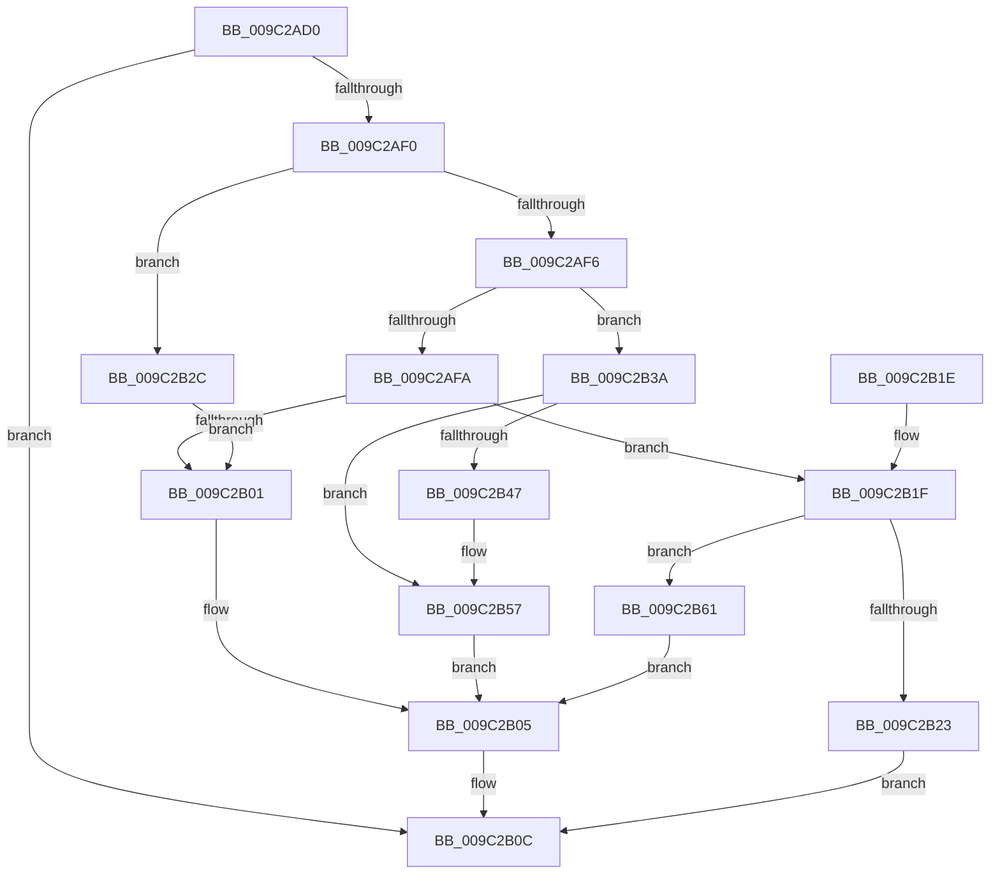

# PiUEventDispatch

- RVA: `0x009C2AD0`–`0x009C2B6B` (길이 `155` bytes)
- VA: `0x00000001409C2AD0`
- 실행 섹션: `PAGE`
- PDB 이름 있음: `예`; PDB Function 태그: `아니요`
- unwind 정보 RVA: `0x0006F318`
- 디코드: `51`개 명령, `155/155` bytes 표시
- 미해석 바이트: `0` (있으면 어셈블리에 `.byte`로 보존)

> 이 문서는 커널 이미지의 기계어와 PDB 기호를 분석해 생성했습니다. 4번과 5번은 함수 원형과 자료형을 바이너리 사용 방식에서 추정한 C 해석이며 원본 소스 복구 결과는 아닙니다.

## 1. Dependencies

- 직접 호출 지점: **3**; 고유 호출 대상: **3**
- 직접 호출자로 확인된 함수: **0**
- RIP 상대 이미지 참조: **0**

### Outgoing calls
- `0x009C2B07` → [IofCompleteRequest](../../text/29/IofCompleteRequest_function_0029B5C0.md) (function, `0x0029B5C0`)
- `0x009C2B23` → [PiUEventHandleIoctl](PiUEventHandleIoctl_function_009C2B74.md) (function, `0x009C2B74`)
- `0x009C2B49` → [PiUEventFreeClientRegistrationContext](PiUEventFreeClientRegistrationContext_function_009C3A2C.md) (function, `0x009C3A2C`)

### Direct callers
- 이 함수 시작 RVA로 연결되는 직접 call은 확인되지 않았습니다. 간접 호출은 완전히 역산할 수 없습니다.

### Static image references
- 디코드된 RIP-relative 메모리 참조가 없습니다.

## 2. Other-region calls and transfers

- 다른 실행 섹션으로 향하는 call: **1**
  - `0x009C2B07` → [IofCompleteRequest](../../text/29/IofCompleteRequest_function_0029B5C0.md) (`PAGE` → `.text`)
- 별도 외부 분기/꼬리 이동을 확인하지 못했습니다.

## 3. Assembly (complete function range)

```asm
009C2AD0  48 89 5C 24 08                  mov qword ptr [rsp + 8], rbx
009C2AD5  48 89 74 24 10                  mov qword ptr [rsp + 0x10], rsi
009C2ADA  57                              push rdi
009C2ADB  48 83 EC 20                     sub rsp, 0x20
009C2ADF  8B 7A 30                        mov edi, dword ptr [rdx + 0x30]
009C2AE2  48 8B DA                        mov rbx, rdx
009C2AE5  48 8B B2 B8 00 00 00            mov rsi, qword ptr [rdx + 0xb8]
009C2AEC  85 FF                           test edi, edi
009C2AEE  78 1C                           js 0x1409c2b0c
009C2AF0  8A 06                           mov al, byte ptr [rsi]
009C2AF2  84 C0                           test al, al
009C2AF4  74 36                           je 0x1409c2b2c
009C2AF6  3C 02                           cmp al, 2
009C2AF8  74 40                           je 0x1409c2b3a
009C2AFA  48 8B CA                        mov rcx, rdx
009C2AFD  3C 12                           cmp al, 0x12
009C2AFF  75 1E                           jne 0x1409c2b1f
009C2B01  83 62 30 00                     and dword ptr [rdx + 0x30], 0
009C2B05  33 D2                           xor edx, edx
009C2B07  E8 B4 8A 8D FF                  call 0x14029b5c0
009C2B0C  48 8B 5C 24 30                  mov rbx, qword ptr [rsp + 0x30]
009C2B11  8B C7                           mov eax, edi
009C2B13  48 8B 74 24 38                  mov rsi, qword ptr [rsp + 0x38]
009C2B18  48 83 C4 20                     add rsp, 0x20
009C2B1C  5F                              pop rdi
009C2B1D  C3                              ret
009C2B1E  CC                              int3
009C2B1F  3C 0E                           cmp al, 0xe
009C2B21  75 3E                           jne 0x1409c2b61
009C2B23  E8 4C 00 00 00                  call 0x1409c2b74
009C2B28  8B F8                           mov edi, eax
009C2B2A  EB E0                           jmp 0x1409c2b0c
009C2B2C  48 8B 46 30                     mov rax, qword ptr [rsi + 0x30]
009C2B30  48 8B CB                        mov rcx, rbx
009C2B33  48 83 60 20 00                  and qword ptr [rax + 0x20], 0
009C2B38  EB C7                           jmp 0x1409c2b01
009C2B3A  48 8B 46 30                     mov rax, qword ptr [rsi + 0x30]
009C2B3E  48 8B 48 20                     mov rcx, qword ptr [rax + 0x20]
009C2B42  48 85 C9                        test rcx, rcx
009C2B45  74 10                           je 0x1409c2b57
009C2B47  B2 01                           mov dl, 1
009C2B49  E8 DE 0E 00 00                  call 0x1409c3a2c
009C2B4E  48 8B 46 30                     mov rax, qword ptr [rsi + 0x30]
009C2B52  48 83 60 20 00                  and qword ptr [rax + 0x20], 0
009C2B57  33 FF                           xor edi, edi
009C2B59  48 8B CB                        mov rcx, rbx
009C2B5C  21 7B 30                        and dword ptr [rbx + 0x30], edi
009C2B5F  EB A4                           jmp 0x1409c2b05
009C2B61  BF BB 00 00 C0                  mov edi, 0xc00000bb
009C2B66  89 7A 30                        mov dword ptr [rdx + 0x30], edi
009C2B69  EB 9A                           jmp 0x1409c2b05
```

## 4. C-style interpretation (structured pseudocode)

```c
__int64 __fastcall PiUEventDispatch(__int64 a1, __int64 a2)
{
    __int64 result;
    __int64 v_rdi;
    __int64 v_rsp;
    unsigned __int64 v_stack_p10;
    unsigned __int64 v_stack_p8;

    v_stack_p8 = v_rbx;
    v_stack_p10 = v_rsi;
    v_rsp = (v_rsp) - (32);
    if (sign_flag) goto loc_009C2B0C;
    if ((unsigned __int8)(*(unsigned __int8 *)(*(unsigned __int64 *)(a2 + 184))) == 0) goto loc_009C2B2C;
    if (((unsigned __int8)(*(unsigned __int8 *)(*(unsigned __int64 *)(a2 + 184)))) == 2) goto loc_009C2B3A;
    if (((unsigned __int8)(*(unsigned __int8 *)(*(unsigned __int64 *)(a2 + 184)))) != 18) goto loc_009C2B1F;
loc_009C2B01:
loc_009C2B05:
    a2 = 0;
    result = IofCompleteRequest(a2, a2, a3, a4);
loc_009C2B0C:
    v_rsp = (v_rsp) + (32);
    return (unsigned int)((unsigned int)((unsigned int)(*(unsigned int *)(a2 + 48))));
loc_009C2B1F:
    if (((unsigned __int8)((unsigned int)((unsigned int)((unsigned int)(*(unsigned int *)(a2 + 48)))))) != 14) goto loc_009C2B61;
    result = PiUEventHandleIoctl(a2, a2, a3, a4);
    goto loc_009C2B0C;
loc_009C2B2C:
    goto loc_009C2B01;
loc_009C2B3A:
    result = *(unsigned __int64 *)(v_stack_p10 + 48);
    if (*(unsigned __int64 *)(*(unsigned __int64 *)(v_stack_p10 + 48) + 32) != 0) {
        a2 = 1;
        result = PiUEventFreeClientRegistrationContext(*(unsigned __int64 *)(*(unsigned __int64 *)(v_stack_p10 + 48) + 32), a2, a3, a4);
        result = *(unsigned __int64 *)(v_stack_p10 + 48);
    }
    v_rdi = 0;
    goto loc_009C2B05;
loc_009C2B61:
    *(unsigned int *)(a2 + 48) = (unsigned int)((unsigned int)(0xC00000BBULL));
    goto loc_009C2B05;
}
```

## 5. (Beta) C Style

```c
int64_t PiUEventDispatch(int64_t Arg1, void *Arg2)
{
    uint8_t *arg2 = (uint8_t *)Arg2;

    int64_t result;
    int64_t local_rdi;
    int64_t local_rsp;
    uint64_t v_stack_p10;
    uint64_t v_stack_p8;

    v_stack_p8 = local_rbx;
    v_stack_p10 = local_rsi;
    local_rsp = (local_rsp) - (32);
    if (sign_flag) goto loc_009C2B0C;
    if ((uint8_t)(*(uint8_t *)(*(uint64_t *)(arg2 + 0xB8))) == 0) goto loc_009C2B2C;
    if (((uint8_t)(*(uint8_t *)(*(uint64_t *)(arg2 + 0xB8)))) == 2) goto loc_009C2B3A;
    if (((uint8_t)(*(uint8_t *)(*(uint64_t *)(arg2 + 0xB8)))) != 18) goto loc_009C2B1F;
loc_009C2B01:
loc_009C2B05:
    Arg2 = 0;
    result = IofCompleteRequest(Arg2, Arg2, a3, a4);
loc_009C2B0C:
    local_rsp = (local_rsp) + (32);
    return (uint32_t)((uint32_t)((uint32_t)(*(uint32_t *)(arg2 + 0x30))));
loc_009C2B1F:
    if (((uint8_t)((uint32_t)((uint32_t)((uint32_t)(*(uint32_t *)(arg2 + 0x30)))))) != 14) goto loc_009C2B61;
    result = PiUEventHandleIoctl(Arg2, Arg2, a3, a4);
    goto loc_009C2B0C;
loc_009C2B2C:
    goto loc_009C2B01;
loc_009C2B3A:
    result = *(uint64_t *)(v_stack_p10 + 0x30);
    if (*(uint64_t *)(*(uint64_t *)(v_stack_p10 + 0x30) + 0x20) != 0) {
        Arg2 = 1;
        result = PiUEventFreeClientRegistrationContext(*(uint64_t *)(*(uint64_t *)(v_stack_p10 + 0x30) + 0x20), Arg2, a3, a4);
        result = *(uint64_t *)(v_stack_p10 + 0x30);
    }
    local_rdi = 0;
    goto loc_009C2B05;
loc_009C2B61:
    *(uint32_t *)(arg2 + 0x30) = (uint32_t)((uint32_t)(0xC00000BBULL));
    goto loc_009C2B05;
}
```

### 관측된 메모리 오프셋

구조체 형식이 확인되지 않은 접근은 인자 기준의 오프셋으로만 기록했습니다.

| 기준 인자 | 오프셋 표현 | 폭 (bit) | 접근 |
|---|---:|---:|---|
| `Arg2` | `+ 0x30` | `32` | `R` |
| `Arg2` | `+ 0x30` | `32` | `R/W` |
| `Arg2` | `+ 0x30` | `32` | `W` |
| `Arg2` | `+ 0xB8` | `64` | `R` |

## 6. Execution-region graph

[열기: 2D/3D 그래프와 함수 탐색 컨트롤 패널](../../../control-panel.html?section=page&rva=0x009C2AD0&view=graph)

- 2D 그래프는 위에서 아래로 흐르고, 3D 그래프는 빈 공간을 드래그해 회전합니다. Shift+드래그는 이동, 휠은 확대·축소, 함수 노드 선택은 대상 보고서 이동입니다.

### Static fallback


