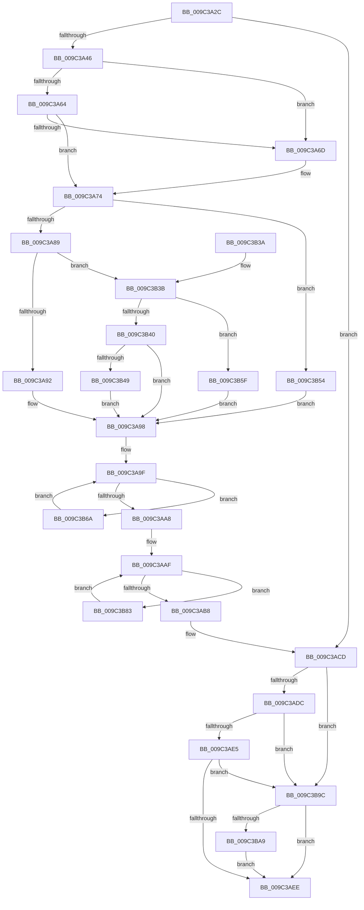

# PiUEventFreeClientRegistrationContext

- RVA: `0x009C3A2C`–`0x009C3BB3` (길이 `391` bytes)
- VA: `0x00000001409C3A2C`
- 실행 섹션: `PAGE`
- PDB 이름 있음: `예`; PDB Function 태그: `아니요`
- unwind 정보 RVA: `0x0009F838`
- 디코드: `96`개 명령, `391/391` bytes 표시
- 미해석 바이트: `0` (있으면 어셈블리에 `.byte`로 보존)

> 이 문서는 커널 이미지의 기계어와 PDB 기호를 분석해 생성했습니다. 4번과 5번은 함수 원형과 자료형을 바이너리 사용 방식에서 추정한 C 해석이며 원본 소스 복구 결과는 아닙니다.

## 1. Dependencies

- 직접 호출 지점: **12**; 고유 호출 대상: **8**
- 직접 호출자로 확인된 함수: **2**
- RIP 상대 이미지 참조: **5**

### Outgoing calls
- `0x009C3A4D` → [ExAcquireFastMutex](../../text/20/ExAcquireFastMutex_function_0020E5A0.md) (function, `0x0020E5A0`)
- `0x009C3A56` → [ExAcquireFastMutex](../../text/20/ExAcquireFastMutex_function_0020E5A0.md) (function, `0x0020E5A0`)
- `0x009C3ABC` → [ExReleaseFastMutex](../../text/25/ExReleaseFastMutex_function_002519C0.md) (function, `0x002519C0`)
- `0x009C3AC8` → [ExReleaseFastMutex](../../text/25/ExReleaseFastMutex_function_002519C0.md) (function, `0x002519C0`)
- `0x009C3AF2` → [ZwDeleteWnfStateName](../../text/6A/ZwDeleteWnfStateName_function_006AECF0.md) (function, `0x006AECF0`)
- `0x009C3AFB` → [SeReleaseSubjectContext](../86/SeReleaseSubjectContext_function_0086B710.md) (function, `0x0086B710`)
- `0x009C3B0B` → [ExFreePoolWithTag](../../poolcode/B8/ExFreePoolWithTag_function_00B82870.md) (function, `0x00B82870`)
- `0x009C3B1B` → [memset](../../text/6C/memset_function_006C6C40.md) (function, `0x006C6C40`)
- `0x009C3B25` → [ExFreePoolWithTag](../../poolcode/B8/ExFreePoolWithTag_function_00B82870.md) (function, `0x00B82870`)
- `0x009C3B79` → [PiUEventDequeuePendingEventWorker](PiUEventDequeuePendingEventWorker_function_009C29C0.md) (function, `0x009C29C0`)
- `0x009C3B92` → [PiUEventDequeuePendingEventWorker](PiUEventDequeuePendingEventWorker_function_009C29C0.md) (function, `0x009C29C0`)
- `0x009C3BA9` → [PiDmObjectRelease](../8E/PiDmObjectRelease_function_008E4F70.md) (function, `0x008E4F70`)

### Direct callers
- [PiUEventDispatch](PiUEventDispatch_function_009C2AD0.md) at `0x009C2B49`
- [PiUEventHandleRegistration](PiUEventHandleRegistration_function_009C3304.md) at `0x009C33D9`

### Static image references
- `0x009C3A46` → RVA `0x00F8C760` (`.data`; read)
- `0x009C3A92` → RVA `0x00E66338` (`.data`; read/write)
- `0x009C3B49` → RVA `0x00E6633C` (`.data`; read/write)
- `0x009C3B54` → RVA `0x00E66344` (`.data`; read/write)
- `0x009C3B5F` → RVA `0x00E66340` (`.data`; read/write)

## 2. Other-region calls and transfers

- 다른 실행 섹션으로 향하는 call: **8**
  - `0x009C3A4D` → [ExAcquireFastMutex](../../text/20/ExAcquireFastMutex_function_0020E5A0.md) (`PAGE` → `.text`)
  - `0x009C3A56` → [ExAcquireFastMutex](../../text/20/ExAcquireFastMutex_function_0020E5A0.md) (`PAGE` → `.text`)
  - `0x009C3ABC` → [ExReleaseFastMutex](../../text/25/ExReleaseFastMutex_function_002519C0.md) (`PAGE` → `.text`)
  - `0x009C3AC8` → [ExReleaseFastMutex](../../text/25/ExReleaseFastMutex_function_002519C0.md) (`PAGE` → `.text`)
  - `0x009C3AF2` → [ZwDeleteWnfStateName](../../text/6A/ZwDeleteWnfStateName_function_006AECF0.md) (`PAGE` → `.text`)
  - `0x009C3B0B` → [ExFreePoolWithTag](../../poolcode/B8/ExFreePoolWithTag_function_00B82870.md) (`PAGE` → `POOLCODE`)
  - `0x009C3B1B` → [memset](../../text/6C/memset_function_006C6C40.md) (`PAGE` → `.text`)
  - `0x009C3B25` → [ExFreePoolWithTag](../../poolcode/B8/ExFreePoolWithTag_function_00B82870.md) (`PAGE` → `POOLCODE`)
- 별도 외부 분기/꼬리 이동을 확인하지 못했습니다.

## 3. Assembly (complete function range)

```asm
009C3A2C  48 89 5C 24 08                  mov qword ptr [rsp + 8], rbx
009C3A31  48 89 74 24 10                  mov qword ptr [rsp + 0x10], rsi
009C3A36  57                              push rdi
009C3A37  48 83 EC 20                     sub rsp, 0x20
009C3A3B  48 8B D9                        mov rbx, rcx
009C3A3E  84 D2                           test dl, dl
009C3A40  0F 84 87 00 00 00               je 0x1409c3acd
009C3A46  48 8D 0D 13 8D 5C 00            lea rcx, [rip + 0x5c8d13]
009C3A4D  E8 4E AB 84 FF                  call 0x14020e5a0
009C3A52  48 8B 4B 10                     mov rcx, qword ptr [rbx + 0x10]
009C3A56  E8 45 AB 84 FF                  call 0x14020e5a0
009C3A5B  48 8B 0B                        mov rcx, qword ptr [rbx]
009C3A5E  48 39 59 08                     cmp qword ptr [rcx + 8], rbx
009C3A62  75 09                           jne 0x1409c3a6d
009C3A64  48 8B 43 08                     mov rax, qword ptr [rbx + 8]
009C3A68  48 39 18                        cmp qword ptr [rax], rbx
009C3A6B  74 07                           je 0x1409c3a74
009C3A6D  B9 03 00 00 00                  mov ecx, 3
009C3A72  CD 29                           int 0x29
009C3A74  48 89 08                        mov qword ptr [rax], rcx
009C3A77  48 89 41 08                     mov qword ptr [rcx + 8], rax
009C3A7B  8B 8B 84 00 00 00               mov ecx, dword ptr [rbx + 0x84]
009C3A81  85 C9                           test ecx, ecx
009C3A83  0F 84 CB 00 00 00               je 0x1409c3b54
009C3A89  83 E9 01                        sub ecx, 1
009C3A8C  0F 85 A9 00 00 00               jne 0x1409c3b3b
009C3A92  FF 0D A0 28 4A 00               dec dword ptr [rip + 0x4a28a0]
009C3A98  48 8D 73 70                     lea rsi, [rbx + 0x70]
009C3A9C  48 8B 3E                        mov rdi, qword ptr [rsi]
009C3A9F  48 3B FE                        cmp rdi, rsi
009C3AA2  0F 85 C2 00 00 00               jne 0x1409c3b6a
009C3AA8  48 8D 73 60                     lea rsi, [rbx + 0x60]
009C3AAC  48 8B 3E                        mov rdi, qword ptr [rsi]
009C3AAF  48 3B FE                        cmp rdi, rsi
009C3AB2  0F 85 CB 00 00 00               jne 0x1409c3b83
009C3AB8  48 8B 4B 10                     mov rcx, qword ptr [rbx + 0x10]
009C3ABC  E8 FF DE 88 FF                  call 0x1402519c0
009C3AC1  48 8D 0D 98 8C 5C 00            lea rcx, [rip + 0x5c8c98]
009C3AC8  E8 F3 DE 88 FF                  call 0x1402519c0
009C3ACD  8B 8B 84 00 00 00               mov ecx, dword ptr [rbx + 0x84]
009C3AD3  83 E9 01                        sub ecx, 1
009C3AD6  0F 84 C0 00 00 00               je 0x1409c3b9c
009C3ADC  83 E9 01                        sub ecx, 1
009C3ADF  0F 84 B7 00 00 00               je 0x1409c3b9c
009C3AE5  83 F9 01                        cmp ecx, 1
009C3AE8  0F 84 AE 00 00 00               je 0x1409c3b9c
009C3AEE  48 8D 4B 58                     lea rcx, [rbx + 0x58]
009C3AF2  E8 F9 B1 CE FF                  call 0x1406aecf0
009C3AF7  48 8D 4B 38                     lea rcx, [rbx + 0x38]
009C3AFB  E8 10 7C EA FF                  call 0x14086b710
009C3B00  48 8B 4B 10                     mov rcx, qword ptr [rbx + 0x10]
009C3B04  BF 50 6E 70 59                  mov edi, 0x59706e50
009C3B09  8B D7                           mov edx, edi
009C3B0B  E8 60 ED 1B 00                  call 0x140b82870
009C3B10  33 D2                           xor edx, edx
009C3B12  41 B8 90 00 00 00               mov r8d, 0x90
009C3B18  48 8B CB                        mov rcx, rbx
009C3B1B  E8 20 31 D0 FF                  call 0x1406c6c40
009C3B20  8B D7                           mov edx, edi
009C3B22  48 8B CB                        mov rcx, rbx
009C3B25  E8 46 ED 1B 00                  call 0x140b82870
009C3B2A  48 8B 5C 24 30                  mov rbx, qword ptr [rsp + 0x30]
009C3B2F  48 8B 74 24 38                  mov rsi, qword ptr [rsp + 0x38]
009C3B34  48 83 C4 20                     add rsp, 0x20
009C3B38  5F                              pop rdi
009C3B39  C3                              ret
009C3B3A  CC                              int3
009C3B3B  83 E9 01                        sub ecx, 1
009C3B3E  74 1F                           je 0x1409c3b5f
009C3B40  83 F9 01                        cmp ecx, 1
009C3B43  0F 85 4F FF FF FF               jne 0x1409c3a98
009C3B49  FF 0D ED 27 4A 00               dec dword ptr [rip + 0x4a27ed]
009C3B4F  E9 44 FF FF FF                  jmp 0x1409c3a98
009C3B54  FF 0D EA 27 4A 00               dec dword ptr [rip + 0x4a27ea]
009C3B5A  E9 39 FF FF FF                  jmp 0x1409c3a98
009C3B5F  FF 0D DB 27 4A 00               dec dword ptr [rip + 0x4a27db]
009C3B65  E9 2E FF FF FF                  jmp 0x1409c3a98
009C3B6A  48 8B D7                        mov rdx, rdi
009C3B6D  41 B1 01                        mov r9b, 1
009C3B70  48 8B 3F                        mov rdi, qword ptr [rdi]
009C3B73  45 33 C0                        xor r8d, r8d
009C3B76  48 8B CB                        mov rcx, rbx
009C3B79  E8 42 EE FF FF                  call 0x1409c29c0
009C3B7E  E9 1C FF FF FF                  jmp 0x1409c3a9f
009C3B83  41 B1 01                        mov r9b, 1
009C3B86  48 8B D7                        mov rdx, rdi
009C3B89  48 8B 3F                        mov rdi, qword ptr [rdi]
009C3B8C  45 8A C1                        mov r8b, r9b
009C3B8F  48 8B CB                        mov rcx, rbx
009C3B92  E8 29 EE FF FF                  call 0x1409c29c0
009C3B97  E9 13 FF FF FF                  jmp 0x1409c3aaf
009C3B9C  48 8B 4B 18                     mov rcx, qword ptr [rbx + 0x18]
009C3BA0  48 85 C9                        test rcx, rcx
009C3BA3  0F 84 45 FF FF FF               je 0x1409c3aee
009C3BA9  E8 C2 13 F2 FF                  call 0x1408e4f70
009C3BAE  E9 3B FF FF FF                  jmp 0x1409c3aee
```

## 4. C-style interpretation (structured pseudocode)

```c
__int64 __fastcall PiUEventFreeClientRegistrationContext(__int64 a1, unsigned __int8 a2)
{
    __int64 result;
    __int64 v_rsp;
    unsigned __int64 v_stack_p10;
    unsigned __int64 v_stack_p8;

    v_stack_p8 = v_rbx;
    v_stack_p10 = v_rsi;
    v_rsp = (v_rsp) - (32);
    if (a2 == 0) goto loc_009C3ACD;
    result = ExAcquireFastMutex(v_rip + 6065427, a2, a3, a4);
    result = ExAcquireFastMutex(*(unsigned __int64 *)(a1 + 16), a2, a3, a4);
    if ((*(unsigned __int64 *)(*(unsigned __int64 *)(a1) + 8)) != a1) goto loc_009C3A6D;
    if ((*(unsigned __int64 *)(*(unsigned __int64 *)(a1 + 8))) != a1) {
        a1 = 3;
    }
    *(unsigned __int64 *)(*(unsigned __int64 *)(a1 + 8)) = a1;
    *(unsigned __int64 *)(a1 + 8) = *(unsigned __int64 *)(a1 + 8);
    if ((unsigned int)((unsigned int)(*(unsigned int *)(a1 + 132))) == 0) goto loc_009C3B54;
    a1 = (unsigned int)(((unsigned int)(*(unsigned int *)(a1 + 132))) - (1));
    if (condition_is_not_equal) goto loc_009C3B3B;
loc_009C3A98:
loc_009C3A9F:
    if ((*(unsigned __int64 *)(a1 + 112)) != (a1 + 112)) goto loc_009C3B6A;
loc_009C3AAF:
    if ((*(unsigned __int64 *)(a1 + 96)) != (a1 + 96)) goto loc_009C3B83;
    result = ExReleaseFastMutex(*(unsigned __int64 *)(a1 + 16), a2, a3, a4);
    result = ExReleaseFastMutex(v_rip + 6065304, a2, a3, a4);
loc_009C3ACD:
    a1 = (unsigned int)(((unsigned int)(*(unsigned int *)(a1 + 132))) - (1));
    if (condition_is_equal) goto loc_009C3B9C;
    a1 = (unsigned int)((a1) - (1));
    if (condition_is_equal) goto loc_009C3B9C;
    if (((unsigned int)(a1)) == 1) goto loc_009C3B9C;
loc_009C3AEE:
    result = ZwDeleteWnfStateName(a1 + 88, a2, a3, a4);
    result = SeReleaseSubjectContext(a1 + 56, a2, a3, a4);
    result = ExFreePoolWithTag(*(unsigned __int64 *)(a1 + 16), (unsigned int)((unsigned int)((unsigned int)(0x59706E50ULL))), a3, a4);
    a2 = 0;
    result = memset(a1, a2, 144, a4);
    result = ExFreePoolWithTag(a1, (unsigned int)((unsigned int)((unsigned int)(0x59706E50ULL))), 144, a4);
    v_rsp = (v_rsp) + (32);
    return result;
loc_009C3B3B:
    a1 = (unsigned int)((a1) - (1));
    if (condition_is_equal) goto loc_009C3B5F;
    if (((unsigned int)(a1)) != 1) goto loc_009C3A98;
    goto loc_009C3A98;
loc_009C3B54:
    goto loc_009C3A98;
loc_009C3B5F:
    goto loc_009C3A98;
loc_009C3B6A:
    a3 = 0;
    result = PiUEventDequeuePendingEventWorker(v_stack_p8, (unsigned int)(0x59706E50ULL), a3, 1);
    goto loc_009C3A9F;
loc_009C3B83:
    result = PiUEventDequeuePendingEventWorker(v_stack_p8, *(unsigned __int64 *)((unsigned int)(0x59706E50ULL)), 1, 1);
    goto loc_009C3AAF;
loc_009C3B9C:
    if (*(unsigned __int64 *)(v_stack_p8 + 24) == 0) goto loc_009C3AEE;
    result = PiDmObjectRelease(*(unsigned __int64 *)(v_stack_p8 + 24), *(unsigned __int64 *)((unsigned int)(0x59706E50ULL)), 1, 1);
    goto loc_009C3AEE;
}
```

## 5. (Beta) C Style

```c
int64_t PiUEventFreeClientRegistrationContext(void *Arg1, uint8_t Arg2)
{
    uint8_t *arg1 = (uint8_t *)Arg1;

    int64_t result;
    int64_t local_rsp;
    uint64_t v_stack_p10;
    uint64_t v_stack_p8;

    v_stack_p8 = local_rbx;
    v_stack_p10 = local_rsi;
    local_rsp = (local_rsp) - (32);
    if (Arg2 == 0) goto loc_009C3ACD;
    result = ExAcquireFastMutex(v_rip + 6065427, Arg2, a3, a4);
    result = ExAcquireFastMutex(*(uint64_t *)(arg1 + 0x10), Arg2, a3, a4);
    if ((*(uint64_t *)(*(uint64_t *)(arg1) + 0x8)) != Arg1) goto loc_009C3A6D;
    if ((*(uint64_t *)(*(uint64_t *)(arg1 + 0x8))) != Arg1) {
        Arg1 = 3;
    }
    *(void **)(*(uint64_t *)(arg1 + 0x8)) = Arg1;
    *(uint64_t *)(arg1 + 0x8) = *(uint64_t *)(arg1 + 0x8);
    if ((uint32_t)((uint32_t)(*(uint32_t *)(arg1 + 0x84))) == 0) goto loc_009C3B54;
    Arg1 = (uint32_t)(((uint32_t)(*(uint32_t *)(arg1 + 0x84))) - (1));
    if (condition_is_not_equal) goto loc_009C3B3B;
loc_009C3A98:
loc_009C3A9F:
    if ((*(uint64_t *)(arg1 + 0x70)) != (Arg1 + 112)) goto loc_009C3B6A;
loc_009C3AAF:
    if ((*(uint64_t *)(arg1 + 0x60)) != (Arg1 + 96)) goto loc_009C3B83;
    result = ExReleaseFastMutex(*(uint64_t *)(arg1 + 0x10), Arg2, a3, a4);
    result = ExReleaseFastMutex(v_rip + 6065304, Arg2, a3, a4);
loc_009C3ACD:
    Arg1 = (uint32_t)(((uint32_t)(*(uint32_t *)(arg1 + 0x84))) - (1));
    if (condition_is_equal) goto loc_009C3B9C;
    Arg1 = (uint32_t)((Arg1) - (1));
    if (condition_is_equal) goto loc_009C3B9C;
    if (((uint32_t)(Arg1)) == 1) goto loc_009C3B9C;
loc_009C3AEE:
    result = ZwDeleteWnfStateName(Arg1 + 88, Arg2, a3, a4);
    result = SeReleaseSubjectContext(Arg1 + 56, Arg2, a3, a4);
    result = ExFreePoolWithTag(*(uint64_t *)(arg1 + 0x10), (uint32_t)((uint32_t)((uint32_t)(0x59706E50ULL))), a3, a4);
    Arg2 = 0;
    result = memset(Arg1, Arg2, 144, a4);
    result = ExFreePoolWithTag(Arg1, (uint32_t)((uint32_t)((uint32_t)(0x59706E50ULL))), 144, a4);
    local_rsp = (local_rsp) + (32);
    return result;
loc_009C3B3B:
    Arg1 = (uint32_t)((Arg1) - (1));
    if (condition_is_equal) goto loc_009C3B5F;
    if (((uint32_t)(Arg1)) != 1) goto loc_009C3A98;
    goto loc_009C3A98;
loc_009C3B54:
    goto loc_009C3A98;
loc_009C3B5F:
    goto loc_009C3A98;
loc_009C3B6A:
    a3 = 0;
    result = PiUEventDequeuePendingEventWorker(v_stack_p8, (uint32_t)(0x59706E50ULL), a3, 1);
    goto loc_009C3A9F;
loc_009C3B83:
    result = PiUEventDequeuePendingEventWorker(v_stack_p8, *(uint64_t *)((uint32_t)(0x59706E50ULL)), 1, 1);
    goto loc_009C3AAF;
loc_009C3B9C:
    if (*(uint64_t *)(v_stack_p8 + 0x18) == 0) goto loc_009C3AEE;
    result = PiDmObjectRelease(*(uint64_t *)(v_stack_p8 + 0x18), *(uint64_t *)((uint32_t)(0x59706E50ULL)), 1, 1);
    goto loc_009C3AEE;
}
```

### 관측된 메모리 오프셋

구조체 형식이 확인되지 않은 접근은 인자 기준의 오프셋으로만 기록했습니다.

| 기준 인자 | 오프셋 표현 | 폭 (bit) | 접근 |
|---|---:|---:|---|
| `Arg1` | `+ 0x0` | `64` | `R` |
| `Arg1` | `+ 0x8` | `64` | `R` |
| `Arg1` | `+ 0x10` | `64` | `R` |
| `Arg1` | `+ 0x18` | `64` | `R` |
| `Arg1` | `+ 0x38` | `64` | `R` |
| `Arg1` | `+ 0x58` | `64` | `R` |
| `Arg1` | `+ 0x60` | `64` | `R` |
| `Arg1` | `+ 0x70` | `64` | `R` |
| `Arg1` | `+ 0x84` | `32` | `R` |

## 6. Execution-region graph

[열기: 2D/3D 그래프와 함수 탐색 컨트롤 패널](../../../control-panel.html?section=page&rva=0x009C3A2C&view=graph)

- 2D 그래프는 위에서 아래로 흐르고, 3D 그래프는 빈 공간을 드래그해 회전합니다. Shift+드래그는 이동, 휠은 확대·축소, 함수 노드 선택은 대상 보고서 이동입니다.

### Static fallback


