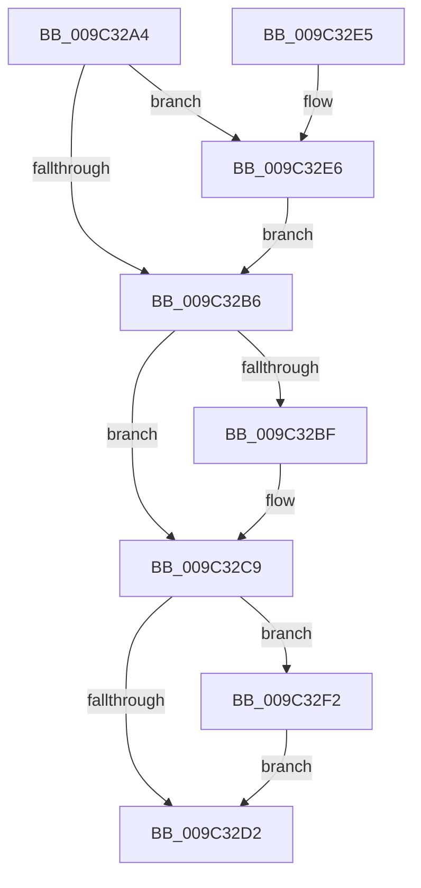

# PiUEventFreeEventEntry

- RVA: `0x009C32A4`–`0x009C32FE` (길이 `90` bytes)
- VA: `0x00000001409C32A4`
- 실행 섹션: `PAGE`
- PDB 이름 있음: `예`; PDB Function 태그: `아니요`
- unwind 정보 RVA: `0x0008C174`
- 디코드: `27`개 명령, `90/90` bytes 표시
- 미해석 바이트: `0` (있으면 어셈블리에 `.byte`로 보존)

> 이 문서는 커널 이미지의 기계어와 PDB 기호를 분석해 생성했습니다. 4번과 5번은 함수 원형과 자료형을 바이너리 사용 방식에서 추정한 C 해석이며 원본 소스 복구 결과는 아닙니다.

## 1. Dependencies

- 직접 호출 지점: **4**; 고유 호출 대상: **1**
- 직접 호출자로 확인된 함수: **2**
- RIP 상대 이미지 참조: **0**

### Outgoing calls
- `0x009C32C4` → [ExFreePoolWithTag](../../poolcode/B8/ExFreePoolWithTag_function_00B82870.md) (function, `0x00B82870`)
- `0x009C32DA` → [ExFreePoolWithTag](../../poolcode/B8/ExFreePoolWithTag_function_00B82870.md) (function, `0x00B82870`)
- `0x009C32EB` → [ExFreePoolWithTag](../../poolcode/B8/ExFreePoolWithTag_function_00B82870.md) (function, `0x00B82870`)
- `0x009C32F7` → [ExFreePoolWithTag](../../poolcode/B8/ExFreePoolWithTag_function_00B82870.md) (function, `0x00B82870`)

### Direct callers
- [PiUEventNotifyUserMode](../95/PiUEventNotifyUserMode_function_00954CB4.md) at `0x0095526B`
- [PiUEventDereferenceEventEntry](PiUEventDereferenceEventEntry_function_009C3244.md) at `0x009C3276`

### Static image references
- 디코드된 RIP-relative 메모리 참조가 없습니다.

## 2. Other-region calls and transfers

- 다른 실행 섹션으로 향하는 call: **4**
  - `0x009C32C4` → [ExFreePoolWithTag](../../poolcode/B8/ExFreePoolWithTag_function_00B82870.md) (`PAGE` → `POOLCODE`)
  - `0x009C32DA` → [ExFreePoolWithTag](../../poolcode/B8/ExFreePoolWithTag_function_00B82870.md) (`PAGE` → `POOLCODE`)
  - `0x009C32EB` → [ExFreePoolWithTag](../../poolcode/B8/ExFreePoolWithTag_function_00B82870.md) (`PAGE` → `POOLCODE`)
  - `0x009C32F7` → [ExFreePoolWithTag](../../poolcode/B8/ExFreePoolWithTag_function_00B82870.md) (`PAGE` → `POOLCODE`)
- 별도 외부 분기/꼬리 이동을 확인하지 못했습니다.

## 3. Assembly (complete function range)

```asm
009C32A4  40 53                           push rbx
009C32A6  48 83 EC 20                     sub rsp, 0x20
009C32AA  48 8B D9                        mov rbx, rcx
009C32AD  48 8B 49 18                     mov rcx, qword ptr [rcx + 0x18]
009C32B1  48 85 C9                        test rcx, rcx
009C32B4  75 30                           jne 0x1409c32e6
009C32B6  48 8B 4B 10                     mov rcx, qword ptr [rbx + 0x10]
009C32BA  48 85 C9                        test rcx, rcx
009C32BD  74 0A                           je 0x1409c32c9
009C32BF  BA 50 6E 70 59                  mov edx, 0x59706e50
009C32C4  E8 A7 F5 1B 00                  call 0x140b82870
009C32C9  48 8B 4B 30                     mov rcx, qword ptr [rbx + 0x30]
009C32CD  48 85 C9                        test rcx, rcx
009C32D0  75 20                           jne 0x1409c32f2
009C32D2  BA 50 6E 70 59                  mov edx, 0x59706e50
009C32D7  48 8B CB                        mov rcx, rbx
009C32DA  E8 91 F5 1B 00                  call 0x140b82870
009C32DF  48 83 C4 20                     add rsp, 0x20
009C32E3  5B                              pop rbx
009C32E4  C3                              ret
009C32E5  CC                              int3
009C32E6  BA 50 6E 70 59                  mov edx, 0x59706e50
009C32EB  E8 80 F5 1B 00                  call 0x140b82870
009C32F0  EB C4                           jmp 0x1409c32b6
009C32F2  BA 50 6E 70 59                  mov edx, 0x59706e50
009C32F7  E8 74 F5 1B 00                  call 0x140b82870
009C32FC  EB D4                           jmp 0x1409c32d2
```

## 4. C-style interpretation (structured pseudocode)

```c
__int64 __fastcall PiUEventFreeEventEntry(__int64 a1)
{
    __int64 result;
    __int64 v_rsp;

    v_rsp = (v_rsp) - (32);
    if (*(unsigned __int64 *)(a1 + 24) != 0) goto loc_009C32E6;
loc_009C32B6:
    if (*(unsigned __int64 *)(a1 + 16) != 0) {
        a2 = 0x59706E50ULL;
        result = ExFreePoolWithTag(*(unsigned __int64 *)(a1 + 16), a2, a3, a4);
    }
    if (*(unsigned __int64 *)(a1 + 48) != 0) goto loc_009C32F2;
loc_009C32D2:
    result = ExFreePoolWithTag(a1, (unsigned int)(0x59706E50ULL), a3, a4);
    v_rsp = (v_rsp) + (32);
    return result;
loc_009C32E6:
    result = ExFreePoolWithTag(a1, (unsigned int)(0x59706E50ULL), a3, a4);
    goto loc_009C32B6;
loc_009C32F2:
    result = ExFreePoolWithTag(a1, (unsigned int)(0x59706E50ULL), a3, a4);
    goto loc_009C32D2;
}
```

## 5. (Beta) C Style

```c
int64_t PiUEventFreeEventEntry(void *Arg1)
{
    uint8_t *arg1 = (uint8_t *)Arg1;

    int64_t result;
    int64_t local_rsp;

    local_rsp = (local_rsp) - (32);
    if (*(uint64_t *)(arg1 + 0x18) != 0) goto loc_009C32E6;
loc_009C32B6:
    if (*(uint64_t *)(arg1 + 0x10) != 0) {
        a2 = 0x59706E50ULL;
        result = ExFreePoolWithTag(*(uint64_t *)(arg1 + 0x10), a2, a3, a4);
    }
    if (*(uint64_t *)(arg1 + 0x30) != 0) goto loc_009C32F2;
loc_009C32D2:
    result = ExFreePoolWithTag(Arg1, (uint32_t)(0x59706E50ULL), a3, a4);
    local_rsp = (local_rsp) + (32);
    return result;
loc_009C32E6:
    result = ExFreePoolWithTag(Arg1, (uint32_t)(0x59706E50ULL), a3, a4);
    goto loc_009C32B6;
loc_009C32F2:
    result = ExFreePoolWithTag(Arg1, (uint32_t)(0x59706E50ULL), a3, a4);
    goto loc_009C32D2;
}
```

### 관측된 메모리 오프셋

구조체 형식이 확인되지 않은 접근은 인자 기준의 오프셋으로만 기록했습니다.

| 기준 인자 | 오프셋 표현 | 폭 (bit) | 접근 |
|---|---:|---:|---|
| `Arg1` | `+ 0x10` | `64` | `R` |
| `Arg1` | `+ 0x18` | `64` | `R` |
| `Arg1` | `+ 0x30` | `64` | `R` |

## 6. Execution-region graph

[열기: 2D/3D 그래프와 함수 탐색 컨트롤 패널](../../../control-panel.html?section=page&rva=0x009C32A4&view=graph)

- 2D 그래프는 위에서 아래로 흐르고, 3D 그래프는 빈 공간을 드래그해 회전합니다. Shift+드래그는 이동, 휠은 확대·축소, 함수 노드 선택은 대상 보고서 이동입니다.

### Static fallback


