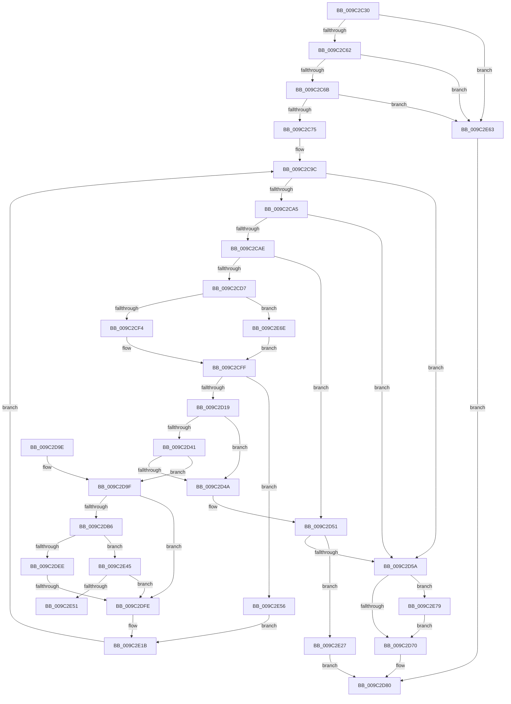

# PiUEventHandleGetEvent

- RVA: `0x009C2C30`–`0x009C2E89` (길이 `601` bytes)
- VA: `0x00000001409C2C30`
- 실행 섹션: `PAGE`
- PDB 이름 있음: `예`; PDB Function 태그: `예`
- unwind 정보 RVA: `0x0009F79C`
- 디코드: `143`개 명령, `601/601` bytes 표시
- 미해석 바이트: `0` (있으면 어셈블리에 `.byte`로 보존)

> 이 문서는 커널 이미지의 기계어와 PDB 기호를 분석해 생성했습니다. 4번과 5번은 함수 원형과 자료형을 바이너리 사용 방식에서 추정한 C 해석이며 원본 소스 복구 결과는 아닙니다.

## 1. Dependencies

- 직접 호출 지점: **8**; 고유 호출 대상: **7**
- 직접 호출자로 확인된 함수: **1**
- RIP 상대 이미지 참조: **3**

### Outgoing calls
- `0x009C2C8F` → [ExAcquireFastMutex](../../text/20/ExAcquireFastMutex_function_0020E5A0.md) (function, `0x0020E5A0`)
- `0x009C2CCB` → [PiUEventCopyEventData](PiUEventCopyEventData_function_009C2E90.md) (function, `0x009C2E90`)
- `0x009C2D5E` → [ExReleaseFastMutex](../../text/25/ExReleaseFastMutex_function_002519C0.md) (function, `0x002519C0`)
- `0x009C2E09` → [PiUEventDereferenceEventEntry](PiUEventDereferenceEventEntry_function_009C3244.md) (function, `0x009C3244`)
- `0x009C2E16` → [ExFreePoolWithTag](../../poolcode/B8/ExFreePoolWithTag_function_00B82870.md) (function, `0x00B82870`)
- `0x009C2E3B` → [ExReleaseFastMutex](../../text/25/ExReleaseFastMutex_function_002519C0.md) (function, `0x002519C0`)
- `0x009C2E5C` → [PiUEventMovePendingEventToSynchronousQueue](../70/PiUEventMovePendingEventToSynchronousQueue_function_00700798.md) (function, `0x00700798`)
- `0x009C2E7F` → [PiUEventNotifyClientPendingEvent](../A1/PiUEventNotifyClientPendingEvent_function_00A1E784.md) (function, `0x00A1E784`)

### Direct callers
- [PiUEventHandleIoctl](PiUEventHandleIoctl_function_009C2B74.md) at `0x009C2BAD`

### Static image references
- `0x009C2DAD` → RVA `0x00EF012C` (`.data`; read)
- `0x009C2DEE` → RVA `0x00E0AA0C` (`.data`; read)
- `0x009C2E45` → RVA `0x00E0AA04` (`.data`; read)

## 2. Other-region calls and transfers

- 다른 실행 섹션으로 향하는 call: **4**
  - `0x009C2C8F` → [ExAcquireFastMutex](../../text/20/ExAcquireFastMutex_function_0020E5A0.md) (`PAGE` → `.text`)
  - `0x009C2D5E` → [ExReleaseFastMutex](../../text/25/ExReleaseFastMutex_function_002519C0.md) (`PAGE` → `.text`)
  - `0x009C2E16` → [ExFreePoolWithTag](../../poolcode/B8/ExFreePoolWithTag_function_00B82870.md) (`PAGE` → `POOLCODE`)
  - `0x009C2E3B` → [ExReleaseFastMutex](../../text/25/ExReleaseFastMutex_function_002519C0.md) (`PAGE` → `.text`)
- call이 아닌 외부 분기/꼬리 이동: **2**
  - `0x009C2DF8` → [sub_00B2F090](../B2/Unknown_function_00B2F090.md) (`tail-transfer`)
  - `0x009C2E51` → [sub_00B2F090 + 0xA5](../B2/Unknown_function_00B2F090.md) (`tail-transfer`)

## 3. Assembly (complete function range)

```asm
009C2C30  48 89 5C 24 10                  mov qword ptr [rsp + 0x10], rbx
009C2C35  44 89 44 24 18                  mov dword ptr [rsp + 0x18], r8d
009C2C3A  55                              push rbp
009C2C3B  56                              push rsi
009C2C3C  57                              push rdi
009C2C3D  41 54                           push r12
009C2C3F  41 55                           push r13
009C2C41  41 56                           push r14
009C2C43  41 57                           push r15
009C2C45  48 81 EC C0 00 00 00            sub rsp, 0xc0
009C2C4C  4C 8B 71 20                     mov r14, qword ptr [rcx + 0x20]
009C2C50  45 33 FF                        xor r15d, r15d
009C2C53  41 8B E9                        mov ebp, r9d
009C2C56  48 8B F2                        mov rsi, rdx
009C2C59  4D 85 F6                        test r14, r14
009C2C5C  0F 84 01 02 00 00               je 0x1409c2e63
009C2C62  48 85 D2                        test rdx, rdx
009C2C65  0F 84 F8 01 00 00               je 0x1409c2e63
009C2C6B  41 83 F9 04                     cmp r9d, 4
009C2C6F  0F 86 EE 01 00 00               jbe 0x1409c2e63
009C2C75  48 8D 42 04                     lea rax, [rdx + 4]
009C2C79  44 89 3A                        mov dword ptr [rdx], r15d
009C2C7C  49 8B 4E 10                     mov rcx, qword ptr [r14 + 0x10]
009C2C80  8B FE                           mov edi, esi
009C2C82  2B F8                           sub edi, eax
009C2C84  48 89 84 24 B0 00 00 00         mov qword ptr [rsp + 0xb0], rax
009C2C8C  41 03 F9                        add edi, r9d
009C2C8F  E8 0C B9 84 FF                  call 0x14020e5a0
009C2C94  49 8B 5E 70                     mov rbx, qword ptr [r14 + 0x70]
009C2C98  4D 8D 66 70                     lea r12, [r14 + 0x70]
009C2C9C  49 3B DC                        cmp rbx, r12
009C2C9F  0F 84 B5 00 00 00               je 0x1409c2d5a
009C2CA5  45 85 FF                        test r15d, r15d
009C2CA8  0F 88 AC 00 00 00               js 0x1409c2d5a
009C2CAE  4C 8B 43 18                     mov r8, qword ptr [rbx + 0x18]
009C2CB2  48 8D 43 18                     lea rax, [rbx + 0x18]
009C2CB6  48 8B 8C 24 B0 00 00 00         mov rcx, qword ptr [rsp + 0xb0]
009C2CBE  8B D7                           mov edx, edi
009C2CC0  4C 8B EB                        mov r13, rbx
009C2CC3  48 89 84 24 A8 00 00 00         mov qword ptr [rsp + 0xa8], rax
009C2CCB  E8 C0 01 00 00                  call 0x1409c2e90
009C2CD0  44 8B F8                        mov r15d, eax
009C2CD3  85 C0                           test eax, eax
009C2CD5  78 7A                           js 0x1409c2d51
009C2CD7  48 8B 8C 24 B0 00 00 00         mov rcx, qword ptr [rsp + 0xb0]
009C2CDF  8B D7                           mov edx, edi
009C2CE1  8B 01                           mov eax, dword ptr [rcx]
009C2CE3  2B D0                           sub edx, eax
009C2CE5  89 94 24 10 01 00 00            mov dword ptr [rsp + 0x110], edx
009C2CEC  3B C7                           cmp eax, edi
009C2CEE  0F 87 7A 01 00 00               ja 0x1409c2e6e
009C2CF4  48 03 C8                        add rcx, rax
009C2CF7  48 89 8C 24 B0 00 00 00         mov qword ptr [rsp + 0xb0], rcx
009C2CFF  FF 06                           inc dword ptr [rsi]
009C2D01  4C 8B 84 24 A8 00 00 00         mov r8, qword ptr [rsp + 0xa8]
009C2D09  48 8B 1B                        mov rbx, qword ptr [rbx]
009C2D0C  49 8B 00                        mov rax, qword ptr [r8]
009C2D0F  80 78 4C 00                     cmp byte ptr [rax + 0x4c], 0
009C2D13  0F 85 3D 01 00 00               jne 0x1409c2e56
009C2D19  33 FF                           xor edi, edi
009C2D1B  48 89 BC 24 A0 00 00 00         mov qword ptr [rsp + 0xa0], rdi
009C2D23  48 89 BC 24 98 00 00 00         mov qword ptr [rsp + 0x98], rdi
009C2D2B  48 89 BC 24 90 00 00 00         mov qword ptr [rsp + 0x90], rdi
009C2D33  48 89 BC 24 00 01 00 00         mov qword ptr [rsp + 0x100], rdi
009C2D3B  4C 39 6B 08                     cmp qword ptr [rbx + 8], r13
009C2D3F  75 09                           jne 0x1409c2d4a
009C2D41  49 8B 45 08                     mov rax, qword ptr [r13 + 8]
009C2D45  4C 39 28                        cmp qword ptr [rax], r13
009C2D48  74 55                           je 0x1409c2d9f
009C2D4A  B9 03 00 00 00                  mov ecx, 3
009C2D4F  CD 29                           int 0x29
009C2D51  83 3E 00                        cmp dword ptr [rsi], 0
009C2D54  0F 84 CD 00 00 00               je 0x1409c2e27
009C2D5A  49 8B 4E 10                     mov rcx, qword ptr [r14 + 0x10]
009C2D5E  E8 5D EC 88 FF                  call 0x1402519c0
009C2D63  41 81 FF 23 00 00 C0            cmp r15d, 0xc0000023
009C2D6A  0F 84 09 01 00 00               je 0x1409c2e79
009C2D70  48 8B 84 24 20 01 00 00         mov rax, qword ptr [rsp + 0x120]
009C2D78  2B EF                           sub ebp, edi
009C2D7A  8B CD                           mov ecx, ebp
009C2D7C  48 89 48 08                     mov qword ptr [rax + 8], rcx
009C2D80  48 8B 9C 24 08 01 00 00         mov rbx, qword ptr [rsp + 0x108]
009C2D88  41 8B C7                        mov eax, r15d
009C2D8B  48 81 C4 C0 00 00 00            add rsp, 0xc0
009C2D92  41 5F                           pop r15
009C2D94  41 5E                           pop r14
009C2D96  41 5D                           pop r13
009C2D98  41 5C                           pop r12
009C2D9A  5F                              pop rdi
009C2D9B  5E                              pop rsi
009C2D9C  5D                              pop rbp
009C2D9D  C3                              ret
009C2D9E  CC                              int3
009C2D9F  48 89 18                        mov qword ptr [rax], rbx
009C2DA2  48 89 43 08                     mov qword ptr [rbx + 8], rax
009C2DA6  41 FF 8E 80 00 00 00            dec dword ptr [r14 + 0x80]
009C2DAD  F6 05 78 D3 52 00 82            test byte ptr [rip + 0x52d378], 0x82
009C2DB4  74 48                           je 0x1409c2dfe
009C2DB6  48 B8 14 00 00 00 80 F7 FF FF   movabs rax, 0xfffff78000000014
009C2DC0  48 8B 08                        mov rcx, qword ptr [rax]
009C2DC3  48 B8 4B 59 86 38 D6 C5 6D 34   movabs rax, 0x346dc5d63886594b
009C2DCD  49 2B 4D 10                     sub rcx, qword ptr [r13 + 0x10]
009C2DD1  48 F7 E9                        imul rcx
009C2DD4  49 8B 08                        mov rcx, qword ptr [r8]
009C2DD7  48 8B FA                        mov rdi, rdx
009C2DDA  48 C1 FF 0B                     sar rdi, 0xb
009C2DDE  48 8B C7                        mov rax, rdi
009C2DE1  48 C1 E8 3F                     shr rax, 0x3f
009C2DE5  48 03 F8                        add rdi, rax
009C2DE8  80 79 4C 00                     cmp byte ptr [rcx + 0x4c], 0
009C2DEC  75 57                           jne 0x1409c2e45
009C2DEE  0F B7 05 17 7C 44 00            movzx eax, word ptr [rip + 0x447c17]
009C2DF5  48 3B F8                        cmp rdi, rax
009C2DF8  0F 8F 92 C2 16 00               jg 0x140b2f090
009C2DFE  48 8B 84 24 A8 00 00 00         mov rax, qword ptr [rsp + 0xa8]
009C2E06  48 8B 08                        mov rcx, qword ptr [rax]
009C2E09  E8 36 04 00 00                  call 0x1409c3244
009C2E0E  BA 50 6E 70 59                  mov edx, 0x59706e50
009C2E13  49 8B CD                        mov rcx, r13
009C2E16  E8 55 FA 1B 00                  call 0x140b82870
009C2E1B  8B BC 24 10 01 00 00            mov edi, dword ptr [rsp + 0x110]
009C2E22  E9 75 FE FF FF                  jmp 0x1409c2c9c
009C2E27  48 8B 84 24 20 01 00 00         mov rax, qword ptr [rsp + 0x120]
009C2E2F  48 C7 40 08 00 00 00 00         mov qword ptr [rax + 8], 0
009C2E37  49 8B 4E 10                     mov rcx, qword ptr [r14 + 0x10]
009C2E3B  E8 80 EB 88 FF                  call 0x1402519c0
009C2E40  E9 3B FF FF FF                  jmp 0x1409c2d80
009C2E45  0F B7 05 B8 7B 44 00            movzx eax, word ptr [rip + 0x447bb8]
009C2E4C  48 3B F8                        cmp rdi, rax
009C2E4F  7E AD                           jle 0x1409c2dfe
009C2E51  E9 DF C2 16 00                  jmp 0x140b2f135
009C2E56  49 8B D5                        mov rdx, r13
009C2E59  49 8B CE                        mov rcx, r14
009C2E5C  E8 37 D9 D3 FF                  call 0x140700798
009C2E61  EB B8                           jmp 0x1409c2e1b
009C2E63  41 BF 0D 00 00 C0               mov r15d, 0xc000000d
009C2E69  E9 12 FF FF FF                  jmp 0x1409c2d80
009C2E6E  41 BF 23 00 00 C0               mov r15d, 0xc0000023
009C2E74  E9 86 FE FF FF                  jmp 0x1409c2cff
009C2E79  45 33 FF                        xor r15d, r15d
009C2E7C  49 8B CE                        mov rcx, r14
009C2E7F  E8 00 B9 05 00                  call 0x140a1e784
009C2E84  E9 E7 FE FF FF                  jmp 0x1409c2d70
```

## 4. C-style interpretation (structured pseudocode)

```c
__int64 __fastcall PiUEventHandleGetEvent(__int64 a1, __int64 a2, int a3, int a4, __int64 a5)
{
    __int64 result;
    __int64 v_r15;
    __int64 v_rbp;
    __int64 v_rdi;
    __int64 v_rsp;
    unsigned __int64 v_stack_m48;
    unsigned __int64 v_stack_m50;
    unsigned __int64 v_stack_m58;
    unsigned __int64 v_stack_m60;
    unsigned __int64 v_stack_m68;
    unsigned __int64 v_stack_p10;
    unsigned int v_stack_p110;
    unsigned int v_stack_p18;
    unsigned __int64 v_stack_p8;
    unsigned __int64 v_stack_pA8;

    v_stack_p10 = v_rbx;
    v_stack_p18 = a3;
    v_rsp = (v_rsp) - (192);
    v_r15 = 0;
    if (*(unsigned __int64 *)(a1 + 32) == 0) goto loc_009C2E63;
    if (a2 == 0) goto loc_009C2E63;
    if (a4 <= 4) goto loc_009C2E63;
    *(unsigned int *)(a2) = 0;
    v_rdi = (unsigned int)(((unsigned int)((unsigned int)(a2))) - ((unsigned int)(a2 + 4)));
    v_stack_m48 = a2 + 4;
    v_rdi = (unsigned int)((v_rdi) + (a4));
    result = ExAcquireFastMutex(*(unsigned __int64 *)(*(unsigned __int64 *)(a1 + 32) + 16), a2, a3, a4);
loc_009C2C9C:
    if ((*(unsigned __int64 *)(*(unsigned __int64 *)(a1 + 32) + 112)) == (*(unsigned __int64 *)(a1 + 32) + 112)) goto loc_009C2D5A;
    if (sign_flag) goto loc_009C2D5A;
    v_stack_m50 = *(unsigned __int64 *)(*(unsigned __int64 *)(a1 + 32) + 112) + 24;
    result = PiUEventCopyEventData(v_stack_m48, (unsigned int)((unsigned int)(v_rdi)), *(unsigned __int64 *)(*(unsigned __int64 *)(*(unsigned __int64 *)(a1 + 32) + 112) + 24), a4);
    if (sign_flag) goto loc_009C2D51;
    a2 = (unsigned int)(((unsigned int)((unsigned int)(v_rdi))) - ((unsigned int)((unsigned int)(*(unsigned int *)(v_stack_m48)))));
    v_stack_p18 = (unsigned int)(a2);
    if (((unsigned int)((unsigned int)(*(unsigned int *)(v_stack_m48)))) > ((unsigned int)(v_rdi))) goto loc_009C2E6E;
    a1 = (v_stack_m48) + ((unsigned int)(*(unsigned int *)(v_stack_m48)));
    v_stack_m48 = a1;
loc_009C2CFF:
    if ((*(unsigned __int8 *)(*(unsigned __int64 *)(v_stack_m50) + 76)) != 0) goto loc_009C2E56;
    v_rdi = 0;
    v_stack_m58 = 0;
    v_stack_m60 = 0;
    v_stack_m68 = 0;
    v_stack_p8 = 0;
    if ((*(unsigned __int64 *)(*(unsigned __int64 *)(*(unsigned __int64 *)(*(unsigned __int64 *)(a1 + 32) + 112)) + 8)) != (*(unsigned __int64 *)(*(unsigned __int64 *)(a1 + 32) + 112))) goto loc_009C2D4A;
    if ((*(unsigned __int64 *)(*(unsigned __int64 *)(*(unsigned __int64 *)(*(unsigned __int64 *)(a1 + 32) + 112) + 8))) == (*(unsigned __int64 *)(*(unsigned __int64 *)(a1 + 32) + 112))) goto loc_009C2D9F;
loc_009C2D4A:
loc_009C2D51:
    if ((*(unsigned int *)(a2)) == 0) goto loc_009C2E27;
loc_009C2D5A:
    result = ExReleaseFastMutex(*(unsigned __int64 *)(*(unsigned __int64 *)(a1 + 32) + 16), a2, v_stack_m50, a4);
    if (((unsigned int)((unsigned int)((unsigned int)(result)))) == 0xC0000023ULL) goto loc_009C2E79;
loc_009C2D70:
    v_rbp = (unsigned int)(((unsigned int)(a4)) - (0));
    *(unsigned __int64 *)(a5 + 8) = (unsigned int)((unsigned int)(v_rbp));
loc_009C2D80:
    v_rsp = (v_rsp) + (192);
    return (unsigned int)((unsigned int)((unsigned int)((unsigned int)(result))));
loc_009C2D9F:
    *(unsigned __int64 *)((unsigned int)((unsigned int)((unsigned int)((unsigned int)(result))))) = v_stack_p10;
    *(unsigned __int64 *)(v_stack_p10 + 8) = (unsigned int)((unsigned int)((unsigned int)((unsigned int)(result))));
    if (((*(unsigned __int8 *)(v_rip + 5428088)) & (130)) == 0) goto loc_009C2DFE;
    a1 = (*(unsigned __int64 *)((unsigned int)((unsigned int)((unsigned int)((unsigned int)(result)))))) - (*(unsigned __int64 *)(*(unsigned __int64 *)(*(unsigned __int64 *)(a1 + 32) + 112) + 16));
    v_rdi = (a2) >> (11);
    result = (v_rdi) >> (63);
    v_rdi = (v_rdi) + (result);
    if ((*(unsigned __int8 *)(*(unsigned __int64 *)(v_stack_m50) + 76)) != 0) goto loc_009C2E45;
loc_009C2DFE:
    result = PiUEventDereferenceEventEntry(*(unsigned __int64 *)(v_stack_pA8), a2, v_stack_m50, a4);
    result = ExFreePoolWithTag(*(unsigned __int64 *)(*(unsigned __int64 *)(a1 + 32) + 112), (unsigned int)(0x59706E50ULL), v_stack_m50, a4);
loc_009C2E1B:
    goto loc_009C2C9C;
loc_009C2E27:
    *(unsigned __int64 *)(a5 + 8) = 0;
    result = ExReleaseFastMutex(*(unsigned __int64 *)(*(unsigned __int64 *)(a1 + 32) + 16), (unsigned int)(0x59706E50ULL), v_stack_m50, a4);
    goto loc_009C2D80;
loc_009C2E45:
    if (((unsigned int)(v_stack_p110)) <= (*(unsigned __int16 *)(v_rip + 4488120))) goto loc_009C2DFE;
loc_009C2E56:
    result = PiUEventMovePendingEventToSynchronousQueue(*(unsigned __int64 *)(a1 + 32), *(unsigned __int64 *)(*(unsigned __int64 *)(a1 + 32) + 112), v_stack_m50, a4);
    goto loc_009C2E1B;
loc_009C2E63:
    goto loc_009C2D80;
loc_009C2E6E:
    goto loc_009C2CFF;
loc_009C2E79:
    v_r15 = 0;
    result = PiUEventNotifyClientPendingEvent(*(unsigned __int64 *)(a1 + 32), *(unsigned __int64 *)(*(unsigned __int64 *)(a1 + 32) + 112), v_stack_m50, a4);
    goto loc_009C2D70;
}
```

## 5. (Beta) C Style

```c
int64_t PiUEventHandleGetEvent(void *Arg1, void *Arg2, int32_t Arg3, int32_t Arg4, void *Arg5)
{
    uint8_t *arg1 = (uint8_t *)Arg1;
    uint8_t *arg2 = (uint8_t *)Arg2;
    uint8_t *arg5 = (uint8_t *)Arg5;

    int64_t result;
    int64_t local_r15;
    int64_t local_rbp;
    int64_t local_rdi;
    int64_t local_rsp;
    uint64_t v_stack_m48;
    uint64_t v_stack_m50;
    uint64_t v_stack_m58;
    uint64_t v_stack_m60;
    uint64_t v_stack_m68;
    uint64_t v_stack_p10;
    uint32_t v_stack_p110;
    uint32_t v_stack_p18;
    uint64_t v_stack_p8;
    uint64_t v_stack_pA8;

    v_stack_p10 = local_rbx;
    v_stack_p18 = Arg3;
    local_rsp = (local_rsp) - (192);
    local_r15 = 0;
    if (*(uint64_t *)(arg1 + 0x20) == 0) goto loc_009C2E63;
    if (Arg2 == NULL) goto loc_009C2E63;
    if (Arg4 <= 4) goto loc_009C2E63;
    *(uint32_t *)(arg2) = 0;
    local_rdi = (uint32_t)(((uint32_t)((uint32_t)(Arg2))) - ((uint32_t)(Arg2 + 4)));
    v_stack_m48 = Arg2 + 4;
    local_rdi = (uint32_t)((local_rdi) + (Arg4));
    result = ExAcquireFastMutex(*(uint64_t *)(*(uint64_t *)(arg1 + 0x20) + 0x10), Arg2, Arg3, Arg4);
loc_009C2C9C:
    if ((*(uint64_t *)(*(uint64_t *)(arg1 + 0x20) + 0x70)) == (*(uint64_t *)(arg1 + 0x20) + 112)) goto loc_009C2D5A;
    if (sign_flag) goto loc_009C2D5A;
    v_stack_m50 = *(uint64_t *)(*(uint64_t *)(arg1 + 0x20) + 0x70) + 24;
    result = PiUEventCopyEventData(v_stack_m48, (uint32_t)((uint32_t)(local_rdi)), *(uint64_t *)(*(uint64_t *)(*(uint64_t *)(arg1 + 0x20) + 0x70) + 0x18), Arg4);
    if (sign_flag) goto loc_009C2D51;
    Arg2 = (uint32_t)(((uint32_t)((uint32_t)(local_rdi))) - ((uint32_t)((uint32_t)(*(uint32_t *)(v_stack_m48)))));
    v_stack_p18 = (uint32_t)(Arg2);
    if (((uint32_t)((uint32_t)(*(uint32_t *)(v_stack_m48)))) > ((uint32_t)(local_rdi))) goto loc_009C2E6E;
    Arg1 = (v_stack_m48) + ((uint32_t)(*(uint32_t *)(v_stack_m48)));
    v_stack_m48 = Arg1;
loc_009C2CFF:
    if ((*(uint8_t *)(*(uint64_t *)(v_stack_m50) + 0x4C)) != 0) goto loc_009C2E56;
    local_rdi = 0;
    v_stack_m58 = 0;
    v_stack_m60 = 0;
    v_stack_m68 = 0;
    v_stack_p8 = 0;
    if ((*(uint64_t *)(*(uint64_t *)(*(uint64_t *)(*(uint64_t *)(arg1 + 0x20) + 0x70)) + 0x8)) != (*(uint64_t *)(*(uint64_t *)(arg1 + 0x20) + 0x70))) goto loc_009C2D4A;
    if ((*(uint64_t *)(*(uint64_t *)(*(uint64_t *)(*(uint64_t *)(arg1 + 0x20) + 0x70) + 0x8))) == (*(uint64_t *)(*(uint64_t *)(arg1 + 0x20) + 0x70))) goto loc_009C2D9F;
loc_009C2D4A:
loc_009C2D51:
    if ((*(uint32_t *)(arg2)) == 0) goto loc_009C2E27;
loc_009C2D5A:
    result = ExReleaseFastMutex(*(uint64_t *)(*(uint64_t *)(arg1 + 0x20) + 0x10), Arg2, v_stack_m50, Arg4);
    if (((uint32_t)((uint32_t)((uint32_t)(result)))) == 0xC0000023ULL) goto loc_009C2E79;
loc_009C2D70:
    local_rbp = (uint32_t)(((uint32_t)(Arg4)) - (0));
    *(uint64_t *)(arg5 + 0x8) = (uint32_t)((uint32_t)(local_rbp));
loc_009C2D80:
    local_rsp = (local_rsp) + (192);
    return (uint32_t)((uint32_t)((uint32_t)((uint32_t)(result))));
loc_009C2D9F:
    *(uint64_t *)((uint32_t)((uint32_t)((uint32_t)((uint32_t)(result))))) = v_stack_p10;
    *(uint64_t *)(v_stack_p10 + 0x8) = (uint32_t)((uint32_t)((uint32_t)((uint32_t)(result))));
    if (((*(uint8_t *)(v_rip + 0x52D378)) & (130)) == 0) goto loc_009C2DFE;
    Arg1 = (*(uint64_t *)((uint32_t)((uint32_t)((uint32_t)((uint32_t)(result)))))) - (*(uint64_t *)(*(uint64_t *)(*(uint64_t *)(arg1 + 0x20) + 0x70) + 0x10));
    local_rdi = (Arg2) >> (11);
    result = (local_rdi) >> (63);
    local_rdi = (local_rdi) + (result);
    if ((*(uint8_t *)(*(uint64_t *)(v_stack_m50) + 0x4C)) != 0) goto loc_009C2E45;
loc_009C2DFE:
    result = PiUEventDereferenceEventEntry(*(uint64_t *)(v_stack_pA8), Arg2, v_stack_m50, Arg4);
    result = ExFreePoolWithTag(*(uint64_t *)(*(uint64_t *)(arg1 + 0x20) + 0x70), (uint32_t)(0x59706E50ULL), v_stack_m50, Arg4);
loc_009C2E1B:
    goto loc_009C2C9C;
loc_009C2E27:
    *(uint64_t *)(arg5 + 0x8) = 0;
    result = ExReleaseFastMutex(*(uint64_t *)(*(uint64_t *)(arg1 + 0x20) + 0x10), (uint32_t)(0x59706E50ULL), v_stack_m50, Arg4);
    goto loc_009C2D80;
loc_009C2E45:
    if (((uint32_t)(v_stack_p110)) <= (*(uint16_t *)(v_rip + 0x447BB8))) goto loc_009C2DFE;
loc_009C2E56:
    result = PiUEventMovePendingEventToSynchronousQueue(*(uint64_t *)(arg1 + 0x20), *(uint64_t *)(*(uint64_t *)(arg1 + 0x20) + 0x70), v_stack_m50, Arg4);
    goto loc_009C2E1B;
loc_009C2E63:
    goto loc_009C2D80;
loc_009C2E6E:
    goto loc_009C2CFF;
loc_009C2E79:
    local_r15 = 0;
    result = PiUEventNotifyClientPendingEvent(*(uint64_t *)(arg1 + 0x20), *(uint64_t *)(*(uint64_t *)(arg1 + 0x20) + 0x70), v_stack_m50, Arg4);
    goto loc_009C2D70;
}
```

### 관측된 메모리 오프셋

구조체 형식이 확인되지 않은 접근은 인자 기준의 오프셋으로만 기록했습니다.

| 기준 인자 | 오프셋 표현 | 폭 (bit) | 접근 |
|---|---:|---:|---|
| `Arg1` | `+ 0x20` | `64` | `R` |
| `Arg2` | `+ 0x0` | `32` | `R` |
| `Arg2` | `+ 0x0` | `32` | `R/W` |
| `Arg5` | `+ 0x8` | `64` | `W` |

## 6. Execution-region graph

[열기: 2D/3D 그래프와 함수 탐색 컨트롤 패널](../../../control-panel.html?section=page&rva=0x009C2C30&view=graph)

- 2D 그래프는 위에서 아래로 흐르고, 3D 그래프는 빈 공간을 드래그해 회전합니다. Shift+드래그는 이동, 휠은 확대·축소, 함수 노드 선택은 대상 보고서 이동입니다.

### Static fallback


