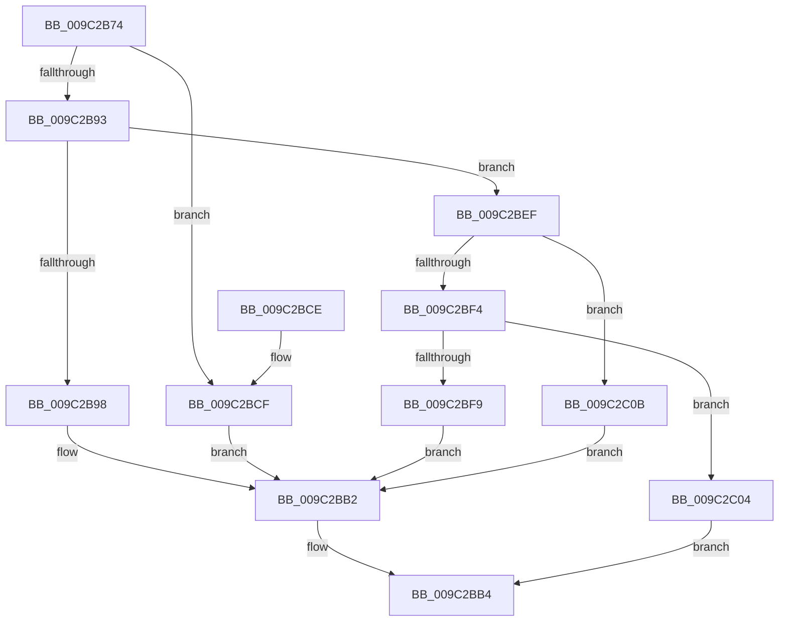

# PiUEventHandleIoctl

- RVA: `0x009C2B74`–`0x009C2C27` (길이 `179` bytes)
- VA: `0x00000001409C2B74`
- 실행 섹션: `PAGE`
- PDB 이름 있음: `예`; PDB Function 태그: `아니요`
- unwind 정보 RVA: `0x0009F78C`
- 디코드: `51`개 명령, `179/179` bytes 표시
- 미해석 바이트: `0` (있으면 어셈블리에 `.byte`로 보존)

> 이 문서는 커널 이미지의 기계어와 PDB 기호를 분석해 생성했습니다. 4번과 5번은 함수 원형과 자료형을 바이너리 사용 방식에서 추정한 C 해석이며 원본 소스 복구 결과는 아닙니다.

## 1. Dependencies

- 직접 호출 지점: **5**; 고유 호출 대상: **5**
- 직접 호출자로 확인된 함수: **1**
- RIP 상대 이미지 참조: **0**

### Outgoing calls
- `0x009C2BAD` → [PiUEventHandleGetEvent](PiUEventHandleGetEvent_function_009C2C30.md) (function, `0x009C2C30`)
- `0x009C2BBC` → [IofCompleteRequest](../../text/29/IofCompleteRequest_function_0029B5C0.md) (function, `0x0029B5C0`)
- `0x009C2BE8` → [PiUEventHandleRegistration](PiUEventHandleRegistration_function_009C3304.md) (function, `0x009C3304`)
- `0x009C2BFD` → [PiUEventHandleUnregisterClient](PiUEventHandleUnregisterClient_function_009C3BBC.md) (function, `0x009C3BBC`)
- `0x009C2C20` → [PiUEventHandleVetoEvent](PiUEventHandleVetoEvent_function_009C2744.md) (function, `0x009C2744`)

### Direct callers
- [PiUEventDispatch](PiUEventDispatch_function_009C2AD0.md) at `0x009C2B23`

### Static image references
- 디코드된 RIP-relative 메모리 참조가 없습니다.

## 2. Other-region calls and transfers

- 다른 실행 섹션으로 향하는 call: **1**
  - `0x009C2BBC` → [IofCompleteRequest](../../text/29/IofCompleteRequest_function_0029B5C0.md) (`PAGE` → `.text`)
- 별도 외부 분기/꼬리 이동을 확인하지 못했습니다.

## 3. Assembly (complete function range)

```asm
009C2B74  48 89 5C 24 08                  mov qword ptr [rsp + 8], rbx
009C2B79  57                              push rdi
009C2B7A  48 83 EC 30                     sub rsp, 0x30
009C2B7E  48 8B D9                        mov rbx, rcx
009C2B81  48 8B 89 B8 00 00 00            mov rcx, qword ptr [rcx + 0xb8]
009C2B88  8B 51 18                        mov edx, dword ptr [rcx + 0x18]
009C2B8B  81 EA 00 08 47 00               sub edx, 0x470800
009C2B91  74 3C                           je 0x1409c2bcf
009C2B93  83 EA 04                        sub edx, 4
009C2B96  75 57                           jne 0x1409c2bef
009C2B98  44 8B 49 08                     mov r9d, dword ptr [rcx + 8]
009C2B9C  48 8D 43 30                     lea rax, [rbx + 0x30]
009C2BA0  48 8B 49 30                     mov rcx, qword ptr [rcx + 0x30]
009C2BA4  48 8B 53 18                     mov rdx, qword ptr [rbx + 0x18]
009C2BA8  48 89 44 24 20                  mov qword ptr [rsp + 0x20], rax
009C2BAD  E8 7E 00 00 00                  call 0x1409c2c30
009C2BB2  8B F8                           mov edi, eax
009C2BB4  33 D2                           xor edx, edx
009C2BB6  89 7B 30                        mov dword ptr [rbx + 0x30], edi
009C2BB9  48 8B CB                        mov rcx, rbx
009C2BBC  E8 FF 89 8D FF                  call 0x14029b5c0
009C2BC1  48 8B 5C 24 40                  mov rbx, qword ptr [rsp + 0x40]
009C2BC6  8B C7                           mov eax, edi
009C2BC8  48 83 C4 30                     add rsp, 0x30
009C2BCC  5F                              pop rdi
009C2BCD  C3                              ret
009C2BCE  CC                              int3
009C2BCF  44 8B 49 08                     mov r9d, dword ptr [rcx + 8]
009C2BD3  48 8D 43 30                     lea rax, [rbx + 0x30]
009C2BD7  44 8B 41 10                     mov r8d, dword ptr [rcx + 0x10]
009C2BDB  48 8B 49 30                     mov rcx, qword ptr [rcx + 0x30]
009C2BDF  48 8B 53 18                     mov rdx, qword ptr [rbx + 0x18]
009C2BE3  48 89 44 24 20                  mov qword ptr [rsp + 0x20], rax
009C2BE8  E8 17 07 00 00                  call 0x1409c3304
009C2BED  EB C3                           jmp 0x1409c2bb2
009C2BEF  83 EA 04                        sub edx, 4
009C2BF2  74 17                           je 0x1409c2c0b
009C2BF4  83 FA 04                        cmp edx, 4
009C2BF7  75 0B                           jne 0x1409c2c04
009C2BF9  48 8B 49 30                     mov rcx, qword ptr [rcx + 0x30]
009C2BFD  E8 BA 0F 00 00                  call 0x1409c3bbc
009C2C02  EB AE                           jmp 0x1409c2bb2
009C2C04  BF BB 00 00 C0                  mov edi, 0xc00000bb
009C2C09  EB A9                           jmp 0x1409c2bb4
009C2C0B  44 8B 41 10                     mov r8d, dword ptr [rcx + 0x10]
009C2C0F  48 8D 43 30                     lea rax, [rbx + 0x30]
009C2C13  48 8B 49 30                     mov rcx, qword ptr [rcx + 0x30]
009C2C17  48 8B 53 18                     mov rdx, qword ptr [rbx + 0x18]
009C2C1B  48 89 44 24 20                  mov qword ptr [rsp + 0x20], rax
009C2C20  E8 1F FB FF FF                  call 0x1409c2744
009C2C25  EB 8B                           jmp 0x1409c2bb2
```

## 4. C-style interpretation (structured pseudocode)

```c
__int64 __fastcall PiUEventHandleIoctl(__int64 a1)
{
    __int64 result;
    __int64 v_rsp;
    unsigned __int64 v_stack_m18;
    unsigned __int64 v_stack_p20;
    unsigned __int64 v_stack_p8;

    v_stack_p8 = v_rbx;
    v_rsp = (v_rsp) - (48);
    a2 = (unsigned int)(((unsigned int)(*(unsigned int *)(*(unsigned __int64 *)(a1 + 184) + 24))) - (0x470800ULL));
    if (condition_is_equal) goto loc_009C2BCF;
    a2 = (unsigned int)((a2) - (4));
    if (condition_is_not_equal) goto loc_009C2BEF;
    v_stack_m18 = a1 + 48;
    result = PiUEventHandleGetEvent(*(unsigned __int64 *)(*(unsigned __int64 *)(a1 + 184) + 48), *(unsigned __int64 *)(a1 + 24), a3, (unsigned int)(*(unsigned int *)(*(unsigned __int64 *)(a1 + 184) + 8)));
loc_009C2BB2:
loc_009C2BB4:
    a2 = 0;
    *(unsigned int *)(a1 + 48) = (unsigned int)((unsigned int)((unsigned int)(result)));
    result = IofCompleteRequest(a1, a2, a3, (unsigned int)(*(unsigned int *)(*(unsigned __int64 *)(a1 + 184) + 8)));
    v_rsp = (v_rsp) + (48);
    return (unsigned int)((unsigned int)((unsigned int)((unsigned int)(result))));
loc_009C2BCF:
    v_stack_p20 = v_stack_p8 + 48;
    result = PiUEventHandleRegistration(*(unsigned __int64 *)(a1 + 48), *(unsigned __int64 *)(v_stack_p8 + 24), (unsigned int)(*(unsigned int *)(a1 + 16)), (unsigned int)(*(unsigned int *)(a1 + 8)));
    goto loc_009C2BB2;
loc_009C2BEF:
    a2 = (unsigned int)((*(unsigned __int64 *)(v_stack_p8 + 24)) - (4));
    if (condition_is_equal) goto loc_009C2C0B;
    if (((unsigned int)(a2)) != 4) goto loc_009C2C04;
    result = PiUEventHandleUnregisterClient(*(unsigned __int64 *)(*(unsigned __int64 *)(a1 + 48) + 48), a2, (unsigned int)(*(unsigned int *)(a1 + 16)), (unsigned int)(*(unsigned int *)(a1 + 8)));
    goto loc_009C2BB2;
loc_009C2C04:
    goto loc_009C2BB4;
loc_009C2C0B:
    v_stack_p20 = v_stack_p8 + 48;
    result = PiUEventHandleVetoEvent(*(unsigned __int64 *)(*(unsigned __int64 *)(*(unsigned __int64 *)(a1 + 48) + 48) + 48), *(unsigned __int64 *)(v_stack_p8 + 24), (unsigned int)(*(unsigned int *)(*(unsigned __int64 *)(*(unsigned __int64 *)(a1 + 48) + 48) + 16)), (unsigned int)(*(unsigned int *)(a1 + 8)));
    goto loc_009C2BB2;
}
```

## 5. (Beta) C Style

```c
int64_t PiUEventHandleIoctl(void *Arg1)
{
    uint8_t *arg1 = (uint8_t *)Arg1;

    int64_t result;
    int64_t local_rsp;
    uint64_t v_stack_m18;
    uint64_t v_stack_p20;
    uint64_t v_stack_p8;

    v_stack_p8 = local_rbx;
    local_rsp = (local_rsp) - (48);
    a2 = (uint32_t)(((uint32_t)(*(uint32_t *)(*(uint64_t *)(arg1 + 0xB8) + 0x18))) - (0x470800ULL));
    if (condition_is_equal) goto loc_009C2BCF;
    a2 = (uint32_t)((a2) - (4));
    if (condition_is_not_equal) goto loc_009C2BEF;
    v_stack_m18 = Arg1 + 48;
    result = PiUEventHandleGetEvent(*(uint64_t *)(*(uint64_t *)(arg1 + 0xB8) + 0x30), *(uint64_t *)(arg1 + 0x18), a3, (uint32_t)(*(uint32_t *)(*(uint64_t *)(arg1 + 0xB8) + 0x8)));
loc_009C2BB2:
loc_009C2BB4:
    a2 = 0;
    *(uint32_t *)(arg1 + 0x30) = (uint32_t)((uint32_t)((uint32_t)(result)));
    result = IofCompleteRequest(Arg1, a2, a3, (uint32_t)(*(uint32_t *)(*(uint64_t *)(arg1 + 0xB8) + 0x8)));
    local_rsp = (local_rsp) + (48);
    return (uint32_t)((uint32_t)((uint32_t)((uint32_t)(result))));
loc_009C2BCF:
    v_stack_p20 = v_stack_p8 + 48;
    result = PiUEventHandleRegistration(*(uint64_t *)(arg1 + 0x30), *(uint64_t *)(v_stack_p8 + 0x18), (uint32_t)(*(uint32_t *)(arg1 + 0x10)), (uint32_t)(*(uint32_t *)(arg1 + 0x8)));
    goto loc_009C2BB2;
loc_009C2BEF:
    a2 = (uint32_t)((*(uint64_t *)(v_stack_p8 + 0x18)) - (4));
    if (condition_is_equal) goto loc_009C2C0B;
    if (((uint32_t)(a2)) != 4) goto loc_009C2C04;
    result = PiUEventHandleUnregisterClient(*(uint64_t *)(*(uint64_t *)(arg1 + 0x30) + 0x30), a2, (uint32_t)(*(uint32_t *)(arg1 + 0x10)), (uint32_t)(*(uint32_t *)(arg1 + 0x8)));
    goto loc_009C2BB2;
loc_009C2C04:
    goto loc_009C2BB4;
loc_009C2C0B:
    v_stack_p20 = v_stack_p8 + 48;
    result = PiUEventHandleVetoEvent(*(uint64_t *)(*(uint64_t *)(*(uint64_t *)(arg1 + 0x30) + 0x30) + 0x30), *(uint64_t *)(v_stack_p8 + 0x18), (uint32_t)(*(uint32_t *)(*(uint64_t *)(*(uint64_t *)(arg1 + 0x30) + 0x30) + 0x10)), (uint32_t)(*(uint32_t *)(arg1 + 0x8)));
    goto loc_009C2BB2;
}
```

### 관측된 메모리 오프셋

구조체 형식이 확인되지 않은 접근은 인자 기준의 오프셋으로만 기록했습니다.

| 기준 인자 | 오프셋 표현 | 폭 (bit) | 접근 |
|---|---:|---:|---|
| `Arg1` | `+ 0x18` | `64` | `R` |
| `Arg1` | `+ 0x30` | `32` | `W` |
| `Arg1` | `+ 0x30` | `64` | `R` |
| `Arg1` | `+ 0xB8` | `64` | `R` |

## 6. Execution-region graph

[열기: 2D/3D 그래프와 함수 탐색 컨트롤 패널](../../../control-panel.html?section=page&rva=0x009C2B74&view=graph)

- 2D 그래프는 위에서 아래로 흐르고, 3D 그래프는 빈 공간을 드래그해 회전합니다. Shift+드래그는 이동, 휠은 확대·축소, 함수 노드 선택은 대상 보고서 이동입니다.

### Static fallback


