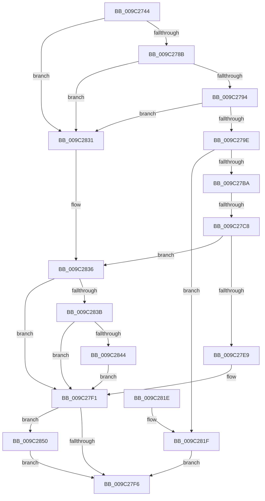

# PiUEventHandleVetoEvent

- RVA: `0x009C2744`–`0x009C285F` (길이 `283` bytes)
- VA: `0x00000001409C2744`
- 실행 섹션: `PAGE`
- PDB 이름 있음: `예`; PDB Function 태그: `예`
- unwind 정보 RVA: `0x0009F714`
- 디코드: `85`개 명령, `283/283` bytes 표시
- 미해석 바이트: `0` (있으면 어셈블리에 `.byte`로 보존)

> 이 문서는 커널 이미지의 기계어와 PDB 기호를 분석해 생성했습니다. 4번과 5번은 함수 원형과 자료형을 바이너리 사용 방식에서 추정한 C 해석이며 원본 소스 복구 결과는 아닙니다.

## 1. Dependencies

- 직접 호출 지점: **7**; 고유 호출 대상: **6**
- 직접 호출자로 확인된 함수: **1**
- RIP 상대 이미지 참조: **0**

### Outgoing calls
- `0x009C27A9` → [ExAcquireFastMutex](../../text/20/ExAcquireFastMutex_function_0020E5A0.md) (function, `0x0020E5A0`)
- `0x009C27D4` → [PiUEventDequeuePendingEventWorker](PiUEventDequeuePendingEventWorker_function_009C29C0.md) (function, `0x009C29C0`)
- `0x009C27DD` → [ExReleaseFastMutex](../../text/25/ExReleaseFastMutex_function_002519C0.md) (function, `0x002519C0`)
- `0x009C27EC` → [RtlFreeAnsiString](RtlFreeAnsiString_function_009C0800.md) (function, `0x009C0800`)
- `0x009C2828` → [ExReleaseFastMutex](../../text/25/ExReleaseFastMutex_function_002519C0.md) (function, `0x002519C0`)
- `0x009C2849` → [ExFreePoolWithTag](../../poolcode/B8/ExFreePoolWithTag_function_00B82870.md) (function, `0x00B82870`)
- `0x009C2858` → [ObfDereferenceObjectWithTag](../../text/2F/ObfDereferenceObjectWithTag_function_002F78E0.md) (function, `0x002F78E0`)

### Direct callers
- [PiUEventHandleIoctl](PiUEventHandleIoctl_function_009C2B74.md) at `0x009C2C20`

### Static image references
- 디코드된 RIP-relative 메모리 참조가 없습니다.

## 2. Other-region calls and transfers

- 다른 실행 섹션으로 향하는 call: **5**
  - `0x009C27A9` → [ExAcquireFastMutex](../../text/20/ExAcquireFastMutex_function_0020E5A0.md) (`PAGE` → `.text`)
  - `0x009C27DD` → [ExReleaseFastMutex](../../text/25/ExReleaseFastMutex_function_002519C0.md) (`PAGE` → `.text`)
  - `0x009C2828` → [ExReleaseFastMutex](../../text/25/ExReleaseFastMutex_function_002519C0.md) (`PAGE` → `.text`)
  - `0x009C2849` → [ExFreePoolWithTag](../../poolcode/B8/ExFreePoolWithTag_function_00B82870.md) (`PAGE` → `POOLCODE`)
  - `0x009C2858` → [ObfDereferenceObjectWithTag](../../text/2F/ObfDereferenceObjectWithTag_function_002F78E0.md) (`PAGE` → `.text`)
- call이 아닌 외부 분기/꼬리 이동: **1**
  - `0x009C27C2` → [sub_00B2EDF4](../B2/Unknown_function_00B2EDF4.md) (`tail-transfer`)

## 3. Assembly (complete function range)

```asm
009C2744  48 89 5C 24 10                  mov qword ptr [rsp + 0x10], rbx
009C2749  48 89 74 24 18                  mov qword ptr [rsp + 0x18], rsi
009C274E  48 89 7C 24 20                  mov qword ptr [rsp + 0x20], rdi
009C2753  55                              push rbp
009C2754  41 54                           push r12
009C2756  41 55                           push r13
009C2758  41 56                           push r14
009C275A  41 57                           push r15
009C275C  48 8B EC                        mov rbp, rsp
009C275F  48 83 EC 50                     sub rsp, 0x50
009C2763  4C 8B 71 20                     mov r14, qword ptr [rcx + 0x20]
009C2767  33 DB                           xor ebx, ebx
009C2769  48 89 5D 30                     mov qword ptr [rbp + 0x30], rbx
009C276D  0F 57 C0                        xorps xmm0, xmm0
009C2770  48 89 5D D0                     mov qword ptr [rbp - 0x30], rbx
009C2774  8B F3                           mov esi, ebx
009C2776  44 8B E3                        mov r12d, ebx
009C2779  8B FB                           mov edi, ebx
009C277B  44 8A EB                        mov r13b, bl
009C277E  0F 11 45 E8                     movups xmmword ptr [rbp - 0x18], xmm0
009C2782  4D 85 F6                        test r14, r14
009C2785  0F 84 A6 00 00 00               je 0x1409c2831
009C278B  48 85 D2                        test rdx, rdx
009C278E  0F 84 9D 00 00 00               je 0x1409c2831
009C2794  41 83 F8 08                     cmp r8d, 8
009C2798  0F 85 93 00 00 00               jne 0x1409c2831
009C279E  48 8B 1A                        mov rbx, qword ptr [rdx]
009C27A1  49 8B 4E 10                     mov rcx, qword ptr [r14 + 0x10]
009C27A5  48 89 5D D8                     mov qword ptr [rbp - 0x28], rbx
009C27A9  E8 F2 BD 84 FF                  call 0x14020e5a0
009C27AE  49 8D 46 60                     lea rax, [r14 + 0x60]
009C27B2  4C 8B 38                        mov r15, qword ptr [rax]
009C27B5  4C 3B F8                        cmp r15, rax
009C27B8  74 65                           je 0x1409c281f
009C27BA  49 8B 47 18                     mov rax, qword ptr [r15 + 0x18]
009C27BE  40 38 70 4D                     cmp byte ptr [rax + 0x4d], sil
009C27C2  0F 85 2C C6 16 00               jne 0x140b2edf4
009C27C8  45 33 C9                        xor r9d, r9d
009C27CB  41 B0 01                        mov r8b, 1
009C27CE  49 8B D7                        mov rdx, r15
009C27D1  49 8B CE                        mov rcx, r14
009C27D4  E8 E7 01 00 00                  call 0x1409c29c0
009C27D9  49 8B 4E 10                     mov rcx, qword ptr [r14 + 0x10]
009C27DD  E8 DE F1 88 FF                  call 0x1402519c0
009C27E2  33 DB                           xor ebx, ebx
009C27E4  45 84 ED                        test r13b, r13b
009C27E7  74 4D                           je 0x1409c2836
009C27E9  48 8B CF                        mov rcx, rdi
009C27EC  E8 0F E0 FF FF                  call 0x1409c0800
009C27F1  4D 85 E4                        test r12, r12
009C27F4  75 5A                           jne 0x1409c2850
009C27F6  48 8B 4D 50                     mov rcx, qword ptr [rbp + 0x50]
009C27FA  4C 8D 5C 24 50                  lea r11, [rsp + 0x50]
009C27FF  49 8B 7B 48                     mov rdi, qword ptr [r11 + 0x48]
009C2803  8B C6                           mov eax, esi
009C2805  49 8B 73 40                     mov rsi, qword ptr [r11 + 0x40]
009C2809  48 89 59 08                     mov qword ptr [rcx + 8], rbx
009C280D  49 8B 5B 38                     mov rbx, qword ptr [r11 + 0x38]
009C2811  49 8B E3                        mov rsp, r11
009C2814  41 5F                           pop r15
009C2816  41 5E                           pop r14
009C2818  41 5D                           pop r13
009C281A  41 5C                           pop r12
009C281C  5D                              pop rbp
009C281D  C3                              ret
009C281E  CC                              int3
009C281F  49 8B 4E 10                     mov rcx, qword ptr [r14 + 0x10]
009C2823  BE 0D 00 00 C0                  mov esi, 0xc000000d
009C2828  E8 93 F1 88 FF                  call 0x1402519c0
009C282D  33 DB                           xor ebx, ebx
009C282F  EB C5                           jmp 0x1409c27f6
009C2831  BE 0D 00 00 C0                  mov esi, 0xc000000d
009C2836  48 85 FF                        test rdi, rdi
009C2839  74 B6                           je 0x1409c27f1
009C283B  48 8D 45 E8                     lea rax, [rbp - 0x18]
009C283F  48 3B F8                        cmp rdi, rax
009C2842  74 AD                           je 0x1409c27f1
009C2844  33 D2                           xor edx, edx
009C2846  48 8B CF                        mov rcx, rdi
009C2849  E8 22 00 1C 00                  call 0x140b82870
009C284E  EB A1                           jmp 0x1409c27f1
009C2850  BA 44 66 6C 74                  mov edx, 0x746c6644
009C2855  49 8B CC                        mov rcx, r12
009C2858  E8 83 50 93 FF                  call 0x1402f78e0
009C285D  EB 97                           jmp 0x1409c27f6
```

## 4. C-style interpretation (structured pseudocode)

```c
__int64 __fastcall PiUEventHandleVetoEvent(__int64 a1, __int64 a2, int a3, int a4, __int64 a5)
{
    __int64 result;
    __int64 v_rbx;
    __int64 v_rsp;
    unsigned __int64 v_stack_m28;
    unsigned __int64 v_stack_m40;
    unsigned __int64 v_stack_m50;
    unsigned __int64 v_stack_m58;
    unsigned __int64 v_stack_p10;
    unsigned __int64 v_stack_p18;
    unsigned __int64 v_stack_p20;
    unsigned __int64 v_stack_p8;

    v_stack_p10 = v_rbx;
    v_stack_p18 = v_rsi;
    v_stack_p20 = v_rdi;
    v_rsp = (v_rsp) - (80);
    v_rbx = 0;
    v_stack_p8 = 0;
    v_stack_m58 = 0;
    v_stack_m40 = v_xmm0;
    if (*(unsigned __int64 *)(a1 + 32) == 0) goto loc_009C2831;
    if (a2 == 0) goto loc_009C2831;
    if (a3 != 8) goto loc_009C2831;
    v_stack_m50 = *(unsigned __int64 *)(a2);
    result = ExAcquireFastMutex(*(unsigned __int64 *)(*(unsigned __int64 *)(a1 + 32) + 16), a2, a3, a4);
    if ((*(unsigned __int64 *)(*(unsigned __int64 *)(a1 + 32) + 96)) == (*(unsigned __int64 *)(a1 + 32) + 96)) goto loc_009C281F;
    a4 = 0;
    result = PiUEventDequeuePendingEventWorker(*(unsigned __int64 *)(a1 + 32), *(unsigned __int64 *)(*(unsigned __int64 *)(a1 + 32) + 96), 1, a4);
    result = ExReleaseFastMutex(*(unsigned __int64 *)(*(unsigned __int64 *)(a1 + 32) + 16), *(unsigned __int64 *)(*(unsigned __int64 *)(a1 + 32) + 96), 1, a4);
    v_rbx = 0;
    if (0 == 0) goto loc_009C2836;
    result = RtlFreeAnsiString(0, *(unsigned __int64 *)(*(unsigned __int64 *)(a1 + 32) + 96), 1, a4);
loc_009C27F1:
    if (0 != 0) goto loc_009C2850;
loc_009C27F6:
    *(unsigned __int64 *)(a5 + 8) = 0;
    return 0;
loc_009C281F:
    result = ExReleaseFastMutex(*(unsigned __int64 *)(*(unsigned __int64 *)(a1 + 32) + 16), *(unsigned __int64 *)(*(unsigned __int64 *)(a1 + 32) + 96), 1, a4);
    v_rbx = 0;
    goto loc_009C27F6;
loc_009C2831:
loc_009C2836:
    if (*(unsigned __int64 *)(v_stack_m28 + 72) == 0) goto loc_009C27F1;
    if ((*(unsigned __int64 *)(v_stack_m28 + 72)) == v_stack_m40) goto loc_009C27F1;
    a2 = 0;
    result = ExFreePoolWithTag(*(unsigned __int64 *)(v_stack_m28 + 72), a2, 1, a4);
    goto loc_009C27F1;
loc_009C2850:
    result = ObfDereferenceObjectWithTag(0, (unsigned int)(0x746C6644ULL), 1, a4);
    goto loc_009C27F6;
}
```

## 5. (Beta) C Style

```c
int64_t PiUEventHandleVetoEvent(void *Arg1, int64_t Arg2, int32_t Arg3, int32_t Arg4, void *Arg5)
{
    uint8_t *arg1 = (uint8_t *)Arg1;
    uint8_t *arg5 = (uint8_t *)Arg5;

    int64_t result;
    int64_t local_rbx;
    int64_t local_rsp;
    uint64_t v_stack_m28;
    uint64_t v_stack_m40;
    uint64_t v_stack_m50;
    uint64_t v_stack_m58;
    uint64_t v_stack_p10;
    uint64_t v_stack_p18;
    uint64_t v_stack_p20;
    uint64_t v_stack_p8;

    v_stack_p10 = local_rbx;
    v_stack_p18 = local_rsi;
    v_stack_p20 = local_rdi;
    local_rsp = (local_rsp) - (80);
    local_rbx = 0;
    v_stack_p8 = 0;
    v_stack_m58 = 0;
    v_stack_m40 = v_xmm0;
    if (*(uint64_t *)(arg1 + 0x20) == 0) goto loc_009C2831;
    if (Arg2 == 0) goto loc_009C2831;
    if (Arg3 != 8) goto loc_009C2831;
    v_stack_m50 = *(uint64_t *)(Arg2);
    result = ExAcquireFastMutex(*(uint64_t *)(*(uint64_t *)(arg1 + 0x20) + 0x10), Arg2, Arg3, Arg4);
    if ((*(uint64_t *)(*(uint64_t *)(arg1 + 0x20) + 0x60)) == (*(uint64_t *)(arg1 + 0x20) + 96)) goto loc_009C281F;
    Arg4 = 0;
    result = PiUEventDequeuePendingEventWorker(*(uint64_t *)(arg1 + 0x20), *(uint64_t *)(*(uint64_t *)(arg1 + 0x20) + 0x60), 1, Arg4);
    result = ExReleaseFastMutex(*(uint64_t *)(*(uint64_t *)(arg1 + 0x20) + 0x10), *(uint64_t *)(*(uint64_t *)(arg1 + 0x20) + 0x60), 1, Arg4);
    local_rbx = 0;
    if (0 == 0) goto loc_009C2836;
    result = RtlFreeAnsiString(0, *(uint64_t *)(*(uint64_t *)(arg1 + 0x20) + 0x60), 1, Arg4);
loc_009C27F1:
    if (0 != 0) goto loc_009C2850;
loc_009C27F6:
    *(uint64_t *)(arg5 + 0x8) = 0;
    return 0;
loc_009C281F:
    result = ExReleaseFastMutex(*(uint64_t *)(*(uint64_t *)(arg1 + 0x20) + 0x10), *(uint64_t *)(*(uint64_t *)(arg1 + 0x20) + 0x60), 1, Arg4);
    local_rbx = 0;
    goto loc_009C27F6;
loc_009C2831:
loc_009C2836:
    if (*(uint64_t *)(v_stack_m28 + 0x48) == 0) goto loc_009C27F1;
    if ((*(uint64_t *)(v_stack_m28 + 0x48)) == v_stack_m40) goto loc_009C27F1;
    Arg2 = 0;
    result = ExFreePoolWithTag(*(uint64_t *)(v_stack_m28 + 0x48), Arg2, 1, Arg4);
    goto loc_009C27F1;
loc_009C2850:
    result = ObfDereferenceObjectWithTag(0, (uint32_t)(0x746C6644ULL), 1, Arg4);
    goto loc_009C27F6;
}
```

### 관측된 메모리 오프셋

구조체 형식이 확인되지 않은 접근은 인자 기준의 오프셋으로만 기록했습니다.

| 기준 인자 | 오프셋 표현 | 폭 (bit) | 접근 |
|---|---:|---:|---|
| `Arg1` | `+ 0x20` | `64` | `R` |
| `Arg5` | `+ 0x8` | `64` | `W` |

## 6. Execution-region graph

[열기: 2D/3D 그래프와 함수 탐색 컨트롤 패널](../../../control-panel.html?section=page&rva=0x009C2744&view=graph)

- 2D 그래프는 위에서 아래로 흐르고, 3D 그래프는 빈 공간을 드래그해 회전합니다. Shift+드래그는 이동, 휠은 확대·축소, 함수 노드 선택은 대상 보고서 이동입니다.

### Static fallback


