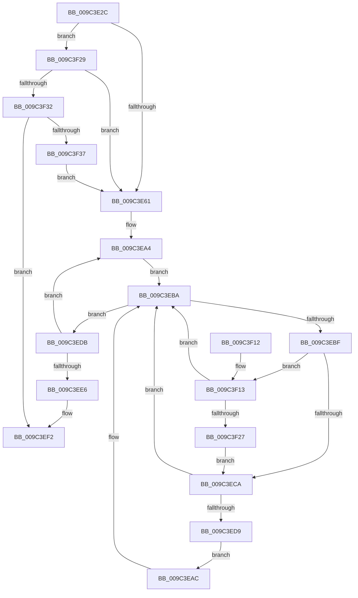

# PiUEventNotifyDeviceInstanceChange

- RVA: `0x009C3E2C`–`0x009C3F3C` (길이 `272` bytes)
- VA: `0x00000001409C3E2C`
- 실행 섹션: `PAGE`
- PDB 이름 있음: `예`; PDB Function 태그: `아니요`
- unwind 정보 RVA: `0x0009F88C`
- 디코드: `80`개 명령, `272/272` bytes 표시
- 미해석 바이트: `0` (있으면 어셈블리에 `.byte`로 보존)

> 이 문서는 커널 이미지의 기계어와 PDB 기호를 분석해 생성했습니다. 4번과 5번은 함수 원형과 자료형을 바이너리 사용 방식에서 추정한 C 해석이며 원본 소스 복구 결과는 아닙니다.

## 1. Dependencies

- 직접 호출 지점: **6**; 고유 호출 대상: **6**
- 직접 호출자로 확인된 함수: **1**
- RIP 상대 이미지 참조: **3**

### Outgoing calls
- `0x009C3E6F` → [ExAcquireFastMutex](../../text/20/ExAcquireFastMutex_function_0020E5A0.md) (function, `0x0020E5A0`)
- `0x009C3E77` → [PiUEventHashStringIntoBucket](../../text/48/PiUEventHashStringIntoBucket_function_00486690.md) (function, `0x00486690`)
- `0x009C3EB2` → [PiUEventNotifyClient](../8E/PiUEventNotifyClient_function_008E6BEC.md) (function, `0x008E6BEC`)
- `0x009C3ED0` → [PiUEventApplyAdditionalFilters](../8E/PiUEventApplyAdditionalFilters_function_008E6840.md) (function, `0x008E6840`)
- `0x009C3EED` → [ExReleaseFastMutex](../../text/25/ExReleaseFastMutex_function_002519C0.md) (function, `0x002519C0`)
- `0x009C3F1E` → [wcsicmp](../../text/50/wcsicmp_function_00500080.md) (function, `0x00500080`)

### Direct callers
- [PiUEventProcessEventWorker](PiUEventProcessEventWorker_function_009C2870.md) at `0x009C29B1`

### Static image references
- `0x009C3E68` → RVA `0x00F8C760` (`.data`; read)
- `0x009C3E7E` → RVA `0x00F8C880` (`.data`; read)
- `0x009C3E98` → RVA `0x00F8C950` (`.data`; read)

## 2. Other-region calls and transfers

- 다른 실행 섹션으로 향하는 call: **4**
  - `0x009C3E6F` → [ExAcquireFastMutex](../../text/20/ExAcquireFastMutex_function_0020E5A0.md) (`PAGE` → `.text`)
  - `0x009C3E77` → [PiUEventHashStringIntoBucket](../../text/48/PiUEventHashStringIntoBucket_function_00486690.md) (`PAGE` → `.text`)
  - `0x009C3EED` → [ExReleaseFastMutex](../../text/25/ExReleaseFastMutex_function_002519C0.md) (`PAGE` → `.text`)
  - `0x009C3F1E` → [wcsicmp](../../text/50/wcsicmp_function_00500080.md) (`PAGE` → `.text`)
- 별도 외부 분기/꼬리 이동을 확인하지 못했습니다.

## 3. Assembly (complete function range)

```asm
009C3E2C  48 8B C4                        mov rax, rsp
009C3E2F  48 89 58 08                     mov qword ptr [rax + 8], rbx
009C3E33  48 89 68 10                     mov qword ptr [rax + 0x10], rbp
009C3E37  48 89 70 18                     mov qword ptr [rax + 0x18], rsi
009C3E3B  57                              push rdi
009C3E3C  41 54                           push r12
009C3E3E  41 55                           push r13
009C3E40  41 56                           push r14
009C3E42  41 57                           push r15
009C3E44  48 83 EC 30                     sub rsp, 0x30
009C3E48  8B 51 60                        mov edx, dword ptr [rcx + 0x60]
009C3E4B  45 33 E4                        xor r12d, r12d
009C3E4E  0F 57 C0                        xorps xmm0, xmm0
009C3E51  48 8B F9                        mov rdi, rcx
009C3E54  0F 11 40 C8                     movups xmmword ptr [rax - 0x38], xmm0
009C3E58  83 EA 04                        sub edx, 4
009C3E5B  0F 85 C8 00 00 00               jne 0x1409c3f29
009C3E61  4C 8D A9 80 00 00 00            lea r13, [rcx + 0x80]
009C3E68  48 8D 0D F1 88 5C 00            lea rcx, [rip + 0x5c88f1]
009C3E6F  E8 2C A7 84 FF                  call 0x14020e5a0
009C3E74  49 8B CD                        mov rcx, r13
009C3E77  E8 14 28 AC FF                  call 0x140486690
009C3E7C  8B C0                           mov eax, eax
009C3E7E  48 8D 0D FB 89 5C 00            lea rcx, [rip + 0x5c89fb]
009C3E85  48 C1 E0 04                     shl rax, 4
009C3E89  4C 8D 7C 24 20                  lea r15, [rsp + 0x20]
009C3E8E  48 03 C1                        add rax, rcx
009C3E91  48 89 44 24 20                  mov qword ptr [rsp + 0x20], rax
009C3E96  33 F6                           xor esi, esi
009C3E98  48 8D 05 B1 8A 5C 00            lea rax, [rip + 0x5c8ab1]
009C3E9F  48 89 44 24 28                  mov qword ptr [rsp + 0x28], rax
009C3EA4  4D 8B 37                        mov r14, qword ptr [r15]
009C3EA7  49 8B 1E                        mov rbx, qword ptr [r14]
009C3EAA  EB 0E                           jmp 0x1409c3eba
009C3EAC  48 8B D5                        mov rdx, rbp
009C3EAF  48 8B CF                        mov rcx, rdi
009C3EB2  E8 35 2D F2 FF                  call 0x1408e6bec
009C3EB7  44 8B E0                        mov r12d, eax
009C3EBA  49 3B DE                        cmp rbx, r14
009C3EBD  74 1C                           je 0x1409c3edb
009C3EBF  48 8B EB                        mov rbp, rbx
009C3EC2  48 8B 1B                        mov rbx, qword ptr [rbx]
009C3EC5  83 FE 01                        cmp esi, 1
009C3EC8  72 49                           jb 0x1409c3f13
009C3ECA  48 8B D5                        mov rdx, rbp
009C3ECD  48 8B CF                        mov rcx, rdi
009C3ED0  E8 6B 29 F2 FF                  call 0x1408e6840
009C3ED5  84 C0                           test al, al
009C3ED7  74 E1                           je 0x1409c3eba
009C3ED9  EB D1                           jmp 0x1409c3eac
009C3EDB  FF C6                           inc esi
009C3EDD  49 83 C7 08                     add r15, 8
009C3EE1  83 FE 02                        cmp esi, 2
009C3EE4  72 BE                           jb 0x1409c3ea4
009C3EE6  48 8D 0D 73 88 5C 00            lea rcx, [rip + 0x5c8873]
009C3EED  E8 CE DA 88 FF                  call 0x1402519c0
009C3EF2  48 8B 5C 24 60                  mov rbx, qword ptr [rsp + 0x60]
009C3EF7  41 8B C4                        mov eax, r12d
009C3EFA  48 8B 6C 24 68                  mov rbp, qword ptr [rsp + 0x68]
009C3EFF  48 8B 74 24 70                  mov rsi, qword ptr [rsp + 0x70]
009C3F04  48 83 C4 30                     add rsp, 0x30
009C3F08  41 5F                           pop r15
009C3F0A  41 5E                           pop r14
009C3F0C  41 5D                           pop r13
009C3F0E  41 5C                           pop r12
009C3F10  5F                              pop rdi
009C3F11  C3                              ret
009C3F12  CC                              int3
009C3F13  48 8B 55 18                     mov rdx, qword ptr [rbp + 0x18]
009C3F17  49 8B CD                        mov rcx, r13
009C3F1A  48 8B 52 10                     mov rdx, qword ptr [rdx + 0x10]
009C3F1E  E8 5D C1 B3 FF                  call 0x140500080
009C3F23  85 C0                           test eax, eax
009C3F25  75 93                           jne 0x1409c3eba
009C3F27  EB A1                           jmp 0x1409c3eca
009C3F29  83 EA 06                        sub edx, 6
009C3F2C  0F 84 2F FF FF FF               je 0x1409c3e61
009C3F32  83 FA 01                        cmp edx, 1
009C3F35  75 BB                           jne 0x1409c3ef2
009C3F37  E9 25 FF FF FF                  jmp 0x1409c3e61
```

## 4. C-style interpretation (structured pseudocode)

```c
__int64 __fastcall PiUEventNotifyDeviceInstanceChange(__int64 a1)
{
    __int64 result;
    __int64 v_r12;
    __int64 v_r15;
    __int64 v_rsi;
    __int64 v_rsp;
    unsigned __int64 v_stack_m30;
    unsigned __int64 v_stack_m38;
    unsigned __int64 v_stack_p10;
    unsigned __int64 v_stack_p18;
    unsigned __int64 v_stack_p8;

    *(unsigned __int64 *)(v_rsp + 8) = v_rbx;
    *(unsigned __int64 *)(v_rsp + 16) = v_rbp;
    *(unsigned __int64 *)(v_rsp + 24) = v_rsi;
    v_rsp = (v_rsp) - (48);
    v_r12 = 0;
    *(unsigned __int64 *)(v_rsp - 56) = v_xmm0;
    a2 = (unsigned int)(((unsigned int)(*(unsigned int *)(a1 + 96))) - (4));
    if (condition_is_not_equal) goto loc_009C3F29;
loc_009C3E61:
    result = ExAcquireFastMutex(v_rip + 6064369, a2, a3, a4);
    result = PiUEventHashStringIntoBucket(a1 + 128, a2, a3, a4);
    result = ((unsigned int)((unsigned int)(result))) << (4);
    result = (result) + (v_rip + 6064635);
    v_stack_m38 = result;
    v_rsi = 0;
    v_stack_m30 = v_rip + 6064817;
loc_009C3EA4:
    goto loc_009C3EBA;
loc_009C3EAC:
    result = PiUEventNotifyClient(a1, v_rbp, a3, a4);
loc_009C3EBA:
    if ((*(unsigned __int64 *)(*(unsigned __int64 *)(v_stack_m38))) == (*(unsigned __int64 *)(v_stack_m38))) goto loc_009C3EDB;
    if (0 < 1) goto loc_009C3F13;
loc_009C3ECA:
    result = PiUEventApplyAdditionalFilters(a1, *(unsigned __int64 *)(*(unsigned __int64 *)(v_stack_m38)), a3, a4);
    if ((unsigned __int8)(result) == 0) goto loc_009C3EBA;
    goto loc_009C3EAC;
loc_009C3EDB:
    v_rsi = (unsigned int)((v_rsi) + 1);
    v_r15 = (v_stack_m38) + (8);
    if (((unsigned int)(v_rsi)) < 2) goto loc_009C3EA4;
    result = ExReleaseFastMutex(v_rip + 6064243, *(unsigned __int64 *)(*(unsigned __int64 *)(v_stack_m38)), a3, a4);
loc_009C3EF2:
    v_rsp = (v_rsp) + (48);
    return (unsigned int)((unsigned int)((unsigned int)((unsigned int)(result))));
loc_009C3F13:
    result = wcsicmp(a1 + 128, *(unsigned __int64 *)(*(unsigned __int64 *)(v_stack_p10 + 24) + 16), a3, a4);
    if ((unsigned int)(result) != 0) goto loc_009C3EBA;
    goto loc_009C3ECA;
loc_009C3F29:
    a2 = (unsigned int)((*(unsigned __int64 *)(*(unsigned __int64 *)(v_stack_p10 + 24) + 16)) - (6));
    if (condition_is_equal) goto loc_009C3E61;
    if (((unsigned int)(a2)) != 1) goto loc_009C3EF2;
    goto loc_009C3E61;
}
```

## 5. (Beta) C Style

```c
int64_t PiUEventNotifyDeviceInstanceChange(void *Arg1)
{
    uint8_t *arg1 = (uint8_t *)Arg1;

    int64_t result;
    int64_t local_r12;
    int64_t local_r15;
    int64_t local_rsi;
    int64_t local_rsp;
    uint64_t v_stack_m30;
    uint64_t v_stack_m38;
    uint64_t v_stack_p10;
    uint64_t v_stack_p18;
    uint64_t v_stack_p8;

    *(uint64_t *)(local_rsp + 0x8) = local_rbx;
    *(uint64_t *)(local_rsp + 0x10) = local_rbp;
    *(uint64_t *)(local_rsp + 0x18) = local_rsi;
    local_rsp = (local_rsp) - (48);
    local_r12 = 0;
    *(uint64_t *)(local_rsp - 0x38) = v_xmm0;
    a2 = (uint32_t)(((uint32_t)(*(uint32_t *)(arg1 + 0x60))) - (4));
    if (condition_is_not_equal) goto loc_009C3F29;
loc_009C3E61:
    result = ExAcquireFastMutex(v_rip + 6064369, a2, a3, a4);
    result = PiUEventHashStringIntoBucket(Arg1 + 128, a2, a3, a4);
    result = ((uint32_t)((uint32_t)(result))) << (4);
    result = (result) + (v_rip + 6064635);
    v_stack_m38 = result;
    local_rsi = 0;
    v_stack_m30 = v_rip + 6064817;
loc_009C3EA4:
    goto loc_009C3EBA;
loc_009C3EAC:
    result = PiUEventNotifyClient(Arg1, local_rbp, a3, a4);
loc_009C3EBA:
    if ((*(uint64_t *)(*(uint64_t *)(v_stack_m38))) == (*(uint64_t *)(v_stack_m38))) goto loc_009C3EDB;
    if (0 < 1) goto loc_009C3F13;
loc_009C3ECA:
    result = PiUEventApplyAdditionalFilters(Arg1, *(uint64_t *)(*(uint64_t *)(v_stack_m38)), a3, a4);
    if ((uint8_t)(result) == 0) goto loc_009C3EBA;
    goto loc_009C3EAC;
loc_009C3EDB:
    local_rsi = (uint32_t)((local_rsi) + 1);
    local_r15 = (v_stack_m38) + (8);
    if (((uint32_t)(local_rsi)) < 2) goto loc_009C3EA4;
    result = ExReleaseFastMutex(v_rip + 6064243, *(uint64_t *)(*(uint64_t *)(v_stack_m38)), a3, a4);
loc_009C3EF2:
    local_rsp = (local_rsp) + (48);
    return (uint32_t)((uint32_t)((uint32_t)((uint32_t)(result))));
loc_009C3F13:
    result = wcsicmp(Arg1 + 128, *(uint64_t *)(*(uint64_t *)(v_stack_p10 + 0x18) + 0x10), a3, a4);
    if ((uint32_t)(result) != 0) goto loc_009C3EBA;
    goto loc_009C3ECA;
loc_009C3F29:
    a2 = (uint32_t)((*(uint64_t *)(*(uint64_t *)(v_stack_p10 + 0x18) + 0x10)) - (6));
    if (condition_is_equal) goto loc_009C3E61;
    if (((uint32_t)(a2)) != 1) goto loc_009C3EF2;
    goto loc_009C3E61;
}
```

### 관측된 메모리 오프셋

구조체 형식이 확인되지 않은 접근은 인자 기준의 오프셋으로만 기록했습니다.

| 기준 인자 | 오프셋 표현 | 폭 (bit) | 접근 |
|---|---:|---:|---|
| `Arg1` | `+ 0x60` | `32` | `R` |
| `Arg1` | `+ 0x80` | `64` | `R` |

## 6. Execution-region graph

[열기: 2D/3D 그래프와 함수 탐색 컨트롤 패널](../../../control-panel.html?section=page&rva=0x009C3E2C&view=graph)

- 2D 그래프는 위에서 아래로 흐르고, 3D 그래프는 빈 공간을 드래그해 회전합니다. Shift+드래그는 이동, 휠은 확대·축소, 함수 노드 선택은 대상 보고서 이동입니다.

### Static fallback


