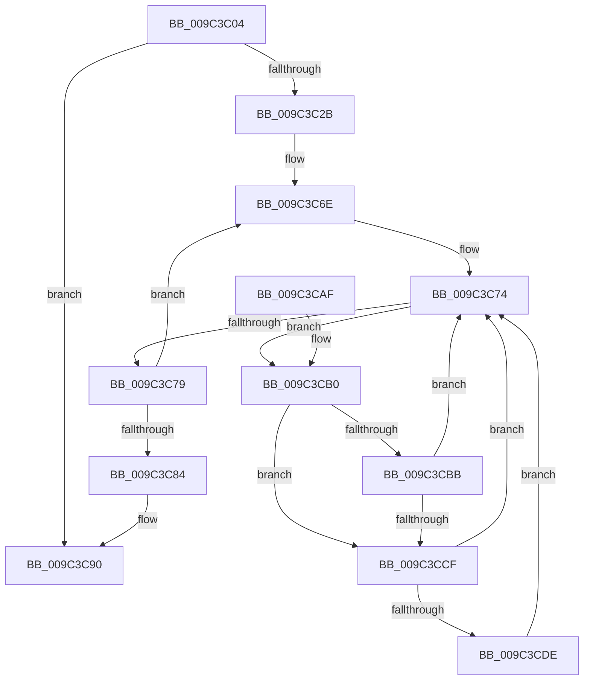

# PiUEventNotifyDeviceInstancePropertyChange

- RVA: `0x009C3C04`–`0x009C3CED` (길이 `233` bytes)
- VA: `0x00000001409C3C04`
- 실행 섹션: `PAGE`
- PDB 이름 있음: `예`; PDB Function 태그: `아니요`
- unwind 정보 RVA: `0x0009F84C`
- 디코드: `69`개 명령, `233/233` bytes 표시
- 미해석 바이트: `0` (있으면 어셈블리에 `.byte`로 보존)

> 이 문서는 커널 이미지의 기계어와 PDB 기호를 분석해 생성했습니다. 4번과 5번은 함수 원형과 자료형을 바이너리 사용 방식에서 추정한 C 해석이며 원본 소스 복구 결과는 아닙니다.

## 1. Dependencies

- 직접 호출 지점: **6**; 고유 호출 대상: **6**
- 직접 호출자로 확인된 함수: **1**
- RIP 상대 이미지 참조: **3**

### Outgoing calls
- `0x009C3C39` → [ExAcquireFastMutex](../../text/20/ExAcquireFastMutex_function_0020E5A0.md) (function, `0x0020E5A0`)
- `0x009C3C41` → [PiUEventHashStringIntoBucket](../../text/48/PiUEventHashStringIntoBucket_function_00486690.md) (function, `0x00486690`)
- `0x009C3C8B` → [ExReleaseFastMutex](../../text/25/ExReleaseFastMutex_function_002519C0.md) (function, `0x002519C0`)
- `0x009C3CC6` → [wcsicmp](../../text/50/wcsicmp_function_00500080.md) (function, `0x00500080`)
- `0x009C3CD5` → [PiUEventApplyAdditionalFilters](../8E/PiUEventApplyAdditionalFilters_function_008E6840.md) (function, `0x008E6840`)
- `0x009C3CE4` → [PiUEventNotifyClient](../8E/PiUEventNotifyClient_function_008E6BEC.md) (function, `0x008E6BEC`)

### Direct callers
- [PiUEventProcessEventWorker](PiUEventProcessEventWorker_function_009C2870.md) at `0x009C2996`

### Static image references
- `0x009C3C32` → RVA `0x00F8C760` (`.data`; read)
- `0x009C3C48` → RVA `0x00F8C7A0` (`.data`; read)
- `0x009C3C62` → RVA `0x00F8C870` (`.data`; read)

## 2. Other-region calls and transfers

- 다른 실행 섹션으로 향하는 call: **4**
  - `0x009C3C39` → [ExAcquireFastMutex](../../text/20/ExAcquireFastMutex_function_0020E5A0.md) (`PAGE` → `.text`)
  - `0x009C3C41` → [PiUEventHashStringIntoBucket](../../text/48/PiUEventHashStringIntoBucket_function_00486690.md) (`PAGE` → `.text`)
  - `0x009C3C8B` → [ExReleaseFastMutex](../../text/25/ExReleaseFastMutex_function_002519C0.md) (`PAGE` → `.text`)
  - `0x009C3CC6` → [wcsicmp](../../text/50/wcsicmp_function_00500080.md) (`PAGE` → `.text`)
- 별도 외부 분기/꼬리 이동을 확인하지 못했습니다.

## 3. Assembly (complete function range)

```asm
009C3C04  48 89 5C 24 08                  mov qword ptr [rsp + 8], rbx
009C3C09  48 89 6C 24 10                  mov qword ptr [rsp + 0x10], rbp
009C3C0E  48 89 74 24 18                  mov qword ptr [rsp + 0x18], rsi
009C3C13  57                              push rdi
009C3C14  41 54                           push r12
009C3C16  41 55                           push r13
009C3C18  41 56                           push r14
009C3C1A  41 57                           push r15
009C3C1C  48 83 EC 30                     sub rsp, 0x30
009C3C20  33 ED                           xor ebp, ebp
009C3C22  48 8B F1                        mov rsi, rcx
009C3C25  83 79 60 09                     cmp dword ptr [rcx + 0x60], 9
009C3C29  75 65                           jne 0x1409c3c90
009C3C2B  4C 8D A1 80 00 00 00            lea r12, [rcx + 0x80]
009C3C32  48 8D 0D 27 8B 5C 00            lea rcx, [rip + 0x5c8b27]
009C3C39  E8 62 A9 84 FF                  call 0x14020e5a0
009C3C3E  49 8B CC                        mov rcx, r12
009C3C41  E8 4A 2A AC FF                  call 0x140486690
009C3C46  8B C0                           mov eax, eax
009C3C48  48 8D 0D 51 8B 5C 00            lea rcx, [rip + 0x5c8b51]
009C3C4F  48 C1 E0 04                     shl rax, 4
009C3C53  4C 8D 7C 24 20                  lea r15, [rsp + 0x20]
009C3C58  48 03 C1                        add rax, rcx
009C3C5B  48 89 44 24 20                  mov qword ptr [rsp + 0x20], rax
009C3C60  33 FF                           xor edi, edi
009C3C62  48 8D 05 07 8C 5C 00            lea rax, [rip + 0x5c8c07]
009C3C69  48 89 44 24 28                  mov qword ptr [rsp + 0x28], rax
009C3C6E  4D 8B 37                        mov r14, qword ptr [r15]
009C3C71  49 8B 1E                        mov rbx, qword ptr [r14]
009C3C74  49 3B DE                        cmp rbx, r14
009C3C77  75 37                           jne 0x1409c3cb0
009C3C79  FF C7                           inc edi
009C3C7B  49 83 C7 08                     add r15, 8
009C3C7F  83 FF 02                        cmp edi, 2
009C3C82  72 EA                           jb 0x1409c3c6e
009C3C84  48 8D 0D D5 8A 5C 00            lea rcx, [rip + 0x5c8ad5]
009C3C8B  E8 30 DD 88 FF                  call 0x1402519c0
009C3C90  48 8B 5C 24 60                  mov rbx, qword ptr [rsp + 0x60]
009C3C95  8B C5                           mov eax, ebp
009C3C97  48 8B 6C 24 68                  mov rbp, qword ptr [rsp + 0x68]
009C3C9C  48 8B 74 24 70                  mov rsi, qword ptr [rsp + 0x70]
009C3CA1  48 83 C4 30                     add rsp, 0x30
009C3CA5  41 5F                           pop r15
009C3CA7  41 5E                           pop r14
009C3CA9  41 5D                           pop r13
009C3CAB  41 5C                           pop r12
009C3CAD  5F                              pop rdi
009C3CAE  C3                              ret
009C3CAF  CC                              int3
009C3CB0  4C 8B EB                        mov r13, rbx
009C3CB3  48 8B 1B                        mov rbx, qword ptr [rbx]
009C3CB6  83 FF 01                        cmp edi, 1
009C3CB9  73 14                           jae 0x1409c3ccf
009C3CBB  49 8B 55 18                     mov rdx, qword ptr [r13 + 0x18]
009C3CBF  49 8B CC                        mov rcx, r12
009C3CC2  48 8B 52 10                     mov rdx, qword ptr [rdx + 0x10]
009C3CC6  E8 B5 C3 B3 FF                  call 0x140500080
009C3CCB  85 C0                           test eax, eax
009C3CCD  75 A5                           jne 0x1409c3c74
009C3CCF  49 8B D5                        mov rdx, r13
009C3CD2  48 8B CE                        mov rcx, rsi
009C3CD5  E8 66 2B F2 FF                  call 0x1408e6840
009C3CDA  84 C0                           test al, al
009C3CDC  74 96                           je 0x1409c3c74
009C3CDE  49 8B D5                        mov rdx, r13
009C3CE1  48 8B CE                        mov rcx, rsi
009C3CE4  E8 03 2F F2 FF                  call 0x1408e6bec
009C3CE9  8B E8                           mov ebp, eax
009C3CEB  EB 87                           jmp 0x1409c3c74
```

## 4. C-style interpretation (structured pseudocode)

```c
__int64 __fastcall PiUEventNotifyDeviceInstancePropertyChange(__int64 a1)
{
    __int64 result;
    __int64 v_r15;
    __int64 v_rbp;
    __int64 v_rdi;
    __int64 v_rsp;
    unsigned __int64 v_stack_m30;
    unsigned __int64 v_stack_m38;
    unsigned __int64 v_stack_p10;
    unsigned __int64 v_stack_p18;
    unsigned __int64 v_stack_p8;

    v_stack_p8 = v_rbx;
    v_stack_p10 = v_rbp;
    v_stack_p18 = v_rsi;
    v_rsp = (v_rsp) - (48);
    v_rbp = 0;
    if ((*(unsigned int *)(a1 + 96)) != 9) goto loc_009C3C90;
    result = ExAcquireFastMutex(v_rip + 6064935, a2, a3, a4);
    result = PiUEventHashStringIntoBucket(a1 + 128, a2, a3, a4);
    result = ((unsigned int)((unsigned int)(result))) << (4);
    result = (result) + (v_rip + 6064977);
    v_stack_m38 = result;
    v_rdi = 0;
    v_stack_m30 = v_rip + 6065159;
loc_009C3C6E:
loc_009C3C74:
    if ((*(unsigned __int64 *)(*(unsigned __int64 *)(v_stack_m38))) != (*(unsigned __int64 *)(v_stack_m38))) goto loc_009C3CB0;
    v_rdi = (unsigned int)((v_rdi) + 1);
    v_r15 = (v_stack_m38) + (8);
    if (((unsigned int)(v_rdi)) < 2) goto loc_009C3C6E;
    result = ExReleaseFastMutex(v_rip + 6064853, a2, a3, a4);
loc_009C3C90:
    v_rsp = (v_rsp) + (48);
    return 0;
loc_009C3CB0:
    if (((unsigned int)(v_rdi)) >= 1) goto loc_009C3CCF;
    result = wcsicmp(a1 + 128, *(unsigned __int64 *)(*(unsigned __int64 *)(v_stack_p8 + 24) + 16), a3, a4);
    if ((unsigned int)(result) != 0) goto loc_009C3C74;
loc_009C3CCF:
    result = PiUEventApplyAdditionalFilters(v_stack_p18, v_stack_p8, a3, a4);
    if ((unsigned __int8)(result) == 0) goto loc_009C3C74;
    result = PiUEventNotifyClient(v_stack_p18, v_stack_p8, a3, a4);
    goto loc_009C3C74;
}
```

## 5. (Beta) C Style

```c
int64_t PiUEventNotifyDeviceInstancePropertyChange(void *Arg1)
{
    uint8_t *arg1 = (uint8_t *)Arg1;

    int64_t result;
    int64_t local_r15;
    int64_t local_rbp;
    int64_t local_rdi;
    int64_t local_rsp;
    uint64_t v_stack_m30;
    uint64_t v_stack_m38;
    uint64_t v_stack_p10;
    uint64_t v_stack_p18;
    uint64_t v_stack_p8;

    v_stack_p8 = local_rbx;
    v_stack_p10 = local_rbp;
    v_stack_p18 = local_rsi;
    local_rsp = (local_rsp) - (48);
    local_rbp = 0;
    if ((*(uint32_t *)(arg1 + 0x60)) != 9) goto loc_009C3C90;
    result = ExAcquireFastMutex(v_rip + 6064935, a2, a3, a4);
    result = PiUEventHashStringIntoBucket(Arg1 + 128, a2, a3, a4);
    result = ((uint32_t)((uint32_t)(result))) << (4);
    result = (result) + (v_rip + 6064977);
    v_stack_m38 = result;
    local_rdi = 0;
    v_stack_m30 = v_rip + 6065159;
loc_009C3C6E:
loc_009C3C74:
    if ((*(uint64_t *)(*(uint64_t *)(v_stack_m38))) != (*(uint64_t *)(v_stack_m38))) goto loc_009C3CB0;
    local_rdi = (uint32_t)((local_rdi) + 1);
    local_r15 = (v_stack_m38) + (8);
    if (((uint32_t)(local_rdi)) < 2) goto loc_009C3C6E;
    result = ExReleaseFastMutex(v_rip + 6064853, a2, a3, a4);
loc_009C3C90:
    local_rsp = (local_rsp) + (48);
    return 0;
loc_009C3CB0:
    if (((uint32_t)(local_rdi)) >= 1) goto loc_009C3CCF;
    result = wcsicmp(Arg1 + 128, *(uint64_t *)(*(uint64_t *)(v_stack_p8 + 0x18) + 0x10), a3, a4);
    if ((uint32_t)(result) != 0) goto loc_009C3C74;
loc_009C3CCF:
    result = PiUEventApplyAdditionalFilters(v_stack_p18, v_stack_p8, a3, a4);
    if ((uint8_t)(result) == 0) goto loc_009C3C74;
    result = PiUEventNotifyClient(v_stack_p18, v_stack_p8, a3, a4);
    goto loc_009C3C74;
}
```

### 관측된 메모리 오프셋

구조체 형식이 확인되지 않은 접근은 인자 기준의 오프셋으로만 기록했습니다.

| 기준 인자 | 오프셋 표현 | 폭 (bit) | 접근 |
|---|---:|---:|---|
| `Arg1` | `+ 0x60` | `32` | `R` |
| `Arg1` | `+ 0x80` | `64` | `R` |

## 6. Execution-region graph

[열기: 2D/3D 그래프와 함수 탐색 컨트롤 패널](../../../control-panel.html?section=page&rva=0x009C3C04&view=graph)

- 2D 그래프는 위에서 아래로 흐르고, 3D 그래프는 빈 공간을 드래그해 회전합니다. Shift+드래그는 이동, 휠은 확대·축소, 함수 노드 선택은 대상 보고서 이동입니다.

### Static fallback


