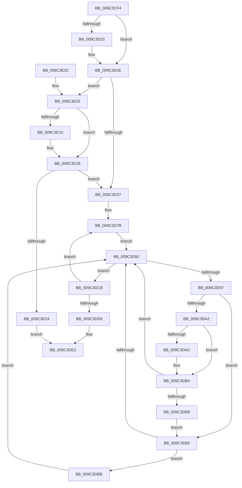

# PiUEventNotifyDeviceInterfaceChange

- RVA: `0x009C3CF4`–`0x009C3E26` (길이 `306` bytes)
- VA: `0x00000001409C3CF4`
- 실행 섹션: `PAGE`
- PDB 이름 있음: `예`; PDB Function 태그: `아니요`
- unwind 정보 RVA: `0x0009F86C`
- 디코드: `85`개 명령, `306/306` bytes 표시
- 미해석 바이트: `0` (있으면 어셈블리에 `.byte`로 보존)

> 이 문서는 커널 이미지의 기계어와 PDB 기호를 분석해 생성했습니다. 4번과 5번은 함수 원형과 자료형을 바이너리 사용 방식에서 추정한 C 해석이며 원본 소스 복구 결과는 아닙니다.

## 1. Dependencies

- 직접 호출 지점: **5**; 고유 호출 대상: **5**
- 직접 호출자로 확인된 함수: **1**
- RIP 상대 이미지 참조: **7**

### Outgoing calls
- `0x009C3D3E` → [ExAcquireFastMutex](../../text/20/ExAcquireFastMutex_function_0020E5A0.md) (function, `0x0020E5A0`)
- `0x009C3D4D` → [PiUEventHashGuidIntoBucket](../../text/49/PiUEventHashGuidIntoBucket_function_00497CEC.md) (function, `0x00497CEC`)
- `0x009C3D89` → [PiUEventApplyAdditionalFilters](../8E/PiUEventApplyAdditionalFilters_function_008E6840.md) (function, `0x008E6840`)
- `0x009C3DC1` → [PiUEventNotifyClient](../8E/PiUEventNotifyClient_function_008E6BEC.md) (function, `0x008E6BEC`)
- `0x009C3DDD` → [ExReleaseFastMutex](../../text/25/ExReleaseFastMutex_function_002519C0.md) (function, `0x002519C0`)

### Direct callers
- [PiUEventProcessEventWorker](PiUEventProcessEventWorker_function_009C2870.md) at `0x009C29A0`

### Static image references
- `0x009C3D17` → RVA `0x00013E30` (`.rdata`; read)
- `0x009C3D27` → RVA `0x00013E38` (`.rdata`; read)
- `0x009C3D37` → RVA `0x00F8C760` (`.data`; read)
- `0x009C3D5E` → RVA `0x00F8C680` (`.data`; read)
- `0x009C3D68` → RVA `0x00F8C750` (`.data`; read)
- `0x009C3E07` → RVA `0x000122D8` (`.rdata`; read)
- `0x009C3E14` → RVA `0x000122E0` (`.rdata`; read)

## 2. Other-region calls and transfers

- 다른 실행 섹션으로 향하는 call: **3**
  - `0x009C3D3E` → [ExAcquireFastMutex](../../text/20/ExAcquireFastMutex_function_0020E5A0.md) (`PAGE` → `.text`)
  - `0x009C3D4D` → [PiUEventHashGuidIntoBucket](../../text/49/PiUEventHashGuidIntoBucket_function_00497CEC.md) (`PAGE` → `.text`)
  - `0x009C3DDD` → [ExReleaseFastMutex](../../text/25/ExReleaseFastMutex_function_002519C0.md) (`PAGE` → `.text`)
- 별도 외부 분기/꼬리 이동을 확인하지 못했습니다.

## 3. Assembly (complete function range)

```asm
009C3CF4  48 89 5C 24 08                  mov qword ptr [rsp + 8], rbx
009C3CF9  48 89 6C 24 10                  mov qword ptr [rsp + 0x10], rbp
009C3CFE  48 89 74 24 18                  mov qword ptr [rsp + 0x18], rsi
009C3D03  57                              push rdi
009C3D04  41 54                           push r12
009C3D06  41 55                           push r13
009C3D08  41 56                           push r14
009C3D0A  41 57                           push r15
009C3D0C  48 83 EC 30                     sub rsp, 0x30
009C3D10  48 8B 41 50                     mov rax, qword ptr [rcx + 0x50]
009C3D14  45 33 E4                        xor r12d, r12d
009C3D17  48 2B 05 12 01 65 FF            sub rax, qword ptr [rip - 0x9afeee]
009C3D1E  48 8B D9                        mov rbx, rcx
009C3D21  75 0B                           jne 0x1409c3d2e
009C3D23  48 8B 41 58                     mov rax, qword ptr [rcx + 0x58]
009C3D27  48 2B 05 0A 01 65 FF            sub rax, qword ptr [rip - 0x9afef6]
009C3D2E  48 85 C0                        test rax, rax
009C3D31  0F 85 CC 00 00 00               jne 0x1409c3e03
009C3D37  48 8D 0D 22 8A 5C 00            lea rcx, [rip + 0x5c8a22]
009C3D3E  E8 5D A8 84 FF                  call 0x14020e5a0
009C3D43  4C 8D AB 80 00 00 00            lea r13, [rbx + 0x80]
009C3D4A  49 8B CD                        mov rcx, r13
009C3D4D  E8 9A 3F AD FF                  call 0x140497cec
009C3D52  44 8B D8                        mov r11d, eax
009C3D55  4C 8D 7C 24 20                  lea r15, [rsp + 0x20]
009C3D5A  49 C1 E3 04                     shl r11, 4
009C3D5E  48 8D 05 1B 89 5C 00            lea rax, [rip + 0x5c891b]
009C3D65  4C 03 D8                        add r11, rax
009C3D68  48 8D 05 E1 89 5C 00            lea rax, [rip + 0x5c89e1]
009C3D6F  48 89 44 24 28                  mov qword ptr [rsp + 0x28], rax
009C3D74  33 F6                           xor esi, esi
009C3D76  4C 89 5C 24 20                  mov qword ptr [rsp + 0x20], r11
009C3D7B  4D 8B 37                        mov r14, qword ptr [r15]
009C3D7E  49 8B 3E                        mov rdi, qword ptr [r14]
009C3D81  EB 0F                           jmp 0x1409c3d92
009C3D83  48 8B D5                        mov rdx, rbp
009C3D86  48 8B CB                        mov rcx, rbx
009C3D89  E8 B2 2A F2 FF                  call 0x1408e6840
009C3D8E  84 C0                           test al, al
009C3D90  75 29                           jne 0x1409c3dbb
009C3D92  49 3B FE                        cmp rdi, r14
009C3D95  74 34                           je 0x1409c3dcb
009C3D97  48 8B EF                        mov rbp, rdi
009C3D9A  48 8B 3F                        mov rdi, qword ptr [rdi]
009C3D9D  83 FE 01                        cmp esi, 1
009C3DA0  73 E1                           jae 0x1409c3d83
009C3DA2  49 8B 4D 00                     mov rcx, qword ptr [r13]
009C3DA6  48 2B 4D 18                     sub rcx, qword ptr [rbp + 0x18]
009C3DAA  75 08                           jne 0x1409c3db4
009C3DAC  49 8B 4D 08                     mov rcx, qword ptr [r13 + 8]
009C3DB0  48 2B 4D 20                     sub rcx, qword ptr [rbp + 0x20]
009C3DB4  48 85 C9                        test rcx, rcx
009C3DB7  75 D9                           jne 0x1409c3d92
009C3DB9  EB C8                           jmp 0x1409c3d83
009C3DBB  48 8B D5                        mov rdx, rbp
009C3DBE  48 8B CB                        mov rcx, rbx
009C3DC1  E8 26 2E F2 FF                  call 0x1408e6bec
009C3DC6  44 8B E0                        mov r12d, eax
009C3DC9  EB C7                           jmp 0x1409c3d92
009C3DCB  FF C6                           inc esi
009C3DCD  49 83 C7 08                     add r15, 8
009C3DD1  83 FE 02                        cmp esi, 2
009C3DD4  72 A5                           jb 0x1409c3d7b
009C3DD6  48 8D 0D 83 89 5C 00            lea rcx, [rip + 0x5c8983]
009C3DDD  E8 DE DB 88 FF                  call 0x1402519c0
009C3DE2  48 8B 5C 24 60                  mov rbx, qword ptr [rsp + 0x60]
009C3DE7  41 8B C4                        mov eax, r12d
009C3DEA  48 8B 6C 24 68                  mov rbp, qword ptr [rsp + 0x68]
009C3DEF  48 8B 74 24 70                  mov rsi, qword ptr [rsp + 0x70]
009C3DF4  48 83 C4 30                     add rsp, 0x30
009C3DF8  41 5F                           pop r15
009C3DFA  41 5E                           pop r14
009C3DFC  41 5D                           pop r13
009C3DFE  41 5C                           pop r12
009C3E00  5F                              pop rdi
009C3E01  C3                              ret
009C3E02  CC                              int3
009C3E03  48 8B 41 50                     mov rax, qword ptr [rcx + 0x50]
009C3E07  48 2B 05 CA E4 64 FF            sub rax, qword ptr [rip - 0x9b1b36]
009C3E0E  75 0B                           jne 0x1409c3e1b
009C3E10  48 8B 41 58                     mov rax, qword ptr [rcx + 0x58]
009C3E14  48 2B 05 C5 E4 64 FF            sub rax, qword ptr [rip - 0x9b1b3b]
009C3E1B  48 85 C0                        test rax, rax
009C3E1E  0F 84 13 FF FF FF               je 0x1409c3d37
009C3E24  EB BC                           jmp 0x1409c3de2
```

## 4. C-style interpretation (structured pseudocode)

```c
__int64 __fastcall PiUEventNotifyDeviceInterfaceChange(__int64 a1)
{
    __int64 result;
    __int64 v_r11;
    __int64 v_r12;
    __int64 v_r15;
    __int64 v_rsi;
    __int64 v_rsp;
    unsigned __int64 v_stack_m30;
    unsigned __int64 v_stack_m38;
    unsigned __int64 v_stack_p10;
    unsigned __int64 v_stack_p18;
    unsigned __int64 v_stack_p8;

    v_stack_p8 = v_rbx;
    v_stack_p10 = v_rbp;
    v_stack_p18 = v_rsi;
    v_rsp = (v_rsp) - (48);
    v_r12 = 0;
    result = (*(unsigned __int64 *)(a1 + 80)) - (*(unsigned __int64 *)(v_rip - 10157806));
    if (!(condition_is_not_equal)) {
        result = *(unsigned __int64 *)(a1 + 88);
        result = (result) - (*(unsigned __int64 *)(v_rip - 10157814));
    }
    if (result != 0) goto loc_009C3E03;
loc_009C3D37:
    result = ExAcquireFastMutex(v_rip + 6064674, a2, a3, a4);
    result = PiUEventHashGuidIntoBucket(a1 + 128, a2, a3, a4);
    v_r11 = ((unsigned int)((unsigned int)(result))) << (4);
    v_r11 = (v_r11) + (v_rip + 6064411);
    v_stack_m30 = v_rip + 6064609;
    v_rsi = 0;
    v_stack_m38 = v_r11;
loc_009C3D7B:
    goto loc_009C3D92;
loc_009C3D83:
    result = PiUEventApplyAdditionalFilters(a1, v_rbp, a3, a4);
    if ((unsigned __int8)(result) != 0) goto loc_009C3DBB;
loc_009C3D92:
    if ((*(unsigned __int64 *)(*(unsigned __int64 *)(v_stack_m38))) == (*(unsigned __int64 *)(v_stack_m38))) goto loc_009C3DCB;
    if (0 >= 1) goto loc_009C3D83;
    a1 = (*(unsigned __int64 *)(a1 + 128)) - (*(unsigned __int64 *)(*(unsigned __int64 *)(*(unsigned __int64 *)(v_stack_m38)) + 24));
    if (!(condition_is_not_equal)) {
        a1 = *(unsigned __int64 *)(a1 + 128 + 8);
        a1 = (a1) - (*(unsigned __int64 *)(*(unsigned __int64 *)(*(unsigned __int64 *)(v_stack_m38)) + 32));
    }
    if (a1 != 0) goto loc_009C3D92;
    goto loc_009C3D83;
loc_009C3DBB:
    result = PiUEventNotifyClient(a1, *(unsigned __int64 *)(*(unsigned __int64 *)(v_stack_m38)), a3, a4);
    goto loc_009C3D92;
loc_009C3DCB:
    v_rsi = (unsigned int)((v_rsi) + 1);
    v_r15 = (v_stack_m38) + (8);
    if (((unsigned int)(v_rsi)) < 2) goto loc_009C3D7B;
    result = ExReleaseFastMutex(v_rip + 6064515, *(unsigned __int64 *)(*(unsigned __int64 *)(v_stack_m38)), a3, a4);
loc_009C3DE2:
    v_rsp = (v_rsp) + (48);
    return (unsigned int)((unsigned int)((unsigned int)((unsigned int)(result))));
loc_009C3E03:
    result = (*(unsigned __int64 *)(v_rip + 6064515 + 80)) - (*(unsigned __int64 *)(v_rip - 10165046));
    if (!(condition_is_not_equal)) {
        result = *(unsigned __int64 *)(v_rip + 6064515 + 88);
        result = (result) - (*(unsigned __int64 *)(v_rip - 10165051));
    }
    if (result == 0) goto loc_009C3D37;
    goto loc_009C3DE2;
}
```

## 5. (Beta) C Style

```c
int64_t PiUEventNotifyDeviceInterfaceChange(void *Arg1)
{
    uint8_t *arg1 = (uint8_t *)Arg1;

    int64_t result;
    int64_t local_r11;
    int64_t local_r12;
    int64_t local_r15;
    int64_t local_rsi;
    int64_t local_rsp;
    uint64_t v_stack_m30;
    uint64_t v_stack_m38;
    uint64_t v_stack_p10;
    uint64_t v_stack_p18;
    uint64_t v_stack_p8;

    v_stack_p8 = local_rbx;
    v_stack_p10 = local_rbp;
    v_stack_p18 = local_rsi;
    local_rsp = (local_rsp) - (48);
    local_r12 = 0;
    result = (*(uint64_t *)(arg1 + 0x50)) - (*(uint64_t *)(v_rip - 0x9AFEEE));
    if (!(condition_is_not_equal)) {
        result = *(uint64_t *)(arg1 + 0x58);
        result = (result) - (*(uint64_t *)(v_rip - 0x9AFEF6));
    }
    if (result != 0) goto loc_009C3E03;
loc_009C3D37:
    result = ExAcquireFastMutex(v_rip + 6064674, a2, a3, a4);
    result = PiUEventHashGuidIntoBucket(Arg1 + 128, a2, a3, a4);
    local_r11 = ((uint32_t)((uint32_t)(result))) << (4);
    local_r11 = (local_r11) + (v_rip + 6064411);
    v_stack_m30 = v_rip + 6064609;
    local_rsi = 0;
    v_stack_m38 = local_r11;
loc_009C3D7B:
    goto loc_009C3D92;
loc_009C3D83:
    result = PiUEventApplyAdditionalFilters(Arg1, local_rbp, a3, a4);
    if ((uint8_t)(result) != 0) goto loc_009C3DBB;
loc_009C3D92:
    if ((*(uint64_t *)(*(uint64_t *)(v_stack_m38))) == (*(uint64_t *)(v_stack_m38))) goto loc_009C3DCB;
    if (0 >= 1) goto loc_009C3D83;
    Arg1 = (*(uint64_t *)(arg1 + 0x80)) - (*(uint64_t *)(*(uint64_t *)(*(uint64_t *)(v_stack_m38)) + 0x18));
    if (!(condition_is_not_equal)) {
        Arg1 = *(uint64_t *)(arg1 + 0x80 + 0x8);
        Arg1 = (Arg1) - (*(uint64_t *)(*(uint64_t *)(*(uint64_t *)(v_stack_m38)) + 0x20));
    }
    if (Arg1 != NULL) goto loc_009C3D92;
    goto loc_009C3D83;
loc_009C3DBB:
    result = PiUEventNotifyClient(Arg1, *(uint64_t *)(*(uint64_t *)(v_stack_m38)), a3, a4);
    goto loc_009C3D92;
loc_009C3DCB:
    local_rsi = (uint32_t)((local_rsi) + 1);
    local_r15 = (v_stack_m38) + (8);
    if (((uint32_t)(local_rsi)) < 2) goto loc_009C3D7B;
    result = ExReleaseFastMutex(v_rip + 6064515, *(uint64_t *)(*(uint64_t *)(v_stack_m38)), a3, a4);
loc_009C3DE2:
    local_rsp = (local_rsp) + (48);
    return (uint32_t)((uint32_t)((uint32_t)((uint32_t)(result))));
loc_009C3E03:
    result = (*(uint64_t *)(v_rip + 0x5C8983 + 0x50)) - (*(uint64_t *)(v_rip - 0x9B1B36));
    if (!(condition_is_not_equal)) {
        result = *(uint64_t *)(v_rip + 0x5C8983 + 0x58);
        result = (result) - (*(uint64_t *)(v_rip - 0x9B1B3B));
    }
    if (result == 0) goto loc_009C3D37;
    goto loc_009C3DE2;
}
```

### 관측된 메모리 오프셋

구조체 형식이 확인되지 않은 접근은 인자 기준의 오프셋으로만 기록했습니다.

| 기준 인자 | 오프셋 표현 | 폭 (bit) | 접근 |
|---|---:|---:|---|
| `Arg1` | `+ 0x0` | `64` | `R` |
| `Arg1` | `+ 0x8` | `64` | `R` |
| `Arg1` | `+ 0x50` | `64` | `R` |
| `Arg1` | `+ 0x58` | `64` | `R` |
| `Arg1` | `+ 0x80` | `64` | `R` |

## 6. Execution-region graph

[열기: 2D/3D 그래프와 함수 탐색 컨트롤 패널](../../../control-panel.html?section=page&rva=0x009C3CF4&view=graph)

- 2D 그래프는 위에서 아래로 흐르고, 3D 그래프는 빈 공간을 드래그해 회전합니다. Shift+드래그는 이동, 휠은 확대·축소, 함수 노드 선택은 대상 보고서 이동입니다.

### Static fallback


