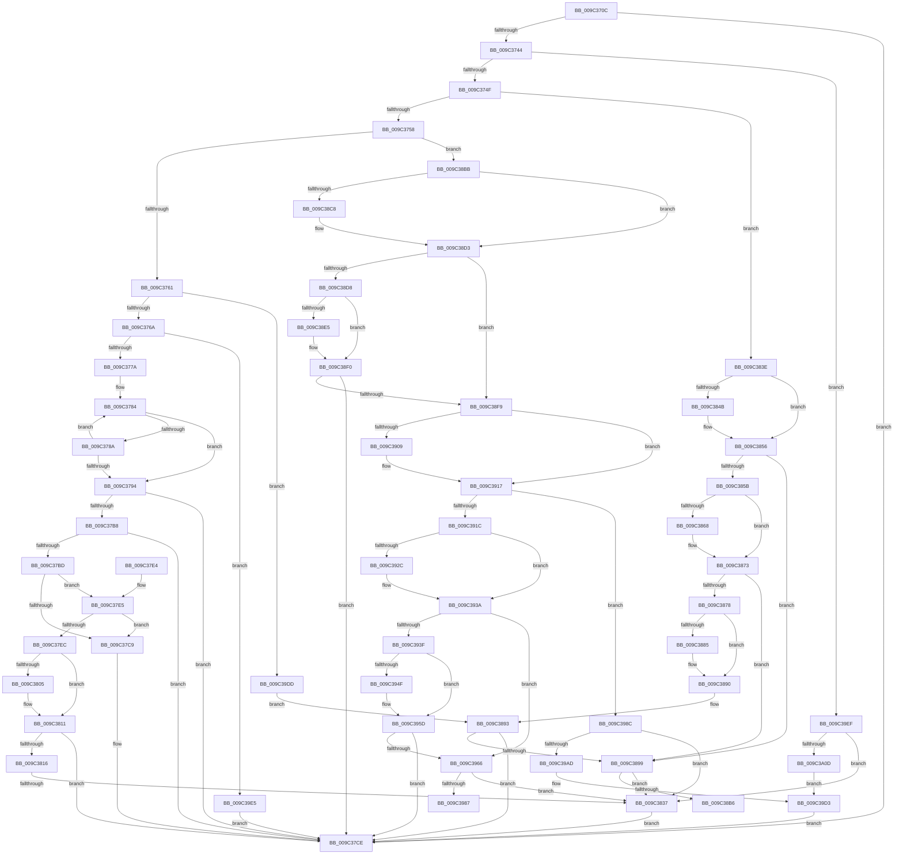

# PiUEventProcessBroadcastNotifications

- RVA: `0x009C370C`–`0x009C3A26` (길이 `794` bytes)
- VA: `0x00000001409C370C`
- 실행 섹션: `PAGE`
- PDB 이름 있음: `예`; PDB Function 태그: `예`
- unwind 정보 RVA: `0x0009F810`
- 디코드: `192`개 명령, `794/794` bytes 표시
- 미해석 바이트: `0` (있으면 어셈블리에 `.byte`로 보존)

> 이 문서는 커널 이미지의 기계어와 PDB 기호를 분석해 생성했습니다. 4번과 5번은 함수 원형과 자료형을 바이너리 사용 방식에서 추정한 C 해석이며 원본 소스 복구 결과는 아닙니다.

## 1. Dependencies

- 직접 호출 지점: **8**; 고유 호출 대상: **4**
- 직접 호출자로 확인된 함수: **1**
- RIP 상대 이미지 참조: **19**

### Outgoing calls
- `0x009C3826` → [ExAllocatePool2](../../poolcode/B8/ExAllocatePool2_function_00B820F0.md) (function, `0x00B820F0`)
- `0x009C38A9` → [ExAllocatePool2](../../poolcode/B8/ExAllocatePool2_function_00B820F0.md) (function, `0x00B820F0`)
- `0x009C3976` → [ExAllocatePool2](../../poolcode/B8/ExAllocatePool2_function_00B820F0.md) (function, `0x00B820F0`)
- `0x009C399C` → [ExAllocatePool2](../../poolcode/B8/ExAllocatePool2_function_00B820F0.md) (function, `0x00B820F0`)
- `0x009C39B8` → [RtlInitUnicodeString](../../text/42/RtlInitUnicodeString_function_0042A780.md) (function, `0x0042A780`)
- `0x009C39C8` → [IopGetSessionIdFromSymbolicName](../70/IopGetSessionIdFromSymbolicName_function_00702084.md) (function, `0x00702084`)
- `0x009C39D3` → [PiUEventQueueBroadcastEventEntry](PiUEventQueueBroadcastEventEntry_function_009C3F44.md) (function, `0x009C3F44`)
- `0x009C39FF` → [ExAllocatePool2](../../poolcode/B8/ExAllocatePool2_function_00B820F0.md) (function, `0x00B820F0`)

### Direct callers
- [PiUEventProcessEventWorker](PiUEventProcessEventWorker_function_009C2870.md) at `0x009C28F5`

### Static image references
- `0x009C3725` → RVA `0x00E66350` (`.data`; read)
- `0x009C37FC` → RVA `0x00013E20` (`.rdata`; read)
- `0x009C380A` → RVA `0x00013E28` (`.rdata`; read)
- `0x009C3842` → RVA `0x00014D58` (`.rdata`; read)
- `0x009C384F` → RVA `0x00014D60` (`.rdata`; read)
- `0x009C385F` → RVA `0x000114E8` (`.rdata`; read)
- `0x009C386C` → RVA `0x000114F0` (`.rdata`; read)
- `0x009C387C` → RVA `0x0001A220` (`.rdata`; read)
- `0x009C3889` → RVA `0x0001A228` (`.rdata`; read)
- `0x009C38BF` → RVA `0x00013E30` (`.rdata`; read)
- `0x009C38CC` → RVA `0x00013E38` (`.rdata`; read)
- `0x009C38DC` → RVA `0x000122D8` (`.rdata`; read)
- `0x009C38E9` → RVA `0x000122E0` (`.rdata`; read)
- `0x009C3900` → RVA `0x00011190` (`.rdata`; read)
- `0x009C3910` → RVA `0x00011198` (`.rdata`; read)
- `0x009C3923` → RVA `0x00013E40` (`.rdata`; read)
- `0x009C3933` → RVA `0x00013E48` (`.rdata`; read)
- `0x009C3946` → RVA `0x00013E50` (`.rdata`; read)
- `0x009C3956` → RVA `0x00013E58` (`.rdata`; read)

## 2. Other-region calls and transfers

- 다른 실행 섹션으로 향하는 call: **6**
  - `0x009C3826` → [ExAllocatePool2](../../poolcode/B8/ExAllocatePool2_function_00B820F0.md) (`PAGE` → `POOLCODE`)
  - `0x009C38A9` → [ExAllocatePool2](../../poolcode/B8/ExAllocatePool2_function_00B820F0.md) (`PAGE` → `POOLCODE`)
  - `0x009C3976` → [ExAllocatePool2](../../poolcode/B8/ExAllocatePool2_function_00B820F0.md) (`PAGE` → `POOLCODE`)
  - `0x009C399C` → [ExAllocatePool2](../../poolcode/B8/ExAllocatePool2_function_00B820F0.md) (`PAGE` → `POOLCODE`)
  - `0x009C39B8` → [RtlInitUnicodeString](../../text/42/RtlInitUnicodeString_function_0042A780.md) (`PAGE` → `.text`)
  - `0x009C39FF` → [ExAllocatePool2](../../poolcode/B8/ExAllocatePool2_function_00B820F0.md) (`PAGE` → `POOLCODE`)
- call이 아닌 외부 분기/꼬리 이동: **3**
  - `0x009C3831` → [sub_00B2F242 + 0x78](../B2/Unknown_function_00B2F242.md) (`tail-transfer`)
  - `0x009C38B6` → [sub_00B2F242](../B2/Unknown_function_00B2F242.md) (`tail-transfer`)
  - `0x009C3987` → [sub_00B2F242 + 0xE9](../B2/Unknown_function_00B2F242.md) (`tail-transfer`)

## 3. Assembly (complete function range)

```asm
009C370C  48 89 5C 24 08                  mov qword ptr [rsp + 8], rbx
009C3711  55                              push rbp
009C3712  56                              push rsi
009C3713  57                              push rdi
009C3714  41 56                           push r14
009C3716  41 57                           push r15
009C3718  48 8B EC                        mov rbp, rsp
009C371B  48 83 EC 70                     sub rsp, 0x70
009C371F  45 33 FF                        xor r15d, r15d
009C3722  0F 57 C0                        xorps xmm0, xmm0
009C3725  44 38 3D 24 2C 4A 00            cmp byte ptr [rip + 0x4a2c24], r15b
009C372C  48 8B F9                        mov rdi, rcx
009C372F  41 8B DF                        mov ebx, r15d
009C3732  44 89 7D 40                     mov dword ptr [rbp + 0x40], r15d
009C3736  0F 11 45 F0                     movups xmmword ptr [rbp - 0x10], xmm0
009C373A  44 89 7D 38                     mov dword ptr [rbp + 0x38], r15d
009C373E  0F 84 8A 00 00 00               je 0x1409c37ce
009C3744  8B 49 60                        mov ecx, dword ptr [rcx + 0x60]
009C3747  85 C9                           test ecx, ecx
009C3749  0F 84 A0 02 00 00               je 0x1409c39ef
009C374F  83 E9 01                        sub ecx, 1
009C3752  0F 84 E6 00 00 00               je 0x1409c383e
009C3758  83 E9 01                        sub ecx, 1
009C375B  0F 84 5A 01 00 00               je 0x1409c38bb
009C3761  83 E9 01                        sub ecx, 1
009C3764  0F 85 73 02 00 00               jne 0x1409c39dd
009C376A  48 8D B7 88 00 00 00            lea rsi, [rdi + 0x88]
009C3771  48 85 F6                        test rsi, rsi
009C3774  0F 84 6B 02 00 00               je 0x1409c39e5
009C377A  BA C8 00 00 00                  mov edx, 0xc8
009C377F  48 8B C6                        mov rax, rsi
009C3782  8B CA                           mov ecx, edx
009C3784  66 44 39 38                     cmp word ptr [rax], r15w
009C3788  74 0A                           je 0x1409c3794
009C378A  48 83 C0 02                     add rax, 2
009C378E  48 83 E9 01                     sub rcx, 1
009C3792  75 F0                           jne 0x1409c3784
009C3794  48 8B C1                        mov rax, rcx
009C3797  48 F7 D8                        neg rax
009C379A  48 8B C1                        mov rax, rcx
009C379D  1B DB                           sbb ebx, ebx
009C379F  48 2B D1                        sub rdx, rcx
009C37A2  F7 D3                           not ebx
009C37A4  81 E3 0D 00 00 C0               and ebx, 0xc000000d
009C37AA  48 F7 D8                        neg rax
009C37AD  48 1B C0                        sbb rax, rax
009C37B0  48 23 C2                        and rax, rdx
009C37B3  48 85 C9                        test rcx, rcx
009C37B6  74 16                           je 0x1409c37ce
009C37B8  48 85 C0                        test rax, rax
009C37BB  74 11                           je 0x1409c37ce
009C37BD  8D 04 45 52 00 00 00            lea eax, [rax*2 + 0x52]
009C37C4  83 F8 50                        cmp eax, 0x50
009C37C7  73 1C                           jae 0x1409c37e5
009C37C9  BB 95 00 00 C0                  mov ebx, 0xc0000095
009C37CE  8B C3                           mov eax, ebx
009C37D0  48 8B 9C 24 A0 00 00 00         mov rbx, qword ptr [rsp + 0xa0]
009C37D8  48 83 C4 70                     add rsp, 0x70
009C37DC  41 5F                           pop r15
009C37DE  41 5E                           pop r14
009C37E0  5F                              pop rdi
009C37E1  5E                              pop rsi
009C37E2  5D                              pop rbp
009C37E3  C3                              ret
009C37E4  CC                              int3
009C37E5  8D 48 07                        lea ecx, [rax + 7]
009C37E8  3B C8                           cmp ecx, eax
009C37EA  72 DD                           jb 0x1409c37c9
009C37EC  B8 F8 FF FF FF                  mov eax, 0xfffffff8
009C37F1  41 8B DF                        mov ebx, r15d
009C37F4  48 23 C8                        and rcx, rax
009C37F7  48 8B 44 39 54                  mov rax, qword ptr [rcx + rdi + 0x54]
009C37FC  48 2B 05 1D 06 65 FF            sub rax, qword ptr [rip - 0x9af9e3]
009C3803  75 0C                           jne 0x1409c3811
009C3805  48 8B 44 39 5C                  mov rax, qword ptr [rcx + rdi + 0x5c]
009C380A  48 2B 05 17 06 65 FF            sub rax, qword ptr [rip - 0x9af9e9]
009C3811  48 85 C0                        test rax, rax
009C3814  75 B8                           jne 0x1409c37ce
009C3816  BA C0 01 00 00                  mov edx, 0x1c0
009C381B  B9 00 01 00 00                  mov ecx, 0x100
009C3820  41 B8 50 6E 70 59               mov r8d, 0x59706e50
009C3826  E8 C5 E8 1B 00                  call 0x140b820f0
009C382B  48 8B F8                        mov rdi, rax
009C382E  48 85 C0                        test rax, rax
009C3831  0F 85 83 BA 16 00               jne 0x140b2f2ba
009C3837  BB 9A 00 00 C0                  mov ebx, 0xc000009a
009C383C  EB 90                           jmp 0x1409c37ce
009C383E  48 8B 47 50                     mov rax, qword ptr [rdi + 0x50]
009C3842  48 2B 05 0F 15 65 FF            sub rax, qword ptr [rip - 0x9aeaf1]
009C3849  75 0B                           jne 0x1409c3856
009C384B  48 8B 47 58                     mov rax, qword ptr [rdi + 0x58]
009C384F  48 2B 05 0A 15 65 FF            sub rax, qword ptr [rip - 0x9aeaf6]
009C3856  48 85 C0                        test rax, rax
009C3859  74 3E                           je 0x1409c3899
009C385B  48 8B 47 50                     mov rax, qword ptr [rdi + 0x50]
009C385F  48 2B 05 82 DC 64 FF            sub rax, qword ptr [rip - 0x9b237e]
009C3866  75 0B                           jne 0x1409c3873
009C3868  48 8B 47 58                     mov rax, qword ptr [rdi + 0x58]
009C386C  48 2B 05 7D DC 64 FF            sub rax, qword ptr [rip - 0x9b2383]
009C3873  48 85 C0                        test rax, rax
009C3876  74 21                           je 0x1409c3899
009C3878  48 8B 47 50                     mov rax, qword ptr [rdi + 0x50]
009C387C  48 2B 05 9D 69 65 FF            sub rax, qword ptr [rip - 0x9a9663]
009C3883  75 0B                           jne 0x1409c3890
009C3885  48 8B 47 58                     mov rax, qword ptr [rdi + 0x58]
009C3889  48 2B 05 98 69 65 FF            sub rax, qword ptr [rip - 0x9a9668]
009C3890  48 85 C0                        test rax, rax
009C3893  0F 85 35 FF FF FF               jne 0x1409c37ce
009C3899  BA C0 01 00 00                  mov edx, 0x1c0
009C389E  B9 00 01 00 00                  mov ecx, 0x100
009C38A3  41 B8 50 6E 70 59               mov r8d, 0x59706e50
009C38A9  E8 42 E8 1B 00                  call 0x140b820f0
009C38AE  48 8B F0                        mov rsi, rax
009C38B1  48 85 C0                        test rax, rax
009C38B4  74 81                           je 0x1409c3837
009C38B6  E9 87 B9 16 00                  jmp 0x140b2f242
009C38BB  48 8B 47 50                     mov rax, qword ptr [rdi + 0x50]
009C38BF  48 2B 05 6A 05 65 FF            sub rax, qword ptr [rip - 0x9afa96]
009C38C6  75 0B                           jne 0x1409c38d3
009C38C8  48 8B 47 58                     mov rax, qword ptr [rdi + 0x58]
009C38CC  48 2B 05 65 05 65 FF            sub rax, qword ptr [rip - 0x9afa9b]
009C38D3  48 85 C0                        test rax, rax
009C38D6  74 21                           je 0x1409c38f9
009C38D8  48 8B 47 50                     mov rax, qword ptr [rdi + 0x50]
009C38DC  48 2B 05 F5 E9 64 FF            sub rax, qword ptr [rip - 0x9b160b]
009C38E3  75 0B                           jne 0x1409c38f0
009C38E5  48 8B 47 58                     mov rax, qword ptr [rdi + 0x58]
009C38E9  48 2B 05 F0 E9 64 FF            sub rax, qword ptr [rip - 0x9b1610]
009C38F0  48 85 C0                        test rax, rax
009C38F3  0F 85 D5 FE FF FF               jne 0x1409c37ce
009C38F9  48 8B 87 80 00 00 00            mov rax, qword ptr [rdi + 0x80]
009C3900  48 2B 05 89 D8 64 FF            sub rax, qword ptr [rip - 0x9b2777]
009C3907  75 0E                           jne 0x1409c3917
009C3909  48 8B 87 88 00 00 00            mov rax, qword ptr [rdi + 0x88]
009C3910  48 2B 05 81 D8 64 FF            sub rax, qword ptr [rip - 0x9b277f]
009C3917  48 85 C0                        test rax, rax
009C391A  74 70                           je 0x1409c398c
009C391C  48 8B 87 80 00 00 00            mov rax, qword ptr [rdi + 0x80]
009C3923  48 2B 05 16 05 65 FF            sub rax, qword ptr [rip - 0x9afaea]
009C392A  75 0E                           jne 0x1409c393a
009C392C  48 8B 87 88 00 00 00            mov rax, qword ptr [rdi + 0x88]
009C3933  48 2B 05 0E 05 65 FF            sub rax, qword ptr [rip - 0x9afaf2]
009C393A  48 85 C0                        test rax, rax
009C393D  74 27                           je 0x1409c3966
009C393F  48 8B 87 80 00 00 00            mov rax, qword ptr [rdi + 0x80]
009C3946  48 2B 05 03 05 65 FF            sub rax, qword ptr [rip - 0x9afafd]
009C394D  75 0E                           jne 0x1409c395d
009C394F  48 8B 87 88 00 00 00            mov rax, qword ptr [rdi + 0x88]
009C3956  48 2B 05 FB 04 65 FF            sub rax, qword ptr [rip - 0x9afb05]
009C395D  48 85 C0                        test rax, rax
009C3960  0F 85 68 FE FF FF               jne 0x1409c37ce
009C3966  BA C0 01 00 00                  mov edx, 0x1c0
009C396B  B9 00 01 00 00                  mov ecx, 0x100
009C3970  41 B8 50 6E 70 59               mov r8d, 0x59706e50
009C3976  E8 75 E7 1B 00                  call 0x140b820f0
009C397B  48 8B F0                        mov rsi, rax
009C397E  48 85 C0                        test rax, rax
009C3981  0F 84 B0 FE FF FF               je 0x1409c3837
009C3987  E9 9F B9 16 00                  jmp 0x140b2f32b
009C398C  BA C0 01 00 00                  mov edx, 0x1c0
009C3991  B9 00 01 00 00                  mov ecx, 0x100
009C3996  41 B8 50 6E 70 59               mov r8d, 0x59706e50
009C399C  E8 4F E7 1B 00                  call 0x140b820f0
009C39A1  48 8B F0                        mov rsi, rax
009C39A4  48 85 C0                        test rax, rax
009C39A7  0F 84 8A FE FF FF               je 0x1409c3837
009C39AD  48 8D 97 90 00 00 00            lea rdx, [rdi + 0x90]
009C39B4  48 8D 4D F0                     lea rcx, [rbp - 0x10]
009C39B8  E8 C3 6D A6 FF                  call 0x14042a780
009C39BD  48 8D 4D F0                     lea rcx, [rbp - 0x10]
009C39C1  C7 46 14 01 00 00 00            mov dword ptr [rsi + 0x14], 1
009C39C8  E8 B7 E6 D3 FF                  call 0x140702084
009C39CD  89 46 18                        mov dword ptr [rsi + 0x18], eax
009C39D0  48 8B CE                        mov rcx, rsi
009C39D3  E8 6C 05 00 00                  call 0x1409c3f44
009C39D8  E9 F1 FD FF FF                  jmp 0x1409c37ce
009C39DD  83 F9 01                        cmp ecx, 1
009C39E0  E9 AE FE FF FF                  jmp 0x1409c3893
009C39E5  BB 0D 00 00 C0                  mov ebx, 0xc000000d
009C39EA  E9 DF FD FF FF                  jmp 0x1409c37ce
009C39EF  BA C0 01 00 00                  mov edx, 0x1c0
009C39F4  B9 00 01 00 00                  mov ecx, 0x100
009C39F9  41 B8 50 6E 70 59               mov r8d, 0x59706e50
009C39FF  E8 EC E6 1B 00                  call 0x140b820f0
009C3A04  48 85 C0                        test rax, rax
009C3A07  0F 84 2A FE FF FF               je 0x1409c3837
009C3A0D  83 48 18 FF                     or dword ptr [rax + 0x18], 0xffffffff
009C3A11  48 8B C8                        mov rcx, rax
009C3A14  C7 40 14 02 00 00 00            mov dword ptr [rax + 0x14], 2
009C3A1B  0F 10 47 50                     movups xmm0, xmmword ptr [rdi + 0x50]
009C3A1F  F3 0F 7F 40 1C                  movdqu xmmword ptr [rax + 0x1c], xmm0
009C3A24  EB AD                           jmp 0x1409c39d3
```

## 4. C-style interpretation (structured pseudocode)

```c
__int64 __fastcall PiUEventProcessBroadcastNotifications(__int64 a1)
{
    __int64 result;
    __int64 v_r15;
    __int64 v_rbx;
    __int64 v_rsp;
    unsigned __int64 v_stack_m38;
    unsigned int v_stack_p10;
    unsigned int v_stack_p18;
    unsigned __int64 v_stack_p8;

    v_stack_p8 = v_rbx;
    v_rsp = (v_rsp) - (112);
    v_r15 = 0;
    v_stack_p18 = 0;
    v_stack_m38 = v_xmm0;
    v_stack_p10 = 0;
    if ((*(unsigned __int8 *)(v_rip + 4860964)) == 0) goto loc_009C37CE;
    if ((unsigned int)((unsigned int)(*(unsigned int *)(a1 + 96))) == 0) goto loc_009C39EF;
    a1 = (unsigned int)(((unsigned int)(*(unsigned int *)(a1 + 96))) - (1));
    if (condition_is_equal) goto loc_009C383E;
    a1 = (unsigned int)((a1) - (1));
    if (condition_is_equal) goto loc_009C38BB;
    a1 = (unsigned int)((a1) - (1));
    if (condition_is_not_equal) goto loc_009C39DD;
    if (a1 + 136 == 0) goto loc_009C39E5;
loc_009C3784:
    if ((*(unsigned __int16 *)(a1 + 136)) == 0) goto loc_009C3794;
    result = (a1 + 136) + (2);
    a1 = (200) - (1);
    if (condition_is_not_equal) goto loc_009C3784;
loc_009C3794:
    result = -(a1);
    a2 = (200) - (a1);
    v_rbx = (unsigned int)(~(0));
    v_rbx = (unsigned int)((v_rbx) & (0xC000000DULL));
    result = -(a1);
    result = (result) & (a2);
    if (a1 == 0) goto loc_009C37CE;
    if (result == 0) goto loc_009C37CE;
    if (((unsigned int)(result * 2 + 82)) >= 80) goto loc_009C37E5;
loc_009C37C9:
loc_009C37CE:
    v_rsp = (v_rsp) + (112);
    return (unsigned int)((unsigned int)((unsigned int)(0xC0000095ULL)));
loc_009C37E5:
    if (((unsigned int)((unsigned int)((unsigned int)((unsigned int)(0xC0000095ULL))) + 7)) < ((unsigned int)((unsigned int)((unsigned int)((unsigned int)(0xC0000095ULL)))))) goto loc_009C37C9;
    a1 = ((unsigned int)((unsigned int)((unsigned int)(0xC0000095ULL))) + 7) & ((unsigned int)(0xFFFFFFF8ULL));
    result = (*(unsigned __int64 *)(a1 + a1 * 1 + 84)) - (*(unsigned __int64 *)(v_rip - 10156515));
    if (!(condition_is_not_equal)) {
        result = *(unsigned __int64 *)(a1 + a1 * 1 + 92);
        result = (result) - (*(unsigned __int64 *)(v_rip - 10156521));
    }
    if (result != 0) goto loc_009C37CE;
    result = ExAllocatePool2(256, 448, (unsigned int)(0x59706E50ULL), a4);
loc_009C3837:
    goto loc_009C37CE;
loc_009C383E:
    result = (*(unsigned __int64 *)(result + 80)) - (*(unsigned __int64 *)(v_rip - 10152689));
    if (!(condition_is_not_equal)) {
        result = *(unsigned __int64 *)(result + 88);
        result = (result) - (*(unsigned __int64 *)(v_rip - 10152694));
    }
    if (result == 0) goto loc_009C3899;
    result = (*(unsigned __int64 *)(result + 80)) - (*(unsigned __int64 *)(v_rip - 10167166));
    if (!(condition_is_not_equal)) {
        result = *(unsigned __int64 *)(result + 88);
        result = (result) - (*(unsigned __int64 *)(v_rip - 10167171));
    }
    if (result == 0) goto loc_009C3899;
    result = (*(unsigned __int64 *)(result + 80)) - (*(unsigned __int64 *)(v_rip - 10131043));
    if (!(condition_is_not_equal)) {
        result = *(unsigned __int64 *)(result + 88);
        result = (result) - (*(unsigned __int64 *)(v_rip - 10131048));
    }
loc_009C3893:
    if (result != 0) goto loc_009C37CE;
loc_009C3899:
    result = ExAllocatePool2(256, 448, (unsigned int)(0x59706E50ULL), a4);
    if (result == 0) goto loc_009C3837;
loc_009C38BB:
    result = (*(unsigned __int64 *)(result + 80)) - (*(unsigned __int64 *)(v_rip - 10156694));
    if (!(condition_is_not_equal)) {
        result = *(unsigned __int64 *)(result + 88);
        result = (result) - (*(unsigned __int64 *)(v_rip - 10156699));
    }
    if (result == 0) goto loc_009C38F9;
    result = (*(unsigned __int64 *)(result + 80)) - (*(unsigned __int64 *)(v_rip - 10163723));
    if (!(condition_is_not_equal)) {
        result = *(unsigned __int64 *)(result + 88);
        result = (result) - (*(unsigned __int64 *)(v_rip - 10163728));
    }
    if (result != 0) goto loc_009C37CE;
loc_009C38F9:
    result = (*(unsigned __int64 *)(result + 128)) - (*(unsigned __int64 *)(v_rip - 10168183));
    if (!(condition_is_not_equal)) {
        result = *(unsigned __int64 *)(result + 136);
        result = (result) - (*(unsigned __int64 *)(v_rip - 10168191));
    }
    if (result == 0) goto loc_009C398C;
    result = (*(unsigned __int64 *)(result + 128)) - (*(unsigned __int64 *)(v_rip - 10156778));
    if (!(condition_is_not_equal)) {
        result = *(unsigned __int64 *)(result + 136);
        result = (result) - (*(unsigned __int64 *)(v_rip - 10156786));
    }
    if (result == 0) goto loc_009C3966;
    result = (*(unsigned __int64 *)(result + 128)) - (*(unsigned __int64 *)(v_rip - 10156797));
    if (!(condition_is_not_equal)) {
        result = *(unsigned __int64 *)(result + 136);
        result = (result) - (*(unsigned __int64 *)(v_rip - 10156805));
    }
    if (result != 0) goto loc_009C37CE;
loc_009C3966:
    result = ExAllocatePool2(256, 448, (unsigned int)(0x59706E50ULL), a4);
    if (result == 0) goto loc_009C3837;
loc_009C398C:
    result = ExAllocatePool2(256, 448, (unsigned int)(0x59706E50ULL), a4);
    if (result == 0) goto loc_009C3837;
    result = RtlInitUnicodeString(v_stack_m38, result + 144, (unsigned int)(0x59706E50ULL), a4);
    *(unsigned int *)(result + 20) = 1;
    result = IopGetSessionIdFromSymbolicName(v_stack_m38, result + 144, (unsigned int)(0x59706E50ULL), a4);
    *(unsigned int *)(result + 24) = (unsigned int)(result);
loc_009C39D3:
    result = PiUEventQueueBroadcastEventEntry(result, result + 144, (unsigned int)(0x59706E50ULL), a4);
    goto loc_009C37CE;
loc_009C39DD:
    goto loc_009C3893;
loc_009C39E5:
    goto loc_009C37CE;
loc_009C39EF:
    result = ExAllocatePool2(256, 448, (unsigned int)(0x59706E50ULL), a4);
    if (result == 0) goto loc_009C3837;
    *(unsigned int *)(result + 20) = 2;
    *(unsigned __int64 *)(result + 28) = v_xmm0;
    goto loc_009C39D3;
}
```

## 5. (Beta) C Style

```c
int64_t PiUEventProcessBroadcastNotifications(void *Arg1)
{
    uint8_t *arg1 = (uint8_t *)Arg1;

    int64_t result;
    int64_t local_r15;
    int64_t local_rbx;
    int64_t local_rsp;
    uint64_t v_stack_m38;
    uint32_t v_stack_p10;
    uint32_t v_stack_p18;
    uint64_t v_stack_p8;

    v_stack_p8 = local_rbx;
    local_rsp = (local_rsp) - (112);
    local_r15 = 0;
    v_stack_p18 = 0;
    v_stack_m38 = v_xmm0;
    v_stack_p10 = 0;
    if ((*(uint8_t *)(v_rip + 0x4A2C24)) == 0) goto loc_009C37CE;
    if ((uint32_t)((uint32_t)(*(uint32_t *)(arg1 + 0x60))) == 0) goto loc_009C39EF;
    Arg1 = (uint32_t)(((uint32_t)(*(uint32_t *)(arg1 + 0x60))) - (1));
    if (condition_is_equal) goto loc_009C383E;
    Arg1 = (uint32_t)((Arg1) - (1));
    if (condition_is_equal) goto loc_009C38BB;
    Arg1 = (uint32_t)((Arg1) - (1));
    if (condition_is_not_equal) goto loc_009C39DD;
    if (Arg1 + 136 == 0) goto loc_009C39E5;
loc_009C3784:
    if ((*(uint16_t *)(arg1 + 0x88)) == 0) goto loc_009C3794;
    result = (Arg1 + 136) + (2);
    Arg1 = (200) - (1);
    if (condition_is_not_equal) goto loc_009C3784;
loc_009C3794:
    result = -(Arg1);
    a2 = (200) - (Arg1);
    local_rbx = (uint32_t)(~(0));
    local_rbx = (uint32_t)((local_rbx) & (0xC000000DULL));
    result = -(Arg1);
    result = (result) & (a2);
    if (Arg1 == NULL) goto loc_009C37CE;
    if (result == 0) goto loc_009C37CE;
    if (((uint32_t)(result * 2 + 82)) >= 80) goto loc_009C37E5;
loc_009C37C9:
loc_009C37CE:
    local_rsp = (local_rsp) + (112);
    return (uint32_t)((uint32_t)((uint32_t)(0xC0000095ULL)));
loc_009C37E5:
    if (((uint32_t)((uint32_t)((uint32_t)((uint32_t)(0xC0000095ULL))) + 7)) < ((uint32_t)((uint32_t)((uint32_t)((uint32_t)(0xC0000095ULL)))))) goto loc_009C37C9;
    Arg1 = ((uint32_t)((uint32_t)((uint32_t)(0xC0000095ULL))) + 7) & ((uint32_t)(0xFFFFFFF8ULL));
    result = (*(uint64_t *)(arg1 + arg1 * 1 + 0x54)) - (*(uint64_t *)(v_rip - 0x9AF9E3));
    if (!(condition_is_not_equal)) {
        result = *(uint64_t *)(arg1 + arg1 * 1 + 0x5C);
        result = (result) - (*(uint64_t *)(v_rip - 0x9AF9E9));
    }
    if (result != 0) goto loc_009C37CE;
    result = ExAllocatePool2(256, 448, (uint32_t)(0x59706E50ULL), a4);
loc_009C3837:
    goto loc_009C37CE;
loc_009C383E:
    result = (*(uint64_t *)(result + 0x50)) - (*(uint64_t *)(v_rip - 0x9AEAF1));
    if (!(condition_is_not_equal)) {
        result = *(uint64_t *)(result + 0x58);
        result = (result) - (*(uint64_t *)(v_rip - 0x9AEAF6));
    }
    if (result == 0) goto loc_009C3899;
    result = (*(uint64_t *)(result + 0x50)) - (*(uint64_t *)(v_rip - 0x9B237E));
    if (!(condition_is_not_equal)) {
        result = *(uint64_t *)(result + 0x58);
        result = (result) - (*(uint64_t *)(v_rip - 0x9B2383));
    }
    if (result == 0) goto loc_009C3899;
    result = (*(uint64_t *)(result + 0x50)) - (*(uint64_t *)(v_rip - 0x9A9663));
    if (!(condition_is_not_equal)) {
        result = *(uint64_t *)(result + 0x58);
        result = (result) - (*(uint64_t *)(v_rip - 0x9A9668));
    }
loc_009C3893:
    if (result != 0) goto loc_009C37CE;
loc_009C3899:
    result = ExAllocatePool2(256, 448, (uint32_t)(0x59706E50ULL), a4);
    if (result == 0) goto loc_009C3837;
loc_009C38BB:
    result = (*(uint64_t *)(result + 0x50)) - (*(uint64_t *)(v_rip - 0x9AFA96));
    if (!(condition_is_not_equal)) {
        result = *(uint64_t *)(result + 0x58);
        result = (result) - (*(uint64_t *)(v_rip - 0x9AFA9B));
    }
    if (result == 0) goto loc_009C38F9;
    result = (*(uint64_t *)(result + 0x50)) - (*(uint64_t *)(v_rip - 0x9B160B));
    if (!(condition_is_not_equal)) {
        result = *(uint64_t *)(result + 0x58);
        result = (result) - (*(uint64_t *)(v_rip - 0x9B1610));
    }
    if (result != 0) goto loc_009C37CE;
loc_009C38F9:
    result = (*(uint64_t *)(result + 0x80)) - (*(uint64_t *)(v_rip - 0x9B2777));
    if (!(condition_is_not_equal)) {
        result = *(uint64_t *)(result + 0x88);
        result = (result) - (*(uint64_t *)(v_rip - 0x9B277F));
    }
    if (result == 0) goto loc_009C398C;
    result = (*(uint64_t *)(result + 0x80)) - (*(uint64_t *)(v_rip - 0x9AFAEA));
    if (!(condition_is_not_equal)) {
        result = *(uint64_t *)(result + 0x88);
        result = (result) - (*(uint64_t *)(v_rip - 0x9AFAF2));
    }
    if (result == 0) goto loc_009C3966;
    result = (*(uint64_t *)(result + 0x80)) - (*(uint64_t *)(v_rip - 0x9AFAFD));
    if (!(condition_is_not_equal)) {
        result = *(uint64_t *)(result + 0x88);
        result = (result) - (*(uint64_t *)(v_rip - 0x9AFB05));
    }
    if (result != 0) goto loc_009C37CE;
loc_009C3966:
    result = ExAllocatePool2(256, 448, (uint32_t)(0x59706E50ULL), a4);
    if (result == 0) goto loc_009C3837;
loc_009C398C:
    result = ExAllocatePool2(256, 448, (uint32_t)(0x59706E50ULL), a4);
    if (result == 0) goto loc_009C3837;
    result = RtlInitUnicodeString(v_stack_m38, result + 144, (uint32_t)(0x59706E50ULL), a4);
    *(uint32_t *)(result + 0x14) = 1;
    result = IopGetSessionIdFromSymbolicName(v_stack_m38, result + 144, (uint32_t)(0x59706E50ULL), a4);
    *(uint32_t *)(result + 0x18) = (uint32_t)(result);
loc_009C39D3:
    result = PiUEventQueueBroadcastEventEntry(result, result + 144, (uint32_t)(0x59706E50ULL), a4);
    goto loc_009C37CE;
loc_009C39DD:
    goto loc_009C3893;
loc_009C39E5:
    goto loc_009C37CE;
loc_009C39EF:
    result = ExAllocatePool2(256, 448, (uint32_t)(0x59706E50ULL), a4);
    if (result == 0) goto loc_009C3837;
    *(uint32_t *)(result + 0x14) = 2;
    *(uint64_t *)(result + 0x1C) = v_xmm0;
    goto loc_009C39D3;
}
```

### 관측된 메모리 오프셋

구조체 형식이 확인되지 않은 접근은 인자 기준의 오프셋으로만 기록했습니다.

| 기준 인자 | 오프셋 표현 | 폭 (bit) | 접근 |
|---|---:|---:|---|
| `Arg1` | `+ 0x50` | `64` | `R` |
| `Arg1` | `+ 0x50` | `128` | `R` |
| `Arg1` | `+ 0x58` | `64` | `R` |
| `Arg1` | `+ 0x60` | `32` | `R` |
| `Arg1` | `+ 0x80` | `64` | `R` |
| `Arg1` | `+ 0x88` | `64` | `R` |
| `Arg1` | `+ 0x90` | `64` | `R` |

## 6. Execution-region graph

[열기: 2D/3D 그래프와 함수 탐색 컨트롤 패널](../../../control-panel.html?section=page&rva=0x009C370C&view=graph)

- 2D 그래프는 위에서 아래로 흐르고, 3D 그래프는 빈 공간을 드래그해 회전합니다. Shift+드래그는 이동, 휠은 확대·축소, 함수 노드 선택은 대상 보고서 이동입니다.

### Static fallback


