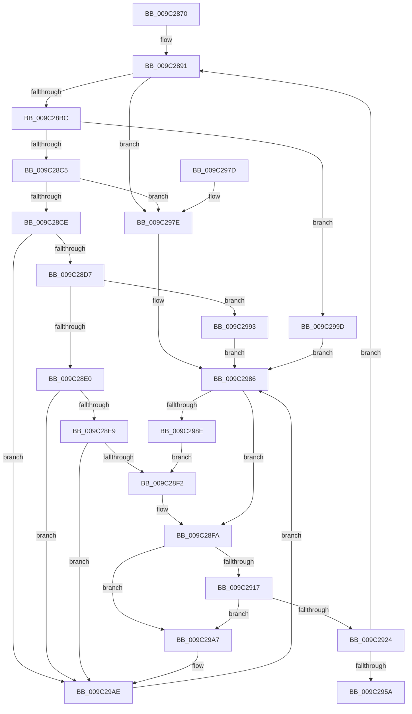

# PiUEventProcessEventWorker

- RVA: `0x009C2870`–`0x009C29B8` (길이 `328` bytes)
- VA: `0x00000001409C2870`
- 실행 섹션: `PAGE`
- PDB 이름 있음: `예`; PDB Function 태그: `아니요`
- unwind 정보 RVA: `0x0009F744`
- 디코드: `75`개 명령, `328/328` bytes 표시
- 미해석 바이트: `0` (있으면 어셈블리에 `.byte`로 보존)

> 이 문서는 커널 이미지의 기계어와 PDB 기호를 분석해 생성했습니다. 4번과 5번은 함수 원형과 자료형을 바이너리 사용 방식에서 추정한 C 해석이며 원본 소스 복구 결과는 아닙니다.

## 1. Dependencies

- 직접 호출 지점: **11**; 고유 호출 대상: **9**
- 직접 호출자로 확인된 함수: **0**
- RIP 상대 이미지 참조: **3**

### Outgoing calls
- `0x009C2898` → [ExAcquireFastMutex](../../text/20/ExAcquireFastMutex_function_0020E5A0.md) (function, `0x0020E5A0`)
- `0x009C28AB` → [ExReleaseFastMutex](../../text/25/ExReleaseFastMutex_function_002519C0.md) (function, `0x002519C0`)
- `0x009C28F5` → [PiUEventProcessBroadcastNotifications](PiUEventProcessBroadcastNotifications_function_009C370C.md) (function, `0x009C370C`)
- `0x009C2901` → [ExAcquireFastMutex](../../text/20/ExAcquireFastMutex_function_0020E5A0.md) (function, `0x0020E5A0`)
- `0x009C2945` → [ExReleaseFastMutex](../../text/25/ExReleaseFastMutex_function_002519C0.md) (function, `0x002519C0`)
- `0x009C294D` → [PiUEventDereferenceEventEntry](PiUEventDereferenceEventEntry_function_009C3244.md) (function, `0x009C3244`)
- `0x009C2962` → [ExFreePoolWithTag](../../poolcode/B8/ExFreePoolWithTag_function_00B82870.md) (function, `0x00B82870`)
- `0x009C2981` → [PiUEventNotifyTargetDeviceChange](../8E/PiUEventNotifyTargetDeviceChange_function_008E65B0.md) (function, `0x008E65B0`)
- `0x009C2996` → [PiUEventNotifyDeviceInstancePropertyChange](PiUEventNotifyDeviceInstancePropertyChange_function_009C3C04.md) (function, `0x009C3C04`)
- `0x009C29A0` → [PiUEventNotifyDeviceInterfaceChange](PiUEventNotifyDeviceInterfaceChange_function_009C3CF4.md) (function, `0x009C3CF4`)
- `0x009C29B1` → [PiUEventNotifyDeviceInstanceChange](PiUEventNotifyDeviceInstanceChange_function_009C3E2C.md) (function, `0x009C3E2C`)

### Direct callers
- 이 함수 시작 RVA로 연결되는 직접 call은 확인되지 않았습니다. 간접 호출은 완전히 역산할 수 없습니다.

### Static image references
- `0x009C2888` → RVA `0x00F8CA80` (`.data`; read)
- `0x009C2891` → RVA `0x00F8CAA0` (`.data`; read)
- `0x009C2924` → RVA `0x00F8CA80` (`.data`; write)

## 2. Other-region calls and transfers

- 다른 실행 섹션으로 향하는 call: **5**
  - `0x009C2898` → [ExAcquireFastMutex](../../text/20/ExAcquireFastMutex_function_0020E5A0.md) (`PAGE` → `.text`)
  - `0x009C28AB` → [ExReleaseFastMutex](../../text/25/ExReleaseFastMutex_function_002519C0.md) (`PAGE` → `.text`)
  - `0x009C2901` → [ExAcquireFastMutex](../../text/20/ExAcquireFastMutex_function_0020E5A0.md) (`PAGE` → `.text`)
  - `0x009C2945` → [ExReleaseFastMutex](../../text/25/ExReleaseFastMutex_function_002519C0.md) (`PAGE` → `.text`)
  - `0x009C2962` → [ExFreePoolWithTag](../../poolcode/B8/ExFreePoolWithTag_function_00B82870.md) (`PAGE` → `POOLCODE`)
- 별도 외부 분기/꼬리 이동을 확인하지 못했습니다.

## 3. Assembly (complete function range)

```asm
009C2870  48 89 5C 24 08                  mov qword ptr [rsp + 8], rbx
009C2875  48 89 74 24 10                  mov qword ptr [rsp + 0x10], rsi
009C287A  48 89 7C 24 18                  mov qword ptr [rsp + 0x18], rdi
009C287F  41 56                           push r14
009C2881  48 83 EC 20                     sub rsp, 0x20
009C2885  48 8B F1                        mov rsi, rcx
009C2888  4C 8D 35 F1 A1 5C 00            lea r14, [rip + 0x5ca1f1]
009C288F  33 FF                           xor edi, edi
009C2891  48 8D 0D 08 A2 5C 00            lea rcx, [rip + 0x5ca208]
009C2898  E8 03 BD 84 FF                  call 0x14020e5a0
009C289D  48 8B 1D DC A1 5C 00            mov rbx, qword ptr [rip + 0x5ca1dc]
009C28A4  48 8D 0D F5 A1 5C 00            lea rcx, [rip + 0x5ca1f5]
009C28AB  E8 10 F1 88 FF                  call 0x1402519c0
009C28B0  8B 4B 60                        mov ecx, dword ptr [rbx + 0x60]
009C28B3  83 E9 01                        sub ecx, 1
009C28B6  0F 84 C2 00 00 00               je 0x1409c297e
009C28BC  83 E9 01                        sub ecx, 1
009C28BF  0F 84 D8 00 00 00               je 0x1409c299d
009C28C5  83 E9 01                        sub ecx, 1
009C28C8  0F 84 B0 00 00 00               je 0x1409c297e
009C28CE  83 E9 01                        sub ecx, 1
009C28D1  0F 84 D7 00 00 00               je 0x1409c29ae
009C28D7  83 E9 05                        sub ecx, 5
009C28DA  0F 84 B3 00 00 00               je 0x1409c2993
009C28E0  83 E9 01                        sub ecx, 1
009C28E3  0F 84 C5 00 00 00               je 0x1409c29ae
009C28E9  83 F9 01                        cmp ecx, 1
009C28EC  0F 84 BC 00 00 00               je 0x1409c29ae
009C28F2  48 8B CB                        mov rcx, rbx
009C28F5  E8 12 0E 00 00                  call 0x1409c370c
009C28FA  48 8D 0D 9F A1 5C 00            lea rcx, [rip + 0x5ca19f]
009C2901  E8 9A BC 84 FF                  call 0x14020e5a0
009C2906  48 8B 05 73 A1 5C 00            mov rax, qword ptr [rip + 0x5ca173]
009C290D  4C 39 70 08                     cmp qword ptr [rax + 8], r14
009C2911  0F 85 90 00 00 00               jne 0x1409c29a7
009C2917  48 8B 08                        mov rcx, qword ptr [rax]
009C291A  48 39 41 08                     cmp qword ptr [rcx + 8], rax
009C291E  0F 85 83 00 00 00               jne 0x1409c29a7
009C2924  48 89 0D 55 A1 5C 00            mov qword ptr [rip + 0x5ca155], rcx
009C292B  B8 01 00 00 00                  mov eax, 1
009C2930  4C 89 71 08                     mov qword ptr [rcx + 8], r14
009C2934  48 8D 0D 65 A1 5C 00            lea rcx, [rip + 0x5ca165]
009C293B  4C 39 35 3E A1 5C 00            cmp qword ptr [rip + 0x5ca13e], r14
009C2942  0F 44 F8                        cmove edi, eax
009C2945  E8 76 F0 88 FF                  call 0x1402519c0
009C294A  48 8B CB                        mov rcx, rbx
009C294D  E8 F2 08 00 00                  call 0x1409c3244
009C2952  85 FF                           test edi, edi
009C2954  0F 84 37 FF FF FF               je 0x1409c2891
009C295A  BA 50 6E 70 59                  mov edx, 0x59706e50
009C295F  48 8B CE                        mov rcx, rsi
009C2962  E8 09 FF 1B 00                  call 0x140b82870
009C2967  48 8B 5C 24 30                  mov rbx, qword ptr [rsp + 0x30]
009C296C  48 8B 74 24 38                  mov rsi, qword ptr [rsp + 0x38]
009C2971  48 8B 7C 24 40                  mov rdi, qword ptr [rsp + 0x40]
009C2976  48 83 C4 20                     add rsp, 0x20
009C297A  41 5E                           pop r14
009C297C  C3                              ret
009C297D  CC                              int3
009C297E  48 8B CB                        mov rcx, rbx
009C2981  E8 2A 3C F2 FF                  call 0x1408e65b0
009C2986  85 C0                           test eax, eax
009C2988  0F 88 6C FF FF FF               js 0x1409c28fa
009C298E  E9 5F FF FF FF                  jmp 0x1409c28f2
009C2993  48 8B CB                        mov rcx, rbx
009C2996  E8 69 12 00 00                  call 0x1409c3c04
009C299B  EB E9                           jmp 0x1409c2986
009C299D  48 8B CB                        mov rcx, rbx
009C29A0  E8 4F 13 00 00                  call 0x1409c3cf4
009C29A5  EB DF                           jmp 0x1409c2986
009C29A7  B9 03 00 00 00                  mov ecx, 3
009C29AC  CD 29                           int 0x29
009C29AE  48 8B CB                        mov rcx, rbx
009C29B1  E8 76 14 00 00                  call 0x1409c3e2c
009C29B6  EB CE                           jmp 0x1409c2986
```

## 4. C-style interpretation (structured pseudocode)

```c
__int64 __fastcall PiUEventProcessEventWorker(__int64 a1)
{
    __int64 result;
    __int64 v_rdi;
    __int64 v_rsp;
    unsigned __int64 v_stack_p10;
    unsigned __int64 v_stack_p18;
    unsigned __int64 v_stack_p8;

    v_stack_p8 = v_rbx;
    v_stack_p10 = v_rsi;
    v_stack_p18 = v_rdi;
    v_rsp = (v_rsp) - (32);
    v_rdi = 0;
loc_009C2891:
    result = ExAcquireFastMutex(v_rip + 6070792, a2, a3, a4);
    result = ExReleaseFastMutex(v_rip + 6070773, a2, a3, a4);
    a1 = (unsigned int)(((unsigned int)(*(unsigned int *)(*(unsigned __int64 *)(v_rip + 6070748) + 96))) - (1));
    if (condition_is_equal) goto loc_009C297E;
    a1 = (unsigned int)((a1) - (1));
    if (condition_is_equal) goto loc_009C299D;
    a1 = (unsigned int)((a1) - (1));
    if (condition_is_equal) goto loc_009C297E;
    a1 = (unsigned int)((a1) - (1));
    if (condition_is_equal) goto loc_009C29AE;
    a1 = (unsigned int)((a1) - (5));
    if (condition_is_equal) goto loc_009C2993;
    a1 = (unsigned int)((a1) - (1));
    if (condition_is_equal) goto loc_009C29AE;
    if (((unsigned int)(a1)) == 1) goto loc_009C29AE;
loc_009C28F2:
    result = PiUEventProcessBroadcastNotifications(*(unsigned __int64 *)(v_rip + 6070748), a2, a3, a4);
loc_009C28FA:
    result = ExAcquireFastMutex(v_rip + 6070687, a2, a3, a4);
    if ((*(unsigned __int64 *)(*(unsigned __int64 *)(v_rip + 6070643) + 8)) != (v_rip + 6070769)) goto loc_009C29A7;
    if ((*(unsigned __int64 *)(*(unsigned __int64 *)(*(unsigned __int64 *)(v_rip + 6070643)) + 8)) != (*(unsigned __int64 *)(v_rip + 6070643))) goto loc_009C29A7;
    *(unsigned __int64 *)(v_rip + 6070613) = *(unsigned __int64 *)(*(unsigned __int64 *)(v_rip + 6070643));
    *(unsigned __int64 *)(*(unsigned __int64 *)(*(unsigned __int64 *)(v_rip + 6070643)) + 8) = v_rip + 6070769;
    if ((*(unsigned __int64 *)(v_rip + 6070590)) == (v_rip + 6070769)) { v_rdi = 1; }
    result = ExReleaseFastMutex(v_rip + 6070629, a2, a3, a4);
    result = PiUEventDereferenceEventEntry(*(unsigned __int64 *)(v_rip + 6070748), a2, a3, a4);
    if ((unsigned int)(v_rdi) == 0) goto loc_009C2891;
    result = ExFreePoolWithTag(a1, (unsigned int)(0x59706E50ULL), a3, a4);
    v_rsp = (v_rsp) + (32);
    return result;
loc_009C297E:
    result = PiUEventNotifyTargetDeviceChange(v_stack_p8, (unsigned int)(0x59706E50ULL), a3, a4);
loc_009C2986:
    if (sign_flag) goto loc_009C28FA;
    goto loc_009C28F2;
loc_009C2993:
    result = PiUEventNotifyDeviceInstancePropertyChange(v_stack_p8, (unsigned int)(0x59706E50ULL), a3, a4);
    goto loc_009C2986;
loc_009C299D:
    result = PiUEventNotifyDeviceInterfaceChange(v_stack_p8, (unsigned int)(0x59706E50ULL), a3, a4);
    goto loc_009C2986;
loc_009C29A7:
loc_009C29AE:
    result = PiUEventNotifyDeviceInstanceChange(v_stack_p8, (unsigned int)(0x59706E50ULL), a3, a4);
    goto loc_009C2986;
}
```

## 5. (Beta) C Style

```c
int64_t PiUEventProcessEventWorker(int64_t Arg1)
{
    int64_t result;
    int64_t local_rdi;
    int64_t local_rsp;
    uint64_t v_stack_p10;
    uint64_t v_stack_p18;
    uint64_t v_stack_p8;

    v_stack_p8 = local_rbx;
    v_stack_p10 = local_rsi;
    v_stack_p18 = local_rdi;
    local_rsp = (local_rsp) - (32);
    local_rdi = 0;
loc_009C2891:
    result = ExAcquireFastMutex(v_rip + 6070792, a2, a3, a4);
    result = ExReleaseFastMutex(v_rip + 6070773, a2, a3, a4);
    Arg1 = (uint32_t)(((uint32_t)(*(uint32_t *)(*(uint64_t *)(v_rip + 0x5CA1DC) + 0x60))) - (1));
    if (condition_is_equal) goto loc_009C297E;
    Arg1 = (uint32_t)((Arg1) - (1));
    if (condition_is_equal) goto loc_009C299D;
    Arg1 = (uint32_t)((Arg1) - (1));
    if (condition_is_equal) goto loc_009C297E;
    Arg1 = (uint32_t)((Arg1) - (1));
    if (condition_is_equal) goto loc_009C29AE;
    Arg1 = (uint32_t)((Arg1) - (5));
    if (condition_is_equal) goto loc_009C2993;
    Arg1 = (uint32_t)((Arg1) - (1));
    if (condition_is_equal) goto loc_009C29AE;
    if (((uint32_t)(Arg1)) == 1) goto loc_009C29AE;
loc_009C28F2:
    result = PiUEventProcessBroadcastNotifications(*(uint64_t *)(v_rip + 0x5CA1DC), a2, a3, a4);
loc_009C28FA:
    result = ExAcquireFastMutex(v_rip + 6070687, a2, a3, a4);
    if ((*(uint64_t *)(*(uint64_t *)(v_rip + 0x5CA173) + 0x8)) != (v_rip + 6070769)) goto loc_009C29A7;
    if ((*(uint64_t *)(*(uint64_t *)(*(uint64_t *)(v_rip + 0x5CA173)) + 0x8)) != (*(uint64_t *)(v_rip + 0x5CA173))) goto loc_009C29A7;
    *(uint64_t *)(v_rip + 0x5CA155) = *(uint64_t *)(*(uint64_t *)(v_rip + 0x5CA173));
    *(uint64_t *)(*(uint64_t *)(*(uint64_t *)(v_rip + 0x5CA173)) + 0x8) = v_rip + 6070769;
    if ((*(uint64_t *)(v_rip + 0x5CA13E)) == (v_rip + 6070769)) { local_rdi = 1; }
    result = ExReleaseFastMutex(v_rip + 6070629, a2, a3, a4);
    result = PiUEventDereferenceEventEntry(*(uint64_t *)(v_rip + 0x5CA1DC), a2, a3, a4);
    if ((uint32_t)(local_rdi) == 0) goto loc_009C2891;
    result = ExFreePoolWithTag(Arg1, (uint32_t)(0x59706E50ULL), a3, a4);
    local_rsp = (local_rsp) + (32);
    return result;
loc_009C297E:
    result = PiUEventNotifyTargetDeviceChange(v_stack_p8, (uint32_t)(0x59706E50ULL), a3, a4);
loc_009C2986:
    if (sign_flag) goto loc_009C28FA;
    goto loc_009C28F2;
loc_009C2993:
    result = PiUEventNotifyDeviceInstancePropertyChange(v_stack_p8, (uint32_t)(0x59706E50ULL), a3, a4);
    goto loc_009C2986;
loc_009C299D:
    result = PiUEventNotifyDeviceInterfaceChange(v_stack_p8, (uint32_t)(0x59706E50ULL), a3, a4);
    goto loc_009C2986;
loc_009C29A7:
loc_009C29AE:
    result = PiUEventNotifyDeviceInstanceChange(v_stack_p8, (uint32_t)(0x59706E50ULL), a3, a4);
    goto loc_009C2986;
}
```

## 6. Execution-region graph

[열기: 2D/3D 그래프와 함수 탐색 컨트롤 패널](../../../control-panel.html?section=page&rva=0x009C2870&view=graph)

- 2D 그래프는 위에서 아래로 흐르고, 3D 그래프는 빈 공간을 드래그해 회전합니다. Shift+드래그는 이동, 휠은 확대·축소, 함수 노드 선택은 대상 보고서 이동입니다.

### Static fallback


