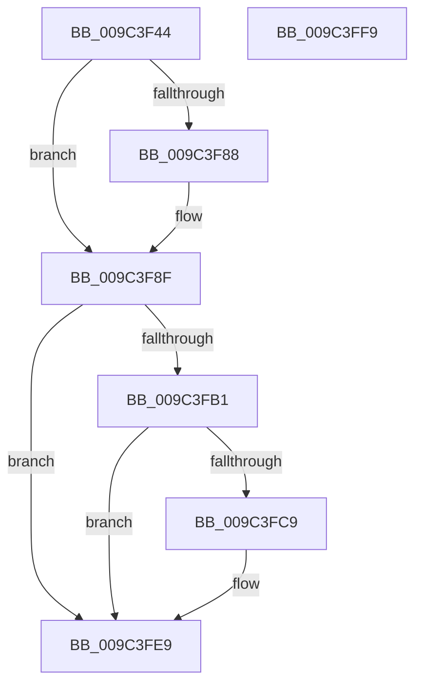

# PiUEventQueueBroadcastEventEntry

- RVA: `0x009C3F44`–`0x009C3FFA` (길이 `182` bytes)
- VA: `0x00000001409C3F44`
- 실행 섹션: `PAGE`
- PDB 이름 있음: `예`; PDB Function 태그: `아니요`
- unwind 정보 RVA: `0x00060BC4`
- 디코드: `44`개 명령, `182/182` bytes 표시
- 미해석 바이트: `0` (있으면 어셈블리에 `.byte`로 보존)

> 이 문서는 커널 이미지의 기계어와 PDB 기호를 분석해 생성했습니다. 4번과 5번은 함수 원형과 자료형을 바이너리 사용 방식에서 추정한 C 해석이며 원본 소스 복구 결과는 아닙니다.

## 1. Dependencies

- 직접 호출 지점: **5**; 고유 호출 대상: **5**
- 직접 호출자로 확인된 함수: **1**
- RIP 상대 이미지 참조: **5**

### Outgoing calls
- `0x009C3F5D` → [ExAcquireFastMutex](../../text/20/ExAcquireFastMutex_function_0020E5A0.md) (function, `0x0020E5A0`)
- `0x009C3F6C` → [PiUEventCoalesceBroadcastEvents](PiUEventCoalesceBroadcastEvents_function_009C4000.md) (function, `0x009C4000`)
- `0x009C3FA7` → [ExReleaseFastMutex](../../text/25/ExReleaseFastMutex_function_002519C0.md) (function, `0x002519C0`)
- `0x009C3FBF` → [ExAllocatePool2](../../poolcode/B8/ExAllocatePool2_function_00B820F0.md) (function, `0x00B820F0`)
- `0x009C3FE4` → [ExQueueWorkItem](../../text/2F/ExQueueWorkItem_function_002F9520.md) (function, `0x002F9520`)

### Direct callers
- [PiUEventProcessBroadcastNotifications](PiUEventProcessBroadcastNotifications_function_009C370C.md) at `0x009C39D3`

### Static image references
- `0x009C3F56` → RVA `0x00F8CA40` (`.data`; read)
- `0x009C3F62` → RVA `0x00F8CAE0` (`.data`; read)
- `0x009C3F7C` → RVA `0x00F8CAE8` (`.data`; read)
- `0x009C3FA0` → RVA `0x00F8CAE8` (`.data`; write)
- `0x009C3FCD` → RVA `0x00A764D0` (`PiUEventBroadcastEventWorker`; read)

## 2. Other-region calls and transfers

- 다른 실행 섹션으로 향하는 call: **4**
  - `0x009C3F5D` → [ExAcquireFastMutex](../../text/20/ExAcquireFastMutex_function_0020E5A0.md) (`PAGE` → `.text`)
  - `0x009C3FA7` → [ExReleaseFastMutex](../../text/25/ExReleaseFastMutex_function_002519C0.md) (`PAGE` → `.text`)
  - `0x009C3FBF` → [ExAllocatePool2](../../poolcode/B8/ExAllocatePool2_function_00B820F0.md) (`PAGE` → `POOLCODE`)
  - `0x009C3FE4` → [ExQueueWorkItem](../../text/2F/ExQueueWorkItem_function_002F9520.md) (`PAGE` → `.text`)
- 별도 외부 분기/꼬리 이동을 확인하지 못했습니다.

## 3. Assembly (complete function range)

```asm
009C3F44  48 89 5C 24 08                  mov qword ptr [rsp + 8], rbx
009C3F49  48 89 74 24 10                  mov qword ptr [rsp + 0x10], rsi
009C3F4E  57                              push rdi
009C3F4F  48 83 EC 20                     sub rsp, 0x20
009C3F53  48 8B D9                        mov rbx, rcx
009C3F56  48 8D 0D E3 8A 5C 00            lea rcx, [rip + 0x5c8ae3]
009C3F5D  E8 3E A6 84 FF                  call 0x14020e5a0
009C3F62  48 8B 3D 77 8B 5C 00            mov rdi, qword ptr [rip + 0x5c8b77]
009C3F69  48 8B CB                        mov rcx, rbx
009C3F6C  E8 8F 00 00 00                  call 0x1409c4000
009C3F71  C6 43 10 01                     mov byte ptr [rbx + 0x10], 1
009C3F75  48 8D 35 64 8B 5C 00            lea rsi, [rip + 0x5c8b64]
009C3F7C  48 8B 05 65 8B 5C 00            mov rax, qword ptr [rip + 0x5c8b65]
009C3F83  48 39 30                        cmp qword ptr [rax], rsi
009C3F86  74 07                           je 0x1409c3f8f
009C3F88  B9 03 00 00 00                  mov ecx, 3
009C3F8D  CD 29                           int 0x29
009C3F8F  48 89 33                        mov qword ptr [rbx], rsi
009C3F92  48 8D 0D A7 8A 5C 00            lea rcx, [rip + 0x5c8aa7]
009C3F99  48 89 43 08                     mov qword ptr [rbx + 8], rax
009C3F9D  48 89 18                        mov qword ptr [rax], rbx
009C3FA0  48 89 1D 41 8B 5C 00            mov qword ptr [rip + 0x5c8b41], rbx
009C3FA7  E8 14 DA 88 FF                  call 0x1402519c0
009C3FAC  48 3B FE                        cmp rdi, rsi
009C3FAF  75 38                           jne 0x1409c3fe9
009C3FB1  BA 20 00 00 00                  mov edx, 0x20
009C3FB6  41 B8 50 6E 70 59               mov r8d, 0x59706e50
009C3FBC  8D 4A 20                        lea ecx, [rdx + 0x20]
009C3FBF  E8 2C E1 1B 00                  call 0x140b820f0
009C3FC4  48 85 C0                        test rax, rax
009C3FC7  74 20                           je 0x1409c3fe9
009C3FC9  48 83 20 00                     and qword ptr [rax], 0
009C3FCD  48 8D 0D FC 24 0B 00            lea rcx, [rip + 0xb24fc]
009C3FD4  48 89 48 10                     mov qword ptr [rax + 0x10], rcx
009C3FD8  BA 04 00 00 00                  mov edx, 4
009C3FDD  48 8B C8                        mov rcx, rax
009C3FE0  48 89 40 18                     mov qword ptr [rax + 0x18], rax
009C3FE4  E8 37 55 93 FF                  call 0x1402f9520
009C3FE9  48 8B 5C 24 30                  mov rbx, qword ptr [rsp + 0x30]
009C3FEE  48 8B 74 24 38                  mov rsi, qword ptr [rsp + 0x38]
009C3FF3  48 83 C4 20                     add rsp, 0x20
009C3FF7  5F                              pop rdi
009C3FF8  C3                              ret
009C3FF9  CC                              int3
```

## 4. C-style interpretation (structured pseudocode)

```c
__int64 __fastcall PiUEventQueueBroadcastEventEntry(__int64 a1)
{
    __int64 result;
    __int64 v_rsp;
    unsigned __int64 v_stack_p10;
    unsigned __int64 v_stack_p8;

    v_stack_p8 = v_rbx;
    v_stack_p10 = v_rsi;
    v_rsp = (v_rsp) - (32);
    result = ExAcquireFastMutex(v_rip + 6064867, a2, a3, a4);
    result = PiUEventCoalesceBroadcastEvents(a1, a2, a3, a4);
    *(unsigned __int8 *)(a1 + 16) = 1;
    if ((*(unsigned __int64 *)(*(unsigned __int64 *)(v_rip + 6064997))) != (v_rip + 6064996)) {
        a1 = 3;
    }
    *(unsigned __int64 *)(a1) = v_rip + 6064996;
    *(unsigned __int64 *)(a1 + 8) = *(unsigned __int64 *)(v_rip + 6064997);
    *(unsigned __int64 *)(*(unsigned __int64 *)(v_rip + 6064997)) = a1;
    *(unsigned __int64 *)(v_rip + 6064961) = a1;
    result = ExReleaseFastMutex(v_rip + 6064807, a2, a3, a4);
    if ((*(unsigned __int64 *)(v_rip + 6065015)) != (v_rip + 6064996)) goto loc_009C3FE9;
    result = ExAllocatePool2(32 + 32, 32, (unsigned int)(0x59706E50ULL), a4);
    if (result != 0) {
        a1 = v_rip + 730364;
        *(unsigned __int64 *)(result + 16) = a1;
        a2 = 4;
        a1 = result;
        *(unsigned __int64 *)(result + 24) = result;
        result = ExQueueWorkItem(a1, a2, (unsigned int)(0x59706E50ULL), a4);
    }
    v_rsp = (v_rsp) + (32);
    return result;
}
```

## 5. (Beta) C Style

```c
int64_t PiUEventQueueBroadcastEventEntry(void *Arg1)
{
    uint8_t *arg1 = (uint8_t *)Arg1;

    int64_t result;
    int64_t local_rsp;
    uint64_t v_stack_p10;
    uint64_t v_stack_p8;

    v_stack_p8 = local_rbx;
    v_stack_p10 = local_rsi;
    local_rsp = (local_rsp) - (32);
    result = ExAcquireFastMutex(v_rip + 6064867, a2, a3, a4);
    result = PiUEventCoalesceBroadcastEvents(Arg1, a2, a3, a4);
    *(uint8_t *)(arg1 + 0x10) = 1;
    if ((*(uint64_t *)(*(uint64_t *)(v_rip + 0x5C8B65))) != (v_rip + 6064996)) {
        Arg1 = 3;
    }
    *(uint64_t *)(arg1) = v_rip + 6064996;
    *(uint64_t *)(arg1 + 0x8) = *(uint64_t *)(v_rip + 0x5C8B65);
    *(void **)(*(uint64_t *)(v_rip + 0x5C8B65)) = Arg1;
    *(void **)(v_rip + 0x5C8B41) = Arg1;
    result = ExReleaseFastMutex(v_rip + 6064807, a2, a3, a4);
    if ((*(uint64_t *)(v_rip + 0x5C8B77)) != (v_rip + 6064996)) goto loc_009C3FE9;
    result = ExAllocatePool2(32 + 32, 32, (uint32_t)(0x59706E50ULL), a4);
    if (result != 0) {
        Arg1 = v_rip + 730364;
        *(void **)(result + 0x10) = Arg1;
        a2 = 4;
        Arg1 = result;
        *(uint64_t *)(result + 0x18) = result;
        result = ExQueueWorkItem(Arg1, a2, (uint32_t)(0x59706E50ULL), a4);
    }
    local_rsp = (local_rsp) + (32);
    return result;
}
```

### 관측된 메모리 오프셋

구조체 형식이 확인되지 않은 접근은 인자 기준의 오프셋으로만 기록했습니다.

| 기준 인자 | 오프셋 표현 | 폭 (bit) | 접근 |
|---|---:|---:|---|
| `Arg1` | `+ 0x0` | `64` | `W` |
| `Arg1` | `+ 0x8` | `64` | `W` |
| `Arg1` | `+ 0x10` | `8` | `W` |

## 6. Execution-region graph

[열기: 2D/3D 그래프와 함수 탐색 컨트롤 패널](../../../control-panel.html?section=page&rva=0x009C3F44&view=graph)

- 2D 그래프는 위에서 아래로 흐르고, 3D 그래프는 빈 공간을 드래그해 회전합니다. Shift+드래그는 이동, 휠은 확대·축소, 함수 노드 선택은 대상 보고서 이동입니다.

### Static fallback


