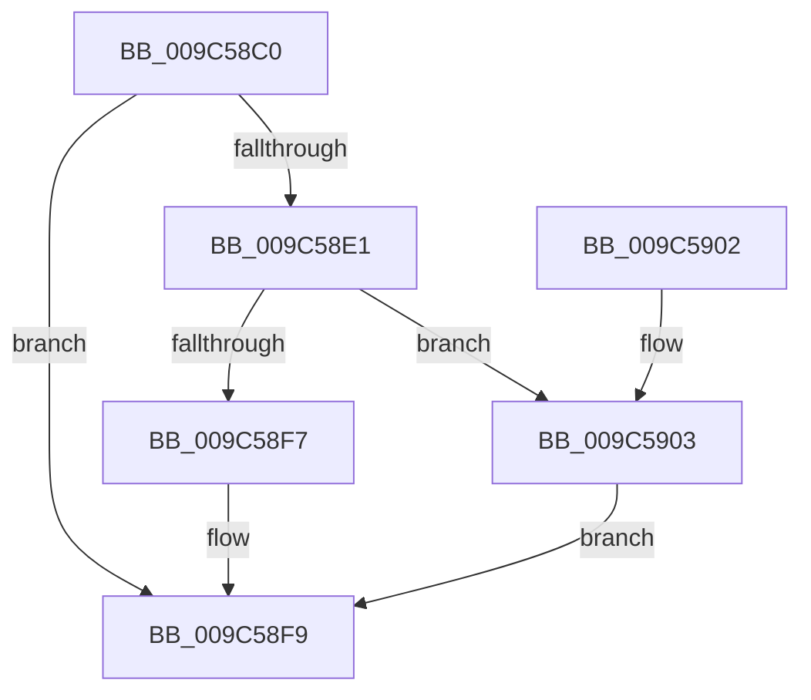

# PoDiagCaptureUsermodeStack

- RVA: `0x009C58C0`–`0x009C5914` (길이 `84` bytes)
- VA: `0x00000001409C58C0`
- 실행 섹션: `PAGE`
- PDB 이름 있음: `예`; PDB Function 태그: `아니요`
- unwind 정보 RVA: `0x0008B9A4`
- 디코드: `26`개 명령, `84/84` bytes 표시
- 미해석 바이트: `0` (있으면 어셈블리에 `.byte`로 보존)

> 이 문서는 커널 이미지의 기계어와 PDB 기호를 분석해 생성했습니다. 4번과 5번은 함수 원형과 자료형을 바이너리 사용 방식에서 추정한 C 해석이며 원본 소스 복구 결과는 아닙니다.

## 1. Dependencies

- 직접 호출 지점: **3**; 고유 호출 대상: **3**
- 직접 호출자로 확인된 함수: **1**
- RIP 상대 이미지 참조: **0**

### Outgoing calls
- `0x009C58D4` → [ExAllocatePool2](../../poolcode/B8/ExAllocatePool2_function_00B820F0.md) (function, `0x00B820F0`)
- `0x009C58EE` → [RtlWalkFrameChain](../../text/2F/RtlWalkFrameChain_function_002F85E0.md) (function, `0x002F85E0`)
- `0x009C590B` → [ExFreePoolWithTag](../../poolcode/B8/ExFreePoolWithTag_function_00B82870.md) (function, `0x00B82870`)

### Direct callers
- [NtSetTimerResolution](NtSetTimerResolution_function_009C5170.md) at `0x009C53D4`

### Static image references
- 디코드된 RIP-relative 메모리 참조가 없습니다.

## 2. Other-region calls and transfers

- 다른 실행 섹션으로 향하는 call: **3**
  - `0x009C58D4` → [ExAllocatePool2](../../poolcode/B8/ExAllocatePool2_function_00B820F0.md) (`PAGE` → `POOLCODE`)
  - `0x009C58EE` → [RtlWalkFrameChain](../../text/2F/RtlWalkFrameChain_function_002F85E0.md) (`PAGE` → `.text`)
  - `0x009C590B` → [ExFreePoolWithTag](../../poolcode/B8/ExFreePoolWithTag_function_00B82870.md) (`PAGE` → `POOLCODE`)
- 별도 외부 분기/꼬리 이동을 확인하지 못했습니다.

## 3. Assembly (complete function range)

```asm
009C58C0  40 53                           push rbx
009C58C2  48 83 EC 20                     sub rsp, 0x20
009C58C6  BA 08 01 00 00                  mov edx, 0x108
009C58CB  41 B8 54 56 45 50               mov r8d, 0x50455654
009C58D1  8D 4A F8                        lea ecx, [rdx - 8]
009C58D4  E8 17 C8 1B 00                  call 0x140b820f0
009C58D9  48 8B D8                        mov rbx, rax
009C58DC  48 85 C0                        test rax, rax
009C58DF  74 18                           je 0x1409c58f9
009C58E1  BA 20 00 00 00                  mov edx, 0x20
009C58E6  48 8D 48 08                     lea rcx, [rax + 8]
009C58EA  44 8D 42 E1                     lea r8d, [rdx - 0x1f]
009C58EE  E8 ED 2C 93 FF                  call 0x1402f85e0
009C58F3  85 C0                           test eax, eax
009C58F5  74 0C                           je 0x1409c5903
009C58F7  89 03                           mov dword ptr [rbx], eax
009C58F9  48 8B C3                        mov rax, rbx
009C58FC  48 83 C4 20                     add rsp, 0x20
009C5900  5B                              pop rbx
009C5901  C3                              ret
009C5902  CC                              int3
009C5903  BA 54 56 45 50                  mov edx, 0x50455654
009C5908  48 8B CB                        mov rcx, rbx
009C590B  E8 60 CF 1B 00                  call 0x140b82870
009C5910  33 DB                           xor ebx, ebx
009C5912  EB E5                           jmp 0x1409c58f9
```

## 4. C-style interpretation (structured pseudocode)

```c
__int64 __fastcall PoDiagCaptureUsermodeStack(void)
{
    __int64 result;
    __int64 v_rbx;
    __int64 v_rsp;

    v_rsp = (v_rsp) - (32);
    result = ExAllocatePool2(264 - 8, 264, (unsigned int)(0x50455654ULL), a4);
    if (result == 0) goto loc_009C58F9;
    result = RtlWalkFrameChain(result + 8, 32, 32 - 31, a4);
    if ((unsigned int)(result) == 0) goto loc_009C5903;
    *(unsigned int *)(result) = (unsigned int)(result);
loc_009C58F9:
    v_rsp = (v_rsp) + (32);
    return result;
loc_009C5903:
    result = ExFreePoolWithTag(result, (unsigned int)(0x50455654ULL), 32 - 31, a4);
    v_rbx = 0;
    goto loc_009C58F9;
}
```

## 5. (Beta) C Style

```c
void PoDiagCaptureUsermodeStack(void)
{
    int64_t result;
    int64_t local_rbx;
    int64_t local_rsp;

    local_rsp = (local_rsp) - (32);
    result = ExAllocatePool2(264 - 8, 264, (uint32_t)(0x50455654ULL), a4);
    if (result == 0) goto loc_009C58F9;
    result = RtlWalkFrameChain(result + 8, 32, 32 - 31, a4);
    if ((uint32_t)(result) == 0) goto loc_009C5903;
    *(uint32_t *)(result) = (uint32_t)(result);
loc_009C58F9:
    local_rsp = (local_rsp) + (32);
    return result;
loc_009C5903:
    result = ExFreePoolWithTag(result, (uint32_t)(0x50455654ULL), 32 - 31, a4);
    local_rbx = 0;
    goto loc_009C58F9;
}
```

## 6. Execution-region graph

[열기: 2D/3D 그래프와 함수 탐색 컨트롤 패널](../../../control-panel.html?section=page&rva=0x009C58C0&view=graph)

- 2D 그래프는 위에서 아래로 흐르고, 3D 그래프는 빈 공간을 드래그해 회전합니다. Shift+드래그는 이동, 휠은 확대·축소, 함수 노드 선택은 대상 보고서 이동입니다.

### Static fallback


