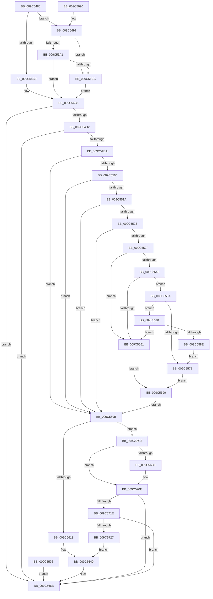

# PoTraceSystemTimerResolution

- RVA: `0x009C5480`–`0x009C5771` (길이 `753` bytes)
- VA: `0x00000001409C5480`
- 실행 섹션: `PAGE`
- PDB 이름 있음: `예`; PDB Function 태그: `아니요`
- unwind 정보 RVA: `0x0009FFF4`
- 디코드: `145`개 명령, `753/753` bytes 표시
- 미해석 바이트: `0` (있으면 어셈블리에 `.byte`로 보존)

> 이 문서는 커널 이미지의 기계어와 PDB 기호를 분석해 생성했습니다. 4번과 5번은 함수 원형과 자료형을 바이너리 사용 방식에서 추정한 C 해석이며 원본 소스 복구 결과는 아닙니다.

## 1. Dependencies

- 직접 호출 지점: **6**; 고유 호출 대상: **3**
- 직접 호출자로 확인된 함수: **2**
- RIP 상대 이미지 참조: **6**

### Outgoing calls
- `0x009C54C0` → [EtwEventEnabled](../../text/39/EtwEventEnabled_function_00392450.md) (function, `0x00392450`)
- `0x009C5666` → [EtwWrite](../../text/41/EtwWrite_function_0041C720.md) (function, `0x0041C720`)
- `0x009C5676` → [_security_check_cookie](../../text/6A/_security_check_cookie_function_006AC640.md) (function, `0x006AC640`)
- `0x009C5698` → [EtwEventEnabled](../../text/39/EtwEventEnabled_function_00392450.md) (function, `0x00392450`)
- `0x009C56AF` → [EtwEventEnabled](../../text/39/EtwEventEnabled_function_00392450.md) (function, `0x00392450`)
- `0x009C5709` → [EtwWrite](../../text/41/EtwWrite_function_0041C720.md) (function, `0x0041C720`)

### Direct callers
- [ExTraceTimerResolution](../../text/4B/ExTraceTimerResolution_function_004B348C.md) at `0x004B351B`
- [NtSetTimerResolution](NtSetTimerResolution_function_009C5170.md) at `0x009C5279`
- [NtSetTimerResolution](NtSetTimerResolution_function_009C5170.md) at `0x009C5387`

### Static image references
- `0x009C5492` → RVA `0x00E0A740` (`.data`; read)
- `0x009C54AC` → RVA `0x00F0B408` (`.data`; read)
- `0x009C54B9` → RVA `0x00013F20` (`.rdata`; read)
- `0x009C54C5` → RVA `0x00E67858` (`.data`; read)
- `0x009C5691` → RVA `0x00013F40` (`.rdata`; read)
- `0x009C56A1` → RVA `0x00013F30` (`.rdata`; read)

## 2. Other-region calls and transfers

- 다른 실행 섹션으로 향하는 call: **6**
  - `0x009C54C0` → [EtwEventEnabled](../../text/39/EtwEventEnabled_function_00392450.md) (`PAGE` → `.text`)
  - `0x009C5666` → [EtwWrite](../../text/41/EtwWrite_function_0041C720.md) (`PAGE` → `.text`)
  - `0x009C5676` → [_security_check_cookie](../../text/6A/_security_check_cookie_function_006AC640.md) (`PAGE` → `.text`)
  - `0x009C5698` → [EtwEventEnabled](../../text/39/EtwEventEnabled_function_00392450.md) (`PAGE` → `.text`)
  - `0x009C56AF` → [EtwEventEnabled](../../text/39/EtwEventEnabled_function_00392450.md) (`PAGE` → `.text`)
  - `0x009C5709` → [EtwWrite](../../text/41/EtwWrite_function_0041C720.md) (`PAGE` → `.text`)
- 별도 외부 분기/꼬리 이동을 확인하지 못했습니다.

## 3. Assembly (complete function range)

```asm
009C5480  48 89 5C 24 08                  mov qword ptr [rsp + 8], rbx
009C5485  48 89 74 24 10                  mov qword ptr [rsp + 0x10], rsi
009C548A  57                              push rdi
009C548B  48 81 EC C0 00 00 00            sub rsp, 0xc0
009C5492  48 8B 05 A7 52 44 00            mov rax, qword ptr [rip + 0x4452a7]
009C5499  48 33 C4                        xor rax, rsp
009C549C  48 89 84 24 B0 00 00 00         mov qword ptr [rsp + 0xb0], rax
009C54A4  48 8B FA                        mov rdi, rdx
009C54A7  0F B6 D9                        movzx ebx, cl
009C54AA  84 C9                           test cl, cl
009C54AC  48 8B 0D 55 5F 54 00            mov rcx, qword ptr [rip + 0x545f55]
009C54B3  0F 85 D8 01 00 00               jne 0x1409c5691
009C54B9  48 8D 15 60 EA 64 FF            lea rdx, [rip - 0x9b15a0]
009C54C0  E8 8B CF 9C FF                  call 0x140392450
009C54C5  80 3D 8C 23 4A 00 00            cmp byte ptr [rip + 0x4a238c], 0
009C54CC  0F 84 99 01 00 00               je 0x1409c566b
009C54D2  84 C0                           test al, al
009C54D4  0F 84 91 01 00 00               je 0x1409c566b
009C54DA  48 8B 97 50 03 00 00            mov rdx, qword ptr [rdi + 0x350]
009C54E1  0F B7 02                        movzx eax, word ptr [rdx]
009C54E4  66 D1 E8                        shr ax, 1
009C54E7  66 89 44 24 30                  mov word ptr [rsp + 0x30], ax
009C54EC  8B 87 B8 05 00 00               mov eax, dword ptr [rdi + 0x5b8]
009C54F2  89 44 24 3C                     mov dword ptr [rsp + 0x3c], eax
009C54F6  33 F6                           xor esi, esi
009C54F8  89 74 24 34                     mov dword ptr [rsp + 0x34], esi
009C54FC  84 DB                           test bl, bl
009C54FE  0F 85 97 00 00 00               jne 0x1409c559b
009C5504  65 48 8B 0C 25 88 01 00 00      mov rcx, qword ptr gs:[0x188]
009C550D  F7 41 74 00 04 00 00            test dword ptr [rcx + 0x74], 0x400
009C5514  0F 85 81 00 00 00               jne 0x1409c559b
009C551A  80 B9 4A 02 00 00 01            cmp byte ptr [rcx + 0x24a], 1
009C5521  74 78                           je 0x1409c559b
009C5523  4C 8B 81 F0 00 00 00            mov r8, qword ptr [rcx + 0xf0]
009C552A  4D 85 C0                        test r8, r8
009C552D  74 6C                           je 0x1409c559b
009C552F  65 48 8B 04 25 88 01 00 00      mov rax, qword ptr gs:[0x188]
009C5538  48 8B 80 B8 00 00 00            mov rax, qword ptr [rax + 0xb8]
009C553F  48 39 B0 10 03 00 00            cmp qword ptr [rax + 0x310], rsi
009C5546  74 19                           je 0x1409c5561
009C5548  65 48 8B 04 25 88 01 00 00      mov rax, qword ptr gs:[0x188]
009C5551  48 8B 88 B8 00 00 00            mov rcx, qword ptr [rax + 0xb8]
009C5558  48 39 B1 10 03 00 00            cmp qword ptr [rcx + 0x310], rsi
009C555F  75 09                           jne 0x1409c556a
009C5561  41 8B 80 20 17 00 00            mov eax, dword ptr [r8 + 0x1720]
009C5568  EB 26                           jmp 0x1409c5590
009C556A  0F B7 81 EC 06 00 00            movzx eax, word ptr [rcx + 0x6ec]
009C5571  B9 4C 01 00 00                  mov ecx, 0x14c
009C5576  66 3B C1                        cmp ax, cx
009C5579  75 09                           jne 0x1409c5584
009C557B  41 8B 80 60 2F 00 00            mov eax, dword ptr [r8 + 0x2f60]
009C5582  EB 0C                           jmp 0x1409c5590
009C5584  B9 C4 01 00 00                  mov ecx, 0x1c4
009C5589  66 3B C1                        cmp ax, cx
009C558C  75 D3                           jne 0x1409c5561
009C558E  EB EB                           jmp 0x1409c557b
009C5590  89 44 24 34                     mov dword ptr [rsp + 0x34], eax
009C5594  EB 05                           jmp 0x1409c559b
009C5596  E9 D0 00 00 00                  jmp 0x1409c566b
009C559B  8B 87 D0 01 00 00               mov eax, dword ptr [rdi + 0x1d0]
009C55A1  89 44 24 40                     mov dword ptr [rsp + 0x40], eax
009C55A5  48 8D 44 24 3C                  lea rax, [rsp + 0x3c]
009C55AA  48 89 44 24 50                  mov qword ptr [rsp + 0x50], rax
009C55AF  48 C7 44 24 58 04 00 00 00      mov qword ptr [rsp + 0x58], 4
009C55B8  48 8D 44 24 40                  lea rax, [rsp + 0x40]
009C55BD  48 89 44 24 60                  mov qword ptr [rsp + 0x60], rax
009C55C2  48 C7 44 24 68 04 00 00 00      mov qword ptr [rsp + 0x68], 4
009C55CB  48 8D 44 24 30                  lea rax, [rsp + 0x30]
009C55D0  48 89 44 24 70                  mov qword ptr [rsp + 0x70], rax
009C55D5  48 C7 44 24 78 02 00 00 00      mov qword ptr [rsp + 0x78], 2
009C55DE  0F B7 0A                        movzx ecx, word ptr [rdx]
009C55E1  48 8B 42 08                     mov rax, qword ptr [rdx + 8]
009C55E5  48 89 84 24 80 00 00 00         mov qword ptr [rsp + 0x80], rax
009C55ED  89 8C 24 88 00 00 00            mov dword ptr [rsp + 0x88], ecx
009C55F4  89 B4 24 8C 00 00 00            mov dword ptr [rsp + 0x8c], esi
009C55FB  8B 87 FC 05 00 00               mov eax, dword ptr [rdi + 0x5fc]
009C5601  C1 E8 1A                        shr eax, 0x1a
009C5604  83 E0 01                        and eax, 1
009C5607  89 44 24 38                     mov dword ptr [rsp + 0x38], eax
009C560B  84 DB                           test bl, bl
009C560D  0F 85 B0 00 00 00               jne 0x1409c56c3
009C5613  48 8D 44 24 34                  lea rax, [rsp + 0x34]
009C5618  48 89 84 24 90 00 00 00         mov qword ptr [rsp + 0x90], rax
009C5620  48 8D 44 24 38                  lea rax, [rsp + 0x38]
009C5625  48 89 84 24 A0 00 00 00         mov qword ptr [rsp + 0xa0], rax
009C562D  48 C7 84 24 A8 00 00 00 04 00 00 00  mov qword ptr [rsp + 0xa8], 4
009C5639  48 8D 15 E0 E8 64 FF            lea rdx, [rip - 0x9b1720]
009C5640  48 8D 44 24 50                  lea rax, [rsp + 0x50]
009C5645  48 89 44 24 20                  mov qword ptr [rsp + 0x20], rax
009C564A  48 C7 84 24 98 00 00 00 04 00 00 00  mov qword ptr [rsp + 0x98], 4
009C5656  41 B9 06 00 00 00               mov r9d, 6
009C565C  45 33 C0                        xor r8d, r8d
009C565F  48 8B 0D A2 5D 54 00            mov rcx, qword ptr [rip + 0x545da2]
009C5666  E8 B5 70 A5 FF                  call 0x14041c720
009C566B  48 8B 8C 24 B0 00 00 00         mov rcx, qword ptr [rsp + 0xb0]
009C5673  48 33 CC                        xor rcx, rsp
009C5676  E8 C5 6F CE FF                  call 0x1406ac640
009C567B  4C 8D 9C 24 C0 00 00 00         lea r11, [rsp + 0xc0]
009C5683  49 8B 5B 10                     mov rbx, qword ptr [r11 + 0x10]
009C5687  49 8B 73 18                     mov rsi, qword ptr [r11 + 0x18]
009C568B  49 8B E3                        mov rsp, r11
009C568E  5F                              pop rdi
009C568F  C3                              ret
009C5690  CC                              int3
009C5691  48 8D 15 A8 E8 64 FF            lea rdx, [rip - 0x9b1758]
009C5698  E8 B3 CD 9C FF                  call 0x140392450
009C569D  84 C0                           test al, al
009C569F  75 1B                           jne 0x1409c56bc
009C56A1  48 8D 15 88 E8 64 FF            lea rdx, [rip - 0x9b1778]
009C56A8  48 8B 0D 59 5D 54 00            mov rcx, qword ptr [rip + 0x545d59]
009C56AF  E8 9C CD 9C FF                  call 0x140392450
009C56B4  84 C0                           test al, al
009C56B6  0F 84 09 FE FF FF               je 0x1409c54c5
009C56BC  B0 01                           mov al, 1
009C56BE  E9 02 FE FF FF                  jmp 0x1409c54c5
009C56C3  F7 87 F4 01 00 00 00 10 00 00   test dword ptr [rdi + 0x1f4], 0x1000
009C56CD  74 3F                           je 0x1409c570e
009C56CF  48 8D 44 24 38                  lea rax, [rsp + 0x38]
009C56D4  48 89 84 24 90 00 00 00         mov qword ptr [rsp + 0x90], rax
009C56DC  48 C7 84 24 98 00 00 00 04 00 00 00  mov qword ptr [rsp + 0x98], 4
009C56E8  48 8D 44 24 50                  lea rax, [rsp + 0x50]
009C56ED  48 89 44 24 20                  mov qword ptr [rsp + 0x20], rax
009C56F2  41 B9 05 00 00 00               mov r9d, 5
009C56F8  45 33 C0                        xor r8d, r8d
009C56FB  48 8D 15 3E E8 64 FF            lea rdx, [rip - 0x9b17c2]
009C5702  48 8B 0D FF 5C 54 00            mov rcx, qword ptr [rip + 0x545cff]
009C5709  E8 12 70 A5 FF                  call 0x14041c720
009C570E  48 8B 97 B0 05 00 00            mov rdx, qword ptr [rdi + 0x5b0]
009C5715  48 85 D2                        test rdx, rdx
009C5718  0F 84 4D FF FF FF               je 0x1409c566b
009C571E  83 3A 00                        cmp dword ptr [rdx], 0
009C5721  0F 84 44 FF FF FF               je 0x1409c566b
009C5727  8B 87 BC 05 00 00               mov eax, dword ptr [rdi + 0x5bc]
009C572D  89 44 24 3C                     mov dword ptr [rsp + 0x3c], eax
009C5731  8B 0A                           mov ecx, dword ptr [rdx]
009C5733  89 4C 24 44                     mov dword ptr [rsp + 0x44], ecx
009C5737  48 8D 44 24 44                  lea rax, [rsp + 0x44]
009C573C  48 89 84 24 90 00 00 00         mov qword ptr [rsp + 0x90], rax
009C5744  48 8D 42 08                     lea rax, [rdx + 8]
009C5748  48 89 84 24 A0 00 00 00         mov qword ptr [rsp + 0xa0], rax
009C5750  8D 04 CD 00 00 00 00            lea eax, [rcx*8]
009C5757  89 84 24 A8 00 00 00            mov dword ptr [rsp + 0xa8], eax
009C575E  89 B4 24 AC 00 00 00            mov dword ptr [rsp + 0xac], esi
009C5765  48 8D 15 C4 E7 64 FF            lea rdx, [rip - 0x9b183c]
009C576C  E9 CF FE FF FF                  jmp 0x1409c5640
```

## 4. C-style interpretation (structured pseudocode)

```c
__int64 __fastcall PoTraceSystemTimerResolution(unsigned __int8 a1, __int64 a2)
{
    __int64 result;
    __int64 v_rsi;
    __int64 v_rsp;
    unsigned int v_stack_m14;
    unsigned __int64 v_stack_m18;
    unsigned __int64 v_stack_m20;
    unsigned __int64 v_stack_m28;
    unsigned __int64 v_stack_m30;
    unsigned __int64 v_stack_m38;
    unsigned int v_stack_m3C;
    unsigned int v_stack_m40;
    unsigned __int64 v_stack_m48;
    unsigned __int64 v_stack_m50;
    unsigned __int64 v_stack_m58;
    unsigned __int64 v_stack_m60;
    unsigned __int64 v_stack_m68;
    unsigned __int64 v_stack_m70;
    unsigned __int64 v_stack_m78;
    unsigned int v_stack_m7C;
    unsigned __int64 v_stack_m8;
    unsigned int v_stack_m84;
    unsigned int v_stack_m88;
    unsigned int v_stack_m8C;
    unsigned int v_stack_m90;
    unsigned int v_stack_m94;
    unsigned __int16 v_stack_m98;
    unsigned __int64 v_stack_mA0;
    unsigned __int64 v_stack_mA8;
    unsigned __int64 v_stack_p10;
    unsigned __int64 v_stack_p8;

    v_stack_p8 = v_rbx;
    v_stack_p10 = v_rsi;
    v_rsp = (v_rsp) - (192);
    result = (*(unsigned __int64 *)(v_rip + 4477607)) ^ (v_rsp);
    v_stack_m18 = result;
    if (a1 != 0) goto loc_009C5691;
    result = EtwEventEnabled(*(unsigned __int64 *)(v_rip + 5529429), v_rip - 10163616, a3, a4);
loc_009C54C5:
    if ((*(unsigned __int8 *)(v_rip + 4858764)) == 0) goto loc_009C566B;
    if ((unsigned __int8)(result) == 0) goto loc_009C566B;
    result = (unsigned __int16)((*(unsigned __int16 *)(*(unsigned __int64 *)(a2 + 848))) >> (1));
    v_stack_m98 = (unsigned __int16)(result);
    v_stack_m8C = (unsigned int)((unsigned int)(*(unsigned int *)(a2 + 1464)));
    v_rsi = 0;
    v_stack_m94 = 0;
    if (a1 != 0) goto loc_009C559B;
    if (((*(unsigned int *)(*(unsigned __int64 *)(gs_base + (0 + 392)) + 116)) & (0x400ULL)) != 0) goto loc_009C559B;
    if ((*(unsigned __int8 *)(*(unsigned __int64 *)(gs_base + (0 + 392)) + 586)) == 1) goto loc_009C559B;
    if (*(unsigned __int64 *)(*(unsigned __int64 *)(gs_base + (0 + 392)) + 240) == 0) goto loc_009C559B;
    if ((*(unsigned __int64 *)(*(unsigned __int64 *)(*(unsigned __int64 *)(gs_base + (0 + 392)) + 184) + 784)) == 0) goto loc_009C5561;
    if ((*(unsigned __int64 *)(*(unsigned __int64 *)(*(unsigned __int64 *)(gs_base + (0 + 392)) + 184) + 784)) != 0) goto loc_009C556A;
loc_009C5561:
    goto loc_009C5590;
loc_009C556A:
    if (((unsigned __int16)(*(unsigned __int16 *)(*(unsigned __int64 *)(*(unsigned __int64 *)(gs_base + (0 + 392)) + 184) + 1772))) != 332) goto loc_009C5584;
loc_009C557B:
    goto loc_009C5590;
loc_009C5584:
    if (((unsigned __int16)((unsigned int)(*(unsigned int *)(*(unsigned __int64 *)(*(unsigned __int64 *)(gs_base + (0 + 392)) + 240) + 12128)))) != 452) goto loc_009C5561;
    goto loc_009C557B;
loc_009C5590:
    v_stack_m94 = (unsigned int)((unsigned int)(*(unsigned int *)(*(unsigned __int64 *)(*(unsigned __int64 *)(gs_base + (0 + 392)) + 240) + 12128)));
    goto loc_009C559B;
loc_009C559B:
    v_stack_m88 = (unsigned int)((unsigned int)(*(unsigned int *)(a2 + 464)));
    v_stack_m78 = v_stack_m8C;
    v_stack_m70 = 4;
    v_stack_m68 = v_stack_m88;
    v_stack_m60 = 4;
    v_stack_m58 = v_stack_m98;
    v_stack_m50 = 2;
    v_stack_m48 = *(unsigned __int64 *)(*(unsigned __int64 *)(a2 + 848) + 8);
    v_stack_m40 = (unsigned int)(*(unsigned __int16 *)(*(unsigned __int64 *)(a2 + 848)));
    v_stack_m3C = 0;
    result = (unsigned int)(((unsigned int)(*(unsigned int *)(a2 + 1532))) >> (26));
    result = (unsigned int)((result) & (1));
    v_stack_m90 = (unsigned int)(result);
    if (a1 != 0) goto loc_009C56C3;
    v_stack_m38 = v_stack_m94;
    v_stack_m28 = v_stack_m90;
    v_stack_m20 = 4;
loc_009C5640:
    v_stack_mA8 = v_stack_m78;
    v_stack_m30 = 4;
    a3 = 0;
    result = EtwWrite(*(unsigned __int64 *)(v_rip + 5528994), v_rip - 10164000, a3, 6);
loc_009C566B:
    a1 = (v_stack_m18) ^ (v_rsp);
    result = _security_check_cookie(a1, v_rip - 10164000, a3, 6);
    return result;
loc_009C5691:
    result = EtwEventEnabled(a1, v_rip - 10164056, a3, 6);
    if ((unsigned __int8)(result) != 0) goto loc_009C56BC;
    result = EtwEventEnabled(*(unsigned __int64 *)(v_rip + 5528921), v_rip - 10164088, a3, 6);
    if ((unsigned __int8)(result) == 0) goto loc_009C54C5;
loc_009C56BC:
    goto loc_009C54C5;
loc_009C56C3:
    result = 1;
    if (((*(unsigned int *)(a2 + 500)) & (0x1000ULL)) != 0) {
        result = v_stack_m88;
        v_stack_m30 = result;
        v_stack_m28 = 4;
        result = v_stack_m70;
        v_stack_mA0 = result;
        a4 = 5;
        a3 = 0;
        a2 = v_rip - 10164162;
        a1 = *(unsigned __int64 *)(v_rip + 5528831);
        result = EtwWrite(a1, a2, a3, a4);
    }
    if (*(unsigned __int64 *)(a2 + 1456) == 0) goto loc_009C566B;
    if ((*(unsigned int *)(*(unsigned __int64 *)(a2 + 1456))) == 0) goto loc_009C566B;
    v_stack_m84 = (unsigned int)((unsigned int)(*(unsigned int *)(a2 + 1468)));
    v_stack_m7C = (unsigned int)((unsigned int)(*(unsigned int *)(*(unsigned __int64 *)(a2 + 1456))));
    v_stack_m30 = v_stack_m7C;
    v_stack_m20 = *(unsigned __int64 *)(a2 + 1456) + 8;
    v_stack_m18 = (unsigned int)((unsigned int)(*(unsigned int *)(*(unsigned __int64 *)(a2 + 1456))) * 8);
    v_stack_m14 = (unsigned int)(*(unsigned __int64 *)(v_stack_m8 + 24));
    goto loc_009C5640;
}
```

## 5. (Beta) C Style

```c
int64_t PoTraceSystemTimerResolution(uint8_t Arg1, void *Arg2)
{
    uint8_t *arg2 = (uint8_t *)Arg2;

    int64_t result;
    int64_t local_rsi;
    int64_t local_rsp;
    uint32_t v_stack_m14;
    uint64_t v_stack_m18;
    uint64_t v_stack_m20;
    uint64_t v_stack_m28;
    uint64_t v_stack_m30;
    uint64_t v_stack_m38;
    uint32_t v_stack_m3C;
    uint32_t v_stack_m40;
    uint64_t v_stack_m48;
    uint64_t v_stack_m50;
    uint64_t v_stack_m58;
    uint64_t v_stack_m60;
    uint64_t v_stack_m68;
    uint64_t v_stack_m70;
    uint64_t v_stack_m78;
    uint32_t v_stack_m7C;
    uint64_t v_stack_m8;
    uint32_t v_stack_m84;
    uint32_t v_stack_m88;
    uint32_t v_stack_m8C;
    uint32_t v_stack_m90;
    uint32_t v_stack_m94;
    uint16_t v_stack_m98;
    uint64_t v_stack_mA0;
    uint64_t v_stack_mA8;
    uint64_t v_stack_p10;
    uint64_t v_stack_p8;

    v_stack_p8 = local_rbx;
    v_stack_p10 = local_rsi;
    local_rsp = (local_rsp) - (192);
    result = (*(uint64_t *)(v_rip + 0x4452A7)) ^ (local_rsp);
    v_stack_m18 = result;
    if (Arg1 != 0) goto loc_009C5691;
    result = EtwEventEnabled(*(uint64_t *)(v_rip + 0x545F55), v_rip - 10163616, a3, a4);
loc_009C54C5:
    if ((*(uint8_t *)(v_rip + 0x4A238C)) == 0) goto loc_009C566B;
    if ((uint8_t)(result) == 0) goto loc_009C566B;
    result = (uint16_t)((*(uint16_t *)(*(uint64_t *)(arg2 + 0x350))) >> (1));
    v_stack_m98 = (uint16_t)(result);
    v_stack_m8C = (uint32_t)((uint32_t)(*(uint32_t *)(arg2 + 0x5B8)));
    local_rsi = 0;
    v_stack_m94 = 0;
    if (Arg1 != 0) goto loc_009C559B;
    if (((*(uint32_t *)(*(uint64_t *)(gs_base + (0 + 0x188)) + 0x74)) & (0x400ULL)) != 0) goto loc_009C559B;
    if ((*(uint8_t *)(*(uint64_t *)(gs_base + (0 + 0x188)) + 0x24A)) == 1) goto loc_009C559B;
    if (*(uint64_t *)(*(uint64_t *)(gs_base + (0 + 0x188)) + 0xF0) == 0) goto loc_009C559B;
    if ((*(uint64_t *)(*(uint64_t *)(*(uint64_t *)(gs_base + (0 + 0x188)) + 0xB8) + 0x310)) == 0) goto loc_009C5561;
    if ((*(uint64_t *)(*(uint64_t *)(*(uint64_t *)(gs_base + (0 + 0x188)) + 0xB8) + 0x310)) != 0) goto loc_009C556A;
loc_009C5561:
    goto loc_009C5590;
loc_009C556A:
    if (((uint16_t)(*(uint16_t *)(*(uint64_t *)(*(uint64_t *)(gs_base + (0 + 0x188)) + 0xB8) + 0x6EC))) != 332) goto loc_009C5584;
loc_009C557B:
    goto loc_009C5590;
loc_009C5584:
    if (((uint16_t)((uint32_t)(*(uint32_t *)(*(uint64_t *)(*(uint64_t *)(gs_base + (0 + 0x188)) + 0xF0) + 0x2F60)))) != 452) goto loc_009C5561;
    goto loc_009C557B;
loc_009C5590:
    v_stack_m94 = (uint32_t)((uint32_t)(*(uint32_t *)(*(uint64_t *)(*(uint64_t *)(gs_base + (0 + 0x188)) + 0xF0) + 0x2F60)));
    goto loc_009C559B;
loc_009C559B:
    v_stack_m88 = (uint32_t)((uint32_t)(*(uint32_t *)(arg2 + 0x1D0)));
    v_stack_m78 = v_stack_m8C;
    v_stack_m70 = 4;
    v_stack_m68 = v_stack_m88;
    v_stack_m60 = 4;
    v_stack_m58 = v_stack_m98;
    v_stack_m50 = 2;
    v_stack_m48 = *(uint64_t *)(*(uint64_t *)(arg2 + 0x350) + 0x8);
    v_stack_m40 = (uint32_t)(*(uint16_t *)(*(uint64_t *)(arg2 + 0x350)));
    v_stack_m3C = 0;
    result = (uint32_t)(((uint32_t)(*(uint32_t *)(arg2 + 0x5FC))) >> (26));
    result = (uint32_t)((result) & (1));
    v_stack_m90 = (uint32_t)(result);
    if (Arg1 != 0) goto loc_009C56C3;
    v_stack_m38 = v_stack_m94;
    v_stack_m28 = v_stack_m90;
    v_stack_m20 = 4;
loc_009C5640:
    v_stack_mA8 = v_stack_m78;
    v_stack_m30 = 4;
    a3 = 0;
    result = EtwWrite(*(uint64_t *)(v_rip + 0x545DA2), v_rip - 10164000, a3, 6);
loc_009C566B:
    Arg1 = (v_stack_m18) ^ (local_rsp);
    result = _security_check_cookie(Arg1, v_rip - 10164000, a3, 6);
    return result;
loc_009C5691:
    result = EtwEventEnabled(Arg1, v_rip - 10164056, a3, 6);
    if ((uint8_t)(result) != 0) goto loc_009C56BC;
    result = EtwEventEnabled(*(uint64_t *)(v_rip + 0x545D59), v_rip - 10164088, a3, 6);
    if ((uint8_t)(result) == 0) goto loc_009C54C5;
loc_009C56BC:
    goto loc_009C54C5;
loc_009C56C3:
    result = 1;
    if (((*(uint32_t *)(arg2 + 0x1F4)) & (0x1000ULL)) != 0) {
        result = v_stack_m88;
        v_stack_m30 = result;
        v_stack_m28 = 4;
        result = v_stack_m70;
        v_stack_mA0 = result;
        a4 = 5;
        a3 = 0;
        Arg2 = v_rip - 10164162;
        Arg1 = *(uint64_t *)(v_rip + 0x545CFF);
        result = EtwWrite(Arg1, Arg2, a3, a4);
    }
    if (*(uint64_t *)(arg2 + 0x5B0) == 0) goto loc_009C566B;
    if ((*(uint32_t *)(*(uint64_t *)(arg2 + 0x5B0))) == 0) goto loc_009C566B;
    v_stack_m84 = (uint32_t)((uint32_t)(*(uint32_t *)(arg2 + 0x5BC)));
    v_stack_m7C = (uint32_t)((uint32_t)(*(uint32_t *)(*(uint64_t *)(arg2 + 0x5B0))));
    v_stack_m30 = v_stack_m7C;
    v_stack_m20 = *(uint64_t *)(arg2 + 0x5B0) + 8;
    v_stack_m18 = (uint32_t)((uint32_t)(*(uint32_t *)(*(uint64_t *)(arg2 + 0x5B0))) * 8);
    v_stack_m14 = (uint32_t)(*(uint64_t *)(v_stack_m8 + 0x18));
    goto loc_009C5640;
}
```

### 관측된 메모리 오프셋

구조체 형식이 확인되지 않은 접근은 인자 기준의 오프셋으로만 기록했습니다.

| 기준 인자 | 오프셋 표현 | 폭 (bit) | 접근 |
|---|---:|---:|---|
| `Arg2` | `+ 0x1D0` | `32` | `R` |
| `Arg2` | `+ 0x1F4` | `32` | `R` |
| `Arg2` | `+ 0x350` | `64` | `R` |
| `Arg2` | `+ 0x5B0` | `64` | `R` |
| `Arg2` | `+ 0x5B8` | `32` | `R` |
| `Arg2` | `+ 0x5BC` | `32` | `R` |
| `Arg2` | `+ 0x5FC` | `32` | `R` |

## 6. Execution-region graph

[열기: 2D/3D 그래프와 함수 탐색 컨트롤 패널](../../../control-panel.html?section=page&rva=0x009C5480&view=graph)

- 2D 그래프는 위에서 아래로 흐르고, 3D 그래프는 빈 공간을 드래그해 회전합니다. Shift+드래그는 이동, 휠은 확대·축소, 함수 노드 선택은 대상 보고서 이동입니다.

### Static fallback


