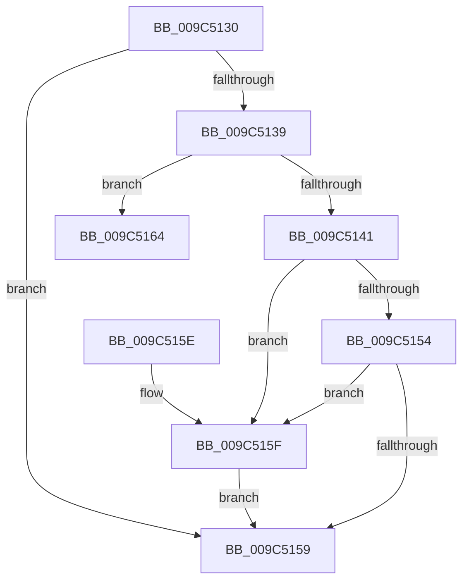

# ProbeForRead

- RVA: `0x009C5130`–`0x009C516A` (길이 `58` bytes)
- VA: `0x00000001409C5130`
- 실행 섹션: `PAGE`
- PDB 이름 있음: `예`; PDB Function 태그: `아니요`
- unwind 정보 RVA: `0x00068784`
- 디코드: `20`개 명령, `58/58` bytes 표시
- 미해석 바이트: `0` (있으면 어셈블리에 `.byte`로 보존)

> 이 문서는 커널 이미지의 기계어와 PDB 기호를 분석해 생성했습니다. 4번과 5번은 함수 원형과 자료형을 바이너리 사용 방식에서 추정한 C 해석이며 원본 소스 복구 결과는 아닙니다.

## 1. Dependencies

- 직접 호출 지점: **1**; 고유 호출 대상: **1**
- 직접 호출자로 확인된 함수: **6**
- RIP 상대 이미지 참조: **0**

### Outgoing calls
- `0x009C5164` → [ExRaiseDatatypeMisalignment](../89/ExRaiseDatatypeMisalignment_function_00899FD0.md) (function, `0x00899FD0`)

### Direct callers
- [RtlCopyFromUser](../../text/4F/RtlCopyFromUser_function_004FDAE8.md) at `0x004FDB24`
- [RtlCopyToUser](../70/RtlCopyToUser_function_00705D68.md) at `0x00705DA1`
- [RtlReadULong64FromUser](../70/RtlReadULong64FromUser_function_00705DCC.md) at `0x00705DF1`
- [RtlReadULongFromUser](../70/RtlReadULongFromUser_function_00705E08.md) at `0x00705E2D`
- [RtlWriteULong64ToUser](../70/RtlWriteULong64ToUser_function_00705E44.md) at `0x00705E70`
- [RtlWriteULongToUser](../70/RtlWriteULongToUser_function_00705E8C.md) at `0x00705EB7`

### Static image references
- 디코드된 RIP-relative 메모리 참조가 없습니다.

## 2. Other-region calls and transfers

- 다른 실행 섹션으로 향하는 call: **0**
- 별도 외부 분기/꼬리 이동을 확인하지 못했습니다.

## 3. Assembly (complete function range)

```asm
009C5130  48 83 EC 28                     sub rsp, 0x28
009C5134  48 85 D2                        test rdx, rdx
009C5137  74 20                           je 0x1409c5159
009C5139  41 FF C8                        dec r8d
009C513C  4C 85 C1                        test rcx, r8
009C513F  75 23                           jne 0x1409c5164
009C5141  48 8D 04 11                     lea rax, [rcx + rdx]
009C5145  48 BA 00 00 FF FF FF 7F 00 00   movabs rdx, 0x7fffffff0000
009C514F  48 3B C2                        cmp rax, rdx
009C5152  77 0B                           ja 0x1409c515f
009C5154  48 3B C1                        cmp rax, rcx
009C5157  72 06                           jb 0x1409c515f
009C5159  48 83 C4 28                     add rsp, 0x28
009C515D  C3                              ret
009C515E  CC                              int3
009C515F  8B 02                           mov eax, dword ptr [rdx]
009C5161  90                              nop
009C5162  EB F5                           jmp 0x1409c5159
009C5164  E8 67 4E ED FF                  call 0x140899fd0
009C5169  CC                              int3
```

## 4. C-style interpretation (structured pseudocode)

```c
__int64 __fastcall ProbeForRead(__int64 a1, __int64 a2, int a3)
{
    __int64 result;
    __int64 v_rsp;

    v_rsp = (v_rsp) - (40);
    if (a2 == 0) goto loc_009C5159;
    a3 = (unsigned int)((a3) - 1);
    if (((a1) & (a3)) != 0) goto loc_009C5164;
    if ((a1 + a2 * 1) > a2) goto loc_009C515F;
    if ((a1 + a2 * 1) < a1) goto loc_009C515F;
loc_009C5159:
    v_rsp = (v_rsp) + (40);
    return a1 + a2 * 1;
loc_009C515F:
    goto loc_009C5159;
loc_009C5164:
    result = ExRaiseDatatypeMisalignment(a1, a2, a3, a4);
    return result;
}
```

## 5. (Beta) C Style

```c
int64_t ProbeForRead(int64_t Arg1, int64_t Arg2, int32_t Arg3)
{
    int64_t result;
    int64_t local_rsp;

    local_rsp = (local_rsp) - (40);
    if (Arg2 == 0) goto loc_009C5159;
    Arg3 = (uint32_t)((Arg3) - 1);
    if (((Arg1) & (Arg3)) != 0) goto loc_009C5164;
    if ((Arg1 + Arg2 * 1) > Arg2) goto loc_009C515F;
    if ((Arg1 + Arg2 * 1) < Arg1) goto loc_009C515F;
loc_009C5159:
    local_rsp = (local_rsp) + (40);
    return Arg1 + Arg2 * 1;
loc_009C515F:
    goto loc_009C5159;
loc_009C5164:
    result = ExRaiseDatatypeMisalignment(Arg1, Arg2, Arg3, a4);
    return result;
}
```

## 6. Execution-region graph

[열기: 2D/3D 그래프와 함수 탐색 컨트롤 패널](../../../control-panel.html?section=page&rva=0x009C5130&view=graph)

- 2D 그래프는 위에서 아래로 흐르고, 3D 그래프는 빈 공간을 드래그해 회전합니다. Shift+드래그는 이동, 휠은 확대·축소, 함수 노드 선택은 대상 보고서 이동입니다.

### Static fallback


