# PsOpenThread

- RVA: `0x009C5CC0`–`0x009C633F` (길이 `1,663` bytes)
- VA: `0x00000001409C5CC0`
- 실행 섹션: `PAGE`
- PDB 이름 있음: `예`; PDB Function 태그: `아니요`
- unwind 정보 RVA: `0x000A0088`
- 디코드: `335`개 명령, `1,663/1,663` bytes 표시
- 미해석 바이트: `0` (있으면 어셈블리에 `.byte`로 보존)

> 이 문서는 커널 이미지의 기계어와 PDB 기호를 분석해 생성했습니다. 4번과 5번은 함수 원형과 자료형을 바이너리 사용 방식에서 추정한 C 해석이며 원본 소스 복구 결과는 아닙니다.

## 1. Dependencies

- 직접 호출 지점: **22**; 고유 호출 대상: **15**
- 직접 호출자로 확인된 함수: **2**
- RIP 상대 이미지 참조: **14**

### Outgoing calls
- `0x009C5D23` → [memset](../../text/6C/memset_function_006C6C40.md) (function, `0x006C6C40`)
- `0x009C5D38` → [memset](../../text/6C/memset_function_006C6C40.md) (function, `0x006C6C40`)
- `0x009C5E6E` → [SeCreateAccessState](../8C/SeCreateAccessState_function_008C6AC0.md) (function, `0x008C6AC0`)
- `0x009C5E9A` → [Feature_OutsideInProtection__private_IsEnabledDeviceUsageNoInline](../../text/5C/Feature_OutsideInProtection__private_IsEnabledDeviceUsageNoInline_function_005CD968.md) (function, `0x005CD968`)
- `0x009C5EAE` → [SeSinglePrivilegeCheck](../87/SeSinglePrivilegeCheck_function_00871E20.md) (function, `0x00871E20`)
- `0x009C5EF9` → [PsLookupThreadByThreadId](../86/PsLookupThreadByThreadId_function_00868300.md) (function, `0x00868300`)
- `0x009C5F18` → [ObfDereferenceObject](../../text/2F/ObfDereferenceObject_function_002F9350.md) (function, `0x002F9350`)
- `0x009C5F2A` → [SeDeleteAccessState](../8C/SeDeleteAccessState_function_008C5F70.md) (function, `0x008C5F70`)
- `0x009C5F46` → [PsLookupThreadByThreadId](../86/PsLookupThreadByThreadId_function_00868300.md) (function, `0x00868300`)
- `0x009C5F65` → [Feature_OutsideInProtection__private_IsEnabledDeviceUsageNoInline](../../text/5C/Feature_OutsideInProtection__private_IsEnabledDeviceUsageNoInline_function_005CD968.md) (function, `0x005CD968`)
- `0x009C5F79` → [SeSinglePrivilegeCheck](../87/SeSinglePrivilegeCheck_function_00871E20.md) (function, `0x00871E20`)
- `0x009C5F85` → [IoThreadToProcess](../../text/44/IoThreadToProcess_function_00448540.md) (function, `0x00448540`)
- `0x009C5F8D` → [PspIsTamperProtectedProcess](../../text/5E/PspIsTamperProtectedProcess_function_005E36D4.md) (function, `0x005E36D4`)
- `0x009C5FF6` → [ObOpenObjectByPointer](../8B/ObOpenObjectByPointer_function_008B7420.md) (function, `0x008B7420`)
- `0x009C6005` → [SeDeleteAccessState](../8C/SeDeleteAccessState_function_008C5F70.md) (function, `0x008C5F70`)
- `0x009C600D` → [ObfDereferenceObject](../../text/2F/ObfDereferenceObject_function_002F9350.md) (function, `0x002F9350`)
- `0x009C6079` → [PsGetThreadId](../../text/45/PsGetThreadId_function_00452220.md) (function, `0x00452220`)
- `0x009C6212` → [EtwWriteTransfer](../../text/41/EtwWriteTransfer_function_0041C830.md) (function, `0x0041C830`)
- `0x009C6308` → [EtwWrite](../../text/41/EtwWrite_function_0041C720.md) (function, `0x0041C720`)
- `0x009C631A` → [_security_check_cookie](../../text/6A/_security_check_cookie_function_006AC640.md) (function, `0x006AC640`)
- `0x009C6333` → [ExRaiseDatatypeMisalignment](../89/ExRaiseDatatypeMisalignment_function_00899FD0.md) (function, `0x00899FD0`)
- `0x009C6338` → [ExRaiseDatatypeMisalignment](../89/ExRaiseDatatypeMisalignment_function_00899FD0.md) (function, `0x00899FD0`)

### Direct callers
- [NtAlpcOpenSenderThread](NtAlpcOpenSenderThread_function_009C5920.md) at `0x009C5ACE`
- [NtOpenThread](NtOpenThread_function_009C5C90.md) at `0x009C5CAE`

### Static image references
- `0x009C5CD6` → RVA `0x00E0A740` (`.data`; read)
- `0x009C5E50` → RVA `0x00FC6AC8` (`ALMOSTRO`; read)
- `0x009C5EA7` → RVA `0x00FD9A80` (`PAGEDATA`; read)
- `0x009C6035` → RVA `0x00E08640` (`.data`; read)
- `0x009C604C` → RVA `0x00E08650` (`.data`; read)
- `0x009C6055` → RVA `0x00E08658` (`.data`; read)
- `0x009C6171` → RVA `0x00052B14` (`.rdata`; read)
- `0x009C6187` → RVA `0x00E08648` (`.data`; read)
- `0x009C61AB` → RVA `0x00052B1E` (`.rdata`; read)
- `0x009C61D0` → RVA `0x0005BCFD` (`.rdata`; read)
- `0x009C61D7` → RVA `0x00043590` (`.rdata`; read)
- `0x009C620B` → RVA `0x00E08660` (`.data`; read)
- `0x009C62FA` → RVA `0x00019A10` (`.rdata`; read)
- `0x009C6301` → RVA `0x00EFFA38` (`.data`; read)

## 2. Other-region calls and transfers

- 다른 실행 섹션으로 향하는 call: **12**
  - `0x009C5D23` → [memset](../../text/6C/memset_function_006C6C40.md) (`PAGE` → `.text`)
  - `0x009C5D38` → [memset](../../text/6C/memset_function_006C6C40.md) (`PAGE` → `.text`)
  - `0x009C5E9A` → [Feature_OutsideInProtection__private_IsEnabledDeviceUsageNoInline](../../text/5C/Feature_OutsideInProtection__private_IsEnabledDeviceUsageNoInline_function_005CD968.md) (`PAGE` → `.text`)
  - `0x009C5F18` → [ObfDereferenceObject](../../text/2F/ObfDereferenceObject_function_002F9350.md) (`PAGE` → `.text`)
  - `0x009C5F65` → [Feature_OutsideInProtection__private_IsEnabledDeviceUsageNoInline](../../text/5C/Feature_OutsideInProtection__private_IsEnabledDeviceUsageNoInline_function_005CD968.md) (`PAGE` → `.text`)
  - `0x009C5F85` → [IoThreadToProcess](../../text/44/IoThreadToProcess_function_00448540.md) (`PAGE` → `.text`)
  - `0x009C5F8D` → [PspIsTamperProtectedProcess](../../text/5E/PspIsTamperProtectedProcess_function_005E36D4.md) (`PAGE` → `.text`)
  - `0x009C600D` → [ObfDereferenceObject](../../text/2F/ObfDereferenceObject_function_002F9350.md) (`PAGE` → `.text`)
  - `0x009C6079` → [PsGetThreadId](../../text/45/PsGetThreadId_function_00452220.md) (`PAGE` → `.text`)
  - `0x009C6212` → [EtwWriteTransfer](../../text/41/EtwWriteTransfer_function_0041C830.md) (`PAGE` → `.text`)
  - `0x009C6308` → [EtwWrite](../../text/41/EtwWrite_function_0041C720.md) (`PAGE` → `.text`)
  - `0x009C631A` → [_security_check_cookie](../../text/6A/_security_check_cookie_function_006AC640.md) (`PAGE` → `.text`)
- 별도 외부 분기/꼬리 이동을 확인하지 못했습니다.

## 3. Assembly (complete function range)

```asm
009C5CC0  89 54 24 10                     mov dword ptr [rsp + 0x10], edx
009C5CC4  53                              push rbx
009C5CC5  56                              push rsi
009C5CC6  57                              push rdi
009C5CC7  41 54                           push r12
009C5CC9  41 55                           push r13
009C5CCB  41 56                           push r14
009C5CCD  41 57                           push r15
009C5CCF  48 81 EC 10 03 00 00            sub rsp, 0x310
009C5CD6  48 8B 05 63 4A 44 00            mov rax, qword ptr [rip + 0x444a63]
009C5CDD  48 33 C4                        xor rax, rsp
009C5CE0  48 89 84 24 00 03 00 00         mov qword ptr [rsp + 0x300], rax
009C5CE8  49 8B D9                        mov rbx, r9
009C5CEB  49 8B F8                        mov rdi, r8
009C5CEE  44 8B E2                        mov r12d, edx
009C5CF1  4C 8B F1                        mov r14, rcx
009C5CF4  48 89 4C 24 68                  mov qword ptr [rsp + 0x68], rcx
009C5CF9  33 F6                           xor esi, esi
009C5CFB  48 89 B4 24 90 00 00 00         mov qword ptr [rsp + 0x90], rsi
009C5D03  48 89 B4 24 80 00 00 00         mov qword ptr [rsp + 0x80], rsi
009C5D0B  0F 57 C0                        xorps xmm0, xmm0
009C5D0E  0F 11 44 24 70                  movups xmmword ptr [rsp + 0x70], xmm0
009C5D13  33 D2                           xor edx, edx
009C5D15  41 B8 A0 00 00 00               mov r8d, 0xa0
009C5D1B  48 8D 8C 24 B0 00 00 00         lea rcx, [rsp + 0xb0]
009C5D23  E8 18 0F D0 FF                  call 0x1406c6c40
009C5D28  33 D2                           xor edx, edx
009C5D2A  41 B8 E0 00 00 00               mov r8d, 0xe0
009C5D30  48 8D 8C 24 50 01 00 00         lea rcx, [rsp + 0x150]
009C5D38  E8 03 0F D0 FF                  call 0x1406c6c40
009C5D3D  44 8B FE                        mov r15d, esi
009C5D40  89 74 24 44                     mov dword ptr [rsp + 0x44], esi
009C5D44  40 38 B4 24 70 03 00 00         cmp byte ptr [rsp + 0x370], sil
009C5D4C  0F 84 9D 00 00 00               je 0x1409c5def
009C5D52  48 BA 00 00 FF FF FF 7F 00 00   movabs rdx, 0x7fffffff0000
009C5D5C  48 8B CA                        mov rcx, rdx
009C5D5F  4C 3B F2                        cmp r14, rdx
009C5D62  49 0F 42 CE                     cmovb rcx, r14
009C5D66  48 8B 01                        mov rax, qword ptr [rcx]
009C5D69  48 89 01                        mov qword ptr [rcx], rax
009C5D6C  40 F6 C7 03                     test dil, 3
009C5D70  0F 85 BD 05 00 00               jne 0x1409c6333
009C5D76  48 8B C2                        mov rax, rdx
009C5D79  48 3B FA                        cmp rdi, rdx
009C5D7C  48 0F 42 C7                     cmovb rax, rdi
009C5D80  90                              nop
009C5D81  0F B6 00                        movzx eax, byte ptr [rax]
009C5D84  48 83 7F 10 00                  cmp qword ptr [rdi + 0x10], 0
009C5D89  0F 95 C1                        setne cl
009C5D8C  88 4C 24 41                     mov byte ptr [rsp + 0x41], cl
009C5D90  44 8B 6F 18                     mov r13d, dword ptr [rdi + 0x18]
009C5D94  B8 F2 1D 00 00                  mov eax, 0x1df2
009C5D99  44 23 E8                        and r13d, eax
009C5D9C  44 89 6C 24 48                  mov dword ptr [rsp + 0x48], r13d
009C5DA1  48 85 DB                        test rbx, rbx
009C5DA4  74 2E                           je 0x1409c5dd4
009C5DA6  F6 C3 03                        test bl, 3
009C5DA9  0F 85 89 05 00 00               jne 0x1409c6338
009C5DAF  48 3B DA                        cmp rbx, rdx
009C5DB2  48 0F 42 D3                     cmovb rdx, rbx
009C5DB6  90                              nop
009C5DB7  0F B6 02                        movzx eax, byte ptr [rdx]
009C5DBA  0F 10 03                        movups xmm0, xmmword ptr [rbx]
009C5DBD  0F 11 44 24 70                  movups xmmword ptr [rsp + 0x70], xmm0
009C5DC2  B0 01                           mov al, 1
009C5DC4  88 44 24 40                     mov byte ptr [rsp + 0x40], al
009C5DC8  0F B6 4C 24 41                  movzx ecx, byte ptr [rsp + 0x41]
009C5DCD  44 8B 6C 24 48                  mov r13d, dword ptr [rsp + 0x48]
009C5DD2  EB 06                           jmp 0x1409c5dda
009C5DD4  32 C0                           xor al, al
009C5DD6  88 44 24 40                     mov byte ptr [rsp + 0x40], al
009C5DDA  EB 55                           jmp 0x1409c5e31
009C5DDC  8B D8                           mov ebx, eax
009C5DDE  4C 8B 74 24 70                  mov r14, qword ptr [rsp + 0x70]
009C5DE3  8B BC 24 58 03 00 00            mov edi, dword ptr [rsp + 0x358]
009C5DEA  E9 7C 04 00 00                  jmp 0x1409c626b
009C5DEF  48 39 77 10                     cmp qword ptr [rdi + 0x10], rsi
009C5DF3  0F 95 C1                        setne cl
009C5DF6  B8 F2 1D 00 00                  mov eax, 0x1df2
009C5DFB  41 BD F2 1F 01 00               mov r13d, 0x11ff2
009C5E01  40 38 B4 24 78 03 00 00         cmp byte ptr [rsp + 0x378], sil
009C5E09  44 0F 45 E8                     cmovne r13d, eax
009C5E0D  44 23 6F 18                     and r13d, dword ptr [rdi + 0x18]
009C5E11  88 4C 24 41                     mov byte ptr [rsp + 0x41], cl
009C5E15  44 89 6C 24 48                  mov dword ptr [rsp + 0x48], r13d
009C5E1A  48 85 DB                        test rbx, rbx
009C5E1D  74 0C                           je 0x1409c5e2b
009C5E1F  0F 10 03                        movups xmm0, xmmword ptr [rbx]
009C5E22  0F 11 44 24 70                  movups xmmword ptr [rsp + 0x70], xmm0
009C5E27  B0 01                           mov al, 1
009C5E29  EB 02                           jmp 0x1409c5e2d
009C5E2B  32 C0                           xor al, al
009C5E2D  88 44 24 40                     mov byte ptr [rsp + 0x40], al
009C5E31  84 C9                           test cl, cl
009C5E33  0F 85 21 04 00 00               jne 0x1409c625a
009C5E39  84 C0                           test al, al
009C5E3B  0F 84 19 04 00 00               je 0x1409c625a
009C5E41  4C 8B 74 24 70                  mov r14, qword ptr [rsp + 0x70]
009C5E46  66 66 0F 1F 84 00 00 00 00 00   nop word ptr [rax + rax]
009C5E50  4C 8B 0D 71 0C 60 00            mov r9, qword ptr [rip + 0x600c71]
009C5E57  49 83 C1 4C                     add r9, 0x4c
009C5E5B  45 8B C4                        mov r8d, r12d
009C5E5E  48 8D 94 24 50 01 00 00         lea rdx, [rsp + 0x150]
009C5E66  48 8D 8C 24 B0 00 00 00         lea rcx, [rsp + 0xb0]
009C5E6E  E8 4D 0C F0 FF                  call 0x1408c6ac0
009C5E73  8B D8                           mov ebx, eax
009C5E75  85 C0                           test eax, eax
009C5E77  0F 88 E7 03 00 00               js 0x1409c6264
009C5E7D  45 8B E5                        mov r12d, r13d
009C5E80  41 81 E4 00 04 00 00            and r12d, 0x400
009C5E87  74 08                           je 0x1409c5e91
009C5E89  45 85 FF                        test r15d, r15d
009C5E8C  41 B7 01                        mov r15b, 1
009C5E8F  74 09                           je 0x1409c5e9a
009C5E91  44 0F B6 BC 24 78 03 00 00      movzx r15d, byte ptr [rsp + 0x378]
009C5E9A  E8 C9 7A C0 FF                  call 0x1405cd968
009C5E9F  85 C0                           test eax, eax
009C5EA1  75 3C                           jne 0x1409c5edf
009C5EA3  41 0F B6 D7                     movzx edx, r15b
009C5EA7  48 8B 0D D2 3B 61 00            mov rcx, qword ptr [rip + 0x613bd2]
009C5EAE  E8 6D BF EA FF                  call 0x140871e20
009C5EB3  84 C0                           test al, al
009C5EB5  74 28                           je 0x1409c5edf
009C5EB7  8B 84 24 C0 00 00 00            mov eax, dword ptr [rsp + 0xc0]
009C5EBE  0F BA E0 19                     bt eax, 0x19
009C5EC2  73 0D                           jae 0x1409c5ed1
009C5EC4  81 8C 24 C4 00 00 00 FF FF 1F 00  or dword ptr [rsp + 0xc4], 0x1fffff
009C5ECF  EB 07                           jmp 0x1409c5ed8
009C5ED1  09 84 24 C4 00 00 00            or dword ptr [rsp + 0xc4], eax
009C5ED8  89 B4 24 C0 00 00 00            mov dword ptr [rsp + 0xc0], esi
009C5EDF  48 8B 4C 24 78                  mov rcx, qword ptr [rsp + 0x78]
009C5EE4  4D 85 F6                        test r14, r14
009C5EE7  74 55                           je 0x1409c5f3e
009C5EE9  48 89 B4 24 88 00 00 00         mov qword ptr [rsp + 0x88], rsi
009C5EF1  48 8D 94 24 88 00 00 00         lea rdx, [rsp + 0x88]
009C5EF9  E8 02 24 EA FF                  call 0x140868300
009C5EFE  8B D8                           mov ebx, eax
009C5F00  85 C0                           test eax, eax
009C5F02  78 1E                           js 0x1409c5f22
009C5F04  48 8B BC 24 88 00 00 00         mov rdi, qword ptr [rsp + 0x88]
009C5F0C  4C 39 B7 08 05 00 00            cmp qword ptr [rdi + 0x508], r14
009C5F13  74 1F                           je 0x1409c5f34
009C5F15  48 8B CF                        mov rcx, rdi
009C5F18  E8 33 34 93 FF                  call 0x1402f9350
009C5F1D  BB 0B 00 00 C0                  mov ebx, 0xc000000b
009C5F22  48 8D 8C 24 B0 00 00 00         lea rcx, [rsp + 0xb0]
009C5F2A  E8 41 00 F0 FF                  call 0x1408c5f70
009C5F2F  E9 30 03 00 00                  jmp 0x1409c6264
009C5F34  48 89 BC 24 80 00 00 00         mov qword ptr [rsp + 0x80], rdi
009C5F3C  EB 27                           jmp 0x1409c5f65
009C5F3E  48 8D 94 24 80 00 00 00         lea rdx, [rsp + 0x80]
009C5F46  E8 B5 23 EA FF                  call 0x140868300
009C5F4B  8B D8                           mov ebx, eax
009C5F4D  85 C0                           test eax, eax
009C5F4F  78 D1                           js 0x1409c5f22
009C5F51  48 8B BC 24 80 00 00 00         mov rdi, qword ptr [rsp + 0x80]
009C5F59  4C 8B B7 08 05 00 00            mov r14, qword ptr [rdi + 0x508]
009C5F60  4C 89 74 24 70                  mov qword ptr [rsp + 0x70], r14
009C5F65  E8 FE 79 C0 FF                  call 0x1405cd968
009C5F6A  85 C0                           test eax, eax
009C5F6C  74 50                           je 0x1409c5fbe
009C5F6E  41 0F B6 D7                     movzx edx, r15b
009C5F72  48 8B 0D 07 3B 61 00            mov rcx, qword ptr [rip + 0x613b07]
009C5F79  E8 A2 BE EA FF                  call 0x140871e20
009C5F7E  84 C0                           test al, al
009C5F80  74 3C                           je 0x1409c5fbe
009C5F82  48 8B CF                        mov rcx, rdi
009C5F85  E8 B6 25 A8 FF                  call 0x140448540
009C5F8A  48 8B C8                        mov rcx, rax
009C5F8D  E8 42 D7 C1 FF                  call 0x1405e36d4
009C5F92  84 C0                           test al, al
009C5F94  75 28                           jne 0x1409c5fbe
009C5F96  8B 84 24 C0 00 00 00            mov eax, dword ptr [rsp + 0xc0]
009C5F9D  0F BA E0 19                     bt eax, 0x19
009C5FA1  73 0D                           jae 0x1409c5fb0
009C5FA3  81 8C 24 C4 00 00 00 FF FF 1F 00  or dword ptr [rsp + 0xc4], 0x1fffff
009C5FAE  EB 07                           jmp 0x1409c5fb7
009C5FB0  09 84 24 C4 00 00 00            or dword ptr [rsp + 0xc4], eax
009C5FB7  89 B4 24 C0 00 00 00            mov dword ptr [rsp + 0xc0], esi
009C5FBE  48 8D 84 24 90 00 00 00         lea rax, [rsp + 0x90]
009C5FC6  48 89 44 24 30                  mov qword ptr [rsp + 0x30], rax
009C5FCB  44 0F B6 BC 24 78 03 00 00      movzx r15d, byte ptr [rsp + 0x378]
009C5FD4  44 88 7C 24 28                  mov byte ptr [rsp + 0x28], r15b
009C5FD9  48 8B 05 E8 0A 60 00            mov rax, qword ptr [rip + 0x600ae8]
009C5FE0  48 89 44 24 20                  mov qword ptr [rsp + 0x20], rax
009C5FE5  45 33 C9                        xor r9d, r9d
009C5FE8  4C 8D 84 24 B0 00 00 00         lea r8, [rsp + 0xb0]
009C5FF0  41 8B D5                        mov edx, r13d
009C5FF3  48 8B CF                        mov rcx, rdi
009C5FF6  E8 25 14 EF FF                  call 0x1408b7420
009C5FFB  8B D8                           mov ebx, eax
009C5FFD  48 8D 8C 24 B0 00 00 00         lea rcx, [rsp + 0xb0]
009C6005  E8 66 FF EF FF                  call 0x1408c5f70
009C600A  48 8B CF                        mov rcx, rdi
009C600D  E8 3E 33 93 FF                  call 0x1402f9350
009C6012  85 DB                           test ebx, ebx
009C6014  0F 88 14 02 00 00               js 0x1409c622e
009C601A  48 8B 84 24 90 00 00 00         mov rax, qword ptr [rsp + 0x90]
009C6022  48 8B 4C 24 68                  mov rcx, qword ptr [rsp + 0x68]
009C6027  48 89 01                        mov qword ptr [rcx], rax
009C602A  83 7C 24 44 00                  cmp dword ptr [rsp + 0x44], 0
009C602F  0F 84 2F 02 00 00               je 0x1409c6264
009C6035  83 3D 04 26 44 00 05            cmp dword ptr [rip + 0x442604], 5
009C603C  0F 86 22 02 00 00               jbe 0x1409c6264
009C6042  49 BC 00 00 00 00 00 40 00 00   movabs r12, 0x400000000000
009C604C  4C 85 25 FD 25 44 00            test qword ptr [rip + 0x4425fd], r12
009C6053  74 17                           je 0x1409c606c
009C6055  48 8B 05 FC 25 44 00            mov rax, qword ptr [rip + 0x4425fc]
009C605C  49 23 C4                        and rax, r12
009C605F  48 3B 05 F2 25 44 00            cmp rax, qword ptr [rip + 0x4425f2]
009C6066  75 04                           jne 0x1409c606c
009C6068  B0 01                           mov al, 1
009C606A  EB 02                           jmp 0x1409c606e
009C606C  32 C0                           xor al, al
009C606E  84 C0                           test al, al
009C6070  0F 84 EE 01 00 00               je 0x1409c6264
009C6076  48 8B CF                        mov rcx, rdi
009C6079  E8 A2 C1 A8 FF                  call 0x140452220
009C607E  89 44 24 50                     mov dword ptr [rsp + 0x50], eax
009C6082  48 8D 44 24 50                  lea rax, [rsp + 0x50]
009C6087  48 89 84 24 90 02 00 00         mov qword ptr [rsp + 0x290], rax
009C608F  48 C7 84 24 98 02 00 00 04 00 00 00  mov qword ptr [rsp + 0x298], 4
009C609B  44 89 74 24 58                  mov dword ptr [rsp + 0x58], r14d
009C60A0  48 8D 44 24 58                  lea rax, [rsp + 0x58]
009C60A5  48 89 84 24 A0 02 00 00         mov qword ptr [rsp + 0x2a0], rax
009C60AD  48 C7 84 24 A8 02 00 00 04 00 00 00  mov qword ptr [rsp + 0x2a8], 4
009C60B9  8B BC 24 58 03 00 00            mov edi, dword ptr [rsp + 0x358]
009C60C0  89 7C 24 60                     mov dword ptr [rsp + 0x60], edi
009C60C4  48 8D 44 24 60                  lea rax, [rsp + 0x60]
009C60C9  48 89 84 24 B0 02 00 00         mov qword ptr [rsp + 0x2b0], rax
009C60D1  48 C7 84 24 B8 02 00 00 04 00 00 00  mov qword ptr [rsp + 0x2b8], 4
009C60DD  44 89 6C 24 68                  mov dword ptr [rsp + 0x68], r13d
009C60E2  48 8D 44 24 68                  lea rax, [rsp + 0x68]
009C60E7  48 89 84 24 C0 02 00 00         mov qword ptr [rsp + 0x2c0], rax
009C60EF  48 C7 84 24 C8 02 00 00 04 00 00 00  mov qword ptr [rsp + 0x2c8], 4
009C60FB  0F B6 84 24 70 03 00 00         movzx eax, byte ptr [rsp + 0x370]
009C6103  88 44 24 42                     mov byte ptr [rsp + 0x42], al
009C6107  48 8D 44 24 42                  lea rax, [rsp + 0x42]
009C610C  48 89 84 24 D0 02 00 00         mov qword ptr [rsp + 0x2d0], rax
009C6114  48 C7 84 24 D8 02 00 00 01 00 00 00  mov qword ptr [rsp + 0x2d8], 1
009C6120  44 88 7C 24 43                  mov byte ptr [rsp + 0x43], r15b
009C6125  48 8D 44 24 43                  lea rax, [rsp + 0x43]
009C612A  48 89 84 24 E0 02 00 00         mov qword ptr [rsp + 0x2e0], rax
009C6132  48 C7 84 24 E8 02 00 00 01 00 00 00  mov qword ptr [rsp + 0x2e8], 1
009C613E  48 C7 84 24 98 00 00 00 00 00 00 01  mov qword ptr [rsp + 0x98], 0x1000000
009C614A  48 8D 84 24 98 00 00 00         lea rax, [rsp + 0x98]
009C6152  48 89 84 24 F0 02 00 00         mov qword ptr [rsp + 0x2f0], rax
009C615A  48 C7 84 24 F8 02 00 00 08 00 00 00  mov qword ptr [rsp + 0x2f8], 8
009C6166  C7 84 24 A0 00 00 00 00 00 00 0B  mov dword ptr [rsp + 0xa0], 0xb000000
009C6171  0F B7 05 9C C9 68 FF            movzx eax, word ptr [rip - 0x973664]
009C6178  89 84 24 A4 00 00 00            mov dword ptr [rsp + 0xa4], eax
009C617F  4C 89 A4 24 A8 00 00 00         mov qword ptr [rsp + 0xa8], r12
009C6187  48 8B 05 BA 24 44 00            mov rax, qword ptr [rip + 0x4424ba]
009C618E  48 89 84 24 70 02 00 00         mov qword ptr [rsp + 0x270], rax
009C6196  0F B7 00                        movzx eax, word ptr [rax]
009C6199  89 84 24 78 02 00 00            mov dword ptr [rsp + 0x278], eax
009C61A0  C7 84 24 7C 02 00 00 02 00 00 00  mov dword ptr [rsp + 0x27c], 2
009C61AB  48 8D 05 6C C9 68 FF            lea rax, [rip - 0x973694]
009C61B2  48 89 84 24 80 02 00 00         mov qword ptr [rsp + 0x280], rax
009C61BA  C7 84 24 88 02 00 00 92 00 00 00  mov dword ptr [rsp + 0x288], 0x92
009C61C5  C7 84 24 8C 02 00 00 01 00 00 00  mov dword ptr [rsp + 0x28c], 1
009C61D0  48 8D 05 26 5B 69 FF            lea rax, [rip - 0x96a4da]
009C61D7  48 8D 0D B2 D3 67 FF            lea rcx, [rip - 0x982c4e]
009C61DE  2B C1                           sub eax, ecx
009C61E0  89 44 24 44                     mov dword ptr [rsp + 0x44], eax
009C61E4  8B 44 24 44                     mov eax, dword ptr [rsp + 0x44]
009C61E8  48 8D 84 24 70 02 00 00         lea rax, [rsp + 0x270]
009C61F0  48 89 44 24 28                  mov qword ptr [rsp + 0x28], rax
009C61F5  C7 44 24 20 09 00 00 00         mov dword ptr [rsp + 0x20], 9
009C61FD  45 33 C9                        xor r9d, r9d
009C6200  45 33 C0                        xor r8d, r8d
009C6203  48 8D 94 24 A0 00 00 00         lea rdx, [rsp + 0xa0]
009C620B  48 8B 0D 4E 24 44 00            mov rcx, qword ptr [rip + 0x44244e]
009C6212  E8 19 66 A5 FF                  call 0x14041c830
009C6217  4C 8B 74 24 70                  mov r14, qword ptr [rsp + 0x70]
009C621C  EB 4D                           jmp 0x1409c626b
009C621E  8B D8                           mov ebx, eax
009C6220  4C 8B 74 24 70                  mov r14, qword ptr [rsp + 0x70]
009C6225  8B BC 24 58 03 00 00            mov edi, dword ptr [rsp + 0x358]
009C622C  EB 3D                           jmp 0x1409c626b
009C622E  45 85 E4                        test r12d, r12d
009C6231  74 31                           je 0x1409c6264
009C6233  81 FB 22 00 00 C0               cmp ebx, 0xc0000022
009C6239  75 29                           jne 0x1409c6264
009C623B  83 7C 24 44 00                  cmp dword ptr [rsp + 0x44], 0
009C6240  75 22                           jne 0x1409c6264
009C6242  41 BF 01 00 00 00               mov r15d, 1
009C6248  44 89 7C 24 44                  mov dword ptr [rsp + 0x44], r15d
009C624D  44 8B A4 24 58 03 00 00         mov r12d, dword ptr [rsp + 0x358]
009C6255  E9 F6 FB FF FF                  jmp 0x1409c5e50
009C625A  BB 30 00 00 C0                  mov ebx, 0xc0000030
009C625F  4C 8B 74 24 70                  mov r14, qword ptr [rsp + 0x70]
009C6264  8B BC 24 58 03 00 00            mov edi, dword ptr [rsp + 0x358]
009C626B  89 5C 24 50                     mov dword ptr [rsp + 0x50], ebx
009C626F  89 7C 24 58                     mov dword ptr [rsp + 0x58], edi
009C6273  8B 44 24 78                     mov eax, dword ptr [rsp + 0x78]
009C6277  89 44 24 60                     mov dword ptr [rsp + 0x60], eax
009C627B  44 89 74 24 68                  mov dword ptr [rsp + 0x68], r14d
009C6280  48 8D 44 24 68                  lea rax, [rsp + 0x68]
009C6285  48 89 84 24 30 02 00 00         mov qword ptr [rsp + 0x230], rax
009C628D  48 C7 84 24 38 02 00 00 04 00 00 00  mov qword ptr [rsp + 0x238], 4
009C6299  48 8D 44 24 60                  lea rax, [rsp + 0x60]
009C629E  48 89 84 24 40 02 00 00         mov qword ptr [rsp + 0x240], rax
009C62A6  48 C7 84 24 48 02 00 00 04 00 00 00  mov qword ptr [rsp + 0x248], 4
009C62B2  48 8D 44 24 58                  lea rax, [rsp + 0x58]
009C62B7  48 89 84 24 50 02 00 00         mov qword ptr [rsp + 0x250], rax
009C62BF  48 C7 84 24 58 02 00 00 04 00 00 00  mov qword ptr [rsp + 0x258], 4
009C62CB  48 8D 44 24 50                  lea rax, [rsp + 0x50]
009C62D0  48 89 84 24 60 02 00 00         mov qword ptr [rsp + 0x260], rax
009C62D8  48 C7 84 24 68 02 00 00 04 00 00 00  mov qword ptr [rsp + 0x268], 4
009C62E4  48 8D 84 24 30 02 00 00         lea rax, [rsp + 0x230]
009C62EC  48 89 44 24 20                  mov qword ptr [rsp + 0x20], rax
009C62F1  41 B9 04 00 00 00               mov r9d, 4
009C62F7  45 33 C0                        xor r8d, r8d
009C62FA  48 8D 15 0F 37 65 FF            lea rdx, [rip - 0x9ac8f1]
009C6301  48 8B 0D 30 97 53 00            mov rcx, qword ptr [rip + 0x539730]
009C6308  E8 13 64 A5 FF                  call 0x14041c720
009C630D  8B C3                           mov eax, ebx
009C630F  48 8B 8C 24 00 03 00 00         mov rcx, qword ptr [rsp + 0x300]
009C6317  48 33 CC                        xor rcx, rsp
009C631A  E8 21 63 CE FF                  call 0x1406ac640
009C631F  48 81 C4 10 03 00 00            add rsp, 0x310
009C6326  41 5F                           pop r15
009C6328  41 5E                           pop r14
009C632A  41 5D                           pop r13
009C632C  41 5C                           pop r12
009C632E  5F                              pop rdi
009C632F  5E                              pop rsi
009C6330  5B                              pop rbx
009C6331  C3                              ret
009C6332  CC                              int3
009C6333  E8 98 3C ED FF                  call 0x140899fd0
009C6338  E8 93 3C ED FF                  call 0x140899fd0
009C633D  90                              nop
009C633E  CC                              int3
```

## 4. C-style interpretation (structured pseudocode)

```c
__int64 __fastcall PsOpenThread(__int64 a1, int a2, __int64 a3, __int64 a4, unsigned __int8 a5, unsigned __int8 a6)
{
    __int64 result;
    __int64 v_r12;
    __int64 v_r13;
    __int64 v_r15;
    __int64 v_rsi;
    __int64 v_rsp;
    unsigned __int64 v_stack_m100;
    unsigned __int64 v_stack_m108;
    unsigned __int64 v_stack_m110;
    unsigned __int64 v_stack_m118;
    unsigned __int64 v_stack_m1F8;
    unsigned int v_stack_m284;
    unsigned int v_stack_m288;
    unsigned __int64 v_stack_m298;
    unsigned __int64 v_stack_m2A0;
    unsigned int v_stack_m2A4;
    unsigned int v_stack_m2A8;
    unsigned __int64 v_stack_m2B0;
    unsigned __int64 v_stack_m2B8;
    unsigned __int64 v_stack_m2C0;
    unsigned __int64 v_stack_m2C8;
    unsigned __int64 v_stack_m2D0;
    unsigned __int64 v_stack_m2D8;
    unsigned __int64 v_stack_m2E0;
    unsigned int v_stack_m2E8;
    unsigned int v_stack_m2F0;
    unsigned int v_stack_m2F8;
    unsigned int v_stack_m300;
    unsigned int v_stack_m304;
    unsigned __int8 v_stack_m305;
    unsigned __int8 v_stack_m306;
    unsigned __int8 v_stack_m307;
    unsigned __int8 v_stack_m308;
    unsigned __int64 v_stack_m318;
    unsigned __int8 v_stack_m320;
    unsigned __int64 v_stack_m328;
    unsigned __int64 v_stack_m48;
    unsigned __int64 v_stack_m50;
    unsigned __int64 v_stack_m58;
    unsigned __int64 v_stack_m60;
    unsigned __int64 v_stack_m68;
    unsigned __int64 v_stack_m70;
    unsigned __int64 v_stack_m78;
    unsigned __int64 v_stack_m80;
    unsigned __int64 v_stack_m88;
    unsigned __int64 v_stack_m90;
    unsigned __int64 v_stack_m98;
    unsigned __int64 v_stack_mA0;
    unsigned __int64 v_stack_mA8;
    unsigned __int64 v_stack_mB0;
    unsigned __int64 v_stack_mB8;
    unsigned int v_stack_mBC;
    unsigned int v_stack_mC0;
    unsigned __int64 v_stack_mC8;
    unsigned int v_stack_mCC;
    unsigned int v_stack_mD0;
    unsigned __int64 v_stack_mD8;
    unsigned __int64 v_stack_mE0;
    unsigned __int64 v_stack_mE8;
    unsigned __int64 v_stack_mF0;
    unsigned __int64 v_stack_mF8;
    unsigned int v_stack_p10;

    v_stack_p10 = a2;
    v_rsp = (v_rsp) - (784);
    result = (*(unsigned __int64 *)(v_rip + 4475491)) ^ (v_rsp);
    v_stack_m48 = result;
    v_stack_m2E0 = a1;
    v_rsi = 0;
    v_stack_m2B8 = 0;
    v_stack_m2C8 = 0;
    v_stack_m2D8 = v_xmm0;
    a2 = 0;
    result = memset(v_stack_m298, a2, 160, a4);
    a2 = 0;
    result = memset(v_stack_m1F8, a2, 224, a4);
    v_stack_m304 = 0;
    if (a5 == 0) goto loc_009C5DEF;
    a1 = 0;
    if (a1 < 0) { a1 = a1; }
    *(unsigned __int64 *)(a1) = *(unsigned __int64 *)(a1);
    if ((((unsigned __int8)(a3)) & (3)) != 0) goto loc_009C6333;
    result = 0;
    if (a3 < 0) { result = a3; }
    a1 = ((*(unsigned __int64 *)(a3 + 16)) != 0) ? 1 : 0;
    v_stack_m307 = (unsigned __int8)(a1);
    v_r13 = (unsigned int)(((unsigned int)(*(unsigned int *)(a3 + 24))) & ((unsigned int)((unsigned int)(0x1DF2ULL))));
    v_stack_m300 = (unsigned int)(v_r13);
    if (a4 == 0) goto loc_009C5DD4;
    if ((((unsigned __int8)(a4)) & (3)) != 0) goto loc_009C6338;
    if (a4 < 0) { a2 = a4; }
    v_stack_m2D8 = v_xmm0;
    v_stack_m308 = 1;
    goto loc_009C5DDA;
loc_009C5DD4:
    result = 0;
    v_stack_m308 = 0;
loc_009C5DDA:
    goto loc_009C5E31;
loc_009C5DEF:
    a1 = ((*(unsigned __int64 *)(a3 + 16)) != 0) ? 1 : 0;
    v_r13 = (unsigned int)(0x11FF2ULL);
    if (a6 != 0) { v_r13 = (unsigned int)((unsigned int)(0x1DF2ULL)); }
    v_r13 = (unsigned int)((v_r13) & (*(unsigned int *)(a3 + 24)));
    v_stack_m307 = (unsigned __int8)(a1);
    v_stack_m300 = (unsigned int)(v_r13);
    if (a4 == 0) goto loc_009C5E2B;
    v_stack_m2D8 = v_xmm0;
    goto loc_009C5E2D;
loc_009C5E2B:
    result = 0;
loc_009C5E2D:
    v_stack_m308 = 0;
loc_009C5E31:
    if ((unsigned __int8)(a1) != 0) goto loc_009C625A;
    if (0 == 0) goto loc_009C625A;
loc_009C5E50:
    a4 = (*(unsigned __int64 *)(v_rip + 6294641)) + (76);
    result = SeCreateAccessState(v_stack_m298, v_stack_m1F8, (unsigned int)((unsigned int)((unsigned int)(a2))), a4);
    if (sign_flag) goto loc_009C6264;
    v_r12 = (unsigned int)(((unsigned int)((unsigned int)(v_r13))) & (0x400ULL));
    if (condition_is_equal) goto loc_009C5E91;
    v_r15 = 1;
    if (0 != 0) {
        v_r15 = a6;
    }
    result = Feature_OutsideInProtection__private_IsEnabledDeviceUsageNoInline(v_stack_m298, v_stack_m1F8, (unsigned int)((unsigned int)((unsigned int)(a2))), a4);
    if ((unsigned int)(result) != 0) goto loc_009C5EDF;
    result = SeSinglePrivilegeCheck(*(unsigned __int64 *)(v_rip + 6372306), (unsigned __int8)(v_r15), (unsigned int)((unsigned int)((unsigned int)(a2))), a4);
    if ((unsigned __int8)(result) == 0) goto loc_009C5EDF;
    if (condition_is_above_or_equal) goto loc_009C5ED1;
    goto loc_009C5ED8;
loc_009C5ED1:
loc_009C5ED8:
    v_stack_m288 = 0;
loc_009C5EDF:
    if (v_stack_m2D8 == 0) goto loc_009C5F3E;
    v_stack_m2C0 = 0;
    result = PsLookupThreadByThreadId(v_stack_m2D0, v_stack_m2C0, (unsigned int)((unsigned int)((unsigned int)(a2))), a4);
    if (sign_flag) goto loc_009C5F22;
    if ((*(unsigned __int64 *)(v_stack_m2C0 + 1288)) == v_stack_m2D8) goto loc_009C5F34;
    result = ObfDereferenceObject(v_stack_m2C0, v_stack_m2C0, (unsigned int)((unsigned int)((unsigned int)(a2))), a4);
loc_009C5F22:
    result = SeDeleteAccessState(v_stack_m298, v_stack_m2C0, (unsigned int)((unsigned int)((unsigned int)(a2))), a4);
    goto loc_009C6264;
loc_009C5F34:
    v_stack_m2C8 = v_stack_m2C0;
    goto loc_009C5F65;
loc_009C5F3E:
    result = PsLookupThreadByThreadId(v_stack_m298, v_stack_m2C8, (unsigned int)((unsigned int)((unsigned int)(a2))), a4);
    if (sign_flag) goto loc_009C5F22;
    v_stack_m2D8 = *(unsigned __int64 *)(v_stack_m2C8 + 1288);
loc_009C5F65:
    result = Feature_OutsideInProtection__private_IsEnabledDeviceUsageNoInline(v_stack_m298, v_stack_m2C8, (unsigned int)((unsigned int)((unsigned int)(a2))), a4);
    if ((unsigned int)(result) == 0) goto loc_009C5FBE;
    result = SeSinglePrivilegeCheck(*(unsigned __int64 *)(v_rip + 6372103), (unsigned __int8)(v_r15), (unsigned int)((unsigned int)((unsigned int)(a2))), a4);
    if ((unsigned __int8)(result) == 0) goto loc_009C5FBE;
    result = IoThreadToProcess(v_stack_m2C8, (unsigned __int8)(v_r15), (unsigned int)((unsigned int)((unsigned int)(a2))), a4);
    result = PspIsTamperProtectedProcess(result, (unsigned __int8)(v_r15), (unsigned int)((unsigned int)((unsigned int)(a2))), a4);
    if ((unsigned __int8)(result) != 0) goto loc_009C5FBE;
    if (condition_is_above_or_equal) goto loc_009C5FB0;
    goto loc_009C5FB7;
loc_009C5FB0:
loc_009C5FB7:
    v_stack_m288 = 0;
loc_009C5FBE:
    v_stack_m318 = v_stack_m2B8;
    v_stack_m320 = a6;
    v_stack_m328 = *(unsigned __int64 *)(v_rip + 6294248);
    a4 = 0;
    result = ObOpenObjectByPointer(v_stack_m2C8, (unsigned int)((unsigned int)(v_r13)), v_stack_m298, a4);
    result = SeDeleteAccessState(v_stack_m298, (unsigned int)((unsigned int)(v_r13)), v_stack_m298, a4);
    result = ObfDereferenceObject(v_stack_m2C8, (unsigned int)((unsigned int)(v_r13)), v_stack_m298, a4);
    if (sign_flag) goto loc_009C622E;
    *(unsigned __int64 *)(v_stack_m2E0) = v_stack_m2B8;
    if (v_stack_m304 == 0) goto loc_009C6264;
    if ((*(unsigned int *)(v_rip + 4466180)) <= 5) goto loc_009C6264;
    if (((*(unsigned __int64 *)(v_rip + 4466173)) & (v_r12)) == 0) goto loc_009C606C;
    result = (*(unsigned __int64 *)(v_rip + 4466172)) & (v_r12);
    if (result != (*(unsigned __int64 *)(v_rip + 4466162))) goto loc_009C606C;
    goto loc_009C606E;
loc_009C606C:
    result = 0;
loc_009C606E:
    if (0 == 0) goto loc_009C6264;
    result = PsGetThreadId(v_stack_m2C8, (unsigned int)((unsigned int)(v_r13)), v_stack_m298, a4);
    v_stack_m2F8 = (unsigned int)(result);
    v_stack_mB8 = v_stack_m2F8;
    v_stack_mB0 = 4;
    v_stack_m2F0 = (unsigned int)(*(unsigned __int64 *)(v_stack_m2C8 + 1288));
    v_stack_mA8 = v_stack_m2F0;
    v_stack_mA0 = 4;
    v_stack_m2E8 = (unsigned int)((unsigned int)(v_stack_p10));
    v_stack_m98 = v_stack_m2E8;
    v_stack_m90 = 4;
    v_stack_m2E0 = (unsigned int)(v_r13);
    v_stack_m88 = v_stack_m2E0;
    v_stack_m80 = 4;
    v_stack_m306 = a5;
    v_stack_m78 = v_stack_m306;
    v_stack_m70 = 1;
    v_stack_m305 = a6;
    v_stack_m68 = v_stack_m305;
    v_stack_m60 = 1;
    v_stack_m2B0 = 0x1000000ULL;
    v_stack_m58 = v_stack_m2B0;
    v_stack_m50 = 8;
    v_stack_m2A8 = 0xB000000ULL;
    v_stack_m2A4 = (unsigned int)(*(unsigned __int16 *)(v_rip - 9909860));
    v_stack_m2A0 = v_r12;
    v_stack_mD8 = *(unsigned __int64 *)(v_rip + 4465850);
    v_stack_mD0 = (unsigned int)(*(unsigned __int16 *)(*(unsigned __int64 *)(v_rip + 4465850)));
    v_stack_mCC = 2;
    v_stack_mC8 = v_rip - 9909908;
    v_stack_mC0 = 146;
    v_stack_mBC = 1;
    result = (unsigned int)((v_rip - 9872602) - ((unsigned int)(v_rip - 9972814)));
    v_stack_m304 = (unsigned int)(result);
    v_stack_m320 = v_stack_mD8;
    v_stack_m328 = 9;
    a4 = 0;
    a3 = 0;
    result = EtwWriteTransfer(*(unsigned __int64 *)(v_rip + 4465742), v_stack_m2A8, a3, a4);
    goto loc_009C626B;
loc_009C622E:
    if ((unsigned int)(v_r12) == 0) goto loc_009C6264;
    if (((unsigned int)((unsigned int)((unsigned int)(result)))) != 0xC0000022ULL) goto loc_009C6264;
    if (v_stack_m304 != 0) goto loc_009C6264;
    v_stack_m304 = 1;
    goto loc_009C5E50;
loc_009C625A:
loc_009C6264:
loc_009C626B:
    v_stack_m2F8 = (unsigned int)((unsigned int)(0xC0000030ULL));
    v_stack_m2F0 = (unsigned int)((unsigned int)(v_stack_p10));
    v_stack_m2E8 = (unsigned int)((unsigned int)(v_stack_m2D0));
    v_stack_m2E0 = (unsigned int)(v_stack_m2D8);
    v_stack_m118 = v_stack_m2E0;
    v_stack_m110 = 4;
    v_stack_m108 = v_stack_m2E8;
    v_stack_m100 = 4;
    v_stack_mF8 = v_stack_m2F0;
    v_stack_mF0 = 4;
    v_stack_mE8 = v_stack_m2F8;
    v_stack_mE0 = 4;
    v_stack_m328 = v_stack_m118;
    a3 = 0;
    result = EtwWrite(*(unsigned __int64 *)(v_rip + 5478192), v_rip - 10143985, a3, 4);
    a1 = (v_stack_m48) ^ (v_rsp);
    result = _security_check_cookie(a1, v_rip - 10143985, a3, 4);
    v_rsp = (v_rsp) + (784);
    return result;
loc_009C6333:
    result = ExRaiseDatatypeMisalignment(a1, v_rip - 10143985, a3, 4);
loc_009C6338:
    result = ExRaiseDatatypeMisalignment(a1, v_rip - 10143985, a3, 4);
    return result;
}
```

## 5. (Beta) C Style

```c
int64_t PsOpenThread(int64_t Arg1, int32_t Arg2, void *Arg3, int64_t Arg4, uint8_t Arg5, uint8_t Arg6)
{
    uint8_t *arg3 = (uint8_t *)Arg3;

    int64_t result;
    int64_t local_r12;
    int64_t local_r13;
    int64_t local_r15;
    int64_t local_rsi;
    int64_t local_rsp;
    uint64_t v_stack_m100;
    uint64_t v_stack_m108;
    uint64_t v_stack_m110;
    uint64_t v_stack_m118;
    uint64_t v_stack_m1F8;
    uint32_t v_stack_m284;
    uint32_t v_stack_m288;
    uint64_t v_stack_m298;
    uint64_t v_stack_m2A0;
    uint32_t v_stack_m2A4;
    uint32_t v_stack_m2A8;
    uint64_t v_stack_m2B0;
    uint64_t v_stack_m2B8;
    uint64_t v_stack_m2C0;
    uint64_t v_stack_m2C8;
    uint64_t v_stack_m2D0;
    uint64_t v_stack_m2D8;
    uint64_t v_stack_m2E0;
    uint32_t v_stack_m2E8;
    uint32_t v_stack_m2F0;
    uint32_t v_stack_m2F8;
    uint32_t v_stack_m300;
    uint32_t v_stack_m304;
    uint8_t v_stack_m305;
    uint8_t v_stack_m306;
    uint8_t v_stack_m307;
    uint8_t v_stack_m308;
    uint64_t v_stack_m318;
    uint8_t v_stack_m320;
    uint64_t v_stack_m328;
    uint64_t v_stack_m48;
    uint64_t v_stack_m50;
    uint64_t v_stack_m58;
    uint64_t v_stack_m60;
    uint64_t v_stack_m68;
    uint64_t v_stack_m70;
    uint64_t v_stack_m78;
    uint64_t v_stack_m80;
    uint64_t v_stack_m88;
    uint64_t v_stack_m90;
    uint64_t v_stack_m98;
    uint64_t v_stack_mA0;
    uint64_t v_stack_mA8;
    uint64_t v_stack_mB0;
    uint64_t v_stack_mB8;
    uint32_t v_stack_mBC;
    uint32_t v_stack_mC0;
    uint64_t v_stack_mC8;
    uint32_t v_stack_mCC;
    uint32_t v_stack_mD0;
    uint64_t v_stack_mD8;
    uint64_t v_stack_mE0;
    uint64_t v_stack_mE8;
    uint64_t v_stack_mF0;
    uint64_t v_stack_mF8;
    uint32_t v_stack_p10;

    v_stack_p10 = Arg2;
    local_rsp = (local_rsp) - (784);
    result = (*(uint64_t *)(v_rip + 0x444A63)) ^ (local_rsp);
    v_stack_m48 = result;
    v_stack_m2E0 = Arg1;
    local_rsi = 0;
    v_stack_m2B8 = 0;
    v_stack_m2C8 = 0;
    v_stack_m2D8 = v_xmm0;
    Arg2 = 0;
    result = memset(v_stack_m298, Arg2, 160, Arg4);
    Arg2 = 0;
    result = memset(v_stack_m1F8, Arg2, 224, Arg4);
    v_stack_m304 = 0;
    if (Arg5 == 0) goto loc_009C5DEF;
    Arg1 = 0;
    if (Arg1 < 0) { Arg1 = Arg1; }
    *(uint64_t *)(Arg1) = *(uint64_t *)(Arg1);
    if ((((uint8_t)(Arg3)) & (3)) != 0) goto loc_009C6333;
    result = 0;
    if (Arg3 < 0) { result = Arg3; }
    Arg1 = ((*(uint64_t *)(arg3 + 0x10)) != 0) ? 1 : 0;
    v_stack_m307 = (uint8_t)(Arg1);
    local_r13 = (uint32_t)(((uint32_t)(*(uint32_t *)(arg3 + 0x18))) & ((uint32_t)((uint32_t)(0x1DF2ULL))));
    v_stack_m300 = (uint32_t)(local_r13);
    if (Arg4 == 0) goto loc_009C5DD4;
    if ((((uint8_t)(Arg4)) & (3)) != 0) goto loc_009C6338;
    if (Arg4 < 0) { Arg2 = Arg4; }
    v_stack_m2D8 = v_xmm0;
    v_stack_m308 = 1;
    goto loc_009C5DDA;
loc_009C5DD4:
    result = 0;
    v_stack_m308 = 0;
loc_009C5DDA:
    goto loc_009C5E31;
loc_009C5DEF:
    Arg1 = ((*(uint64_t *)(arg3 + 0x10)) != 0) ? 1 : 0;
    local_r13 = (uint32_t)(0x11FF2ULL);
    if (Arg6 != 0) { local_r13 = (uint32_t)((uint32_t)(0x1DF2ULL)); }
    local_r13 = (uint32_t)((local_r13) & (*(uint32_t *)(arg3 + 0x18)));
    v_stack_m307 = (uint8_t)(Arg1);
    v_stack_m300 = (uint32_t)(local_r13);
    if (Arg4 == 0) goto loc_009C5E2B;
    v_stack_m2D8 = v_xmm0;
    goto loc_009C5E2D;
loc_009C5E2B:
    result = 0;
loc_009C5E2D:
    v_stack_m308 = 0;
loc_009C5E31:
    if ((uint8_t)(Arg1) != 0) goto loc_009C625A;
    if (0 == 0) goto loc_009C625A;
loc_009C5E50:
    Arg4 = (*(uint64_t *)(v_rip + 0x600C71)) + (76);
    result = SeCreateAccessState(v_stack_m298, v_stack_m1F8, (uint32_t)((uint32_t)((uint32_t)(Arg2))), Arg4);
    if (sign_flag) goto loc_009C6264;
    local_r12 = (uint32_t)(((uint32_t)((uint32_t)(local_r13))) & (0x400ULL));
    if (condition_is_equal) goto loc_009C5E91;
    local_r15 = 1;
    if (0 != 0) {
        local_r15 = Arg6;
    }
    result = Feature_OutsideInProtection__private_IsEnabledDeviceUsageNoInline(v_stack_m298, v_stack_m1F8, (uint32_t)((uint32_t)((uint32_t)(Arg2))), Arg4);
    if ((uint32_t)(result) != 0) goto loc_009C5EDF;
    result = SeSinglePrivilegeCheck(*(uint64_t *)(v_rip + 0x613BD2), (uint8_t)(local_r15), (uint32_t)((uint32_t)((uint32_t)(Arg2))), Arg4);
    if ((uint8_t)(result) == 0) goto loc_009C5EDF;
    if (condition_is_above_or_equal) goto loc_009C5ED1;
    goto loc_009C5ED8;
loc_009C5ED1:
loc_009C5ED8:
    v_stack_m288 = 0;
loc_009C5EDF:
    if (v_stack_m2D8 == 0) goto loc_009C5F3E;
    v_stack_m2C0 = 0;
    result = PsLookupThreadByThreadId(v_stack_m2D0, v_stack_m2C0, (uint32_t)((uint32_t)((uint32_t)(Arg2))), Arg4);
    if (sign_flag) goto loc_009C5F22;
    if ((*(uint64_t *)(v_stack_m2C0 + 0x508)) == v_stack_m2D8) goto loc_009C5F34;
    result = ObfDereferenceObject(v_stack_m2C0, v_stack_m2C0, (uint32_t)((uint32_t)((uint32_t)(Arg2))), Arg4);
loc_009C5F22:
    result = SeDeleteAccessState(v_stack_m298, v_stack_m2C0, (uint32_t)((uint32_t)((uint32_t)(Arg2))), Arg4);
    goto loc_009C6264;
loc_009C5F34:
    v_stack_m2C8 = v_stack_m2C0;
    goto loc_009C5F65;
loc_009C5F3E:
    result = PsLookupThreadByThreadId(v_stack_m298, v_stack_m2C8, (uint32_t)((uint32_t)((uint32_t)(Arg2))), Arg4);
    if (sign_flag) goto loc_009C5F22;
    v_stack_m2D8 = *(uint64_t *)(v_stack_m2C8 + 0x508);
loc_009C5F65:
    result = Feature_OutsideInProtection__private_IsEnabledDeviceUsageNoInline(v_stack_m298, v_stack_m2C8, (uint32_t)((uint32_t)((uint32_t)(Arg2))), Arg4);
    if ((uint32_t)(result) == 0) goto loc_009C5FBE;
    result = SeSinglePrivilegeCheck(*(uint64_t *)(v_rip + 0x613B07), (uint8_t)(local_r15), (uint32_t)((uint32_t)((uint32_t)(Arg2))), Arg4);
    if ((uint8_t)(result) == 0) goto loc_009C5FBE;
    result = IoThreadToProcess(v_stack_m2C8, (uint8_t)(local_r15), (uint32_t)((uint32_t)((uint32_t)(Arg2))), Arg4);
    result = PspIsTamperProtectedProcess(result, (uint8_t)(local_r15), (uint32_t)((uint32_t)((uint32_t)(Arg2))), Arg4);
    if ((uint8_t)(result) != 0) goto loc_009C5FBE;
    if (condition_is_above_or_equal) goto loc_009C5FB0;
    goto loc_009C5FB7;
loc_009C5FB0:
loc_009C5FB7:
    v_stack_m288 = 0;
loc_009C5FBE:
    v_stack_m318 = v_stack_m2B8;
    v_stack_m320 = Arg6;
    v_stack_m328 = *(uint64_t *)(v_rip + 0x600AE8);
    Arg4 = 0;
    result = ObOpenObjectByPointer(v_stack_m2C8, (uint32_t)((uint32_t)(local_r13)), v_stack_m298, Arg4);
    result = SeDeleteAccessState(v_stack_m298, (uint32_t)((uint32_t)(local_r13)), v_stack_m298, Arg4);
    result = ObfDereferenceObject(v_stack_m2C8, (uint32_t)((uint32_t)(local_r13)), v_stack_m298, Arg4);
    if (sign_flag) goto loc_009C622E;
    *(uint64_t *)(v_stack_m2E0) = v_stack_m2B8;
    if (v_stack_m304 == 0) goto loc_009C6264;
    if ((*(uint32_t *)(v_rip + 0x442604)) <= 5) goto loc_009C6264;
    if (((*(uint64_t *)(v_rip + 0x4425FD)) & (local_r12)) == 0) goto loc_009C606C;
    result = (*(uint64_t *)(v_rip + 0x4425FC)) & (local_r12);
    if (result != (*(uint64_t *)(v_rip + 0x4425F2))) goto loc_009C606C;
    goto loc_009C606E;
loc_009C606C:
    result = 0;
loc_009C606E:
    if (0 == 0) goto loc_009C6264;
    result = PsGetThreadId(v_stack_m2C8, (uint32_t)((uint32_t)(local_r13)), v_stack_m298, Arg4);
    v_stack_m2F8 = (uint32_t)(result);
    v_stack_mB8 = v_stack_m2F8;
    v_stack_mB0 = 4;
    v_stack_m2F0 = (uint32_t)(*(uint64_t *)(v_stack_m2C8 + 0x508));
    v_stack_mA8 = v_stack_m2F0;
    v_stack_mA0 = 4;
    v_stack_m2E8 = (uint32_t)((uint32_t)(v_stack_p10));
    v_stack_m98 = v_stack_m2E8;
    v_stack_m90 = 4;
    v_stack_m2E0 = (uint32_t)(local_r13);
    v_stack_m88 = v_stack_m2E0;
    v_stack_m80 = 4;
    v_stack_m306 = Arg5;
    v_stack_m78 = v_stack_m306;
    v_stack_m70 = 1;
    v_stack_m305 = Arg6;
    v_stack_m68 = v_stack_m305;
    v_stack_m60 = 1;
    v_stack_m2B0 = 0x1000000ULL;
    v_stack_m58 = v_stack_m2B0;
    v_stack_m50 = 8;
    v_stack_m2A8 = 0xB000000ULL;
    v_stack_m2A4 = (uint32_t)(*(uint16_t *)(v_rip - 0x973664));
    v_stack_m2A0 = local_r12;
    v_stack_mD8 = *(uint64_t *)(v_rip + 0x4424BA);
    v_stack_mD0 = (uint32_t)(*(uint16_t *)(*(uint64_t *)(v_rip + 0x4424BA)));
    v_stack_mCC = 2;
    v_stack_mC8 = v_rip - 9909908;
    v_stack_mC0 = 146;
    v_stack_mBC = 1;
    result = (uint32_t)((v_rip - 9872602) - ((uint32_t)(v_rip - 9972814)));
    v_stack_m304 = (uint32_t)(result);
    v_stack_m320 = v_stack_mD8;
    v_stack_m328 = 9;
    Arg4 = 0;
    Arg3 = 0;
    result = EtwWriteTransfer(*(uint64_t *)(v_rip + 0x44244E), v_stack_m2A8, Arg3, Arg4);
    goto loc_009C626B;
loc_009C622E:
    if ((uint32_t)(local_r12) == 0) goto loc_009C6264;
    if (((uint32_t)((uint32_t)((uint32_t)(result)))) != 0xC0000022ULL) goto loc_009C6264;
    if (v_stack_m304 != 0) goto loc_009C6264;
    v_stack_m304 = 1;
    goto loc_009C5E50;
loc_009C625A:
loc_009C6264:
loc_009C626B:
    v_stack_m2F8 = (uint32_t)((uint32_t)(0xC0000030ULL));
    v_stack_m2F0 = (uint32_t)((uint32_t)(v_stack_p10));
    v_stack_m2E8 = (uint32_t)((uint32_t)(v_stack_m2D0));
    v_stack_m2E0 = (uint32_t)(v_stack_m2D8);
    v_stack_m118 = v_stack_m2E0;
    v_stack_m110 = 4;
    v_stack_m108 = v_stack_m2E8;
    v_stack_m100 = 4;
    v_stack_mF8 = v_stack_m2F0;
    v_stack_mF0 = 4;
    v_stack_mE8 = v_stack_m2F8;
    v_stack_mE0 = 4;
    v_stack_m328 = v_stack_m118;
    Arg3 = 0;
    result = EtwWrite(*(uint64_t *)(v_rip + 0x539730), v_rip - 10143985, Arg3, 4);
    Arg1 = (v_stack_m48) ^ (local_rsp);
    result = _security_check_cookie(Arg1, v_rip - 10143985, Arg3, 4);
    local_rsp = (local_rsp) + (784);
    return result;
loc_009C6333:
    result = ExRaiseDatatypeMisalignment(Arg1, v_rip - 10143985, Arg3, 4);
loc_009C6338:
    result = ExRaiseDatatypeMisalignment(Arg1, v_rip - 10143985, Arg3, 4);
    return result;
}
```

### 관측된 메모리 오프셋

구조체 형식이 확인되지 않은 접근은 인자 기준의 오프셋으로만 기록했습니다.

| 기준 인자 | 오프셋 표현 | 폭 (bit) | 접근 |
|---|---:|---:|---|
| `Arg3` | `+ 0x10` | `64` | `R` |
| `Arg3` | `+ 0x18` | `32` | `R` |

## 6. Execution-region graph

[열기: 2D/3D 그래프와 함수 탐색 컨트롤 패널](../../../control-panel.html?section=page&rva=0x009C5CC0&view=graph)

- 2D 그래프는 위에서 아래로 흐르고, 3D 그래프는 빈 공간을 드래그해 회전합니다. Shift+드래그는 이동, 휠은 확대·축소, 함수 노드 선택은 대상 보고서 이동입니다.

### Static fallback

```mermaid
flowchart TD
  bb_009C5CC0[BB_009C5CC0]
  bb_009C5D52[BB_009C5D52]
  bb_009C5D76[BB_009C5D76]
  bb_009C5DA6[BB_009C5DA6]
  bb_009C5DAF[BB_009C5DAF]
  bb_009C5DD4[BB_009C5DD4]
  bb_009C5DDA[BB_009C5DDA]
  bb_009C5DDC[BB_009C5DDC]
  bb_009C5DEF[BB_009C5DEF]
  bb_009C5E1F[BB_009C5E1F]
  bb_009C5E2B[BB_009C5E2B]
  bb_009C5E2D[BB_009C5E2D]
  bb_009C5E31[BB_009C5E31]
  bb_009C5E39[BB_009C5E39]
  bb_009C5E41[BB_009C5E41]
  bb_009C5E50[BB_009C5E50]
  bb_009C5E7D[BB_009C5E7D]
  bb_009C5E89[BB_009C5E89]
  bb_009C5E91[BB_009C5E91]
  bb_009C5E9A[BB_009C5E9A]
  bb_009C5EA3[BB_009C5EA3]
  bb_009C5EB7[BB_009C5EB7]
  bb_009C5EC4[BB_009C5EC4]
  bb_009C5ED1[BB_009C5ED1]
  bb_009C5ED8[BB_009C5ED8]
  bb_009C5EDF[BB_009C5EDF]
  bb_009C5EE9[BB_009C5EE9]
  bb_009C5F04[BB_009C5F04]
  bb_009C5F15[BB_009C5F15]
  bb_009C5F22[BB_009C5F22]
  bb_009C5F34[BB_009C5F34]
  bb_009C5F3E[BB_009C5F3E]
  bb_009C5F51[BB_009C5F51]
  bb_009C5F65[BB_009C5F65]
  bb_009C5F6E[BB_009C5F6E]
  bb_009C5F82[BB_009C5F82]
  bb_009C5F96[BB_009C5F96]
  bb_009C5FA3[BB_009C5FA3]
  bb_009C5FB0[BB_009C5FB0]
  bb_009C5FB7[BB_009C5FB7]
  bb_009C5FBE[BB_009C5FBE]
  bb_009C601A[BB_009C601A]
  bb_009C6035[BB_009C6035]
  bb_009C6042[BB_009C6042]
  bb_009C6055[BB_009C6055]
  bb_009C6068[BB_009C6068]
  bb_009C606C[BB_009C606C]
  bb_009C606E[BB_009C606E]
  bb_009C6076[BB_009C6076]
  bb_009C621E[BB_009C621E]
  bb_009C622E[BB_009C622E]
  bb_009C6233[BB_009C6233]
  bb_009C623B[BB_009C623B]
  bb_009C6242[BB_009C6242]
  bb_009C625A[BB_009C625A]
  bb_009C6264[BB_009C6264]
  bb_009C626B[BB_009C626B]
  bb_009C6332[BB_009C6332]
  bb_009C6333[BB_009C6333]
  bb_009C6338[BB_009C6338]
  bb_009C5CC0 -->|branch| bb_009C5DEF
  bb_009C5CC0 -->|fallthrough| bb_009C5D52
  bb_009C5D52 -->|branch| bb_009C6333
  bb_009C5D52 -->|fallthrough| bb_009C5D76
  bb_009C5D76 -->|branch| bb_009C5DD4
  bb_009C5D76 -->|fallthrough| bb_009C5DA6
  bb_009C5DA6 -->|branch| bb_009C6338
  bb_009C5DA6 -->|fallthrough| bb_009C5DAF
  bb_009C5DAF -->|branch| bb_009C5DDA
  bb_009C5DD4 -->|flow| bb_009C5DDA
  bb_009C5DDA -->|branch| bb_009C5E31
  bb_009C5DDC -->|branch| bb_009C626B
  bb_009C5DEF -->|branch| bb_009C5E2B
  bb_009C5DEF -->|fallthrough| bb_009C5E1F
  bb_009C5E1F -->|branch| bb_009C5E2D
  bb_009C5E2B -->|flow| bb_009C5E2D
  bb_009C5E2D -->|flow| bb_009C5E31
  bb_009C5E31 -->|branch| bb_009C625A
  bb_009C5E31 -->|fallthrough| bb_009C5E39
  bb_009C5E39 -->|branch| bb_009C625A
  bb_009C5E39 -->|fallthrough| bb_009C5E41
  bb_009C5E41 -->|flow| bb_009C5E50
  bb_009C5E50 -->|branch| bb_009C6264
  bb_009C5E50 -->|fallthrough| bb_009C5E7D
  bb_009C5E7D -->|branch| bb_009C5E91
  bb_009C5E7D -->|fallthrough| bb_009C5E89
  bb_009C5E89 -->|branch| bb_009C5E9A
  bb_009C5E89 -->|fallthrough| bb_009C5E91
  bb_009C5E91 -->|flow| bb_009C5E9A
  bb_009C5E9A -->|branch| bb_009C5EDF
  bb_009C5E9A -->|fallthrough| bb_009C5EA3
  bb_009C5EA3 -->|branch| bb_009C5EDF
  bb_009C5EA3 -->|fallthrough| bb_009C5EB7
  bb_009C5EB7 -->|branch| bb_009C5ED1
  bb_009C5EB7 -->|fallthrough| bb_009C5EC4
  bb_009C5EC4 -->|branch| bb_009C5ED8
  bb_009C5ED1 -->|flow| bb_009C5ED8
  bb_009C5ED8 -->|flow| bb_009C5EDF
  bb_009C5EDF -->|branch| bb_009C5F3E
  bb_009C5EDF -->|fallthrough| bb_009C5EE9
  bb_009C5EE9 -->|branch| bb_009C5F22
  bb_009C5EE9 -->|fallthrough| bb_009C5F04
  bb_009C5F04 -->|branch| bb_009C5F34
  bb_009C5F04 -->|fallthrough| bb_009C5F15
  bb_009C5F15 -->|flow| bb_009C5F22
  bb_009C5F22 -->|branch| bb_009C6264
  bb_009C5F34 -->|branch| bb_009C5F65
  bb_009C5F3E -->|branch| bb_009C5F22
  bb_009C5F3E -->|fallthrough| bb_009C5F51
  bb_009C5F51 -->|flow| bb_009C5F65
  bb_009C5F65 -->|branch| bb_009C5FBE
  bb_009C5F65 -->|fallthrough| bb_009C5F6E
  bb_009C5F6E -->|branch| bb_009C5FBE
  bb_009C5F6E -->|fallthrough| bb_009C5F82
  bb_009C5F82 -->|branch| bb_009C5FBE
  bb_009C5F82 -->|fallthrough| bb_009C5F96
  bb_009C5F96 -->|branch| bb_009C5FB0
  bb_009C5F96 -->|fallthrough| bb_009C5FA3
  bb_009C5FA3 -->|branch| bb_009C5FB7
  bb_009C5FB0 -->|flow| bb_009C5FB7
  bb_009C5FB7 -->|flow| bb_009C5FBE
  bb_009C5FBE -->|branch| bb_009C622E
  bb_009C5FBE -->|fallthrough| bb_009C601A
  bb_009C601A -->|branch| bb_009C6264
  bb_009C601A -->|fallthrough| bb_009C6035
  bb_009C6035 -->|branch| bb_009C6264
  bb_009C6035 -->|fallthrough| bb_009C6042
  bb_009C6042 -->|branch| bb_009C606C
  bb_009C6042 -->|fallthrough| bb_009C6055
  bb_009C6055 -->|branch| bb_009C606C
  bb_009C6055 -->|fallthrough| bb_009C6068
  bb_009C6068 -->|branch| bb_009C606E
  bb_009C606C -->|flow| bb_009C606E
  bb_009C606E -->|branch| bb_009C6264
  bb_009C606E -->|fallthrough| bb_009C6076
  bb_009C6076 -->|branch| bb_009C626B
  bb_009C621E -->|branch| bb_009C626B
  bb_009C622E -->|branch| bb_009C6264
  bb_009C622E -->|fallthrough| bb_009C6233
  bb_009C6233 -->|branch| bb_009C6264
  bb_009C6233 -->|fallthrough| bb_009C623B
  bb_009C623B -->|branch| bb_009C6264
  bb_009C623B -->|fallthrough| bb_009C6242
  bb_009C6242 -->|branch| bb_009C5E50
  bb_009C625A -->|flow| bb_009C6264
  bb_009C6264 -->|flow| bb_009C626B
  bb_009C6332 -->|flow| bb_009C6333
  bb_009C6333 -->|flow| bb_009C6338
```


