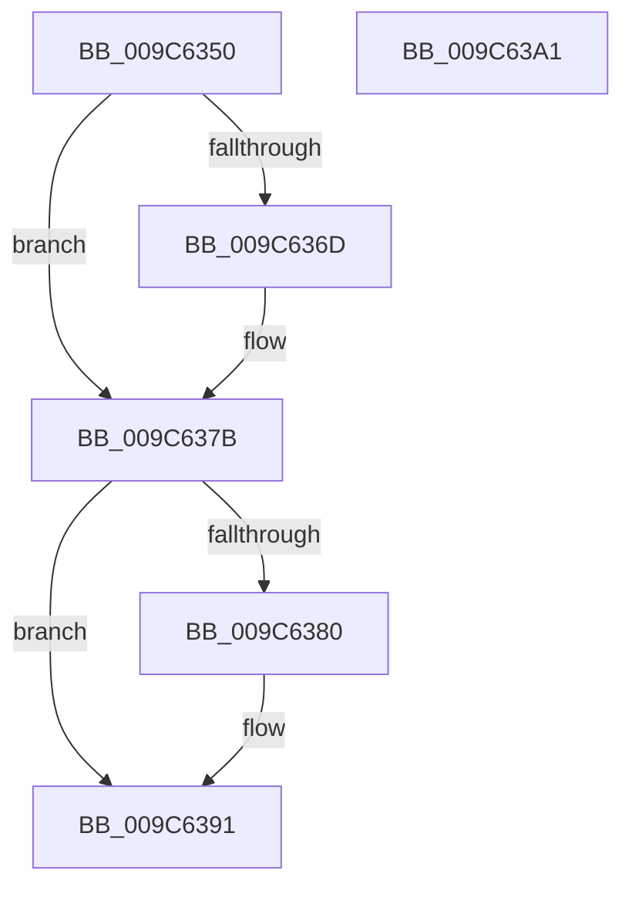

# PsQueryProcessAttributesByToken

- RVA: `0x009C6350`–`0x009C63A2` (길이 `82` bytes)
- VA: `0x00000001409C6350`
- 실행 섹션: `PAGE`
- PDB 이름 있음: `예`; PDB Function 태그: `아니요`
- unwind 정보 RVA: `0x00060BC4`
- 디코드: `24`개 명령, `82/82` bytes 표시
- 미해석 바이트: `0` (있으면 어셈블리에 `.byte`로 보존)

> 이 문서는 커널 이미지의 기계어와 PDB 기호를 분석해 생성했습니다. 4번과 5번은 함수 원형과 자료형을 바이너리 사용 방식에서 추정한 C 해석이며 원본 소스 복구 결과는 아닙니다.

## 1. Dependencies

- 직접 호출 지점: **2**; 고유 호출 대상: **1**
- 직접 호출자로 확인된 함수: **1**
- RIP 상대 이미지 참조: **2**

### Outgoing calls
- `0x009C6374` → [SeSecurityAttributePresent](../../text/21/SeSecurityAttributePresent_function_00213660.md) (function, `0x00213660`)
- `0x009C638A` → [SeSecurityAttributePresent](../../text/21/SeSecurityAttributePresent_function_00213660.md) (function, `0x00213660`)

### Direct callers
- [sub_00B47918](../B4/Unknown_function_00B47918.md) at `0x00B47936`

### Static image references
- `0x009C636D` → RVA `0x00B4BEA8` (`PspSysAppIdClaim`; read)
- `0x009C6380` → RVA `0x00B4BE98` (`PspPackagedAppClaim`; read)

## 2. Other-region calls and transfers

- 다른 실행 섹션으로 향하는 call: **2**
  - `0x009C6374` → [SeSecurityAttributePresent](../../text/21/SeSecurityAttributePresent_function_00213660.md) (`PAGE` → `.text`)
  - `0x009C638A` → [SeSecurityAttributePresent](../../text/21/SeSecurityAttributePresent_function_00213660.md) (`PAGE` → `.text`)
- 별도 외부 분기/꼬리 이동을 확인하지 못했습니다.

## 3. Assembly (complete function range)

```asm
009C6350  48 89 5C 24 08                  mov qword ptr [rsp + 8], rbx
009C6355  48 89 74 24 10                  mov qword ptr [rsp + 0x10], rsi
009C635A  57                              push rdi
009C635B  48 83 EC 20                     sub rsp, 0x20
009C635F  49 8B D8                        mov rbx, r8
009C6362  48 8B FA                        mov rdi, rdx
009C6365  48 8B F1                        mov rsi, rcx
009C6368  48 85 D2                        test rdx, rdx
009C636B  74 0E                           je 0x1409c637b
009C636D  48 8D 15 34 5B 18 00            lea rdx, [rip + 0x185b34]
009C6374  E8 E7 D2 84 FF                  call 0x140213660
009C6379  88 07                           mov byte ptr [rdi], al
009C637B  48 85 DB                        test rbx, rbx
009C637E  74 11                           je 0x1409c6391
009C6380  48 8D 15 11 5B 18 00            lea rdx, [rip + 0x185b11]
009C6387  48 8B CE                        mov rcx, rsi
009C638A  E8 D1 D2 84 FF                  call 0x140213660
009C638F  88 03                           mov byte ptr [rbx], al
009C6391  48 8B 5C 24 30                  mov rbx, qword ptr [rsp + 0x30]
009C6396  48 8B 74 24 38                  mov rsi, qword ptr [rsp + 0x38]
009C639B  48 83 C4 20                     add rsp, 0x20
009C639F  5F                              pop rdi
009C63A0  C3                              ret
009C63A1  CC                              int3
```

## 4. C-style interpretation (structured pseudocode)

```c
__int64 __fastcall PsQueryProcessAttributesByToken(__int64 a1, __int64 a2, __int64 a3)
{
    __int64 result;
    __int64 v_rsp;
    unsigned __int64 v_stack_p10;
    unsigned __int64 v_stack_p8;

    v_stack_p8 = v_rbx;
    v_stack_p10 = v_rsi;
    v_rsp = (v_rsp) - (32);
    if (a2 != 0) {
        a2 = v_rip + 1596212;
        result = SeSecurityAttributePresent(a1, a2, a3, a4);
        *(unsigned __int8 *)(a2) = (unsigned __int8)(result);
    }
    if (a3 != 0) {
        a2 = v_rip + 1596177;
        a1 = a1;
        result = SeSecurityAttributePresent(a1, a2, a3, a4);
        *(unsigned __int8 *)(a3) = (unsigned __int8)(result);
    }
    v_rsp = (v_rsp) + (32);
    return result;
}
```

## 5. (Beta) C Style

```c
int64_t PsQueryProcessAttributesByToken(int64_t Arg1, void *Arg2, int64_t Arg3)
{
    uint8_t *arg2 = (uint8_t *)Arg2;

    int64_t result;
    int64_t local_rsp;
    uint64_t v_stack_p10;
    uint64_t v_stack_p8;

    v_stack_p8 = local_rbx;
    v_stack_p10 = local_rsi;
    local_rsp = (local_rsp) - (32);
    if (Arg2 != NULL) {
        Arg2 = v_rip + 1596212;
        result = SeSecurityAttributePresent(Arg1, Arg2, Arg3, a4);
        *(uint8_t *)(arg2) = (uint8_t)(result);
    }
    if (Arg3 != 0) {
        Arg2 = v_rip + 1596177;
        Arg1 = Arg1;
        result = SeSecurityAttributePresent(Arg1, Arg2, Arg3, a4);
        *(uint8_t *)(Arg3) = (uint8_t)(result);
    }
    local_rsp = (local_rsp) + (32);
    return result;
}
```

### 관측된 메모리 오프셋

구조체 형식이 확인되지 않은 접근은 인자 기준의 오프셋으로만 기록했습니다.

| 기준 인자 | 오프셋 표현 | 폭 (bit) | 접근 |
|---|---:|---:|---|
| `Arg2` | `+ 0x0` | `8` | `W` |

## 6. Execution-region graph

[열기: 2D/3D 그래프와 함수 탐색 컨트롤 패널](../../../control-panel.html?section=page&rva=0x009C6350&view=graph)

- 2D 그래프는 위에서 아래로 흐르고, 3D 그래프는 빈 공간을 드래그해 회전합니다. Shift+드래그는 이동, 휠은 확대·축소, 함수 노드 선택은 대상 보고서 이동입니다.

### Static fallback


