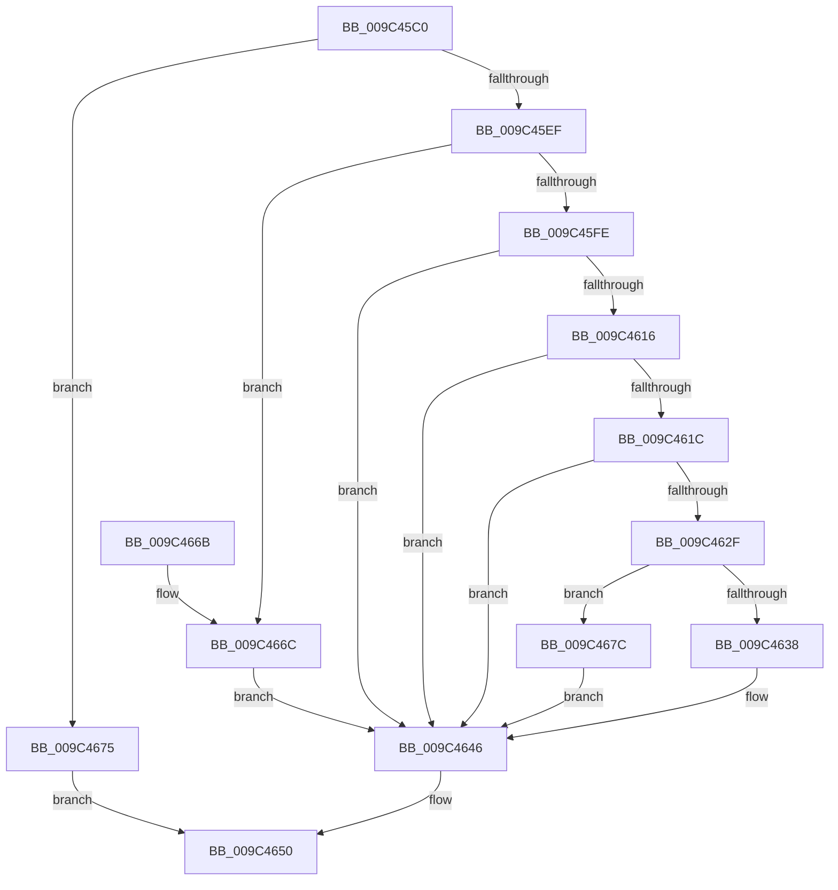

# RtlDeleteAtomFromAtomTable

- RVA: `0x009C45C0`–`0x009C4683` (길이 `195` bytes)
- VA: `0x00000001409C45C0`
- 실행 섹션: `PAGE`
- PDB 이름 있음: `예`; PDB Function 태그: `아니요`
- unwind 정보 RVA: `0x00096B1C`
- 디코드: `57`개 명령, `195/195` bytes 표시
- 미해석 바이트: `0` (있으면 어셈블리에 `.byte`로 보존)

> 이 문서는 커널 이미지의 기계어와 PDB 기호를 분석해 생성했습니다. 4번과 5번은 함수 원형과 자료형을 바이너리 사용 방식에서 추정한 C 해석이며 원본 소스 복구 결과는 아닙니다.

## 1. Dependencies

- 직접 호출 지점: **5**; 고유 호출 대상: **5**
- 직접 호출자로 확인된 함수: **1**
- RIP 상대 이미지 참조: **0**

### Outgoing calls
- `0x009C45DF` → [RtlpLockAtomTable](RtlpLockAtomTable_function_009C4A10.md) (function, `0x009C4A10`)
- `0x009C4609` → [RtlpAtomMapAtomToHandleEntry](RtlpAtomMapAtomToHandleEntry_function_009C4AD0.md) (function, `0x009C4AD0`)
- `0x009C4625` → [RtlpLookupLowBox](../../text/43/RtlpLookupLowBox_function_004388AC.md) (function, `0x004388AC`)
- `0x009C4641` → [RtlpDereferenceAtom](../../text/47/RtlpDereferenceAtom_function_004791B4.md) (function, `0x004791B4`)
- `0x009C4649` → [RtlpUnlockAtomTable](RtlpUnlockAtomTable_function_009C4A8C.md) (function, `0x009C4A8C`)

### Direct callers
- [NtDeleteAtom](../AF/NtDeleteAtom_function_00AF74E0.md) at `0x00AF7526`

### Static image references
- 디코드된 RIP-relative 메모리 참조가 없습니다.

## 2. Other-region calls and transfers

- 다른 실행 섹션으로 향하는 call: **2**
  - `0x009C4625` → [RtlpLookupLowBox](../../text/43/RtlpLookupLowBox_function_004388AC.md) (`PAGE` → `.text`)
  - `0x009C4641` → [RtlpDereferenceAtom](../../text/47/RtlpDereferenceAtom_function_004791B4.md) (`PAGE` → `.text`)
- 별도 외부 분기/꼬리 이동을 확인하지 못했습니다.

## 3. Assembly (complete function range)

```asm
009C45C0  48 8B C4                        mov rax, rsp
009C45C3  48 89 58 08                     mov qword ptr [rax + 8], rbx
009C45C7  48 89 68 10                     mov qword ptr [rax + 0x10], rbp
009C45CB  48 89 70 18                     mov qword ptr [rax + 0x18], rsi
009C45CF  48 89 78 20                     mov qword ptr [rax + 0x20], rdi
009C45D3  41 56                           push r14
009C45D5  48 83 EC 20                     sub rsp, 0x20
009C45D9  0F B7 FA                        movzx edi, dx
009C45DC  48 8B F1                        mov rsi, rcx
009C45DF  E8 2C 04 00 00                  call 0x1409c4a10
009C45E4  45 33 F6                        xor r14d, r14d
009C45E7  84 C0                           test al, al
009C45E9  0F 84 86 00 00 00               je 0x1409c4675
009C45EF  B8 00 C0 00 00                  mov eax, 0xc000
009C45F4  BB 08 00 00 C0                  mov ebx, 0xc0000008
009C45F9  66 3B F8                        cmp di, ax
009C45FC  72 6E                           jb 0x1409c466c
009C45FE  8B D7                           mov edx, edi
009C4600  48 8B CE                        mov rcx, rsi
009C4603  81 E2 FF 3F 00 00               and edx, 0x3fff
009C4609  E8 C2 04 00 00                  call 0x1409c4ad0
009C460E  48 8B E8                        mov rbp, rax
009C4611  48 85 C0                        test rax, rax
009C4614  74 30                           je 0x1409c4646
009C4616  66 39 78 0A                     cmp word ptr [rax + 0xa], di
009C461A  75 2A                           jne 0x1409c4646
009C461C  41 B0 01                        mov r8b, 1
009C461F  48 8B D0                        mov rdx, rax
009C4622  48 8B CE                        mov rcx, rsi
009C4625  E8 82 42 A7 FF                  call 0x1404388ac
009C462A  48 85 C0                        test rax, rax
009C462D  74 17                           je 0x1409c4646
009C462F  F6 40 16 01                     test byte ptr [rax + 0x16], 1
009C4633  41 8B DE                        mov ebx, r14d
009C4636  75 44                           jne 0x1409c467c
009C4638  4C 8B C6                        mov r8, rsi
009C463B  48 8B D0                        mov rdx, rax
009C463E  48 8B CD                        mov rcx, rbp
009C4641  E8 6E 4B AB FF                  call 0x1404791b4
009C4646  48 8B CE                        mov rcx, rsi
009C4649  E8 3E 04 00 00                  call 0x1409c4a8c
009C464E  8B C3                           mov eax, ebx
009C4650  48 8B 5C 24 30                  mov rbx, qword ptr [rsp + 0x30]
009C4655  48 8B 6C 24 38                  mov rbp, qword ptr [rsp + 0x38]
009C465A  48 8B 74 24 40                  mov rsi, qword ptr [rsp + 0x40]
009C465F  48 8B 7C 24 48                  mov rdi, qword ptr [rsp + 0x48]
009C4664  48 83 C4 20                     add rsp, 0x20
009C4668  41 5E                           pop r14
009C466A  C3                              ret
009C466B  CC                              int3
009C466C  66 85 FF                        test di, di
009C466F  41 0F 45 DE                     cmovne ebx, r14d
009C4673  EB D1                           jmp 0x1409c4646
009C4675  B8 0D 00 00 C0                  mov eax, 0xc000000d
009C467A  EB D4                           jmp 0x1409c4650
009C467C  BB 19 00 00 40                  mov ebx, 0x40000019
009C4681  EB C3                           jmp 0x1409c4646
```

## 4. C-style interpretation (structured pseudocode)

```c
__int64 __fastcall RtlDeleteAtomFromAtomTable(__int64 a1, unsigned __int16 a2)
{
    __int64 result;
    __int64 v_r14;
    __int64 v_rbx;
    __int64 v_rsp;
    unsigned __int64 v_stack_p10;
    unsigned __int64 v_stack_p18;
    unsigned __int64 v_stack_p20;
    unsigned __int64 v_stack_p8;

    *(unsigned __int64 *)(v_rsp + 8) = v_rbx;
    *(unsigned __int64 *)(v_rsp + 16) = v_rbp;
    *(unsigned __int64 *)(v_rsp + 24) = v_rsi;
    *(unsigned __int64 *)(v_rsp + 32) = v_rdi;
    v_rsp = (v_rsp) - (32);
    result = RtlpLockAtomTable(a1, a2, a3, a4);
    v_r14 = 0;
    if ((unsigned __int8)(result) == 0) goto loc_009C4675;
    if (a2 < ((unsigned __int16)((unsigned int)(0xC000ULL)))) goto loc_009C466C;
    a2 = (unsigned int)(((unsigned int)(a2)) & (0x3FFFULL));
    result = RtlpAtomMapAtomToHandleEntry(a1, a2, a3, a4);
    if (result == 0) goto loc_009C4646;
    if ((*(unsigned __int16 *)(result + 10)) != a2) goto loc_009C4646;
    result = RtlpLookupLowBox(a1, result, 1, a4);
    if (result == 0) goto loc_009C4646;
    if (((*(unsigned __int8 *)(result + 22)) & (1)) != 0) goto loc_009C467C;
    result = RtlpDereferenceAtom(result, result, a1, a4);
loc_009C4646:
    result = RtlpUnlockAtomTable(a1, result, a1, a4);
loc_009C4650:
    v_rsp = (v_rsp) + (32);
    return 0;
loc_009C466C:
    v_rbx = v_stack_p8;
    if ((unsigned __int16)(v_stack_p20) != 0) { v_rbx = 0; }
    goto loc_009C4646;
loc_009C4675:
    goto loc_009C4650;
loc_009C467C:
    goto loc_009C4646;
}
```

## 5. (Beta) C Style

```c
int64_t RtlDeleteAtomFromAtomTable(int64_t Arg1, uint16_t Arg2)
{
    int64_t result;
    int64_t local_r14;
    int64_t local_rbx;
    int64_t local_rsp;
    uint64_t v_stack_p10;
    uint64_t v_stack_p18;
    uint64_t v_stack_p20;
    uint64_t v_stack_p8;

    *(uint64_t *)(local_rsp + 0x8) = local_rbx;
    *(uint64_t *)(local_rsp + 0x10) = local_rbp;
    *(uint64_t *)(local_rsp + 0x18) = local_rsi;
    *(uint64_t *)(local_rsp + 0x20) = local_rdi;
    local_rsp = (local_rsp) - (32);
    result = RtlpLockAtomTable(Arg1, Arg2, a3, a4);
    local_r14 = 0;
    if ((uint8_t)(result) == 0) goto loc_009C4675;
    if (Arg2 < ((uint16_t)((uint32_t)(0xC000ULL)))) goto loc_009C466C;
    Arg2 = (uint32_t)(((uint32_t)(Arg2)) & (0x3FFFULL));
    result = RtlpAtomMapAtomToHandleEntry(Arg1, Arg2, a3, a4);
    if (result == 0) goto loc_009C4646;
    if ((*(uint16_t *)(result + 0xA)) != Arg2) goto loc_009C4646;
    result = RtlpLookupLowBox(Arg1, result, 1, a4);
    if (result == 0) goto loc_009C4646;
    if (((*(uint8_t *)(result + 0x16)) & (1)) != 0) goto loc_009C467C;
    result = RtlpDereferenceAtom(result, result, Arg1, a4);
loc_009C4646:
    result = RtlpUnlockAtomTable(Arg1, result, Arg1, a4);
loc_009C4650:
    local_rsp = (local_rsp) + (32);
    return 0;
loc_009C466C:
    local_rbx = v_stack_p8;
    if ((uint16_t)(v_stack_p20) != 0) { local_rbx = 0; }
    goto loc_009C4646;
loc_009C4675:
    goto loc_009C4650;
loc_009C467C:
    goto loc_009C4646;
}
```

## 6. Execution-region graph

[열기: 2D/3D 그래프와 함수 탐색 컨트롤 패널](../../../control-panel.html?section=page&rva=0x009C45C0&view=graph)

- 2D 그래프는 위에서 아래로 흐르고, 3D 그래프는 빈 공간을 드래그해 회전합니다. Shift+드래그는 이동, 휠은 확대·축소, 함수 노드 선택은 대상 보고서 이동입니다.

### Static fallback


