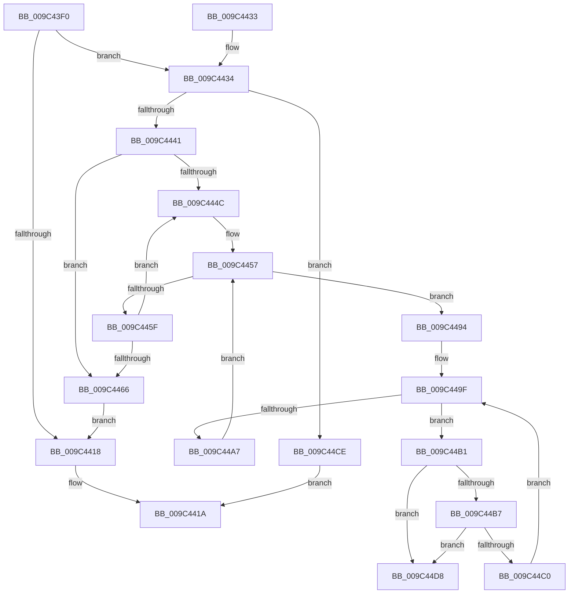

# RtlDestroyAtomTable

- RVA: `0x009C43F0`–`0x009C44DF` (길이 `239` bytes)
- VA: `0x00000001409C43F0`
- 실행 섹션: `PAGE`
- PDB 이름 있음: `예`; PDB Function 태그: `아니요`
- unwind 정보 RVA: `0x0009FC44`
- 디코드: `73`개 명령, `239/239` bytes 표시
- 미해석 바이트: `0` (있으면 어셈블리에 `.byte`로 보존)

> 이 문서는 커널 이미지의 기계어와 PDB 기호를 분석해 생성했습니다. 4번과 5번은 함수 원형과 자료형을 바이너리 사용 방식에서 추정한 C 해석이며 원본 소스 복구 결과는 아닙니다.

## 1. Dependencies

- 직접 호출 지점: **6**; 고유 호출 대상: **4**
- 직접 호출자로 확인된 함수: **2**
- RIP 상대 이미지 참조: **0**

### Outgoing calls
- `0x009C4434` → [RtlpLockAtomTable](RtlpLockAtomTable_function_009C4A10.md) (function, `0x009C4A10`)
- `0x009C446C` → [RtlpUnlockAtomTable](RtlpUnlockAtomTable_function_009C4A8C.md) (function, `0x009C4A8C`)
- `0x009C4475` → [ExDestroyHandleTable](../90/ExDestroyHandleTable_function_00904D18.md) (function, `0x00904D18`)
- `0x009C448D` → [RtlpFreeAtom](../8B/RtlpFreeAtom_function_008BD87C.md) (function, `0x008BD87C`)
- `0x009C44AA` → [RtlpFreeAtom](../8B/RtlpFreeAtom_function_008BD87C.md) (function, `0x008BD87C`)
- `0x009C44C7` → [RtlpFreeAtom](../8B/RtlpFreeAtom_function_008BD87C.md) (function, `0x008BD87C`)

### Direct callers
- [SeCaptureAtomTableCallout](../../text/4E/SeCaptureAtomTableCallout_function_004E9BD0.md) at `0x004E9CAA`
- [RtlDereferenceAtomTable](../../text/5E/RtlDereferenceAtomTable_function_005E6EE0.md) at `0x005E6EE4`

### Static image references
- 디코드된 RIP-relative 메모리 참조가 없습니다.

## 2. Other-region calls and transfers

- 다른 실행 섹션으로 향하는 call: **0**
- 별도 외부 분기/꼬리 이동을 확인하지 못했습니다.

## 3. Assembly (complete function range)

```asm
009C43F0  48 89 5C 24 08                  mov qword ptr [rsp + 8], rbx
009C43F5  48 89 6C 24 10                  mov qword ptr [rsp + 0x10], rbp
009C43FA  48 89 74 24 18                  mov qword ptr [rsp + 0x18], rsi
009C43FF  57                              push rdi
009C4400  41 56                           push r14
009C4402  41 57                           push r15
009C4404  48 83 EC 20                     sub rsp, 0x20
009C4408  48 8B D9                        mov rbx, rcx
009C440B  83 C8 FF                        or eax, 0xffffffff
009C440E  F0 0F C1 41 04                  lock xadd dword ptr [rcx + 4], eax
009C4413  83 F8 01                        cmp eax, 1
009C4416  74 1C                           je 0x1409c4434
009C4418  33 C0                           xor eax, eax
009C441A  48 8B 5C 24 40                  mov rbx, qword ptr [rsp + 0x40]
009C441F  48 8B 6C 24 48                  mov rbp, qword ptr [rsp + 0x48]
009C4424  48 8B 74 24 50                  mov rsi, qword ptr [rsp + 0x50]
009C4429  48 83 C4 20                     add rsp, 0x20
009C442D  41 5F                           pop r15
009C442F  41 5E                           pop r14
009C4431  5F                              pop rdi
009C4432  C3                              ret
009C4433  CC                              int3
009C4434  E8 D7 05 00 00                  call 0x1409c4a10
009C4439  84 C0                           test al, al
009C443B  0F 84 8D 00 00 00               je 0x1409c44ce
009C4441  33 ED                           xor ebp, ebp
009C4443  48 8D 73 20                     lea rsi, [rbx + 0x20]
009C4447  39 6B 1C                        cmp dword ptr [rbx + 0x1c], ebp
009C444A  76 1A                           jbe 0x1409c4466
009C444C  48 8B 3E                        mov rdi, qword ptr [rsi]
009C444F  48 83 26 00                     and qword ptr [rsi], 0
009C4453  48 8D 76 08                     lea rsi, [rsi + 8]
009C4457  4C 8B F7                        mov r14, rdi
009C445A  48 85 FF                        test rdi, rdi
009C445D  75 35                           jne 0x1409c4494
009C445F  FF C5                           inc ebp
009C4461  3B 6B 1C                        cmp ebp, dword ptr [rbx + 0x1c]
009C4464  72 E6                           jb 0x1409c444c
009C4466  83 23 00                        and dword ptr [rbx], 0
009C4469  48 8B CB                        mov rcx, rbx
009C446C  E8 1B 06 00 00                  call 0x1409c4a8c
009C4471  48 8B 4B 10                     mov rcx, qword ptr [rbx + 0x10]
009C4475  E8 9E 08 F4 FF                  call 0x140904d18
009C447A  0F 57 C0                        xorps xmm0, xmm0
009C447D  33 C0                           xor eax, eax
009C447F  0F 11 03                        movups xmmword ptr [rbx], xmm0
009C4482  48 8B CB                        mov rcx, rbx
009C4485  0F 11 43 10                     movups xmmword ptr [rbx + 0x10], xmm0
009C4489  48 89 43 20                     mov qword ptr [rbx + 0x20], rax
009C448D  E8 EA 93 EF FF                  call 0x1408bd87c
009C4492  EB 84                           jmp 0x1409c4418
009C4494  48 8B 3F                        mov rdi, qword ptr [rdi]
009C4497  4D 8D 7E 10                     lea r15, [r14 + 0x10]
009C449B  49 83 26 00                     and qword ptr [r14], 0
009C449F  49 8B 0F                        mov rcx, qword ptr [r15]
009C44A2  49 3B CF                        cmp rcx, r15
009C44A5  75 0A                           jne 0x1409c44b1
009C44A7  49 8B CE                        mov rcx, r14
009C44AA  E8 CD 93 EF FF                  call 0x1408bd87c
009C44AF  EB A6                           jmp 0x1409c4457
009C44B1  4C 39 79 08                     cmp qword ptr [rcx + 8], r15
009C44B5  75 21                           jne 0x1409c44d8
009C44B7  48 8B 01                        mov rax, qword ptr [rcx]
009C44BA  48 39 48 08                     cmp qword ptr [rax + 8], rcx
009C44BE  75 18                           jne 0x1409c44d8
009C44C0  49 89 07                        mov qword ptr [r15], rax
009C44C3  4C 89 78 08                     mov qword ptr [rax + 8], r15
009C44C7  E8 B0 93 EF FF                  call 0x1408bd87c
009C44CC  EB D1                           jmp 0x1409c449f
009C44CE  B8 0D 00 00 C0                  mov eax, 0xc000000d
009C44D3  E9 42 FF FF FF                  jmp 0x1409c441a
009C44D8  B9 03 00 00 00                  mov ecx, 3
009C44DD  CD 29                           int 0x29
```

## 4. C-style interpretation (structured pseudocode)

```c
__int64 __fastcall RtlDestroyAtomTable(__int64 a1)
{
    __int64 result;
    __int64 v_rbp;
    __int64 v_rsp;
    unsigned __int64 v_stack_p10;
    unsigned __int64 v_stack_p18;
    unsigned __int64 v_stack_p8;

    v_stack_p8 = v_rbx;
    v_stack_p10 = v_rbp;
    v_stack_p18 = v_rsi;
    v_rsp = (v_rsp) - (32);
    result = (unsigned int)((result) | (0xFFFFFFFFULL));
    if (((unsigned int)(result)) == 1) goto loc_009C4434;
loc_009C4418:
    result = 0;
loc_009C441A:
    v_rsp = (v_rsp) + (32);
    return result;
loc_009C4434:
    result = RtlpLockAtomTable(a1, a2, a3, a4);
    if ((unsigned __int8)(result) == 0) goto loc_009C44CE;
    v_rbp = 0;
    if ((*(unsigned int *)(v_stack_p8 + 28)) <= 0) goto loc_009C4466;
loc_009C444C:
loc_009C4457:
    if (*(unsigned __int64 *)(v_stack_p8 + 32) != 0) goto loc_009C4494;
    v_rbp = (unsigned int)((v_rbp) + 1);
    if (((unsigned int)(v_rbp)) < (*(unsigned int *)(v_stack_p8 + 28))) goto loc_009C444C;
loc_009C4466:
    result = RtlpUnlockAtomTable(v_stack_p8, a2, a3, a4);
    result = ExDestroyHandleTable(*(unsigned __int64 *)(v_stack_p8 + 16), a2, a3, a4);
    result = 0;
    *(unsigned __int64 *)(v_stack_p8) = v_xmm0;
    *(unsigned __int64 *)(v_stack_p8 + 16) = v_xmm0;
    *(unsigned __int64 *)(v_stack_p8 + 32) = 0;
    result = RtlpFreeAtom(v_stack_p8, a2, a3, a4);
    goto loc_009C4418;
loc_009C4494:
loc_009C449F:
    if ((*(unsigned __int64 *)(*(unsigned __int64 *)(v_stack_p8 + 32) + 16)) != (*(unsigned __int64 *)(v_stack_p8 + 32) + 16)) goto loc_009C44B1;
    result = RtlpFreeAtom(*(unsigned __int64 *)(v_stack_p8 + 32), a2, a3, a4);
    goto loc_009C4457;
loc_009C44B1:
    if ((*(unsigned __int64 *)(*(unsigned __int64 *)(v_stack_p8 + 32) + 8)) != (*(unsigned __int64 *)(v_stack_p8 + 32) + 16)) goto loc_009C44D8;
    if ((*(unsigned __int64 *)(*(unsigned __int64 *)(*(unsigned __int64 *)(v_stack_p8 + 32)) + 8)) != (*(unsigned __int64 *)(v_stack_p8 + 32))) goto loc_009C44D8;
    *(unsigned __int64 *)(*(unsigned __int64 *)(v_stack_p8 + 32) + 16) = *(unsigned __int64 *)(*(unsigned __int64 *)(v_stack_p8 + 32));
    *(unsigned __int64 *)(*(unsigned __int64 *)(*(unsigned __int64 *)(v_stack_p8 + 32)) + 8) = *(unsigned __int64 *)(v_stack_p8 + 32) + 16;
    result = RtlpFreeAtom(*(unsigned __int64 *)(v_stack_p8 + 32), a2, a3, a4);
    goto loc_009C449F;
loc_009C44CE:
    goto loc_009C441A;
loc_009C44D8:
    return (unsigned int)(0xC000000DULL);
}
```

## 5. (Beta) C Style

```c
int64_t RtlDestroyAtomTable(void *Arg1)
{
    uint8_t *arg1 = (uint8_t *)Arg1;

    int64_t result;
    int64_t local_rbp;
    int64_t local_rsp;
    uint64_t v_stack_p10;
    uint64_t v_stack_p18;
    uint64_t v_stack_p8;

    v_stack_p8 = local_rbx;
    v_stack_p10 = local_rbp;
    v_stack_p18 = local_rsi;
    local_rsp = (local_rsp) - (32);
    result = (uint32_t)((result) | (0xFFFFFFFFULL));
    if (((uint32_t)(result)) == 1) goto loc_009C4434;
loc_009C4418:
    result = 0;
loc_009C441A:
    local_rsp = (local_rsp) + (32);
    return result;
loc_009C4434:
    result = RtlpLockAtomTable(Arg1, a2, a3, a4);
    if ((uint8_t)(result) == 0) goto loc_009C44CE;
    local_rbp = 0;
    if ((*(uint32_t *)(v_stack_p8 + 0x1C)) <= 0) goto loc_009C4466;
loc_009C444C:
loc_009C4457:
    if (*(uint64_t *)(v_stack_p8 + 0x20) != 0) goto loc_009C4494;
    local_rbp = (uint32_t)((local_rbp) + 1);
    if (((uint32_t)(local_rbp)) < (*(uint32_t *)(v_stack_p8 + 0x1C))) goto loc_009C444C;
loc_009C4466:
    result = RtlpUnlockAtomTable(v_stack_p8, a2, a3, a4);
    result = ExDestroyHandleTable(*(uint64_t *)(v_stack_p8 + 0x10), a2, a3, a4);
    result = 0;
    *(uint64_t *)(v_stack_p8) = v_xmm0;
    *(uint64_t *)(v_stack_p8 + 0x10) = v_xmm0;
    *(uint64_t *)(v_stack_p8 + 0x20) = 0;
    result = RtlpFreeAtom(v_stack_p8, a2, a3, a4);
    goto loc_009C4418;
loc_009C4494:
loc_009C449F:
    if ((*(uint64_t *)(*(uint64_t *)(v_stack_p8 + 0x20) + 0x10)) != (*(uint64_t *)(v_stack_p8 + 0x20) + 16)) goto loc_009C44B1;
    result = RtlpFreeAtom(*(uint64_t *)(v_stack_p8 + 0x20), a2, a3, a4);
    goto loc_009C4457;
loc_009C44B1:
    if ((*(uint64_t *)(*(uint64_t *)(v_stack_p8 + 0x20) + 0x8)) != (*(uint64_t *)(v_stack_p8 + 0x20) + 16)) goto loc_009C44D8;
    if ((*(uint64_t *)(*(uint64_t *)(*(uint64_t *)(v_stack_p8 + 0x20)) + 0x8)) != (*(uint64_t *)(v_stack_p8 + 0x20))) goto loc_009C44D8;
    *(uint64_t *)(*(uint64_t *)(v_stack_p8 + 0x20) + 0x10) = *(uint64_t *)(*(uint64_t *)(v_stack_p8 + 0x20));
    *(uint64_t *)(*(uint64_t *)(*(uint64_t *)(v_stack_p8 + 0x20)) + 0x8) = *(uint64_t *)(v_stack_p8 + 0x20) + 16;
    result = RtlpFreeAtom(*(uint64_t *)(v_stack_p8 + 0x20), a2, a3, a4);
    goto loc_009C449F;
loc_009C44CE:
    goto loc_009C441A;
loc_009C44D8:
    return (uint32_t)(0xC000000DULL);
}
```

### 관측된 메모리 오프셋

구조체 형식이 확인되지 않은 접근은 인자 기준의 오프셋으로만 기록했습니다.

| 기준 인자 | 오프셋 표현 | 폭 (bit) | 접근 |
|---|---:|---:|---|
| `Arg1` | `+ 0x0` | `32` | `R/W` |
| `Arg1` | `+ 0x0` | `64` | `R` |
| `Arg1` | `+ 0x0` | `64` | `R/W` |
| `Arg1` | `+ 0x0` | `128` | `R` |
| `Arg1` | `+ 0x4` | `32` | `R/W` |
| `Arg1` | `+ 0x8` | `64` | `R` |
| `Arg1` | `+ 0x10` | `64` | `R` |
| `Arg1` | `+ 0x10` | `128` | `R` |
| `Arg1` | `+ 0x1C` | `32` | `R` |
| `Arg1` | `+ 0x20` | `64` | `R` |
| `Arg1` | `+ 0x20` | `64` | `W` |

## 6. Execution-region graph

[열기: 2D/3D 그래프와 함수 탐색 컨트롤 패널](../../../control-panel.html?section=page&rva=0x009C43F0&view=graph)

- 2D 그래프는 위에서 아래로 흐르고, 3D 그래프는 빈 공간을 드래그해 회전합니다. Shift+드래그는 이동, 휠은 확대·축소, 함수 노드 선택은 대상 보고서 이동입니다.

### Static fallback


