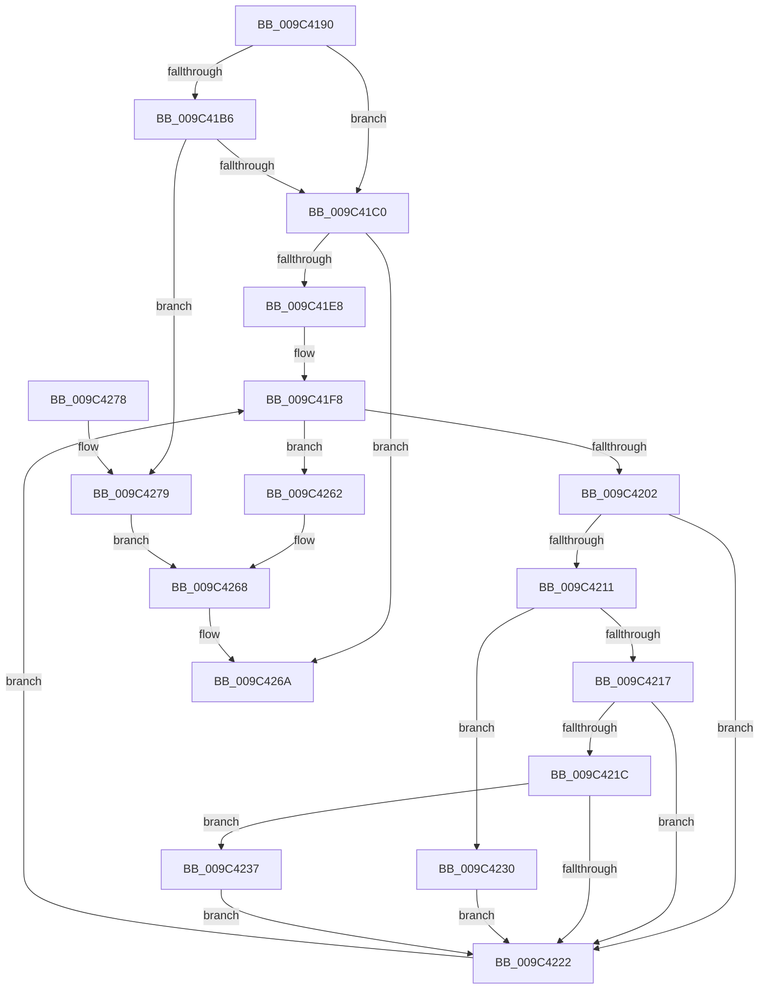

# RtlDowncaseUnicodeString

- RVA: `0x009C4190`–`0x009C4282` (길이 `242` bytes)
- VA: `0x00000001409C4190`
- 실행 섹션: `PAGE`
- PDB 이름 있음: `예`; PDB Function 태그: `아니요`
- unwind 정보 RVA: `0x0009F94C`
- 디코드: `72`개 명령, `242/242` bytes 표시
- 미해석 바이트: `0` (있으면 어셈블리에 `.byte`로 보존)

> 이 문서는 커널 이미지의 기계어와 PDB 기호를 분석해 생성했습니다. 4번과 5번은 함수 원형과 자료형을 바이너리 사용 방식에서 추정한 C 해석이며 원본 소스 복구 결과는 아닙니다.

## 1. Dependencies

- 직접 호출 지점: **2**; 고유 호출 대상: **2**
- 직접 호출자로 확인된 함수: **2**
- RIP 상대 이미지 참조: **0**

### Outgoing calls
- `0x009C41C0` → [PsGetCurrentServerSiloGlobals](../../text/2F/PsGetCurrentServerSiloGlobals_function_002FE1F0.md) (function, `0x002FE1F0`)
- `0x009C41DB` → [AllocateOrValidateUnicodeStringBuffer](../../text/43/AllocateOrValidateUnicodeStringBuffer_function_00437A60.md) (function, `0x00437A60`)

### Direct callers
- [DifRtlDowncaseUnicodeStringWrapper](../../text/63/DifRtlDowncaseUnicodeStringWrapper_function_0063BAC0.md) at `0x0063BBA5`
- [ExpKdPullRemoteFileForUser](../7D/ExpKdPullRemoteFileForUser_function_007D15AC.md) at `0x007D16EF`

### Static image references
- 디코드된 RIP-relative 메모리 참조가 없습니다.

## 2. Other-region calls and transfers

- 다른 실행 섹션으로 향하는 call: **2**
  - `0x009C41C0` → [PsGetCurrentServerSiloGlobals](../../text/2F/PsGetCurrentServerSiloGlobals_function_002FE1F0.md) (`PAGE` → `.text`)
  - `0x009C41DB` → [AllocateOrValidateUnicodeStringBuffer](../../text/43/AllocateOrValidateUnicodeStringBuffer_function_00437A60.md) (`PAGE` → `.text`)
- 별도 외부 분기/꼬리 이동을 확인하지 못했습니다.

## 3. Assembly (complete function range)

```asm
009C4190  48 89 5C 24 10                  mov qword ptr [rsp + 0x10], rbx
009C4195  44 88 44 24 18                  mov byte ptr [rsp + 0x18], r8b
009C419A  48 89 4C 24 08                  mov qword ptr [rsp + 8], rcx
009C419F  56                              push rsi
009C41A0  57                              push rdi
009C41A1  41 56                           push r14
009C41A3  48 83 EC 30                     sub rsp, 0x30
009C41A7  45 0F B6 D0                     movzx r10d, r8b
009C41AB  48 8B FA                        mov rdi, rdx
009C41AE  48 8B D9                        mov rbx, rcx
009C41B1  45 84 C0                        test r8b, r8b
009C41B4  75 0A                           jne 0x1409c41c0
009C41B6  66 83 3A 00                     cmp word ptr [rdx], 0
009C41BA  0F 84 B9 00 00 00               je 0x1409c4279
009C41C0  E8 2B A0 93 FF                  call 0x1402fe1f0
009C41C5  48 8B B0 B8 04 00 00            mov rsi, qword ptr [rax + 0x4b8]
009C41CC  4C 8D 4B 02                     lea r9, [rbx + 2]
009C41D0  4C 8D 43 08                     lea r8, [rbx + 8]
009C41D4  0F B7 12                        movzx edx, word ptr [rdx]
009C41D7  41 0F B6 CA                     movzx ecx, r10b
009C41DB  E8 80 38 A7 FF                  call 0x140437a60
009C41E0  85 C0                           test eax, eax
009C41E2  0F 88 82 00 00 00               js 0x1409c426a
009C41E8  44 0F B7 1F                     movzx r11d, word ptr [rdi]
009C41EC  41 D1 EB                        shr r11d, 1
009C41EF  45 33 C9                        xor r9d, r9d
009C41F2  41 BE C0 00 00 00               mov r14d, 0xc0
009C41F8  44 89 4C 24 20                  mov dword ptr [rsp + 0x20], r9d
009C41FD  45 3B CB                        cmp r9d, r11d
009C4200  73 60                           jae 0x1409c4262
009C4202  48 8B 4F 08                     mov rcx, qword ptr [rdi + 8]
009C4206  46 0F B7 14 49                  movzx r10d, word ptr [rcx + r9*2]
009C420B  41 83 FA 41                     cmp r10d, 0x41
009C420F  72 11                           jb 0x1409c4222
009C4211  41 83 FA 5A                     cmp r10d, 0x5a
009C4215  76 19                           jbe 0x1409c4230
009C4217  48 85 F6                        test rsi, rsi
009C421A  74 06                           je 0x1409c4222
009C421C  66 45 3B D6                     cmp r10w, r14w
009C4220  73 15                           jae 0x1409c4237
009C4222  48 8B 4B 08                     mov rcx, qword ptr [rbx + 8]
009C4226  66 46 89 14 49                  mov word ptr [rcx + r9*2], r10w
009C422B  41 FF C1                        inc r9d
009C422E  EB C8                           jmp 0x1409c41f8
009C4230  66 41 83 C2 20                  add r10w, 0x20
009C4235  EB EB                           jmp 0x1409c4222
009C4237  45 8B C2                        mov r8d, r10d
009C423A  49 8B CA                        mov rcx, r10
009C423D  48 C1 E9 08                     shr rcx, 8
009C4241  0F B7 14 4E                     movzx edx, word ptr [rsi + rcx*2]
009C4245  41 8B CA                        mov ecx, r10d
009C4248  C1 E9 04                        shr ecx, 4
009C424B  83 E1 0F                        and ecx, 0xf
009C424E  03 D1                           add edx, ecx
009C4250  0F B7 14 56                     movzx edx, word ptr [rsi + rdx*2]
009C4254  41 83 E0 0F                     and r8d, 0xf
009C4258  41 03 D0                        add edx, r8d
009C425B  66 44 03 14 56                  add r10w, word ptr [rsi + rdx*2]
009C4260  EB C0                           jmp 0x1409c4222
009C4262  0F B7 07                        movzx eax, word ptr [rdi]
009C4265  66 89 03                        mov word ptr [rbx], ax
009C4268  33 C0                           xor eax, eax
009C426A  48 8B 5C 24 58                  mov rbx, qword ptr [rsp + 0x58]
009C426F  48 83 C4 30                     add rsp, 0x30
009C4273  41 5E                           pop r14
009C4275  5F                              pop rdi
009C4276  5E                              pop rsi
009C4277  C3                              ret
009C4278  CC                              int3
009C4279  45 33 C9                        xor r9d, r9d
009C427C  66 44 89 09                     mov word ptr [rcx], r9w
009C4280  EB E6                           jmp 0x1409c4268
```

## 4. C-style interpretation (structured pseudocode)

```c
__int64 __fastcall RtlDowncaseUnicodeString(__int64 a1, __int64 a2, unsigned __int8 a3)
{
    __int64 result;
    __int64 v_r10;
    __int64 v_r11;
    __int64 v_rsp;
    unsigned int v_stack_m28;
    unsigned __int64 v_stack_p10;
    unsigned __int8 v_stack_p18;
    unsigned __int64 v_stack_p8;

    v_stack_p10 = v_rbx;
    v_stack_p18 = a3;
    v_stack_p8 = a1;
    v_rsp = (v_rsp) - (48);
    if (a3 != 0) goto loc_009C41C0;
    if ((*(unsigned __int16 *)(a2)) == 0) goto loc_009C4279;
loc_009C41C0:
    result = PsGetCurrentServerSiloGlobals(a1, a2, a3, a4);
    result = AllocateOrValidateUnicodeStringBuffer(a3, *(unsigned __int16 *)(a2), a1 + 8, a1 + 2);
    if (sign_flag) goto loc_009C426A;
    v_r11 = (unsigned int)((*(unsigned __int16 *)(a2)) >> (1));
    a4 = 0;
loc_009C41F8:
    v_stack_m28 = 0;
    if (0 >= ((unsigned int)(v_r11))) goto loc_009C4262;
    if (((unsigned int)(*(unsigned __int16 *)(*(unsigned __int64 *)(a2 + 8) + a4 * 2))) < 65) goto loc_009C4222;
    if (((unsigned int)(*(unsigned __int16 *)(*(unsigned __int64 *)(a2 + 8) + a4 * 2))) <= 90) goto loc_009C4230;
    if (*(unsigned __int64 *)(result + 1208) == 0) goto loc_009C4222;
    if (((unsigned __int16)(*(unsigned __int16 *)(*(unsigned __int64 *)(a2 + 8) + a4 * 2))) >= 192) goto loc_009C4237;
loc_009C4222:
    *(unsigned __int16 *)(*(unsigned __int64 *)(a1 + 8) + a4 * 2) = (unsigned __int16)(*(unsigned __int16 *)(*(unsigned __int64 *)(a2 + 8) + a4 * 2));
    a4 = (unsigned int)((a4) + 1);
    goto loc_009C41F8;
loc_009C4230:
    v_r10 = (unsigned __int16)((*(unsigned __int16 *)(*(unsigned __int64 *)(a2 + 8) + a4 * 2)) + (32));
    goto loc_009C4222;
loc_009C4237:
    a1 = (v_r10) >> (8);
    a1 = (unsigned int)(((unsigned int)((unsigned int)(v_r10))) >> (4));
    a1 = (unsigned int)((a1) & (15));
    a2 = (unsigned int)((*(unsigned __int16 *)(*(unsigned __int64 *)(result + 1208) + a1 * 2)) + ((unsigned int)(a1)));
    a3 = (unsigned int)(((unsigned int)((unsigned int)(v_r10))) & (15));
    a2 = (unsigned int)((*(unsigned __int16 *)(*(unsigned __int64 *)(result + 1208) + a2 * 2)) + (a3));
    v_r10 = (unsigned __int16)((v_r10) + (*(unsigned __int16 *)(*(unsigned __int64 *)(result + 1208) + a2 * 2)));
    goto loc_009C4222;
loc_009C4262:
    *(unsigned __int16 *)(a1) = (unsigned __int16)(*(unsigned __int16 *)(a2));
loc_009C4268:
    result = 0;
loc_009C426A:
    v_rsp = (v_rsp) + (48);
    return result;
loc_009C4279:
    a4 = 0;
    *(unsigned __int16 *)(a1) = 0;
    goto loc_009C4268;
}
```

## 5. (Beta) C Style

```c
int64_t RtlDowncaseUnicodeString(void *Arg1, void *Arg2, uint8_t Arg3)
{
    uint8_t *arg1 = (uint8_t *)Arg1;
    uint8_t *arg2 = (uint8_t *)Arg2;

    int64_t result;
    int64_t local_r10;
    int64_t local_r11;
    int64_t local_rsp;
    uint32_t v_stack_m28;
    uint64_t v_stack_p10;
    uint8_t v_stack_p18;
    uint64_t v_stack_p8;

    v_stack_p10 = local_rbx;
    v_stack_p18 = Arg3;
    v_stack_p8 = Arg1;
    local_rsp = (local_rsp) - (48);
    if (Arg3 != 0) goto loc_009C41C0;
    if ((*(uint16_t *)(arg2)) == 0) goto loc_009C4279;
loc_009C41C0:
    result = PsGetCurrentServerSiloGlobals(Arg1, Arg2, Arg3, a4);
    result = AllocateOrValidateUnicodeStringBuffer(Arg3, *(uint16_t *)(arg2), Arg1 + 8, Arg1 + 2);
    if (sign_flag) goto loc_009C426A;
    local_r11 = (uint32_t)((*(uint16_t *)(arg2)) >> (1));
    a4 = 0;
loc_009C41F8:
    v_stack_m28 = 0;
    if (0 >= ((uint32_t)(local_r11))) goto loc_009C4262;
    if (((uint32_t)(*(uint16_t *)(*(uint64_t *)(arg2 + 0x8) + a4 * 2))) < 65) goto loc_009C4222;
    if (((uint32_t)(*(uint16_t *)(*(uint64_t *)(arg2 + 0x8) + a4 * 2))) <= 90) goto loc_009C4230;
    if (*(uint64_t *)(result + 0x4B8) == 0) goto loc_009C4222;
    if (((uint16_t)(*(uint16_t *)(*(uint64_t *)(arg2 + 0x8) + a4 * 2))) >= 192) goto loc_009C4237;
loc_009C4222:
    *(uint16_t *)(*(uint64_t *)(arg1 + 0x8) + a4 * 2) = (uint16_t)(*(uint16_t *)(*(uint64_t *)(arg2 + 0x8) + a4 * 2));
    a4 = (uint32_t)((a4) + 1);
    goto loc_009C41F8;
loc_009C4230:
    local_r10 = (uint16_t)((*(uint16_t *)(*(uint64_t *)(arg2 + 0x8) + a4 * 2)) + (32));
    goto loc_009C4222;
loc_009C4237:
    Arg1 = (local_r10) >> (8);
    Arg1 = (uint32_t)(((uint32_t)((uint32_t)(local_r10))) >> (4));
    Arg1 = (uint32_t)((Arg1) & (15));
    Arg2 = (uint32_t)((*(uint16_t *)(*(uint64_t *)(result + 0x4B8) + arg1 * 2)) + ((uint32_t)(Arg1)));
    Arg3 = (uint32_t)(((uint32_t)((uint32_t)(local_r10))) & (15));
    Arg2 = (uint32_t)((*(uint16_t *)(*(uint64_t *)(result + 0x4B8) + arg2 * 2)) + (Arg3));
    local_r10 = (uint16_t)((local_r10) + (*(uint16_t *)(*(uint64_t *)(result + 0x4B8) + arg2 * 2)));
    goto loc_009C4222;
loc_009C4262:
    *(uint16_t *)(arg1) = (uint16_t)(*(uint16_t *)(arg2));
loc_009C4268:
    result = 0;
loc_009C426A:
    local_rsp = (local_rsp) + (48);
    return result;
loc_009C4279:
    a4 = 0;
    *(uint16_t *)(arg1) = 0;
    goto loc_009C4268;
}
```

### 관측된 메모리 오프셋

구조체 형식이 확인되지 않은 접근은 인자 기준의 오프셋으로만 기록했습니다.

| 기준 인자 | 오프셋 표현 | 폭 (bit) | 접근 |
|---|---:|---:|---|
| `Arg1` | `+ 0x0` | `16` | `W` |
| `Arg1` | `+ 0x2` | `64` | `R` |
| `Arg1` | `+ 0x8` | `64` | `R` |
| `Arg2` | `+ 0x0` | `16` | `R` |
| `Arg2` | `+ 0x8` | `64` | `R` |

## 6. Execution-region graph

[열기: 2D/3D 그래프와 함수 탐색 컨트롤 패널](../../../control-panel.html?section=page&rva=0x009C4190&view=graph)

- 2D 그래프는 위에서 아래로 흐르고, 3D 그래프는 빈 공간을 드래그해 회전합니다. Shift+드래그는 이동, 휠은 확대·축소, 함수 노드 선택은 대상 보고서 이동입니다.

### Static fallback


