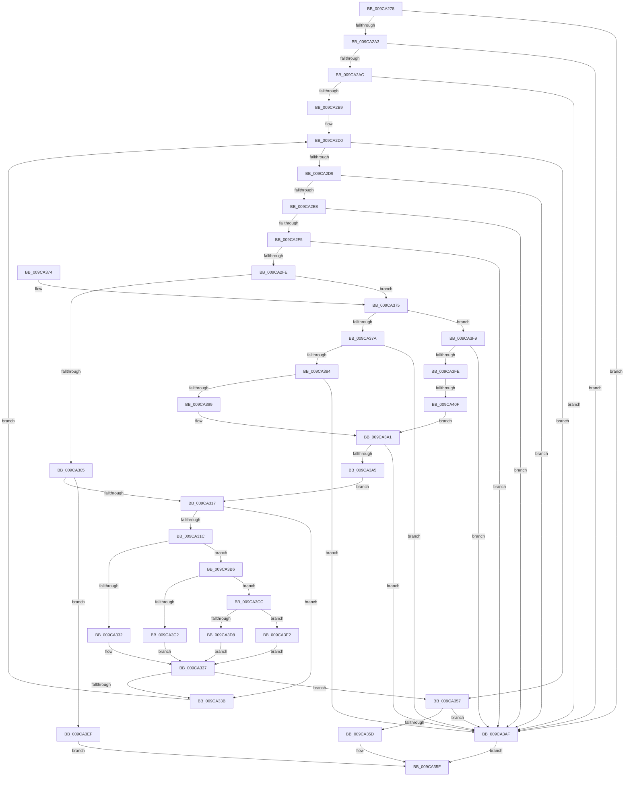

# RtlEnumerateBoundaryDescriptorEntries

- RVA: `0x009CA278`–`0x009CA41C` (길이 `420` bytes)
- VA: `0x00000001409CA278`
- 실행 섹션: `PAGE`
- PDB 이름 있음: `예`; PDB Function 태그: `예`
- unwind 정보 RVA: `0x00091774`
- 디코드: `119`개 명령, `420/420` bytes 표시
- 미해석 바이트: `0` (있으면 어셈블리에 `.byte`로 보존)

> 이 문서는 커널 이미지의 기계어와 PDB 기호를 분석해 생성했습니다. 4번과 5번은 함수 원형과 자료형을 바이너리 사용 방식에서 추정한 C 해석이며 원본 소스 복구 결과는 아닙니다.

## 1. Dependencies

- 직접 호출 지점: **8**; 고유 호출 대상: **8**
- 직접 호출자로 확인된 함수: **5**
- RIP 상대 이미지 참조: **3**

### Outgoing calls
- `0x009CA332` → [ObpCompareEntryLevel2](ObpCompareEntryLevel2_function_009CA430.md) (function, `0x009CA430`)
- `0x009CA387` → [RtlSubAuthorityCountSid](../../text/46/RtlSubAuthorityCountSid_function_00468F10.md) (function, `0x00468F10`)
- `0x009CA38F` → [RtlLengthRequiredSid](RtlLengthRequiredSid_function_009CA4D0.md) (function, `0x009CA4D0`)
- `0x009CA39C` → [RtlValidSid](../92/RtlValidSid_function_00929710.md) (function, `0x00929710`)
- `0x009CA3C2` → [ObpCompareEntryLevel1](ObpCompareEntryLevel1_function_009CA220.md) (function, `0x009CA220`)
- `0x009CA3D8` → [ObpHashBoundaryFunction](ObpHashBoundaryFunction_function_009CA4F0.md) (function, `0x009CA4F0`)
- `0x009CA3E5` → [guard_dispatch_icall](../../text/6B/guard_dispatch_icall_function_006BAAD0.md) (function, `0x006BAAD0`)
- `0x009CA415` → [RtlpValidateSidBuffer](RtlpValidateSidBuffer_function_009CA484.md) (function, `0x009CA484`)

### Direct callers
- [ObpCompareNamespaceEntry](ObpCompareNamespaceEntry_function_009C946C.md) at `0x009C94A5`
- [ObpCaptureBoundaryDescriptor](ObpCaptureBoundaryDescriptor_function_009C9738.md) at `0x009C9908`
- [ObpCaptureBoundaryDescriptor](ObpCaptureBoundaryDescriptor_function_009C9738.md) at `0x009C9928`
- [ObpCheckDuplicateEntries](ObpCheckDuplicateEntries_function_009C9A98.md) at `0x009C9AC5`
- [ObpCompareEntryLevel1](ObpCompareEntryLevel1_function_009CA220.md) at `0x009CA242`
- [ObpVerifyCreatorAccessCheck](ObpVerifyCreatorAccessCheck_function_009CA524.md) at `0x009CA616`

### Static image references
- `0x009CA31C` → RVA `0x009CA430` (`ObpCompareEntryLevel2`; read)
- `0x009CA3B6` → RVA `0x009CA220` (`ObpCompareEntryLevel1`; read)
- `0x009CA3CC` → RVA `0x009CA4F0` (`ObpHashBoundaryFunction`; read)

## 2. Other-region calls and transfers

- 다른 실행 섹션으로 향하는 call: **2**
  - `0x009CA387` → [RtlSubAuthorityCountSid](../../text/46/RtlSubAuthorityCountSid_function_00468F10.md) (`PAGE` → `.text`)
  - `0x009CA3E5` → [guard_dispatch_icall](../../text/6B/guard_dispatch_icall_function_006BAAD0.md) (`PAGE` → `.text`)
- call이 아닌 외부 분기/꼬리 이동: **1**
  - `0x009CA409` → [sub_00B2F548](../B2/Unknown_function_00B2F548.md) (`tail-transfer`)

## 3. Assembly (complete function range)

```asm
009CA278  48 89 5C 24 10                  mov qword ptr [rsp + 0x10], rbx
009CA27D  4C 89 44 24 18                  mov qword ptr [rsp + 0x18], r8
009CA282  55                              push rbp
009CA283  56                              push rsi
009CA284  57                              push rdi
009CA285  41 54                           push r12
009CA287  41 55                           push r13
009CA289  41 56                           push r14
009CA28B  41 57                           push r15
009CA28D  48 83 EC 20                     sub rsp, 0x20
009CA291  8B 41 08                        mov eax, dword ptr [rcx + 8]
009CA294  48 8B EA                        mov rbp, rdx
009CA297  48 8B F9                        mov rdi, rcx
009CA29A  83 F8 10                        cmp eax, 0x10
009CA29D  0F 82 0C 01 00 00               jb 0x1409ca3af
009CA2A3  83 39 01                        cmp dword ptr [rcx], 1
009CA2A6  0F 85 03 01 00 00               jne 0x1409ca3af
009CA2AC  48 8D 34 01                     lea rsi, [rcx + rax]
009CA2B0  48 3B F1                        cmp rsi, rcx
009CA2B3  0F 82 F6 00 00 00               jb 0x1409ca3af
009CA2B9  45 33 D2                        xor r10d, r10d
009CA2BC  48 8D 59 10                     lea rbx, [rcx + 0x10]
009CA2C0  45 33 C9                        xor r9d, r9d
009CA2C3  44 89 54 24 78                  mov dword ptr [rsp + 0x78], r10d
009CA2C8  44 89 4C 24 60                  mov dword ptr [rsp + 0x60], r9d
009CA2CD  45 33 E4                        xor r12d, r12d
009CA2D0  4C 8D 73 08                     lea r14, [rbx + 8]
009CA2D4  4C 3B F6                        cmp r14, rsi
009CA2D7  73 7E                           jae 0x1409ca357
009CA2D9  8B 53 04                        mov edx, dword ptr [rbx + 4]
009CA2DC  41 FF C4                        inc r12d
009CA2DF  83 FA 08                        cmp edx, 8
009CA2E2  0F 82 C7 00 00 00               jb 0x1409ca3af
009CA2E8  4C 8D 2C 13                     lea r13, [rbx + rdx]
009CA2EC  4C 3B EE                        cmp r13, rsi
009CA2EF  0F 87 BA 00 00 00               ja 0x1409ca3af
009CA2F5  4C 3B EB                        cmp r13, rbx
009CA2F8  0F 82 B1 00 00 00               jb 0x1409ca3af
009CA2FE  8B 0B                           mov ecx, dword ptr [rbx]
009CA300  83 E9 01                        sub ecx, 1
009CA303  75 70                           jne 0x1409ca375
009CA305  41 FF C1                        inc r9d
009CA308  44 89 4C 24 60                  mov dword ptr [rsp + 0x60], r9d
009CA30D  41 83 F9 01                     cmp r9d, 1
009CA311  0F 87 D8 00 00 00               ja 0x1409ca3ef
009CA317  48 85 ED                        test rbp, rbp
009CA31A  74 1F                           je 0x1409ca33b
009CA31C  48 8D 05 0D 01 00 00            lea rax, [rip + 0x10d]
009CA323  49 8B D0                        mov rdx, r8
009CA326  48 8B CB                        mov rcx, rbx
009CA329  48 3B E8                        cmp rbp, rax
009CA32C  0F 85 84 00 00 00               jne 0x1409ca3b6
009CA332  E8 F9 00 00 00                  call 0x1409ca430
009CA337  85 C0                           test eax, eax
009CA339  74 1C                           je 0x1409ca357
009CA33B  4C 8B 44 24 70                  mov r8, qword ptr [rsp + 0x70]
009CA340  49 8D 5D 07                     lea rbx, [r13 + 7]
009CA344  44 8B 4C 24 60                  mov r9d, dword ptr [rsp + 0x60]
009CA349  48 83 E3 F8                     and rbx, 0xfffffffffffffff8
009CA34D  44 8B 54 24 78                  mov r10d, dword ptr [rsp + 0x78]
009CA352  E9 79 FF FF FF                  jmp 0x1409ca2d0
009CA357  44 39 67 04                     cmp dword ptr [rdi + 4], r12d
009CA35B  75 52                           jne 0x1409ca3af
009CA35D  33 C0                           xor eax, eax
009CA35F  48 8B 5C 24 68                  mov rbx, qword ptr [rsp + 0x68]
009CA364  48 83 C4 20                     add rsp, 0x20
009CA368  41 5F                           pop r15
009CA36A  41 5E                           pop r14
009CA36C  41 5D                           pop r13
009CA36E  41 5C                           pop r12
009CA370  5F                              pop rdi
009CA371  5E                              pop rsi
009CA372  5D                              pop rbp
009CA373  C3                              ret
009CA374  CC                              int3
009CA375  83 E9 01                        sub ecx, 1
009CA378  75 7F                           jne 0x1409ca3f9
009CA37A  44 8D 7A F8                     lea r15d, [rdx - 8]
009CA37E  41 83 FF 08                     cmp r15d, 8
009CA382  72 2B                           jb 0x1409ca3af
009CA384  49 8B CE                        mov rcx, r14
009CA387  E8 84 EB A9 FF                  call 0x140468f10
009CA38C  0F B6 08                        movzx ecx, byte ptr [rax]
009CA38F  E8 3C 01 00 00                  call 0x1409ca4d0
009CA394  44 3B F8                        cmp r15d, eax
009CA397  72 16                           jb 0x1409ca3af
009CA399  49 8B CE                        mov rcx, r14
009CA39C  E8 6F F3 F5 FF                  call 0x140929710
009CA3A1  84 C0                           test al, al
009CA3A3  74 0A                           je 0x1409ca3af
009CA3A5  4C 8B 44 24 70                  mov r8, qword ptr [rsp + 0x70]
009CA3AA  E9 68 FF FF FF                  jmp 0x1409ca317
009CA3AF  B8 0D 00 00 C0                  mov eax, 0xc000000d
009CA3B4  EB A9                           jmp 0x1409ca35f
009CA3B6  48 8D 05 63 FE FF FF            lea rax, [rip - 0x19d]
009CA3BD  48 3B E8                        cmp rbp, rax
009CA3C0  75 0A                           jne 0x1409ca3cc
009CA3C2  E8 59 FE FF FF                  call 0x1409ca220
009CA3C7  E9 6B FF FF FF                  jmp 0x1409ca337
009CA3CC  48 8D 05 1D 01 00 00            lea rax, [rip + 0x11d]
009CA3D3  48 3B E8                        cmp rbp, rax
009CA3D6  75 0A                           jne 0x1409ca3e2
009CA3D8  E8 13 01 00 00                  call 0x1409ca4f0
009CA3DD  E9 55 FF FF FF                  jmp 0x1409ca337
009CA3E2  48 8B C5                        mov rax, rbp
009CA3E5  E8 E6 06 CF FF                  call 0x1406baad0
009CA3EA  E9 48 FF FF FF                  jmp 0x1409ca337
009CA3EF  B8 BD 00 00 C0                  mov eax, 0xc00000bd
009CA3F4  E9 66 FF FF FF                  jmp 0x1409ca35f
009CA3F9  83 F9 01                        cmp ecx, 1
009CA3FC  75 B1                           jne 0x1409ca3af
009CA3FE  41 FF C2                        inc r10d
009CA401  44 89 54 24 78                  mov dword ptr [rsp + 0x78], r10d
009CA406  44 3B D1                        cmp r10d, ecx
009CA409  0F 87 39 51 16 00               ja 0x140b2f548
009CA40F  83 C2 F8                        add edx, -8
009CA412  49 8B CE                        mov rcx, r14
009CA415  E8 6A 00 00 00                  call 0x1409ca484
009CA41A  EB 85                           jmp 0x1409ca3a1
```

## 4. C-style interpretation (structured pseudocode)

```c
__int64 __fastcall RtlEnumerateBoundaryDescriptorEntries(__int64 a1, __int64 a2, __int64 a3, int a4)
{
    __int64 result;
    __int64 v_r10;
    __int64 v_r12;
    __int64 v_rbx;
    __int64 v_rsp;
    unsigned __int64 v_stack_p10;
    unsigned __int64 v_stack_p18;
    unsigned int v_stack_p20;
    unsigned __int64 v_stack_p70;
    unsigned int v_stack_p78;
    unsigned int v_stack_p8;

    v_stack_p10 = v_rbx;
    v_stack_p18 = a3;
    v_rsp = (v_rsp) - (32);
    if (((unsigned int)((unsigned int)(*(unsigned int *)(a1 + 8)))) < 16) goto loc_009CA3AF;
    if ((*(unsigned int *)(a1)) != 1) goto loc_009CA3AF;
    if ((a1 + (unsigned int)(*(unsigned int *)(a1 + 8)) * 1) < a1) goto loc_009CA3AF;
    v_r10 = 0;
    a4 = 0;
    v_stack_p20 = 0;
    v_stack_p8 = 0;
    v_r12 = 0;
loc_009CA2D0:
    if ((a1 + 16 + 8) >= (a1 + (unsigned int)(*(unsigned int *)(a1 + 8)) * 1)) goto loc_009CA357;
    v_r12 = (unsigned int)((v_r12) + 1);
    if (((unsigned int)((unsigned int)(*(unsigned int *)(a1 + 16 + 4)))) < 8) goto loc_009CA3AF;
    if ((a1 + 16 + (unsigned int)(*(unsigned int *)(a1 + 16 + 4)) * 1) > (a1 + (unsigned int)(*(unsigned int *)(a1 + 8)) * 1)) goto loc_009CA3AF;
    if ((a1 + 16 + (unsigned int)(*(unsigned int *)(a1 + 16 + 4)) * 1) < (a1 + 16)) goto loc_009CA3AF;
    a1 = (unsigned int)(((unsigned int)(*(unsigned int *)(a1 + 16))) - (1));
    if (condition_is_not_equal) goto loc_009CA375;
    a4 = (unsigned int)((a4) + 1);
    v_stack_p8 = a4;
    if (a4 > 1) goto loc_009CA3EF;
loc_009CA317:
    if (a2 == 0) goto loc_009CA33B;
    if (a2 != (v_rip + 269)) goto loc_009CA3B6;
    result = ObpCompareEntryLevel2(a1 + 16, a3, a3, a4);
loc_009CA337:
    if ((unsigned int)(result) == 0) goto loc_009CA357;
loc_009CA33B:
    v_rbx = (a1 + 16 + (unsigned int)(*(unsigned int *)(a1 + 16 + 4)) * 1 + 7) & (-8);
    goto loc_009CA2D0;
loc_009CA357:
    if ((*(unsigned int *)(a1 + 4)) != ((unsigned int)(v_r12))) goto loc_009CA3AF;
    result = 0;
loc_009CA35F:
    v_rsp = (v_rsp) + (32);
    return result;
loc_009CA375:
    a1 = (unsigned int)((a1 + 16) - (1));
    if (condition_is_not_equal) goto loc_009CA3F9;
    if (((unsigned int)(a3 - 8)) < 8) goto loc_009CA3AF;
    result = RtlSubAuthorityCountSid(a1 + 16 + 8, a3, v_stack_p18, (unsigned int)(v_stack_p8));
    result = RtlLengthRequiredSid(*(unsigned __int8 *)(result), a3, v_stack_p18, (unsigned int)(v_stack_p8));
    if (((unsigned int)(a3 - 8)) < ((unsigned int)(result))) goto loc_009CA3AF;
    result = RtlValidSid(a1 + 16 + 8, a3, v_stack_p18, (unsigned int)(v_stack_p8));
loc_009CA3A1:
    if ((unsigned __int8)(result) == 0) goto loc_009CA3AF;
    goto loc_009CA317;
loc_009CA3AF:
    goto loc_009CA35F;
loc_009CA3B6:
    if (a2 != (v_rip - 413)) goto loc_009CA3CC;
    result = ObpCompareEntryLevel1(a1 + 16 + 8, a3, v_stack_p70, (unsigned int)(v_stack_p8));
    goto loc_009CA337;
loc_009CA3CC:
    if (a2 != (v_rip + 285)) goto loc_009CA3E2;
    result = ObpHashBoundaryFunction(a1 + 16 + 8, a3, v_stack_p70, (unsigned int)(v_stack_p8));
    goto loc_009CA337;
loc_009CA3E2:
    result = guard_dispatch_icall(a1 + 16 + 8, a3, v_stack_p70, (unsigned int)(v_stack_p8));
    goto loc_009CA337;
loc_009CA3EF:
    goto loc_009CA35F;
loc_009CA3F9:
    if (((unsigned int)(a1 + 16 + 8)) != 1) goto loc_009CA3AF;
    v_r10 = (unsigned int)(((unsigned int)(v_stack_p20)) + 1);
    v_stack_p78 = (unsigned int)(v_r10);
    a2 = (unsigned int)((a3) + (-8));
    result = RtlpValidateSidBuffer(a1 + 16 + 8, a2, v_stack_p70, (unsigned int)(v_stack_p8));
    goto loc_009CA3A1;
}
```

## 5. (Beta) C Style

```c
int64_t RtlEnumerateBoundaryDescriptorEntries(void *Arg1, int64_t Arg2, int64_t Arg3, int32_t Arg4)
{
    uint8_t *arg1 = (uint8_t *)Arg1;

    int64_t result;
    int64_t local_r10;
    int64_t local_r12;
    int64_t local_rbx;
    int64_t local_rsp;
    uint64_t v_stack_p10;
    uint64_t v_stack_p18;
    uint32_t v_stack_p20;
    uint64_t v_stack_p70;
    uint32_t v_stack_p78;
    uint32_t v_stack_p8;

    v_stack_p10 = local_rbx;
    v_stack_p18 = Arg3;
    local_rsp = (local_rsp) - (32);
    if (((uint32_t)((uint32_t)(*(uint32_t *)(arg1 + 0x8)))) < 16) goto loc_009CA3AF;
    if ((*(uint32_t *)(arg1)) != 1) goto loc_009CA3AF;
    if ((Arg1 + (uint32_t)(*(uint32_t *)(arg1 + 0x8)) * 1) < Arg1) goto loc_009CA3AF;
    local_r10 = 0;
    Arg4 = 0;
    v_stack_p20 = 0;
    v_stack_p8 = 0;
    local_r12 = 0;
loc_009CA2D0:
    if ((Arg1 + 16 + 8) >= (Arg1 + (uint32_t)(*(uint32_t *)(arg1 + 0x8)) * 1)) goto loc_009CA357;
    local_r12 = (uint32_t)((local_r12) + 1);
    if (((uint32_t)((uint32_t)(*(uint32_t *)(arg1 + 0x10 + 0x4)))) < 8) goto loc_009CA3AF;
    if ((Arg1 + 16 + (uint32_t)(*(uint32_t *)(arg1 + 0x10 + 0x4)) * 1) > (Arg1 + (uint32_t)(*(uint32_t *)(arg1 + 0x8)) * 1)) goto loc_009CA3AF;
    if ((Arg1 + 16 + (uint32_t)(*(uint32_t *)(arg1 + 0x10 + 0x4)) * 1) < (Arg1 + 16)) goto loc_009CA3AF;
    Arg1 = (uint32_t)(((uint32_t)(*(uint32_t *)(arg1 + 0x10))) - (1));
    if (condition_is_not_equal) goto loc_009CA375;
    Arg4 = (uint32_t)((Arg4) + 1);
    v_stack_p8 = Arg4;
    if (Arg4 > 1) goto loc_009CA3EF;
loc_009CA317:
    if (Arg2 == 0) goto loc_009CA33B;
    if (Arg2 != (v_rip + 269)) goto loc_009CA3B6;
    result = ObpCompareEntryLevel2(Arg1 + 16, Arg3, Arg3, Arg4);
loc_009CA337:
    if ((uint32_t)(result) == 0) goto loc_009CA357;
loc_009CA33B:
    local_rbx = (Arg1 + 16 + (uint32_t)(*(uint32_t *)(arg1 + 0x10 + 0x4)) * 1 + 7) & (-8);
    goto loc_009CA2D0;
loc_009CA357:
    if ((*(uint32_t *)(arg1 + 0x4)) != ((uint32_t)(local_r12))) goto loc_009CA3AF;
    result = 0;
loc_009CA35F:
    local_rsp = (local_rsp) + (32);
    return result;
loc_009CA375:
    Arg1 = (uint32_t)((Arg1 + 16) - (1));
    if (condition_is_not_equal) goto loc_009CA3F9;
    if (((uint32_t)(Arg3 - 8)) < 8) goto loc_009CA3AF;
    result = RtlSubAuthorityCountSid(Arg1 + 16 + 8, Arg3, v_stack_p18, (uint32_t)(v_stack_p8));
    result = RtlLengthRequiredSid(*(uint8_t *)(result), Arg3, v_stack_p18, (uint32_t)(v_stack_p8));
    if (((uint32_t)(Arg3 - 8)) < ((uint32_t)(result))) goto loc_009CA3AF;
    result = RtlValidSid(Arg1 + 16 + 8, Arg3, v_stack_p18, (uint32_t)(v_stack_p8));
loc_009CA3A1:
    if ((uint8_t)(result) == 0) goto loc_009CA3AF;
    goto loc_009CA317;
loc_009CA3AF:
    goto loc_009CA35F;
loc_009CA3B6:
    if (Arg2 != (v_rip - 413)) goto loc_009CA3CC;
    result = ObpCompareEntryLevel1(Arg1 + 16 + 8, Arg3, v_stack_p70, (uint32_t)(v_stack_p8));
    goto loc_009CA337;
loc_009CA3CC:
    if (Arg2 != (v_rip + 285)) goto loc_009CA3E2;
    result = ObpHashBoundaryFunction(Arg1 + 16 + 8, Arg3, v_stack_p70, (uint32_t)(v_stack_p8));
    goto loc_009CA337;
loc_009CA3E2:
    result = guard_dispatch_icall(Arg1 + 16 + 8, Arg3, v_stack_p70, (uint32_t)(v_stack_p8));
    goto loc_009CA337;
loc_009CA3EF:
    goto loc_009CA35F;
loc_009CA3F9:
    if (((uint32_t)(Arg1 + 16 + 8)) != 1) goto loc_009CA3AF;
    local_r10 = (uint32_t)(((uint32_t)(v_stack_p20)) + 1);
    v_stack_p78 = (uint32_t)(local_r10);
    Arg2 = (uint32_t)((Arg3) + (-8));
    result = RtlpValidateSidBuffer(Arg1 + 16 + 8, Arg2, v_stack_p70, (uint32_t)(v_stack_p8));
    goto loc_009CA3A1;
}
```

### 관측된 메모리 오프셋

구조체 형식이 확인되지 않은 접근은 인자 기준의 오프셋으로만 기록했습니다.

| 기준 인자 | 오프셋 표현 | 폭 (bit) | 접근 |
|---|---:|---:|---|
| `Arg1` | `+ 0x0` | `32` | `R` |
| `Arg1` | `+ 0x0 + rax*1` | `64` | `R` |
| `Arg1` | `+ 0x4` | `32` | `R` |
| `Arg1` | `+ 0x8` | `32` | `R` |
| `Arg1` | `+ 0x10` | `64` | `R` |

## 6. Execution-region graph

[열기: 2D/3D 그래프와 함수 탐색 컨트롤 패널](../../../control-panel.html?section=page&rva=0x009CA278&view=graph)

- 2D 그래프는 위에서 아래로 흐르고, 3D 그래프는 빈 공간을 드래그해 회전합니다. Shift+드래그는 이동, 휠은 확대·축소, 함수 노드 선택은 대상 보고서 이동입니다.

### Static fallback


