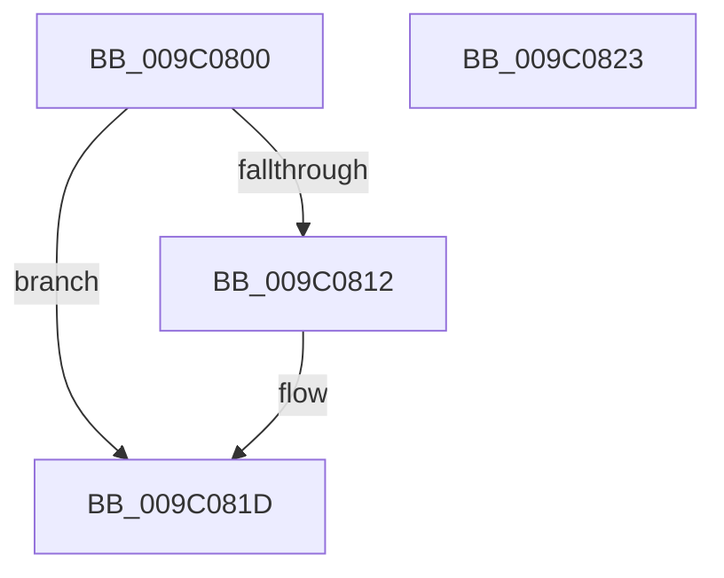

# RtlFreeAnsiString

- RVA: `0x009C0800`–`0x009C0824` (길이 `36` bytes)
- VA: `0x00000001409C0800`
- 실행 섹션: `PAGE`
- PDB 이름 있음: `예`; PDB Function 태그: `아니요`
- unwind 정보 RVA: `0x0005CF00`
- 디코드: `13`개 명령, `36/36` bytes 표시
- 미해석 바이트: `0` (있으면 어셈블리에 `.byte`로 보존)

> 이 문서는 커널 이미지의 기계어와 PDB 기호를 분석해 생성했습니다. 4번과 5번은 함수 원형과 자료형을 바이너리 사용 방식에서 추정한 C 해석이며 원본 소스 복구 결과는 아닙니다.

## 1. Dependencies

- 직접 호출 지점: **1**; 고유 호출 대상: **1**
- 직접 호출자로 확인된 함수: **166**
- RIP 상대 이미지 참조: **0**

### Outgoing calls
- `0x009C0812` → [ExFreePool](../../poolcode/B8/ExFreePool_function_00B82850.md) (function, `0x00B82850`)

### Direct callers
- [RtlIsNameInExpression](../../text/2F/RtlIsNameInExpression_function_002FDA70.md) at `0x002FDAC8`
- [RtlIsNameInUnUpcasedExpression](../../text/2F/RtlIsNameInUnUpcasedExpression_function_002FDAF0.md) at `0x002FDB93`
- [RtlIsNameInUnUpcasedExpression](../../text/2F/RtlIsNameInUnUpcasedExpression_function_002FDAF0.md) at `0x002FDB9F`
- [RtlAreNamesEqual](../../text/40/RtlAreNamesEqual_function_0040BCB0.md) at `0x0040BD64`
- [RtlAreNamesEqual](../../text/40/RtlAreNamesEqual_function_0040BCB0.md) at `0x0040BD6E`
- [RtlAreNamesEqual](../../text/40/RtlAreNamesEqual_function_0040BCB0.md) at `0x0040BDB7`
- [SeClearLearningModeObjectInformation](../../text/40/SeClearLearningModeObjectInformation_function_0040D470.md) at `0x0040D4D2`
- [CmpDoQueryKeyName](../../text/45/CmpDoQueryKeyName_function_00456664.md) at `0x004569FC`
- [RtlDeriveCapabilitySidsFromName](../../text/47/RtlDeriveCapabilitySidsFromName_function_00474DC0.md) at `0x00474ECF`
- [HvlDebuggerSupportInitialize](../../text/58/HvlDebuggerSupportInitialize_function_00583790.md) at `0x005838FA`
- [PnpBootDeviceWait](../../text/5A/PnpBootDeviceWait_function_005A4D68.md) at `0x005A4E40`
- [PnpBootDeviceWait](../../text/5A/PnpBootDeviceWait_function_005A4D68.md) at `0x005A4E9E`
- [PopEmModuleAddressMatchCallback](../../text/5D/PopEmModuleAddressMatchCallback_function_005DA3F0.md) at `0x005DA480`
- [PopEmUpdateDeviceConstraintCallback](../../text/5D/PopEmUpdateDeviceConstraintCallback_function_005DC7F0.md) at `0x005DC8A5`
- [EtwpQueryPartitionRegistryInformation](../../text/64/EtwpQueryPartitionRegistryInformation_function_0064ECCC.md) at `0x0064EF3B`
- [EtwpQueryPartitionRegistryInformation](../../text/64/EtwpQueryPartitionRegistryInformation_function_0064ECCC.md) at `0x0064EF45`
- [EtwpQuerySiloRegistrySettings](../../text/64/EtwpQuerySiloRegistrySettings_function_0064EF78.md) at `0x0064F0E9`
- [EtwpTransitionToRealtime](../../text/65/EtwpTransitionToRealtime_function_006518D8.md) at `0x0065198A`
- [EtwpTransitionToRealtime](../../text/65/EtwpTransitionToRealtime_function_006518D8.md) at `0x00651996`
- [EtwpTransitionToRealtime](../../text/65/EtwpTransitionToRealtime_function_006518D8.md) at `0x006519A2`
- [OpenGlobalizationUserSettingsKey_ForMua](../../text/65/OpenGlobalizationUserSettingsKey_ForMua_function_0065D0C8.md) at `0x0065D309`
- [CmpSetSystemRegistryString](../../text/66/CmpSetSystemRegistryString_function_0066A2F0.md) at `0x0066A375`
- [RtlIsNameInExpression$fin$0](../../text/6D/RtlIsNameInExpression_fin_0_function_006D1FA0.md) at `0x006D1FB4`
- [RtlIsNameInUnUpcasedExpression$fin$0](../../text/6D/RtlIsNameInUnUpcasedExpression_fin_0_function_006D1FD0.md) at `0x006D1FE4`
- [RtlIsNameInUnUpcasedExpression$fin$0](../../text/6D/RtlIsNameInUnUpcasedExpression_fin_0_function_006D1FD0.md) at `0x006D1FF5`
- [PiDevCfgFreeDeviceContext](../70/PiDevCfgFreeDeviceContext_function_00704A00.md) at `0x00704A3D`
- [MiApplyRequiredDriverHotPatches](../70/MiApplyRequiredDriverHotPatches_function_007053D4.md) at `0x00705478`
- [IopCopyBootLogRegistryToFile](../71/IopCopyBootLogRegistryToFile_function_0071B19C.md) at `0x0071B2DE`
- [PipFreeBindingRequestEntry](../72/PipFreeBindingRequestEntry_function_00727C84.md) at `0x00727C9C`
- [IoGetDeviceDirectory](../72/IoGetDeviceDirectory_function_00728370.md) at `0x007286B8`
- [IoGetDeviceDirectory](../72/IoGetDeviceDirectory_function_00728370.md) at `0x007286C1`
- [IoGetDeviceDirectory](../72/IoGetDeviceDirectory_function_00728370.md) at `0x007286CA`
- [PiBuildAndOpenDeviceDirectoryPath](../72/PiBuildAndOpenDeviceDirectoryPath_function_00728724.md) at `0x00728826`
- [PiCreateDirectoryPath](../72/PiCreateDirectoryPath_function_0072885C.md) at `0x00728B18`
- [PiCreateRegistryPath](../72/PiCreateRegistryPath_function_00728B58.md) at `0x00728DAE`
- [PiCreateServiceKeyUnderPath](../72/PiCreateServiceKeyUnderPath_function_00728DEC.md) at `0x00728FE3`
- [PiGetDriverMutableStateDirectory](../72/PiGetDriverMutableStateDirectory_function_00729038.md) at `0x00729156`
- [PiGetDriverMutableStateDirectory](../72/PiGetDriverMutableStateDirectory_function_00729038.md) at `0x0072915F`
- [PiOpenDriverRedirectedStateRootKey](../72/PiOpenDriverRedirectedStateRootKey_function_0072935C.md) at `0x00729418`
- [PiDevCfgAppendMultiSz](../73/PiDevCfgAppendMultiSz_function_00731B28.md) at `0x00731D8D`
- [PiDevCfgAppendMultiSz](../73/PiDevCfgAppendMultiSz_function_00731B28.md) at `0x00731DAF`
- [PiDevCfgCheckDeviceNeedsUpdate](../73/PiDevCfgCheckDeviceNeedsUpdate_function_00731DDC.md) at `0x007321EA`
- [PiDevCfgCheckDeviceNeedsUpdate](../73/PiDevCfgCheckDeviceNeedsUpdate_function_00731DDC.md) at `0x00732425`
- [PiDevCfgCheckDeviceNeedsUpdate](../73/PiDevCfgCheckDeviceNeedsUpdate_function_00731DDC.md) at `0x0073242E`
- [PiDevCfgCheckDeviceNeedsUpdate](../73/PiDevCfgCheckDeviceNeedsUpdate_function_00731DDC.md) at `0x00732437`
- [PiDevCfgCheckDeviceNeedsUpdate](../73/PiDevCfgCheckDeviceNeedsUpdate_function_00731DDC.md) at `0x00732440`
- [PiDevCfgCheckDeviceNeedsUpdate](../73/PiDevCfgCheckDeviceNeedsUpdate_function_00731DDC.md) at `0x00732449`
- [PiDevCfgFindDeviceMigrationNode](../73/PiDevCfgFindDeviceMigrationNode_function_00732920.md) at `0x007332FE`
- [PiDevCfgFindDeviceMigrationNode](../73/PiDevCfgFindDeviceMigrationNode_function_00732920.md) at `0x00733307`
- [PiDevCfgFindDeviceMigrationNode](../73/PiDevCfgFindDeviceMigrationNode_function_00732920.md) at `0x00733310`
- [PiDevCfgFindDeviceMigrationNode](../73/PiDevCfgFindDeviceMigrationNode_function_00732920.md) at `0x00733319`
- [PiDevCfgFreeDriverNode](../73/PiDevCfgFreeDriverNode_function_00733354.md) at `0x00733436`
- [PiDevCfgFreeDriverNode](../73/PiDevCfgFreeDriverNode_function_00733354.md) at `0x0073343F`
- [PiDevCfgFreeDriverNode](../73/PiDevCfgFreeDriverNode_function_00733354.md) at `0x00733448`
- [PiDevCfgFreeDriverNode](../73/PiDevCfgFreeDriverNode_function_00733354.md) at `0x00733451`
- [PiDevCfgFreeDriverNode](../73/PiDevCfgFreeDriverNode_function_00733354.md) at `0x0073345D`
- [PiDevCfgFreeDriverNode](../73/PiDevCfgFreeDriverNode_function_00733354.md) at `0x00733469`
- [PiDevCfgFreeDriverNode](../73/PiDevCfgFreeDriverNode_function_00733354.md) at `0x00733475`
- [PiDevCfgFreeDriverNode](../73/PiDevCfgFreeDriverNode_function_00733354.md) at `0x00733481`
- [PiDevCfgFreeDriverNode](../73/PiDevCfgFreeDriverNode_function_00733354.md) at `0x0073348D`
- [PiDevCfgFreeDriverNode](../73/PiDevCfgFreeDriverNode_function_00733354.md) at `0x00733499`
- [PiDevCfgFreeDriverNode](../73/PiDevCfgFreeDriverNode_function_00733354.md) at `0x007334A5`
- [PiDevCfgFreeDriverNode](../73/PiDevCfgFreeDriverNode_function_00733354.md) at `0x007334B1`
- [PiDevCfgFreeDriverNode](../73/PiDevCfgFreeDriverNode_function_00733354.md) at `0x007334BD`
- [PiDevCfgFreeDriverNode](../73/PiDevCfgFreeDriverNode_function_00733354.md) at `0x007334C9`
- [PiDevCfgFreeDriverNode](../73/PiDevCfgFreeDriverNode_function_00733354.md) at `0x007334D5`
- [PiDevCfgFreeDriverNode](../73/PiDevCfgFreeDriverNode_function_00733354.md) at `0x007334E1`
- [PiDevCfgGetDeviceClassDriverConfigurable](../73/PiDevCfgGetDeviceClassDriverConfigurable_function_00733504.md) at `0x007336F0`
- [PiDevCfgGetDeviceClassDriverConfigurable](../73/PiDevCfgGetDeviceClassDriverConfigurable_function_00733504.md) at `0x007336FF`
- [PiDevCfgQueryDriverNode](../73/PiDevCfgQueryDriverNode_function_0073435C.md) at `0x00734609`
- [PiDevCfgQueryDriverNode](../73/PiDevCfgQueryDriverNode_function_0073435C.md) at `0x00734612`
- [PiDevCfgQueryDriverNode](../73/PiDevCfgQueryDriverNode_function_0073435C.md) at `0x00734A95`
- [PiDevCfgQueryDriverNode](../73/PiDevCfgQueryDriverNode_function_0073435C.md) at `0x00734B92`
- [PiDevCfgQueryIncludedDriverNode](../73/PiDevCfgQueryIncludedDriverNode_function_00734D88.md) at `0x00734FEB`
- [PiDevCfgQueryIncludedDriverNode](../73/PiDevCfgQueryIncludedDriverNode_function_00734D88.md) at `0x007350C8`
- [PiDevCfgRequestDriverConfigurations](../73/PiDevCfgRequestDriverConfigurations_function_00735778.md) at `0x00735896`
- [PiDevCfgResolveVariableGenerateGuid](../73/PiDevCfgResolveVariableGenerateGuid_function_00735FD0.md) at `0x00736095`
- [PpDevCfgProcessDeviceClass](../73/PpDevCfgProcessDeviceClass_function_00736824.md) at `0x00736BC9`
- [PpDevCfgProcessDeviceExtensions](../73/PpDevCfgProcessDeviceExtensions_function_00736C2C.md) at `0x007370D5`
- [PpDevCfgProcessDeviceExtensions](../73/PpDevCfgProcessDeviceExtensions_function_00736C2C.md) at `0x00737327`
- [PpDevCfgProcessDeviceExtensions](../73/PpDevCfgProcessDeviceExtensions_function_00736C2C.md) at `0x00737330`
- [PpDevCfgProcessDeviceExtensions](../73/PpDevCfgProcessDeviceExtensions_function_00736C2C.md) at `0x00737339`
- [PpDevCfgProcessDeviceExtensions](../73/PpDevCfgProcessDeviceExtensions_function_00736C2C.md) at `0x00737342`
- [PpDevCfgProcessDeviceExtensions](../73/PpDevCfgProcessDeviceExtensions_function_00736C2C.md) at `0x0073734B`
- [PpDevCfgProcessDeviceExtensions](../73/PpDevCfgProcessDeviceExtensions_function_00736C2C.md) at `0x00737354`
- [PpDevCfgProcessDeviceExtensions](../73/PpDevCfgProcessDeviceExtensions_function_00736C2C.md) at `0x0073735D`
- [PpDevCfgProcessDeviceExtensions](../73/PpDevCfgProcessDeviceExtensions_function_00736C2C.md) at `0x00737366`
- [PpDevCfgProcessDeviceExtensions](../73/PpDevCfgProcessDeviceExtensions_function_00736C2C.md) at `0x00737370`
- [PpDevCfgProcessDeviceExtensions](../73/PpDevCfgProcessDeviceExtensions_function_00736C2C.md) at `0x00737379`
- [PpDevCfgProcessDevices](../73/PpDevCfgProcessDevices_function_007373C0.md) at `0x0073757F`
- [PiDrvDbDestroyNode](../74/PiDrvDbDestroyNode_function_00740DF8.md) at `0x00740E38`
- [PiDrvDbDestroyNode](../74/PiDrvDbDestroyNode_function_00740DF8.md) at `0x00740E41`
- [PiDrvDbDestroyNode](../74/PiDrvDbDestroyNode_function_00740DF8.md) at `0x00740E4A`
- [PiDrvDbDestroyNode](../74/PiDrvDbDestroyNode_function_00740DF8.md) at `0x00740E56`
- [PiDrvDbQueryHiveFileName](../74/PiDrvDbQueryHiveFileName_function_00741DDC.md) at `0x00741F3A`
- [PiDrvDbQuerySystemPathWin32](../74/PiDrvDbQuerySystemPathWin32_function_007421F4.md) at `0x007425FB`
- [PiDrvDbRegisterNode](../74/PiDrvDbRegisterNode_function_00742658.md) at `0x00742AA6`
- [PiDrvDbResolveFilePathKeyValues](../74/PiDrvDbResolveFilePathKeyValues_function_00742C00.md) at `0x00742CCF`
- [PiDrvDbResolveFilePathKeyValues](../74/PiDrvDbResolveFilePathKeyValues_function_00742C00.md) at `0x00742CD8`
- [PiDrvDbResolveFilePathKeyValues](../74/PiDrvDbResolveFilePathKeyValues_function_00742C00.md) at `0x00742CE1`
- [PiDrvDbResolveKeyFilePaths](../74/PiDrvDbResolveKeyFilePaths_function_0074326C.md) at `0x00743383`
- [PiDrvDbResolveNodeFilePaths](../74/PiDrvDbResolveNodeFilePaths_function_007433A4.md) at `0x007434E5`
- [PiDrvDbSetupNodeHive](../74/PiDrvDbSetupNodeHive_function_00743884.md) at `0x00743CD3`
- [PiDrvDbSetupNodeHive](../74/PiDrvDbSetupNodeHive_function_00743884.md) at `0x00743CDC`
- [KsepGetModuleInfoByName](../74/KsepGetModuleInfoByName_function_0074AA04.md) at `0x0074AAD1`
- [PopRegisterCoolingExtensionProtection](../75/PopRegisterCoolingExtensionProtection_function_007575D0.md) at `0x007577D1`
- [PspDeleteServerSiloGlobals](../77/PspDeleteServerSiloGlobals_function_0077FC54.md) at `0x0077FD53`
- [PspSiloInitializeUserSharedData](../78/PspSiloInitializeUserSharedData_function_00780684.md) at `0x0078080B`
- [RtlpGetTokenNamedObjectPath](../78/RtlpGetTokenNamedObjectPath_function_0078ED40.md) at `0x0078F0C3`
- [RtlpGetTokenNamedObjectPath](../78/RtlpGetTokenNamedObjectPath_function_0078ED40.md) at `0x0078F311`
- [RtlpGetTokenNamedObjectPath](../78/RtlpGetTokenNamedObjectPath_function_0078ED40.md) at `0x0078F31D`
- [RtlpGetTokenNamedObjectPath](../78/RtlpGetTokenNamedObjectPath_function_0078ED40.md) at `0x0078F32E`
- [RtlOpenCurrentUser](../78/RtlOpenCurrentUser_function_0078F940.md) at `0x0078F9BA`
- [RtlpConstructCrossVmObjectPath](../79/RtlpConstructCrossVmObjectPath_function_00790958.md) at `0x00790A88`
- [RtlpConstructCrossVmObjectPath](../79/RtlpConstructCrossVmObjectPath_function_00790958.md) at `0x00790A91`
- [SepInitializationPhase1](../79/SepInitializationPhase1_function_0079C580.md) at `0x0079C741`
- [SepInitializationPhase1](../79/SepInitializationPhase1_function_0079C580.md) at `0x0079C7B7`
- [WmipCheckSMBiosSysInfoString](../7B/WmipCheckSMBiosSysInfoString_function_007B289C.md) at `0x007B2924`
- [WmipTranslateFileHandle](../7B/WmipTranslateFileHandle_function_007B3DA4.md) at `0x007B3EA7`
- [EtwWmitraceWorker](../7B/EtwWmitraceWorker_function_007BBD3C.md) at `0x007BC017`
- [EtwWmitraceWorker](../7B/EtwWmitraceWorker_function_007BBD3C.md) at `0x007BC029`
- [EtwStartAutoLogger](../7B/EtwStartAutoLogger_function_007BD2F8.md) at `0x007BE220`
- [EtwStartAutoLogger](../7B/EtwStartAutoLogger_function_007BD2F8.md) at `0x007BE242`
- [EtwStartAutoLogger](../7B/EtwStartAutoLogger_function_007BD2F8.md) at `0x007BE24B`
- [EtwStartAutoLogger](../7B/EtwStartAutoLogger_function_007BD2F8.md) at `0x007BE254`
- [EtwpSavePersistedLogger](../7B/EtwpSavePersistedLogger_function_007BF374.md) at `0x007BF8D8`
- [ExpAcquirePrmInterface](../7C/ExpAcquirePrmInterface_function_007CECA8.md) at `0x007CEDAB`
- [ExpPrmNotifyInterfaceChange](../7C/ExpPrmNotifyInterfaceChange_function_007CEDE0.md) at `0x007CEE7E`
- [CmpCloneHwProfile](../7E/CmpCloneHwProfile_function_007E303C.md) at `0x007E3556`
- [CmpCloneHwProfile](../7E/CmpCloneHwProfile_function_007E303C.md) at `0x007E3631`
- [CmpCreateHwProfileFriendlyName](../7E/CmpCreateHwProfileFriendlyName_function_007E3840.md) at `0x007E3AA2`
- [CmpAddProcessorConfigurationEntry](../7E/CmpAddProcessorConfigurationEntry_function_007E4CF8.md) at `0x007E4FCF`
- [CmpAddProcessorConfigurationEntry](../7E/CmpAddProcessorConfigurationEntry_function_007E4CF8.md) at `0x007E504B`
- [CmpTraceHiveRestoreStart](../7E/CmpTraceHiveRestoreStart_function_007E6624.md) at `0x007E6709`
- [CmpGetVirtualStoreRoot](../7E/CmpGetVirtualStoreRoot_function_007EB974.md) at `0x007EBA03`
- [CmpReparseToVirtualPath](../7E/CmpReparseToVirtualPath_function_007EBA48.md) at `0x007EBACD`
- [CmpReplicateKeyToVirtual](../7E/CmpReplicateKeyToVirtual_function_007EBAEC.md) at `0x007EBD15`
- [CmpReportAuditVirtualizationEvent](../7E/CmpReportAuditVirtualizationEvent_function_007ED758.md) at `0x007ED9C3`
- [CmpReportAuditVirtualizationEvent](../7E/CmpReportAuditVirtualizationEvent_function_007ED758.md) at `0x007ED9E9`
- [CmpInitializeRegistryNode](../7E/CmpInitializeRegistryNode_function_007EE81C.md) at `0x007EEA87`
- [CmpRecoverEnlistment](../7F/CmpRecoverEnlistment_function_007F0014.md) at `0x007F00ED`
- [CmpRecoverEnlistment](../7F/CmpRecoverEnlistment_function_007F0014.md) at `0x007F00F6`
- [CmpAddRemoveRMLogContainer](../7F/CmpAddRemoveRMLogContainer_function_007F01A0.md) at `0x007F02EF`
- [CmpAddRemoveRMLogContainer](../7F/CmpAddRemoveRMLogContainer_function_007F01A0.md) at `0x007F02FE`
- [CmpStartRMLog](../7F/CmpStartRMLog_function_007F0AFC.md) at `0x007F104D`
- [CmpStartRMLog](../7F/CmpStartRMLog_function_007F0AFC.md) at `0x007F105C`
- [CmpIsFileInSystemConfig](../7F/CmpIsFileInSystemConfig_function_007F1F80.md) at `0x007F20F8`
- [CmpIsFileInSystemConfig](../7F/CmpIsFileInSystemConfig_function_007F1F80.md) at `0x007F215A`
- [CmpIsFileInSystemConfig](../7F/CmpIsFileInSystemConfig_function_007F1F80.md) at `0x007F2168`
- [CmpAddRemoveContainerToCLFSLog](../7F/CmpAddRemoveContainerToCLFSLog_function_007F69FC.md) at `0x007F6C46`
- [MiApplyImageHotPatchRequest](../80/MiApplyImageHotPatchRequest_function_008025AC.md) at `0x00802B27`
- [MiApplyImageHotPatchRequest](../80/MiApplyImageHotPatchRequest_function_008025AC.md) at `0x00802B3F`
- [MiCreatePatchSectionRequest](../80/MiCreatePatchSectionRequest_function_008031E0.md) at `0x0080326D`
- [MiDeleteHotPatchEntry](../80/MiDeleteHotPatchEntry_function_008033C0.md) at `0x008033EB`
- [MiGetAllRegisteredPatches](../80/MiGetAllRegisteredPatches_function_0080367C.md) at `0x00803861`
- [MiGetAllRegisteredPatches](../80/MiGetAllRegisteredPatches_function_0080367C.md) at `0x00803906`
- [MiGetAllRegisteredPatches](../80/MiGetAllRegisteredPatches_function_0080367C.md) at `0x0080391E`
- [MmInsertSecureImageActivePatch](../80/MmInsertSecureImageActivePatch_function_008073E4.md) at `0x008074BC`
- [AslDoesFileExistNtPath](../81/AslDoesFileExistNtPath_function_00819BF4.md) at `0x00819CA7`
- [AslRegistryBuildUserPath](../81/AslRegistryBuildUserPath_function_00819DB0.md) at `0x00819E85`
- [AslPathWildcardFindFirst](../81/AslPathWildcardFindFirst_function_0081B534.md) at `0x0081BAD5`
- [BiUpdateObjectReferenceInEfiEntry](../82/BiUpdateObjectReferenceInEfiEntry_function_0082745C.md) at `0x00827586`
- [PnpCtxDestroyNode](../82/PnpCtxDestroyNode_function_00828D50.md) at `0x00828D5D`
- [RegRtlOpenPredefinedKey](../83/RegRtlOpenPredefinedKey_function_00832A14.md) at `0x00832ABD`
- [DrvDbSetDriverDatabaseMappedProperty](../83/DrvDbSetDriverDatabaseMappedProperty_function_00834014.md) at `0x0083458C`
- [DrvDbDestroyDatabaseNode](../83/DrvDbDestroyDatabaseNode_function_00835674.md) at `0x008356EE`
- [DrvDbDestroyDatabaseNode](../83/DrvDbDestroyDatabaseNode_function_00835674.md) at `0x008356F7`
- [CmKeyBodyReplicateToVirtual](../84/CmKeyBodyReplicateToVirtual_function_00843FE4.md) at `0x00844341`
- [CmpInitCmRM](../87/CmpInitCmRM_function_0087C700.md) at `0x0087CC38`
- [CmpInitCmRM](../87/CmpInitCmRM_function_0087C700.md) at `0x0087CDD2`
- [CmpInitCmRM](../87/CmpInitCmRM_function_0087C700.md) at `0x0087CEC0`
- [CmpInitCmRM](../87/CmpInitCmRM_function_0087C700.md) at `0x0087D1FA`
- [CmpInitCmRM](../87/CmpInitCmRM_function_0087C700.md) at `0x0087D209`
- [CmpInitCmRM](../87/CmpInitCmRM_function_0087C700.md) at `0x0087D219`
- [IoGetDeviceInterfaceAlias](../8F/IoGetDeviceInterfaceAlias_function_008F5570.md) at `0x008F58C5`
- [RtlFormatCurrentUserKeyPath](../92/RtlFormatCurrentUserKeyPath_function_00927820.md) at `0x00927963`
- [IopBuildGlobalSymbolicLinkString](../95/IopBuildGlobalSymbolicLinkString_function_00951530.md) at `0x009516AC`
- [AslFileMappingCreate](../95/AslFileMappingCreate_function_00958448.md) at `0x009585F1`
- [PiDevCfgFreeVariable](../96/PiDevCfgFreeVariable_function_00964E80.md) at `0x00964E8D`
- [PpDevCfgProcessDeviceReset](../96/PpDevCfgProcessDeviceReset_function_00965498.md) at `0x009655F0`
- [PiDevCfgClearDeviceMigrationNode](../96/PiDevCfgClearDeviceMigrationNode_function_00965780.md) at `0x00965A45`
- [PiDevCfgClearDeviceMigrationNode](../96/PiDevCfgClearDeviceMigrationNode_function_00965780.md) at `0x00965A69`
- [PiDevCfgQueryDriverConfiguration](../97/PiDevCfgQueryDriverConfiguration_function_0097584C.md) at `0x00975AC9`
- [PiDevCfgQueryDriverConfiguration](../97/PiDevCfgQueryDriverConfiguration_function_0097584C.md) at `0x00975AE1`
- [PiDevCfgQueryDriverConfiguration](../97/PiDevCfgQueryDriverConfiguration_function_0097584C.md) at `0x00975AFA`
- [PiDevCfgQueryDriverConfiguration](../97/PiDevCfgQueryDriverConfiguration_function_0097584C.md) at `0x00975B14`
- [PiDevCfgQueryDriverConfiguration](../97/PiDevCfgQueryDriverConfiguration_function_0097584C.md) at `0x00975B30`
- [PiDevCfgQueryDriverConfiguration](../97/PiDevCfgQueryDriverConfiguration_function_0097584C.md) at `0x00975B4B`
- [PiDevCfgQueryDriverConfiguration](../97/PiDevCfgQueryDriverConfiguration_function_0097584C.md) at `0x00975B74`
- [PiDevCfgQueryDriverConfiguration](../97/PiDevCfgQueryDriverConfiguration_function_0097584C.md) at `0x00975B8C`
- [PiDevCfgQueryDriverConfiguration](../97/PiDevCfgQueryDriverConfiguration_function_0097584C.md) at `0x00975B9D`
- [PiDevCfgConfigureDevice](../97/PiDevCfgConfigureDevice_function_00977BB4.md) at `0x00978376`
- [PiDevCfgConfigureDevice](../97/PiDevCfgConfigureDevice_function_00977BB4.md) at `0x0097838C`
- [PiDevCfgConfigureDevice](../97/PiDevCfgConfigureDevice_function_00977BB4.md) at `0x0097940B`
- [CmRealKCBToVirtualPath](../99/CmRealKCBToVirtualPath_function_00990130.md) at `0x00990302`
- [CmKtmNotification](../9B/CmKtmNotification_function_009B1950.md) at `0x009B1D98`
- [CmKtmNotification](../9B/CmKtmNotification_function_009B1950.md) at `0x009B1E65`
- [PiDevCfgFreeDeviceMigrationNode](../9B/PiDevCfgFreeDeviceMigrationNode_function_009BCD54.md) at `0x009BCD73`
- [PiDevCfgFreeDeviceMigrationNode](../9B/PiDevCfgFreeDeviceMigrationNode_function_009BCD54.md) at `0x009BCD84`
- [PiDevCfgFreeDeviceMigrationNode](../9B/PiDevCfgFreeDeviceMigrationNode_function_009BCD54.md) at `0x009BCD97`
- [PiDevCfgFreeDeviceMigrationNode](../9B/PiDevCfgFreeDeviceMigrationNode_function_009BCD54.md) at `0x009BCDA0`
- [PiDevCfgFreeDeviceMigrationNode](../9B/PiDevCfgFreeDeviceMigrationNode_function_009BCD54.md) at `0x009BCDAC`
- [PiDevCfgFreeDeviceMigrationNode](../9B/PiDevCfgFreeDeviceMigrationNode_function_009BCD54.md) at `0x009BCDB8`
- [PiDevCfgQueryDeviceMigrationNode](../9B/PiDevCfgQueryDeviceMigrationNode_function_009BD328.md) at `0x009BD60F`
- [PiDevCfgQueryDeviceMigrationNode](../9B/PiDevCfgQueryDeviceMigrationNode_function_009BD328.md) at `0x009BD6E1`
- [PiDevCfgQueryDeviceMigrationNode](../9B/PiDevCfgQueryDeviceMigrationNode_function_009BD328.md) at `0x009BD6FB`
- [PiDevCfgQueryDeviceMigrationNode](../9B/PiDevCfgQueryDeviceMigrationNode_function_009BD328.md) at `0x009BD720`
- [PiDevCfgQueryDeviceMigrationNode](../9B/PiDevCfgQueryDeviceMigrationNode_function_009BD328.md) at `0x009BD73A`
- [EtwpBufferingModeFlush](../9B/EtwpBufferingModeFlush_function_009BD8F4.md) at `0x009BDAA7`
- [EtwpCreateLogFile](EtwpCreateLogFile_function_009C035C.md) at `0x009C0676`
- [EtwpExpandFileName](EtwpExpandFileName_function_009C147C.md) at `0x009C1617`
- [EtwpFreeLoggerContext](EtwpFreeLoggerContext_function_009C1688.md) at `0x009C17AD`
- [EtwpFreeLoggerContext](EtwpFreeLoggerContext_function_009C1688.md) at `0x009C17B9`
- [EtwpFreeLoggerContext](EtwpFreeLoggerContext_function_009C1688.md) at `0x009C17C5`
- [EtwpFreeLoggerContext](EtwpFreeLoggerContext_function_009C1688.md) at `0x009C17D1`
- [EtwpFreeSoftRestartContext](EtwpFreeSoftRestartContext_function_009C1D94.md) at `0x009C1DC2`
- [PiUEventHandleVetoEvent](PiUEventHandleVetoEvent_function_009C2744.md) at `0x009C27EC`
- [PspDeleteCreateProcessContext](../9E/PspDeleteCreateProcessContext_function_009EF4C4.md) at `0x009EF5D9`
- [RtlpGetPolicyValueForSystemCapability](../A2/RtlpGetPolicyValueForSystemCapability_function_00A207F8.md) at `0x00A20840`
- [BiCreateObject](../A3/BiCreateObject_function_00A3D92C.md) at `0x00A3DA4D`
- [EtwpSetSoftRestartInformation](../A5/EtwpSetSoftRestartInformation_function_00A53DB8.md) at `0x00A53F70`
- [EtwpSetSoftRestartInformation](../A5/EtwpSetSoftRestartInformation_function_00A53DB8.md) at `0x00A53F95`
- [EtwpSetSoftRestartInformation](../A5/EtwpSetSoftRestartInformation_function_00A53DB8.md) at `0x00A53FC3`
- [WmipGetGuidObjectInstanceInfo](../A8/WmipGetGuidObjectInstanceInfo_function_00A87470.md) at `0x00A87544`
- [PipGenerateContainerID](../A8/PipGenerateContainerID_function_00A87694.md) at `0x00A87833`
- [EtwpEnableAutoLoggerProvider](../A9/EtwpEnableAutoLoggerProvider_function_00A92B00.md) at `0x00A931EA`
- [EtwpGetAutoLoggerProviderFilter](../A9/EtwpGetAutoLoggerProviderFilter_function_00A93248.md) at `0x00A93A84`
- [EtwpGenerateFileName](../A9/EtwpGenerateFileName_function_00A962C8.md) at `0x00A963C1`
- [EtwpStartLogger](../A9/EtwpStartLogger_function_00A99D80.md) at `0x00A9A07A`
- [EtwpStartLogger](../A9/EtwpStartLogger_function_00A99D80.md) at `0x00A9A084`
- [EtwpStartLogger](../A9/EtwpStartLogger_function_00A99D80.md) at `0x00A9A264`
- [EtwpStartLogger](../A9/EtwpStartLogger_function_00A99D80.md) at `0x00A9A397`
- [EtwpStartLogger](../A9/EtwpStartLogger_function_00A99D80.md) at `0x00A9A3F7`
- [EtwpStartLogger](../A9/EtwpStartLogger_function_00A99D80.md) at `0x00A9A7CB`
- [EtwpStartLogger](../A9/EtwpStartLogger_function_00A99D80.md) at `0x00A9A7D7`
- [EtwpStartLogger](../A9/EtwpStartLogger_function_00A99D80.md) at `0x00A9A820`
- [PiDevCfgConfigureDeviceLocation](../AA/PiDevCfgConfigureDeviceLocation_function_00AA88C0.md) at `0x00AA8A6A`
- [PipFreeBindingId](../AB/PipFreeBindingId_function_00AB657C.md) at `0x00AB6589`
- [PnpLogVetoInformation](../AB/PnpLogVetoInformation_function_00AB6BE8.md) at `0x00AB6D39`
- [PnpLogVetoInformation](../AB/PnpLogVetoInformation_function_00AB6BE8.md) at `0x00AB6D6A`
- [PiCreateDriverSwDeviceCallback](../AB/PiCreateDriverSwDeviceCallback_function_00ABB420.md) at `0x00ABB661`
- [PiCreateDriverSwDeviceCallback](../AB/PiCreateDriverSwDeviceCallback_function_00ABB420.md) at `0x00ABB67B`
- [PiCreateDriverSwDeviceCallback](../AB/PiCreateDriverSwDeviceCallback_function_00ABB420.md) at `0x00ABB697`
- [PiCreateDriverSwDeviceCallback](../AB/PiCreateDriverSwDeviceCallback_function_00ABB420.md) at `0x00ABB6D9`
- [PiCreateDriverSwDeviceCallback](../AB/PiCreateDriverSwDeviceCallback_function_00ABB420.md) at `0x00ABB6F3`
- [EtwpUpdateTrace](../AB/EtwpUpdateTrace_function_00ABCC7C.md) at `0x00ABD124`
- [MiLoadUserSymbols](../AC/MiLoadUserSymbols_function_00AC91D0.md) at `0x00AC9265`
- [CmKeyBodyRemapToVirtual](../AC/CmKeyBodyRemapToVirtual_function_00AC9494.md) at `0x00AC95FA`
- [MiRememberUnloadedDriver](../AC/MiRememberUnloadedDriver_function_00ACDC80.md) at `0x00ACDD03`
- [PiDevCfgLogDeviceConfigured](../AD/PiDevCfgLogDeviceConfigured_function_00ADCDD4.md) at `0x00ADD044`
- [PiDevCfgLogDeviceConfigured](../AD/PiDevCfgLogDeviceConfigured_function_00ADCDD4.md) at `0x00ADDB1A`
- [PiDevCfgLogDeviceConfigured](../AD/PiDevCfgLogDeviceConfigured_function_00ADCDD4.md) at `0x00ADDBC2`
- [PiDevCfgLogDeviceConfigured](../AD/PiDevCfgLogDeviceConfigured_function_00ADCDD4.md) at `0x00ADDBCB`
- [PiDevCfgLogDeviceConfigured](../AD/PiDevCfgLogDeviceConfigured_function_00ADCDD4.md) at `0x00ADDBD7`
- [PiDevCfgLogDeviceConfigured](../AD/PiDevCfgLogDeviceConfigured_function_00ADCDD4.md) at `0x00ADDBE3`
- [PiDevCfgLogDeviceConfigured](../AD/PiDevCfgLogDeviceConfigured_function_00ADCDD4.md) at `0x00ADDF55`
- [PiDevCfgLogDeviceConfigured](../AD/PiDevCfgLogDeviceConfigured_function_00ADCDD4.md) at `0x00ADE0A5`
- [PiDevCfgLogDeviceConfigured](../AD/PiDevCfgLogDeviceConfigured_function_00ADCDD4.md) at `0x00ADE0AE`
- [PiDevCfgLogDeviceConfigured](../AD/PiDevCfgLogDeviceConfigured_function_00ADCDD4.md) at `0x00ADE0B7`
- [PiDevCfgLogDeviceConfigured](../AD/PiDevCfgLogDeviceConfigured_function_00ADCDD4.md) at `0x00ADE0C0`
- [PiDevCfgLogDeviceConfigured](../AD/PiDevCfgLogDeviceConfigured_function_00ADCDD4.md) at `0x00ADE0C9`
- [PiDevCfgLogDeviceConfigured](../AD/PiDevCfgLogDeviceConfigured_function_00ADCDD4.md) at `0x00ADE0D2`
- [PiDevCfgLogDeviceConfigured](../AD/PiDevCfgLogDeviceConfigured_function_00ADCDD4.md) at `0x00ADE0DB`
- [PiDevCfgLogDeviceConfigured](../AD/PiDevCfgLogDeviceConfigured_function_00ADCDD4.md) at `0x00ADE0E4`
- [PiDevCfgLogDeviceConfigured](../AD/PiDevCfgLogDeviceConfigured_function_00ADCDD4.md) at `0x00ADE0ED`
- [PiDevCfgLogDeviceConfigured](../AD/PiDevCfgLogDeviceConfigured_function_00ADCDD4.md) at `0x00ADE0F6`
- [PopCleanCoolingExtension](../AD/PopCleanCoolingExtension_function_00ADF580.md) at `0x00ADF5B2`
- [PopCleanCoolingExtension](../AD/PopCleanCoolingExtension_function_00ADF580.md) at `0x00ADF5BE`
- [EtwpFlushTrace](../AF/EtwpFlushTrace_function_00AF47B4.md) at `0x00AF49A4`
- [NtManageHotPatch](../AF/NtManageHotPatch_function_00AF8660.md) at `0x00AF8D7A`
- [ConvertDevpropcompkeyToString](../AF/ConvertDevpropcompkeyToString_function_00AFA604.md) at `0x00AFA783`
- [CmQueryKey$fin$0](../B0/CmQueryKey_fin_0_function_00B0E530.md) at `0x00B0E599`
- [sub_00B1C3F8](../B1/Unknown_function_00B1C3F8.md) at `0x00B1C49E`
- [sub_00B1E93A](../B1/Unknown_function_00B1E93A.md) at `0x00B1EA93`
- [sub_00B21A3E](../B2/Unknown_function_00B21A3E.md) at `0x00B21A42`
- [sub_00B257D0](../B2/Unknown_function_00B257D0.md) at `0x00B258AF`
- [sub_00B3C216](../B3/Unknown_function_00B3C216.md) at `0x00B3C473`
- [sub_00B3FE90](../B3/Unknown_function_00B3FE90.md) at `0x00B3FECE`
- [sub_00B4169E](../B4/Unknown_function_00B4169E.md) at `0x00B41731`
- [sub_00B44B48](../B4/Unknown_function_00B44B48.md) at `0x00B44B90`
- [sub_00B46364](../B4/Unknown_function_00B46364.md) at `0x00B46405`
- [sub_00B46364](../B4/Unknown_function_00B46364.md) at `0x00B464FE`
- [sub_00B476B8](../B4/Unknown_function_00B476B8.md) at `0x00B47703`
- [ViThunkHookExportAddress](../../pagevrfy/BA/ViThunkHookExportAddress_function_00BA78E8.md) at `0x00BA79C6`
- [IopCreateArcNamesCd](../../init/C2/IopCreateArcNamesCd_function_00C2C060.md) at `0x00C2C462`
- [IopCreateArcNamesCd](../../init/C2/IopCreateArcNamesCd_function_00C2C060.md) at `0x00C2C4EF`
- [IopCreateArcNamesCd](../../init/C2/IopCreateArcNamesCd_function_00C2C060.md) at `0x00C2C4F9`
- [IopCreateArcNamesCd](../../init/C2/IopCreateArcNamesCd_function_00C2C060.md) at `0x00C2C568`
- [IopMarkBootPartition](../../init/C2/IopMarkBootPartition_function_00C2CFA0.md) at `0x00C2D19B`
- [IopGetBootDiskInformation](../../init/C2/IopGetBootDiskInformation_function_00C2DAAC.md) at `0x00C2DC15`
- [IopApplySystemPartitionProt](../../init/C2/IopApplySystemPartitionProt_function_00C2E398.md) at `0x00C2E589`
- [PiInitFirmwareResources](../../init/C3/PiInitFirmwareResources_function_00C301C8.md) at `0x00C302D2`
- [PiCreateDriverDataDirectoryRoot](../../init/C3/PiCreateDriverDataDirectoryRoot_function_00C329A8.md) at `0x00C32B31`
- [PnpEarlyLaunchImageNotificationPostProcess](../../init/C3/PnpEarlyLaunchImageNotificationPostProcess_function_00C32C40.md) at `0x00C32C82`
- [PnpEarlyLaunchImageNotificationPostProcess](../../init/C3/PnpEarlyLaunchImageNotificationPostProcess_function_00C32C40.md) at `0x00C32C8B`
- [PnpEarlyLaunchImageNotificationPostProcess](../../init/C3/PnpEarlyLaunchImageNotificationPostProcess_function_00C32C40.md) at `0x00C32C94`
- [PnpEarlyLaunchImageNotificationPostProcess](../../init/C3/PnpEarlyLaunchImageNotificationPostProcess_function_00C32C40.md) at `0x00C32CF4`
- [SepSecureBootSetRegistryKey](../../init/C4/SepSecureBootSetRegistryKey_function_00C4B798.md) at `0x00C4B968`
- [BapdpRegisterFwUpdateResults](../../init/C5/BapdpRegisterFwUpdateResults_function_00C507E4.md) at `0x00C50923`
- [CmpInitializeDriverStores](../../init/C5/CmpInitializeDriverStores_function_00C57CF0.md) at `0x00C57F67`
- [CmpSetSystemBiosInformation](../../init/C5/CmpSetSystemBiosInformation_function_00C5A5D0.md) at `0x00C5A797`
- [CmpSetSystemBiosInformation](../../init/C5/CmpSetSystemBiosInformation_function_00C5A5D0.md) at `0x00C5A81B`
- [CmpSetSystemBiosInformation](../../init/C5/CmpSetSystemBiosInformation_function_00C5A5D0.md) at `0x00C5A8BA`
- [CmpSetVideoBiosInformation](../../init/C5/CmpSetVideoBiosInformation_function_00C5A970.md) at `0x00C5AB38`
- [CmpSetVideoBiosInformation](../../init/C5/CmpSetVideoBiosInformation_function_00C5A970.md) at `0x00C5ABA8`
- [VhdAutoAttachVirtualDisks](../../init/C6/VhdAutoAttachVirtualDisks_function_00C6D934.md) at `0x00C6DB0F`
- [VhdInitialize](../../init/C6/VhdInitialize_function_00C6DBB4.md) at `0x00C6DD8D`
- [CimfsInitialize](../../init/C6/CimfsInitialize_function_00C6E64C.md) at `0x00C6E971`
- [RamdiskCreateSymbolicLink](../../init/C6/RamdiskCreateSymbolicLink_function_00C6EDB8.md) at `0x00C6EEAD`
- [RamdiskCreateSymbolicLink](../../init/C6/RamdiskCreateSymbolicLink_function_00C6EDB8.md) at `0x00C6EEB7`
- [StartFirstUserProcess](../../init/C7/StartFirstUserProcess_function_00C70848.md) at `0x00C70B07`
- [IopInitializeSystemDrivers](../../init/C7/IopInitializeSystemDrivers_function_00C73590.md) at `0x00C7362B`
- [CmpCloseSystemDriverHiveContext](../../init/C7/CmpCloseSystemDriverHiveContext_function_00C73F30.md) at `0x00C73F46`
- [PipInitComputerIds](../../init/C7/PipInitComputerIds_function_00C74734.md) at `0x00C748BB`
- [PipInitComputerIds](../../init/C7/PipInitComputerIds_function_00C74734.md) at `0x00C74CF7`

### Static image references
- 디코드된 RIP-relative 메모리 참조가 없습니다.

## 2. Other-region calls and transfers

- 다른 실행 섹션으로 향하는 call: **1**
  - `0x009C0812` → [ExFreePool](../../poolcode/B8/ExFreePool_function_00B82850.md) (`PAGE` → `POOLCODE`)
- 별도 외부 분기/꼬리 이동을 확인하지 못했습니다.

## 3. Assembly (complete function range)

```asm
009C0800  40 53                           push rbx
009C0802  48 83 EC 20                     sub rsp, 0x20
009C0806  48 8B D9                        mov rbx, rcx
009C0809  48 8B 49 08                     mov rcx, qword ptr [rcx + 8]
009C080D  48 85 C9                        test rcx, rcx
009C0810  74 0B                           je 0x1409c081d
009C0812  E8 39 20 1C 00                  call 0x140b82850
009C0817  0F 57 C0                        xorps xmm0, xmm0
009C081A  0F 11 03                        movups xmmword ptr [rbx], xmm0
009C081D  48 83 C4 20                     add rsp, 0x20
009C0821  5B                              pop rbx
009C0822  C3                              ret
009C0823  CC                              int3
```

## 4. C-style interpretation (structured pseudocode)

```c
__int64 __fastcall RtlFreeAnsiString(__int64 a1)
{
    __int64 result;
    __int64 v_rsp;

    v_rsp = (v_rsp) - (32);
    if (*(unsigned __int64 *)(a1 + 8) != 0) {
        result = ExFreePool(*(unsigned __int64 *)(a1 + 8), a2, a3, a4);
        *(unsigned __int64 *)(a1) = v_xmm0;
    }
    v_rsp = (v_rsp) + (32);
    return result;
}
```

## 5. (Beta) C Style

```c
int64_t RtlFreeAnsiString(void *Arg1)
{
    uint8_t *arg1 = (uint8_t *)Arg1;

    int64_t result;
    int64_t local_rsp;

    local_rsp = (local_rsp) - (32);
    if (*(uint64_t *)(arg1 + 0x8) != 0) {
        result = ExFreePool(*(uint64_t *)(arg1 + 0x8), a2, a3, a4);
        *(uint64_t *)(arg1) = v_xmm0;
    }
    local_rsp = (local_rsp) + (32);
    return result;
}
```

### 관측된 메모리 오프셋

구조체 형식이 확인되지 않은 접근은 인자 기준의 오프셋으로만 기록했습니다.

| 기준 인자 | 오프셋 표현 | 폭 (bit) | 접근 |
|---|---:|---:|---|
| `Arg1` | `+ 0x0` | `128` | `R` |
| `Arg1` | `+ 0x8` | `64` | `R` |

## 6. Execution-region graph

[열기: 2D/3D 그래프와 함수 탐색 컨트롤 패널](../../../control-panel.html?section=page&rva=0x009C0800&view=graph)

- 2D 그래프는 위에서 아래로 흐르고, 3D 그래프는 빈 공간을 드래그해 회전합니다. Shift+드래그는 이동, 휠은 확대·축소, 함수 노드 선택은 대상 보고서 이동입니다.

### Static fallback


