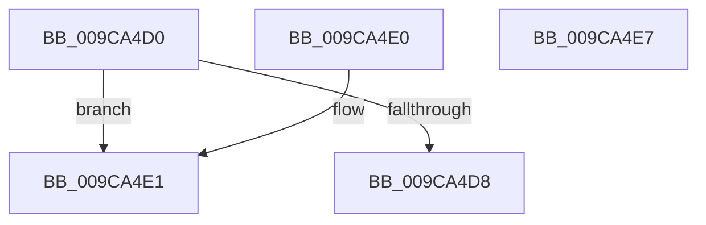

# RtlLengthRequiredSid

- RVA: `0x009CA4D0`–`0x009CA4E8` (길이 `24` bytes)
- VA: `0x00000001409CA4D0`
- 실행 섹션: `PAGE`
- PDB 이름 있음: `예`; PDB Function 태그: `아니요`
- unwind 정보 RVA: `0x000DB714`
- 디코드: `8`개 명령, `24/24` bytes 표시
- 미해석 바이트: `0` (있으면 어셈블리에 `.byte`로 보존)

> 이 문서는 커널 이미지의 기계어와 PDB 기호를 분석해 생성했습니다. 4번과 5번은 함수 원형과 자료형을 바이너리 사용 방식에서 추정한 C 해석이며 원본 소스 복구 결과는 아닙니다.

## 1. Dependencies

- 직접 호출 지점: **0**; 고유 호출 대상: **0**
- 직접 호출자로 확인된 함수: **30**
- RIP 상대 이미지 참조: **0**

### Outgoing calls
- 직접 디코드된 call 명령이 없습니다.

### Direct callers
- [EtwpApplyPayloadFilterInternal](../../text/3F/EtwpApplyPayloadFilterInternal_function_003F43D0.md) at `0x003F4C12`
- [RtlNormalizeSecurityDescriptor](../../text/4B/RtlNormalizeSecurityDescriptor_function_004BABA0.md) at `0x004BAD6E`
- [RtlNormalizeSecurityDescriptor](../../text/4B/RtlNormalizeSecurityDescriptor_function_004BABA0.md) at `0x004BADB9`
- [SepCreateTokenEx](../../text/4E/SepCreateTokenEx_function_004E9CD0.md) at `0x004EA21F`
- [SepCreateTokenEx](../../text/4E/SepCreateTokenEx_function_004E9CD0.md) at `0x004EA23C`
- [SepCreateTokenEx](../../text/4E/SepCreateTokenEx_function_004E9CD0.md) at `0x004EA720`
- [SepAppIdentityFromHash](../../text/60/SepAppIdentityFromHash_function_006079E4.md) at `0x00607A15`
- [SepAppSuiteFromHash](../../text/60/SepAppSuiteFromHash_function_00607F3C.md) at `0x00607F66`
- [SepAllocateInstanceSid](../../text/60/SepAllocateInstanceSid_function_0060A788.md) at `0x0060A7AE`
- [WdipAccessCheck](../../text/64/WdipAccessCheck_function_0064E084.md) at `0x0064E0E7`
- [NtQueryQuotaInformationFile](../72/NtQueryQuotaInformationFile_function_00720FE0.md) at `0x007210E4`
- [PiAuAllocateAndInitializeSid](../73/PiAuAllocateAndInitializeSid_function_00731200.md) at `0x0073121B`
- [PiAuCheckClientInteractive](../73/PiAuCheckClientInteractive_function_00731284.md) at `0x007312AD`
- [PopCreateHiberFileSecurityDescriptor](../75/PopCreateHiberFileSecurityDescriptor_function_0075D3DC.md) at `0x0075D3FF`
- [RtlAllocateAndInitializeSidEx](../78/RtlAllocateAndInitializeSidEx_function_0078E36C.md) at `0x0078E391`
- [RtlGetAppContainerParent](../78/RtlGetAppContainerParent_function_0078E4A0.md) at `0x0078E4DE`
- [SmKmStoreFileMakeSecurityDescriptor](../7A/SmKmStoreFileMakeSecurityDescriptor_function_007A9988.md) at `0x007A99C5`
- [SmKmStoreFileMakeSecurityDescriptor](../7A/SmKmStoreFileMakeSecurityDescriptor_function_007A9988.md) at `0x007A9A51`
- [NtSetUuidSeed](../7D/NtSetUuidSeed_function_007D0DD0.md) at `0x007D0E85`
- [CMFCreateSecurityDescriptor](../7D/CMFCreateSecurityDescriptor_function_007D2B10.md) at `0x007D2BA4`
- [CMFCreateSecurityDescriptor](../7D/CMFCreateSecurityDescriptor_function_007D2B10.md) at `0x007D2C07`
- [CMFCreateSecurityDescriptor](../7D/CMFCreateSecurityDescriptor_function_007D2B10.md) at `0x007D2CB6`
- [CmpAdminSystemSecurityDescriptor](../7E/CmpAdminSystemSecurityDescriptor_function_007EBED8.md) at `0x007EBF01`
- [CmpAdminSystemSecurityDescriptor](../7E/CmpAdminSystemSecurityDescriptor_function_007EBED8.md) at `0x007EBF27`
- [CmpHiveRootSecurityDescriptor](../7E/CmpHiveRootSecurityDescriptor_function_007ED104.md) at `0x007ED16C`
- [CmpHiveRootSecurityDescriptor](../7E/CmpHiveRootSecurityDescriptor_function_007ED104.md) at `0x007ED1AE`
- [DrvDbGetSecurityDescriptor](../83/DrvDbGetSecurityDescriptor_function_0083580C.md) at `0x00835858`
- [DrvDbGetSecurityDescriptor](../83/DrvDbGetSecurityDescriptor_function_0083580C.md) at `0x00835959`
- [SeCaptureSid](../92/SeCaptureSid_function_009276D4.md) at `0x00927719`
- [SeCaptureSid](../92/SeCaptureSid_function_009276D4.md) at `0x009277F0`
- [SeCaptureSecurityDescriptor](../92/SeCaptureSecurityDescriptor_function_00929F40.md) at `0x0092A700`
- [SeCaptureSecurityDescriptor](../92/SeCaptureSecurityDescriptor_function_00929F40.md) at `0x0092A725`
- [SeCaptureSidAndAttributesArray](SeCaptureSidAndAttributesArray_function_009C9D70.md) at `0x009CA0D8`
- [RtlEnumerateBoundaryDescriptorEntries](RtlEnumerateBoundaryDescriptorEntries_function_009CA278.md) at `0x009CA38F`
- [RtlpValidateSidBuffer](RtlpValidateSidBuffer_function_009CA484.md) at `0x009CA4A0`
- [IopCreateUmdfDirectory](../../init/C2/IopCreateUmdfDirectory_function_00C2C818.md) at `0x00C2C870`
- [PopCreateTimebrokerServiceSid](../../init/C3/PopCreateTimebrokerServiceSid_function_00C3D2C8.md) at `0x00C3D2E3`
- [PopNetInitialize](../../init/C4/PopNetInitialize_function_00C423AC.md) at `0x00C423D6`
- [PspInitializeCpuPartitionsDefaultSd](../../init/C4/PspInitializeCpuPartitionsDefaultSd_function_00C457D4.md) at `0x00C45800`
- [PspInitializeCpuPartitionsDefaultSd](../../init/C4/PspInitializeCpuPartitionsDefaultSd_function_00C457D4.md) at `0x00C4582B`
- [SepVariableInitialization](../../init/C4/SepVariableInitialization_function_00C483A4.md) at `0x00C48732`
- [SepVariableInitialization](../../init/C4/SepVariableInitialization_function_00C483A4.md) at `0x00C48924`
- [SepVariableInitialization](../../init/C4/SepVariableInitialization_function_00C483A4.md) at `0x00C48A54`
- [SepVariableInitialization](../../init/C4/SepVariableInitialization_function_00C483A4.md) at `0x00C48BB3`
- [SepVariableInitialization](../../init/C4/SepVariableInitialization_function_00C483A4.md) at `0x00C48D26`
- [SepVariableInitialization](../../init/C4/SepVariableInitialization_function_00C483A4.md) at `0x00C48E3C`
- [CmpInitializeTrustedInstallerSid](../../init/C5/CmpInitializeTrustedInstallerSid_function_00C5B108.md) at `0x00C5B11F`

### Static image references
- 디코드된 RIP-relative 메모리 참조가 없습니다.

## 2. Other-region calls and transfers

- 다른 실행 섹션으로 향하는 call: **0**
- 별도 외부 분기/꼬리 이동을 확인하지 못했습니다.

## 3. Assembly (complete function range)

```asm
009CA4D0  81 F9 F7 FF FF 3F               cmp ecx, 0x3ffffff7
009CA4D6  77 09                           ja 0x1409ca4e1
009CA4D8  8D 04 8D 08 00 00 00            lea eax, [rcx*4 + 8]
009CA4DF  C3                              ret
009CA4E0  CC                              int3
009CA4E1  B8 FF FF FF FF                  mov eax, 0xffffffff
009CA4E6  C3                              ret
009CA4E7  CC                              int3
```

## 4. C-style interpretation (structured pseudocode)

```c
__int64 __fastcall RtlLengthRequiredSid(__int64 a1)
{
    if (((unsigned int)(a1)) > 0x3FFFFFF7ULL) goto loc_009CA4E1;
    return a1 * 4 + 8;
loc_009CA4E1:
    return (unsigned int)(0xFFFFFFFFULL);
}
```

## 5. (Beta) C Style

```c
int64_t RtlLengthRequiredSid(int64_t Arg1)
{
    if (((uint32_t)(Arg1)) > 0x3FFFFFF7ULL) goto loc_009CA4E1;
    return Arg1 * 4 + 8;
loc_009CA4E1:
    return (uint32_t)(0xFFFFFFFFULL);
}
```

## 6. Execution-region graph

[열기: 2D/3D 그래프와 함수 탐색 컨트롤 패널](../../../control-panel.html?section=page&rva=0x009CA4D0&view=graph)

- 2D 그래프는 위에서 아래로 흐르고, 3D 그래프는 빈 공간을 드래그해 회전합니다. Shift+드래그는 이동, 휠은 확대·축소, 함수 노드 선택은 대상 보고서 이동입니다.

### Static fallback


