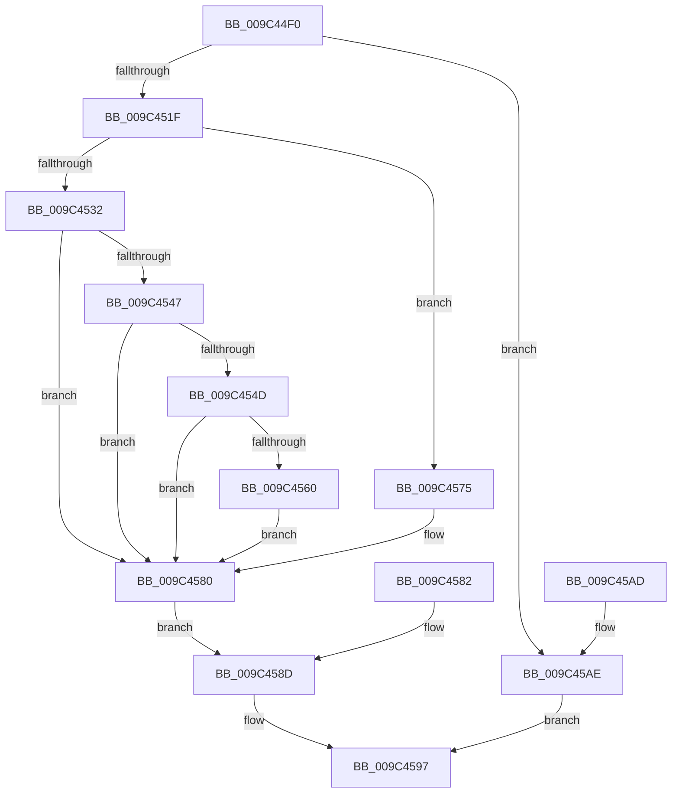

# RtlPinAtomInAtomTable

- RVA: `0x009C44F0`–`0x009C45B5` (길이 `197` bytes)
- VA: `0x00000001409C44F0`
- 실행 섹션: `PAGE`
- PDB 이름 있음: `예`; PDB Function 태그: `아니요`
- unwind 정보 RVA: `0x0009FC60`
- 디코드: `57`개 명령, `197/197` bytes 표시
- 미해석 바이트: `0` (있으면 어셈블리에 `.byte`로 보존)

> 이 문서는 커널 이미지의 기계어와 PDB 기호를 분석해 생성했습니다. 4번과 5번은 함수 원형과 자료형을 바이너리 사용 방식에서 추정한 C 해석이며 원본 소스 복구 결과는 아닙니다.

## 1. Dependencies

- 직접 호출 지점: **4**; 고유 호출 대상: **4**
- 직접 호출자로 확인된 함수: **0**
- RIP 상대 이미지 참조: **0**

### Outgoing calls
- `0x009C450F` → [RtlpLockAtomTable](RtlpLockAtomTable_function_009C4A10.md) (function, `0x009C4A10`)
- `0x009C453D` → [RtlpAtomMapAtomToHandleEntry](RtlpAtomMapAtomToHandleEntry_function_009C4AD0.md) (function, `0x009C4AD0`)
- `0x009C4556` → [RtlpLookupLowBox](../../text/43/RtlpLookupLowBox_function_004388AC.md) (function, `0x004388AC`)
- `0x009C4590` → [RtlpUnlockAtomTable](RtlpUnlockAtomTable_function_009C4A8C.md) (function, `0x009C4A8C`)

### Direct callers
- 이 함수 시작 RVA로 연결되는 직접 call은 확인되지 않았습니다. 간접 호출은 완전히 역산할 수 없습니다.

### Static image references
- 디코드된 RIP-relative 메모리 참조가 없습니다.

## 2. Other-region calls and transfers

- 다른 실행 섹션으로 향하는 call: **1**
  - `0x009C4556` → [RtlpLookupLowBox](../../text/43/RtlpLookupLowBox_function_004388AC.md) (`PAGE` → `.text`)
- 별도 외부 분기/꼬리 이동을 확인하지 못했습니다.

## 3. Assembly (complete function range)

```asm
009C44F0  48 8B C4                        mov rax, rsp
009C44F3  48 89 58 10                     mov qword ptr [rax + 0x10], rbx
009C44F7  48 89 70 18                     mov qword ptr [rax + 0x18], rsi
009C44FB  48 89 78 20                     mov qword ptr [rax + 0x20], rdi
009C44FF  48 89 48 08                     mov qword ptr [rax + 8], rcx
009C4503  41 56                           push r14
009C4505  48 83 EC 30                     sub rsp, 0x30
009C4509  0F B7 F2                        movzx esi, dx
009C450C  48 8B F9                        mov rdi, rcx
009C450F  E8 FC 04 00 00                  call 0x1409c4a10
009C4514  45 33 F6                        xor r14d, r14d
009C4517  84 C0                           test al, al
009C4519  0F 84 8F 00 00 00               je 0x1409c45ae
009C451F  BB 08 00 00 C0                  mov ebx, 0xc0000008
009C4524  89 5C 24 20                     mov dword ptr [rsp + 0x20], ebx
009C4528  B8 00 C0 00 00                  mov eax, 0xc000
009C452D  66 3B F0                        cmp si, ax
009C4530  72 43                           jb 0x1409c4575
009C4532  8B D6                           mov edx, esi
009C4534  81 E2 FF 3F 00 00               and edx, 0x3fff
009C453A  48 8B CF                        mov rcx, rdi
009C453D  E8 8E 05 00 00                  call 0x1409c4ad0
009C4542  48 85 C0                        test rax, rax
009C4545  74 39                           je 0x1409c4580
009C4547  66 39 70 0A                     cmp word ptr [rax + 0xa], si
009C454B  75 33                           jne 0x1409c4580
009C454D  45 33 C0                        xor r8d, r8d
009C4550  48 8B D0                        mov rdx, rax
009C4553  48 8B CF                        mov rcx, rdi
009C4556  E8 51 43 A7 FF                  call 0x1404388ac
009C455B  48 85 C0                        test rax, rax
009C455E  74 20                           je 0x1409c4580
009C4560  41 8B DE                        mov ebx, r14d
009C4563  89 5C 24 20                     mov dword ptr [rsp + 0x20], ebx
009C4567  0F B7 48 16                     movzx ecx, word ptr [rax + 0x16]
009C456B  66 83 C9 01                     or cx, 1
009C456F  66 89 48 16                     mov word ptr [rax + 0x16], cx
009C4573  EB 0B                           jmp 0x1409c4580
009C4575  66 85 F6                        test si, si
009C4578  41 0F 45 DE                     cmovne ebx, r14d
009C457C  89 5C 24 20                     mov dword ptr [rsp + 0x20], ebx
009C4580  EB 0B                           jmp 0x1409c458d
009C4582  8B D8                           mov ebx, eax
009C4584  89 44 24 20                     mov dword ptr [rsp + 0x20], eax
009C4588  48 8B 7C 24 40                  mov rdi, qword ptr [rsp + 0x40]
009C458D  48 8B CF                        mov rcx, rdi
009C4590  E8 F7 04 00 00                  call 0x1409c4a8c
009C4595  8B C3                           mov eax, ebx
009C4597  48 8B 5C 24 48                  mov rbx, qword ptr [rsp + 0x48]
009C459C  48 8B 74 24 50                  mov rsi, qword ptr [rsp + 0x50]
009C45A1  48 8B 7C 24 58                  mov rdi, qword ptr [rsp + 0x58]
009C45A6  48 83 C4 30                     add rsp, 0x30
009C45AA  41 5E                           pop r14
009C45AC  C3                              ret
009C45AD  CC                              int3
009C45AE  B8 0D 00 00 C0                  mov eax, 0xc000000d
009C45B3  EB E2                           jmp 0x1409c4597
```

## 4. C-style interpretation (structured pseudocode)

```c
__int64 __fastcall RtlPinAtomInAtomTable(__int64 a1, unsigned __int16 a2, int a3)
{
    __int64 result;
    __int64 v_r14;
    __int64 v_rbx;
    __int64 v_rsp;
    unsigned int v_stack_m18;
    unsigned __int64 v_stack_p10;
    unsigned __int64 v_stack_p18;
    unsigned __int64 v_stack_p20;
    unsigned __int64 v_stack_p8;

    *(unsigned __int64 *)(v_rsp + 16) = v_rbx;
    *(unsigned __int64 *)(v_rsp + 24) = v_rsi;
    *(unsigned __int64 *)(v_rsp + 32) = v_rdi;
    *(unsigned __int64 *)(v_rsp + 8) = a1;
    v_rsp = (v_rsp) - (48);
    result = RtlpLockAtomTable(a1, a2, a3, a4);
    v_r14 = 0;
    if ((unsigned __int8)(result) == 0) goto loc_009C45AE;
    v_stack_m18 = (unsigned int)((unsigned int)(0xC0000008ULL));
    if (a2 < ((unsigned __int16)((unsigned int)(0xC000ULL)))) goto loc_009C4575;
    a2 = (unsigned int)(((unsigned int)(a2)) & (0x3FFFULL));
    result = RtlpAtomMapAtomToHandleEntry(a1, a2, a3, a4);
    if (result == 0) goto loc_009C4580;
    if ((*(unsigned __int16 *)(result + 10)) != a2) goto loc_009C4580;
    a3 = 0;
    result = RtlpLookupLowBox(a1, result, a3, a4);
    if (result == 0) goto loc_009C4580;
    v_stack_m18 = 0;
    a1 = (unsigned __int16)((*(unsigned __int16 *)(result + 22)) | (1));
    *(unsigned __int16 *)(result + 22) = (unsigned __int16)(a1);
    goto loc_009C4580;
loc_009C4575:
    v_rbx = 0;
    if (a2 != 0) { v_rbx = 0; }
    v_stack_m18 = (unsigned int)(v_rbx);
loc_009C4580:
    goto loc_009C458D;
loc_009C458D:
    result = RtlpUnlockAtomTable(a1, result, a3, a4);
loc_009C4597:
    v_rsp = (v_rsp) + (48);
    return (unsigned int)((unsigned int)(v_rbx));
loc_009C45AE:
    goto loc_009C4597;
}
```

## 5. (Beta) C Style

```c
int64_t RtlPinAtomInAtomTable(int64_t Arg1, uint16_t Arg2, int32_t Arg3)
{
    int64_t result;
    int64_t local_r14;
    int64_t local_rbx;
    int64_t local_rsp;
    uint32_t v_stack_m18;
    uint64_t v_stack_p10;
    uint64_t v_stack_p18;
    uint64_t v_stack_p20;
    uint64_t v_stack_p8;

    *(uint64_t *)(local_rsp + 0x10) = local_rbx;
    *(uint64_t *)(local_rsp + 0x18) = local_rsi;
    *(uint64_t *)(local_rsp + 0x20) = local_rdi;
    *(uint64_t *)(local_rsp + 0x8) = Arg1;
    local_rsp = (local_rsp) - (48);
    result = RtlpLockAtomTable(Arg1, Arg2, Arg3, a4);
    local_r14 = 0;
    if ((uint8_t)(result) == 0) goto loc_009C45AE;
    v_stack_m18 = (uint32_t)((uint32_t)(0xC0000008ULL));
    if (Arg2 < ((uint16_t)((uint32_t)(0xC000ULL)))) goto loc_009C4575;
    Arg2 = (uint32_t)(((uint32_t)(Arg2)) & (0x3FFFULL));
    result = RtlpAtomMapAtomToHandleEntry(Arg1, Arg2, Arg3, a4);
    if (result == 0) goto loc_009C4580;
    if ((*(uint16_t *)(result + 0xA)) != Arg2) goto loc_009C4580;
    Arg3 = 0;
    result = RtlpLookupLowBox(Arg1, result, Arg3, a4);
    if (result == 0) goto loc_009C4580;
    v_stack_m18 = 0;
    Arg1 = (uint16_t)((*(uint16_t *)(result + 0x16)) | (1));
    *(uint16_t *)(result + 0x16) = (uint16_t)(Arg1);
    goto loc_009C4580;
loc_009C4575:
    local_rbx = 0;
    if (Arg2 != 0) { local_rbx = 0; }
    v_stack_m18 = (uint32_t)(local_rbx);
loc_009C4580:
    goto loc_009C458D;
loc_009C458D:
    result = RtlpUnlockAtomTable(Arg1, result, Arg3, a4);
loc_009C4597:
    local_rsp = (local_rsp) + (48);
    return (uint32_t)((uint32_t)(local_rbx));
loc_009C45AE:
    goto loc_009C4597;
}
```

## 6. Execution-region graph

[열기: 2D/3D 그래프와 함수 탐색 컨트롤 패널](../../../control-panel.html?section=page&rva=0x009C44F0&view=graph)

- 2D 그래프는 위에서 아래로 흐르고, 3D 그래프는 빈 공간을 드래그해 회전합니다. Shift+드래그는 이동, 휠은 확대·축소, 함수 노드 선택은 대상 보고서 이동입니다.

### Static fallback


