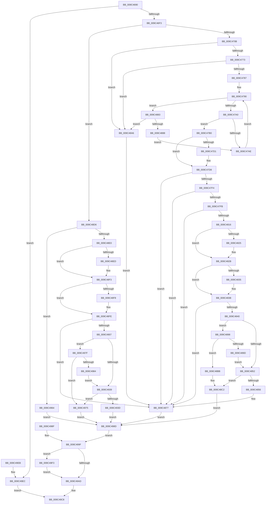

# RtlQueryAtomInAtomTable

- RVA: `0x009C4690`–`0x009C49FE` (길이 `878` bytes)
- VA: `0x00000001409C4690`
- 실행 섹션: `PAGE`
- PDB 이름 있음: `예`; PDB Function 태그: `아니요`
- unwind 정보 RVA: `0x0009FC90`
- 디코드: `219`개 명령, `878/878` bytes 표시
- 미해석 바이트: `0` (있으면 어셈블리에 `.byte`로 보존)

> 이 문서는 커널 이미지의 기계어와 PDB 기호를 분석해 생성했습니다. 4번과 5번은 함수 원형과 자료형을 바이너리 사용 방식에서 추정한 C 해석이며 원본 소스 복구 결과는 아닙니다.

## 1. Dependencies

- 직접 호출 지점: **15**; 고유 호출 대상: **12**
- 직접 호출자로 확인된 함수: **1**
- RIP 상대 이미지 참조: **2**

### Outgoing calls
- `0x009C46E6` → [RtlpLockAtomTable](RtlpLockAtomTable_function_009C4A10.md) (function, `0x009C4A10`)
- `0x009C4776` → [ExpLookupHandleTableEntry](../86/ExpLookupHandleTableEntry_function_00869DB0.md) (function, `0x00869DB0`)
- `0x009C47B3` → [ExGetHandlePointer](../../text/43/ExGetHandlePointer_function_00430C90.md) (function, `0x00430C90`)
- `0x009C47D3` → [ExfUnblockPushLock](../../text/2A/ExfUnblockPushLock_function_002A3FE0.md) (function, `0x002A3FE0`)
- `0x009C47E6` → [KeLeaveCriticalRegionThread](../../text/25/KeLeaveCriticalRegionThread_function_0025EFF0.md) (function, `0x0025EFF0`)
- `0x009C4804` → [RtlpLookupLowBox](../../text/43/RtlpLookupLowBox_function_004388AC.md) (function, `0x004388AC`)
- `0x009C4862` → [memcpy](../../text/6C/memcpy_function_006C6840.md) (function, `0x006C6840`)
- `0x009C488E` → [ExpBlockOnLockedHandleEntry](../86/ExpBlockOnLockedHandleEntry_function_00868838.md) (function, `0x00868838`)
- `0x009C48B4` → [KeLeaveCriticalRegionThread](../../text/25/KeLeaveCriticalRegionThread_function_0025EFF0.md) (function, `0x0025EFF0`)
- `0x009C4928` → [snwprintf_s](../../text/50/snwprintf_s_function_00505440.md) (function, `0x00505440`)
- `0x009C494D` → [memcpy](../../text/6C/memcpy_function_006C6840.md) (function, `0x006C6840`)
- `0x009C49B1` → [KeAbPostRelease](../../text/2E/KeAbPostRelease_function_002E1600.md) (function, `0x002E1600`)
- `0x009C49BF` → [KeLeaveCriticalRegionThread](../../text/25/KeLeaveCriticalRegionThread_function_0025EFF0.md) (function, `0x0025EFF0`)
- `0x009C49D3` → [_security_check_cookie](../../text/6A/_security_check_cookie_function_006AC640.md) (function, `0x006AC640`)
- `0x009C49F7` → [ExfTryToWakePushLock](../../text/26/ExfTryToWakePushLock_function_00265DD0.md) (function, `0x00265DD0`)

### Direct callers
- [NtQueryInformationAtom](../AF/NtQueryInformationAtom_function_00AF7720.md) at `0x00AF7872`

### Static image references
- `0x009C46A3` → RVA `0x00E0A740` (`.data`; read)
- `0x009C490C` → RVA `0x00B05560` (` ?? ::NNGAKEGL::`string'`; read)

## 2. Other-region calls and transfers

- 다른 실행 섹션으로 향하는 call: **12**
  - `0x009C47B3` → [ExGetHandlePointer](../../text/43/ExGetHandlePointer_function_00430C90.md) (`PAGE` → `.text`)
  - `0x009C47D3` → [ExfUnblockPushLock](../../text/2A/ExfUnblockPushLock_function_002A3FE0.md) (`PAGE` → `.text`)
  - `0x009C47E6` → [KeLeaveCriticalRegionThread](../../text/25/KeLeaveCriticalRegionThread_function_0025EFF0.md) (`PAGE` → `.text`)
  - `0x009C4804` → [RtlpLookupLowBox](../../text/43/RtlpLookupLowBox_function_004388AC.md) (`PAGE` → `.text`)
  - `0x009C4862` → [memcpy](../../text/6C/memcpy_function_006C6840.md) (`PAGE` → `.text`)
  - `0x009C48B4` → [KeLeaveCriticalRegionThread](../../text/25/KeLeaveCriticalRegionThread_function_0025EFF0.md) (`PAGE` → `.text`)
  - `0x009C4928` → [snwprintf_s](../../text/50/snwprintf_s_function_00505440.md) (`PAGE` → `.text`)
  - `0x009C494D` → [memcpy](../../text/6C/memcpy_function_006C6840.md) (`PAGE` → `.text`)
  - `0x009C49B1` → [KeAbPostRelease](../../text/2E/KeAbPostRelease_function_002E1600.md) (`PAGE` → `.text`)
  - `0x009C49BF` → [KeLeaveCriticalRegionThread](../../text/25/KeLeaveCriticalRegionThread_function_0025EFF0.md) (`PAGE` → `.text`)
  - `0x009C49D3` → [_security_check_cookie](../../text/6A/_security_check_cookie_function_006AC640.md) (`PAGE` → `.text`)
  - `0x009C49F7` → [ExfTryToWakePushLock](../../text/26/ExfTryToWakePushLock_function_00265DD0.md) (`PAGE` → `.text`)
- 별도 외부 분기/꼬리 이동을 확인하지 못했습니다.

## 3. Assembly (complete function range)

```asm
009C4690  40 53                           push rbx
009C4692  56                              push rsi
009C4693  57                              push rdi
009C4694  41 54                           push r12
009C4696  41 55                           push r13
009C4698  41 56                           push r14
009C469A  41 57                           push r15
009C469C  48 81 EC B0 00 00 00            sub rsp, 0xb0
009C46A3  48 8B 05 96 60 44 00            mov rax, qword ptr [rip + 0x446096]
009C46AA  48 33 C4                        xor rax, rsp
009C46AD  48 89 84 24 A8 00 00 00         mov qword ptr [rsp + 0xa8], rax
009C46B5  49 8B D9                        mov rbx, r9
009C46B8  48 89 5C 24 58                  mov qword ptr [rsp + 0x58], rbx
009C46BD  49 8B F0                        mov rsi, r8
009C46C0  4C 89 44 24 38                  mov qword ptr [rsp + 0x38], r8
009C46C5  44 0F B7 FA                     movzx r15d, dx
009C46C9  4C 8B F1                        mov r14, rcx
009C46CC  4C 8B AC 24 10 01 00 00         mov r13, qword ptr [rsp + 0x110]
009C46D4  48 8B BC 24 18 01 00 00         mov rdi, qword ptr [rsp + 0x118]
009C46DC  48 89 7C 24 50                  mov qword ptr [rsp + 0x50], rdi
009C46E1  48 89 4C 24 68                  mov qword ptr [rsp + 0x68], rcx
009C46E6  E8 25 03 00 00                  call 0x1409c4a10
009C46EB  84 C0                           test al, al
009C46ED  0F 84 F9 02 00 00               je 0x1409c49ec
009C46F3  8B 3F                           mov edi, dword ptr [rdi]
009C46F5  83 E7 FE                        and edi, 0xfffffffe
009C46F8  89 7C 24 40                     mov dword ptr [rsp + 0x40], edi
009C46FC  B8 00 C0 00 00                  mov eax, 0xc000
009C4701  66 44 3B F8                     cmp r15w, ax
009C4705  0F 82 CB 01 00 00               jb 0x1409c48d6
009C470B  C7 44 24 30 08 00 00 C0         mov dword ptr [rsp + 0x30], 0xc0000008
009C4713  45 33 E4                        xor r12d, r12d
009C4716  4C 89 64 24 48                  mov qword ptr [rsp + 0x48], r12
009C471B  4C 89 64 24 48                  mov qword ptr [rsp + 0x48], r12
009C4720  45 8B C7                        mov r8d, r15d
009C4723  41 81 E0 FF 3F 00 00            and r8d, 0x3fff
009C472A  41 C1 E0 02                     shl r8d, 2
009C472E  44 89 44 24 48                  mov dword ptr [rsp + 0x48], r8d
009C4733  65 48 8B 0C 25 88 01 00 00      mov rcx, qword ptr gs:[0x188]
009C473C  48 89 4C 24 70                  mov qword ptr [rsp + 0x70], rcx
009C4741  0F B7 81 E4 01 00 00            movzx eax, word ptr [rcx + 0x1e4]
009C4748  66 FF C8                        dec ax
009C474B  66 89 81 E4 01 00 00            mov word ptr [rcx + 0x1e4], ax
009C4752  90                              nop
009C4753  49 8B 7E 10                     mov rdi, qword ptr [r14 + 0x10]
009C4757  4C 89 64 24 60                  mov qword ptr [rsp + 0x60], r12
009C475C  48 8B 54 24 48                  mov rdx, qword ptr [rsp + 0x48]
009C4761  48 89 54 24 60                  mov qword ptr [rsp + 0x60], rdx
009C4766  41 F7 C0 FC 03 00 00            test r8d, 0x3fc
009C476D  0F 84 33 01 00 00               je 0x1409c48a6
009C4773  48 8B CF                        mov rcx, rdi
009C4776  E8 35 56 EA FF                  call 0x140869db0
009C477B  48 8B D8                        mov rbx, rax
009C477E  48 85 C0                        test rax, rax
009C4781  0F 84 1F 01 00 00               je 0x1409c48a6
009C4787  66 0F 1F 84 00 00 00 00 00      nop word ptr [rax + rax]
009C4790  0F 0D 0B                        prefetchw byte ptr [rbx]
009C4793  4C 8B 03                        mov r8, qword ptr [rbx]
009C4796  41 F6 C0 01                     test r8b, 1
009C479A  0F 84 E3 00 00 00               je 0x1409c4883
009C47A0  49 8D 48 FF                     lea rcx, [r8 - 1]
009C47A4  49 8B C0                        mov rax, r8
009C47A7  F0 48 0F B1 0B                  lock cmpxchg qword ptr [rbx], rcx
009C47AC  74 02                           je 0x1409c47b0
009C47AE  EB E0                           jmp 0x1409c4790
009C47B0  48 8B CB                        mov rcx, rbx
009C47B3  E8 D8 C4 A6 FF                  call 0x140430c90
009C47B8  48 8B F0                        mov rsi, rax
009C47BB  49 8B 4E 10                     mov rcx, qword ptr [r14 + 0x10]
009C47BF  F0 48 FF 03                     lock inc qword ptr [rbx]
009C47C3  48 83 C1 30                     add rcx, 0x30
009C47C7  F0 44 09 24 24                  lock or dword ptr [rsp], r12d
009C47CC  4C 39 21                        cmp qword ptr [rcx], r12
009C47CF  74 07                           je 0x1409c47d8
009C47D1  33 D2                           xor edx, edx
009C47D3  E8 08 F8 8D FF                  call 0x1402a3fe0
009C47D8  65 48 8B 0C 25 88 01 00 00      mov rcx, qword ptr gs:[0x188]
009C47E1  48 89 4C 24 78                  mov qword ptr [rsp + 0x78], rcx
009C47E6  E8 05 A8 89 FF                  call 0x14025eff0
009C47EB  48 85 F6                        test rsi, rsi
009C47EE  0F 84 83 00 00 00               je 0x1409c4877
009C47F4  66 44 39 7E 0A                  cmp word ptr [rsi + 0xa], r15w
009C47F9  75 7C                           jne 0x1409c4877
009C47FB  45 33 C0                        xor r8d, r8d
009C47FE  48 8B D6                        mov rdx, rsi
009C4801  49 8B CE                        mov rcx, r14
009C4804  E8 A3 40 A7 FF                  call 0x1404388ac
009C4809  48 89 84 24 80 00 00 00         mov qword ptr [rsp + 0x80], rax
009C4811  48 85 C0                        test rax, rax
009C4814  74 61                           je 0x1409c4877
009C4816  44 89 64 24 30                  mov dword ptr [rsp + 0x30], r12d
009C481B  48 8B 4C 24 38                  mov rcx, qword ptr [rsp + 0x38]
009C4820  48 85 C9                        test rcx, rcx
009C4823  74 06                           je 0x1409c482b
009C4825  0F B7 46 24                     movzx eax, word ptr [rsi + 0x24]
009C4829  89 01                           mov dword ptr [rcx], eax
009C482B  48 8B 4C 24 58                  mov rcx, qword ptr [rsp + 0x58]
009C4830  48 85 C9                        test rcx, rcx
009C4833  74 06                           je 0x1409c483b
009C4835  0F B7 46 26                     movzx eax, word ptr [rsi + 0x26]
009C4839  89 01                           mov dword ptr [rcx], eax
009C483B  4D 85 ED                        test r13, r13
009C483E  74 37                           je 0x1409c4877
009C4840  0F B6 7E 28                     movzx edi, byte ptr [rsi + 0x28]
009C4844  03 FF                           add edi, edi
009C4846  89 7C 24 38                     mov dword ptr [rsp + 0x38], edi
009C484A  8B 44 24 40                     mov eax, dword ptr [rsp + 0x40]
009C484E  3B F8                           cmp edi, eax
009C4850  73 46                           jae 0x1409c4898
009C4852  85 FF                           test edi, edi
009C4854  74 6C                           je 0x1409c48c2
009C4856  8B DF                           mov ebx, edi
009C4858  48 8D 56 2A                     lea rdx, [rsi + 0x2a]
009C485C  44 8B C7                        mov r8d, edi
009C485F  49 8B CD                        mov rcx, r13
009C4862  E8 D9 1F D0 FF                  call 0x1406c6840
009C4867  48 D1 EB                        shr rbx, 1
009C486A  66 45 89 64 5D 00               mov word ptr [r13 + rbx*2], r12w
009C4870  48 8B 44 24 50                  mov rax, qword ptr [rsp + 0x50]
009C4875  89 38                           mov dword ptr [rax], edi
009C4877  48 C7 C3 FF FF FF FF            mov rbx, 0xffffffffffffffff
009C487E  E9 0A 01 00 00                  jmp 0x1409c498d
009C4883  4D 85 C0                        test r8, r8
009C4886  74 1E                           je 0x1409c48a6
009C4888  48 8B D3                        mov rdx, rbx
009C488B  48 8B CF                        mov rcx, rdi
009C488E  E8 A5 3F EA FF                  call 0x140868838
009C4893  E9 16 FF FF FF                  jmp 0x1409c47ae
009C4898  83 F8 02                        cmp eax, 2
009C489B  72 1E                           jb 0x1409c48bb
009C489D  8D 78 FE                        lea edi, [rax - 2]
009C48A0  89 7C 24 38                     mov dword ptr [rsp + 0x38], edi
009C48A4  EB AC                           jmp 0x1409c4852
009C48A6  65 48 8B 0C 25 88 01 00 00      mov rcx, qword ptr gs:[0x188]
009C48AF  48 89 4C 24 58                  mov qword ptr [rsp + 0x58], rcx
009C48B4  E8 37 A7 89 FF                  call 0x14025eff0
009C48B9  EB BC                           jmp 0x1409c4877
009C48BB  48 8B 44 24 50                  mov rax, qword ptr [rsp + 0x50]
009C48C0  89 38                           mov dword ptr [rax], edi
009C48C2  C7 44 24 30 23 00 00 C0         mov dword ptr [rsp + 0x30], 0xc0000023
009C48CA  48 C7 C3 FF FF FF FF            mov rbx, 0xffffffffffffffff
009C48D1  E9 B7 00 00 00                  jmp 0x1409c498d
009C48D6  66 45 85 FF                     test r15w, r15w
009C48DA  0F 84 84 00 00 00               je 0x1409c4964
009C48E0  45 33 E4                        xor r12d, r12d
009C48E3  44 89 64 24 30                  mov dword ptr [rsp + 0x30], r12d
009C48E8  48 85 F6                        test rsi, rsi
009C48EB  74 06                           je 0x1409c48f3
009C48ED  C7 06 01 00 00 00               mov dword ptr [rsi], 1
009C48F3  48 85 DB                        test rbx, rbx
009C48F6  74 06                           je 0x1409c48fe
009C48F8  C7 03 01 00 00 00               mov dword ptr [rbx], 1
009C48FE  4D 85 ED                        test r13, r13
009C4901  0F 84 70 FF FF FF               je 0x1409c4877
009C4907  44 89 7C 24 20                  mov dword ptr [rsp + 0x20], r15d
009C490C  4C 8D 0D 4D 0C 14 00            lea r9, [rip + 0x140c4d]
009C4913  48 C7 C3 FF FF FF FF            mov rbx, 0xffffffffffffffff
009C491A  4C 8B C3                        mov r8, rbx
009C491D  8D 53 11                        lea edx, [rbx + 0x11]
009C4920  48 8D 8C 24 88 00 00 00         lea rcx, [rsp + 0x88]
009C4928  E8 13 0B B4 FF                  call 0x140505440
009C492D  8B F0                           mov esi, eax
009C492F  03 F6                           add esi, esi
009C4931  89 74 24 38                     mov dword ptr [rsp + 0x38], esi
009C4935  3B F7                           cmp esi, edi
009C4937  73 46                           jae 0x1409c497f
009C4939  85 F6                           test esi, esi
009C493B  74 38                           je 0x1409c4975
009C493D  8B FE                           mov edi, esi
009C493F  44 8B C6                        mov r8d, esi
009C4942  48 8D 94 24 88 00 00 00         lea rdx, [rsp + 0x88]
009C494A  49 8B CD                        mov rcx, r13
009C494D  E8 EE 1E D0 FF                  call 0x1406c6840
009C4952  48 D1 EF                        shr rdi, 1
009C4955  66 45 89 64 7D 00               mov word ptr [r13 + rdi*2], r12w
009C495B  48 8B 44 24 50                  mov rax, qword ptr [rsp + 0x50]
009C4960  89 30                           mov dword ptr [rax], esi
009C4962  EB 29                           jmp 0x1409c498d
009C4964  C7 44 24 30 0D 00 00 C0         mov dword ptr [rsp + 0x30], 0xc000000d
009C496C  48 C7 C3 FF FF FF FF            mov rbx, 0xffffffffffffffff
009C4973  EB 18                           jmp 0x1409c498d
009C4975  C7 44 24 30 23 00 00 C0         mov dword ptr [rsp + 0x30], 0xc0000023
009C497D  EB 0E                           jmp 0x1409c498d
009C497F  83 FF 02                        cmp edi, 2
009C4982  72 F1                           jb 0x1409c4975
009C4984  8D 77 FE                        lea esi, [rdi - 2]
009C4987  89 74 24 38                     mov dword ptr [rsp + 0x38], esi
009C498B  EB AC                           jmp 0x1409c4939
009C498D  EB 10                           jmp 0x1409c499f
009C498F  89 44 24 30                     mov dword ptr [rsp + 0x30], eax
009C4993  48 C7 C3 FF FF FF FF            mov rbx, 0xffffffffffffffff
009C499A  4C 8B 74 24 68                  mov r14, qword ptr [rsp + 0x68]
009C499F  F0 49 0F C1 5E 08               lock xadd qword ptr [r14 + 8], rbx
009C49A5  80 E3 06                        and bl, 6
009C49A8  80 FB 02                        cmp bl, 2
009C49AB  74 46                           je 0x1409c49f3
009C49AD  49 8D 4E 08                     lea rcx, [r14 + 8]
009C49B1  E8 4A CC 91 FF                  call 0x1402e1600
009C49B6  65 48 8B 0C 25 88 01 00 00      mov rcx, qword ptr gs:[0x188]
009C49BF  E8 2C A6 89 FF                  call 0x14025eff0
009C49C4  8B 44 24 30                     mov eax, dword ptr [rsp + 0x30]
009C49C8  48 8B 8C 24 A8 00 00 00         mov rcx, qword ptr [rsp + 0xa8]
009C49D0  48 33 CC                        xor rcx, rsp
009C49D3  E8 68 7C CE FF                  call 0x1406ac640
009C49D8  48 81 C4 B0 00 00 00            add rsp, 0xb0
009C49DF  41 5F                           pop r15
009C49E1  41 5E                           pop r14
009C49E3  41 5D                           pop r13
009C49E5  41 5C                           pop r12
009C49E7  5F                              pop rdi
009C49E8  5E                              pop rsi
009C49E9  5B                              pop rbx
009C49EA  C3                              ret
009C49EB  CC                              int3
009C49EC  B8 0D 00 00 C0                  mov eax, 0xc000000d
009C49F1  EB D5                           jmp 0x1409c49c8
009C49F3  49 8D 4E 08                     lea rcx, [r14 + 8]
009C49F7  E8 D4 13 8A FF                  call 0x140265dd0
009C49FC  EB AF                           jmp 0x1409c49ad
```

## 4. C-style interpretation (structured pseudocode)

```c
__int64 __fastcall RtlQueryAtomInAtomTable(__int64 a1, unsigned __int16 a2, __int64 a3, __int64 a4, __int64 a5, __int64 a6)
{
    __int64 result;
    __int64 v_r12;
    __int64 v_rbx;
    __int64 v_rdi;
    __int64 v_rsi;
    __int64 v_rsp;
    unsigned __int64 v_stack_m40;
    unsigned __int64 v_stack_m60;
    unsigned __int64 v_stack_m68;
    unsigned __int64 v_stack_m70;
    unsigned __int64 v_stack_m78;
    unsigned __int64 v_stack_m80;
    unsigned __int64 v_stack_m88;
    unsigned __int64 v_stack_m90;
    unsigned __int64 v_stack_m98;
    unsigned __int64 v_stack_mA0;
    unsigned int v_stack_mA8;
    unsigned __int64 v_stack_mB0;
    unsigned int v_stack_mB8;
    unsigned int v_stack_mC8;
    unsigned int v_stack_mE8;

    v_rsp = (v_rsp) - (176);
    result = (*(unsigned __int64 *)(v_rip + 4481174)) ^ (v_rsp);
    v_stack_m40 = result;
    v_stack_m90 = a4;
    v_stack_mB0 = a3;
    v_stack_m98 = a6;
    v_stack_m80 = a1;
    result = RtlpLockAtomTable(a1, a2, a3, a4);
    if ((unsigned __int8)(result) == 0) goto loc_009C49EC;
    v_rdi = (unsigned int)(((unsigned int)(*(unsigned int *)(a6))) & (0xFFFFFFFEULL));
    v_stack_mA8 = (unsigned int)(v_rdi);
    if (a2 < ((unsigned __int16)((unsigned int)(0xC000ULL)))) goto loc_009C48D6;
    v_stack_mB8 = 0xC0000008ULL;
    v_r12 = 0;
    v_stack_mA0 = 0;
    v_stack_mA0 = 0;
    a3 = (unsigned int)(((unsigned int)(a2)) & (0x3FFFULL));
    a3 = (unsigned int)((a3) << (2));
    v_stack_mA0 = (unsigned int)(a3);
    v_stack_m78 = *(unsigned __int64 *)(gs_base + (0 + 392));
    result = (unsigned __int16)((*(unsigned __int16 *)(*(unsigned __int64 *)(gs_base + (0 + 392)) + 484)) - 1);
    *(unsigned __int16 *)(*(unsigned __int64 *)(gs_base + (0 + 392)) + 484) = (unsigned __int16)(result);
    v_stack_m88 = 0;
    v_stack_m88 = v_stack_mA0;
    if ((((unsigned int)(a3)) & (0x3FCULL)) == 0) goto loc_009C48A6;
    result = ExpLookupHandleTableEntry(*(unsigned __int64 *)(a1 + 16), v_stack_mA0, a3, a4);
    if (result == 0) goto loc_009C48A6;
loc_009C4790:
    if ((((unsigned __int8)(*(unsigned __int64 *)(result))) & (1)) == 0) goto loc_009C4883;
    if ((((unsigned __int8)(*(unsigned __int64 *)(result))) & (1)) == 0) goto loc_009C47B0;
loc_009C47AE:
    goto loc_009C4790;
loc_009C47B0:
    result = ExGetHandlePointer(result, v_stack_mA0, *(unsigned __int64 *)(result), a4);
    a1 = (*(unsigned __int64 *)(a1 + 16)) + (48);
    if ((*(unsigned __int64 *)(a1)) != 0) {
        a2 = 0;
        result = ExfUnblockPushLock(a1, a2, *(unsigned __int64 *)(result), a4);
    }
    v_stack_m70 = *(unsigned __int64 *)(gs_base + (0 + 392));
    result = KeLeaveCriticalRegionThread(*(unsigned __int64 *)(gs_base + (0 + 392)), a2, *(unsigned __int64 *)(result), a4);
    if (result == 0) goto loc_009C4877;
    if ((*(unsigned __int16 *)(result + 10)) != 0) goto loc_009C4877;
    a3 = 0;
    result = RtlpLookupLowBox(a1, result, a3, a4);
    v_stack_m68 = result;
    if (result == 0) goto loc_009C4877;
    v_stack_mB8 = 0;
    if (v_stack_mB0 != 0) {
        result = *(unsigned __int16 *)(result + 36);
        *(unsigned int *)(v_stack_mB0) = (unsigned int)(result);
    }
    if (v_stack_m90 != 0) {
        result = *(unsigned __int16 *)(result + 38);
        *(unsigned int *)(v_stack_m90) = (unsigned int)(result);
    }
    if (a5 == 0) goto loc_009C4877;
    v_rdi = (unsigned int)((*(unsigned __int8 *)(result + 40)) + ((unsigned int)(*(unsigned __int8 *)(result + 40))));
    v_stack_mB0 = (unsigned int)(v_rdi);
    if (((unsigned int)(v_rdi)) >= ((unsigned int)((unsigned int)(v_stack_mA8)))) goto loc_009C4898;
loc_009C4852:
    if ((unsigned int)(v_rdi) == 0) goto loc_009C48C2;
    result = memcpy(a5, result + 42, (unsigned int)((unsigned int)(v_rdi)), a4);
    v_rbx = ((unsigned int)((unsigned int)(v_rdi))) >> (1);
    *(unsigned __int16 *)(a5 + v_rbx * 2) = 0;
    *(unsigned int *)(v_stack_m98) = (unsigned int)(v_rdi);
loc_009C4877:
    goto loc_009C498D;
loc_009C4883:
    if ((unsigned int)((unsigned int)(v_rdi)) == 0) goto loc_009C48A6;
    result = ExpBlockOnLockedHandleEntry(v_rdi, -1, (unsigned int)((unsigned int)(v_rdi)), a4);
    goto loc_009C47AE;
loc_009C4898:
    if (((unsigned int)(result)) < 2) goto loc_009C48BB;
    v_stack_mB0 = (unsigned int)(result - 2);
    goto loc_009C4852;
loc_009C48A6:
    v_stack_m90 = *(unsigned __int64 *)(gs_base + (0 + 392));
    result = KeLeaveCriticalRegionThread(*(unsigned __int64 *)(gs_base + (0 + 392)), -1, (unsigned int)((unsigned int)(v_rdi)), a4);
    goto loc_009C4877;
loc_009C48BB:
    *(unsigned int *)(v_stack_m98) = (unsigned int)(result - 2);
loc_009C48C2:
    v_stack_mB8 = 0xC0000023ULL;
    goto loc_009C498D;
loc_009C48D6:
    if (0 == 0) goto loc_009C4964;
    v_r12 = 0;
    v_stack_mB8 = 0;
    if (result != 0) {
        *(unsigned int *)(result) = 1;
    }
    if (-1 != 0) {
        *(unsigned int *)(-1) = 1;
    }
    if (a5 == 0) goto loc_009C4877;
    v_stack_mC8 = 0;
    result = snwprintf_s(v_stack_m60, -1 + 17, -1, v_rip + 1313869);
    v_rsi = (unsigned int)(((unsigned int)((unsigned int)(result))) + ((unsigned int)((unsigned int)((unsigned int)(result)))));
    v_stack_mB0 = (unsigned int)(v_rsi);
    if (((unsigned int)(v_rsi)) >= ((unsigned int)(result - 2))) goto loc_009C497F;
loc_009C4939:
    if ((unsigned int)(v_rsi) == 0) goto loc_009C4975;
    result = memcpy(a5, v_stack_m60, (unsigned int)((unsigned int)(v_rsi)), v_rip + 1313869);
    v_rdi = ((unsigned int)((unsigned int)(v_rsi))) >> (1);
    *(unsigned __int16 *)(a5 + v_rdi * 2) = 0;
    *(unsigned int *)(v_stack_m98) = (unsigned int)(v_rsi);
    goto loc_009C498D;
loc_009C4964:
    v_stack_mB8 = 0xC000000DULL;
    goto loc_009C498D;
loc_009C4975:
    v_stack_mB8 = 0xC0000023ULL;
    goto loc_009C498D;
loc_009C497F:
    if (((unsigned int)(v_rdi)) < 2) goto loc_009C4975;
    v_stack_mB0 = (unsigned int)(v_rdi - 2);
    goto loc_009C4939;
loc_009C498D:
    goto loc_009C499F;
loc_009C499F:
    v_rbx = (unsigned __int8)((-1) & (6));
    if (((unsigned __int8)(v_rbx)) == 2) goto loc_009C49F3;
loc_009C49AD:
    result = KeAbPostRelease(a1 + 8, v_stack_m60, (unsigned int)((unsigned int)(v_rsi)), v_rip + 1313869);
    result = KeLeaveCriticalRegionThread(*(unsigned __int64 *)(gs_base + (0 + 392)), v_stack_m60, (unsigned int)((unsigned int)(v_rsi)), v_rip + 1313869);
loc_009C49C8:
    a1 = (v_stack_m40) ^ (v_rsp);
    result = _security_check_cookie(a1, v_stack_m60, (unsigned int)((unsigned int)(v_rsi)), v_rip + 1313869);
    v_rsp = (v_rsp) + (176);
    return result;
loc_009C49EC:
    goto loc_009C49C8;
loc_009C49F3:
    result = ExfTryToWakePushLock(a1 + 8, v_stack_m60, (unsigned int)((unsigned int)(v_rsi)), v_rip + 1313869);
    goto loc_009C49AD;
}
```

## 5. (Beta) C Style

```c
int64_t RtlQueryAtomInAtomTable(void *Arg1, uint16_t Arg2, int64_t Arg3, int64_t Arg4, int64_t Arg5, void *Arg6)
{
    uint8_t *arg1 = (uint8_t *)Arg1;
    uint8_t *arg6 = (uint8_t *)Arg6;

    int64_t result;
    int64_t local_r12;
    int64_t local_rbx;
    int64_t local_rdi;
    int64_t local_rsi;
    int64_t local_rsp;
    uint64_t v_stack_m40;
    uint64_t v_stack_m60;
    uint64_t v_stack_m68;
    uint64_t v_stack_m70;
    uint64_t v_stack_m78;
    uint64_t v_stack_m80;
    uint64_t v_stack_m88;
    uint64_t v_stack_m90;
    uint64_t v_stack_m98;
    uint64_t v_stack_mA0;
    uint32_t v_stack_mA8;
    uint64_t v_stack_mB0;
    uint32_t v_stack_mB8;
    uint32_t v_stack_mC8;
    uint32_t v_stack_mE8;

    local_rsp = (local_rsp) - (176);
    result = (*(uint64_t *)(v_rip + 0x446096)) ^ (local_rsp);
    v_stack_m40 = result;
    v_stack_m90 = Arg4;
    v_stack_mB0 = Arg3;
    v_stack_m98 = Arg6;
    v_stack_m80 = Arg1;
    result = RtlpLockAtomTable(Arg1, Arg2, Arg3, Arg4);
    if ((uint8_t)(result) == 0) goto loc_009C49EC;
    local_rdi = (uint32_t)(((uint32_t)(*(uint32_t *)(arg6))) & (0xFFFFFFFEULL));
    v_stack_mA8 = (uint32_t)(local_rdi);
    if (Arg2 < ((uint16_t)((uint32_t)(0xC000ULL)))) goto loc_009C48D6;
    v_stack_mB8 = 0xC0000008ULL;
    local_r12 = 0;
    v_stack_mA0 = 0;
    v_stack_mA0 = 0;
    Arg3 = (uint32_t)(((uint32_t)(Arg2)) & (0x3FFFULL));
    Arg3 = (uint32_t)((Arg3) << (2));
    v_stack_mA0 = (uint32_t)(Arg3);
    v_stack_m78 = *(uint64_t *)(gs_base + (0 + 0x188));
    result = (uint16_t)((*(uint16_t *)(*(uint64_t *)(gs_base + (0 + 0x188)) + 0x1E4)) - 1);
    *(uint16_t *)(*(uint64_t *)(gs_base + (0 + 0x188)) + 0x1E4) = (uint16_t)(result);
    v_stack_m88 = 0;
    v_stack_m88 = v_stack_mA0;
    if ((((uint32_t)(Arg3)) & (0x3FCULL)) == 0) goto loc_009C48A6;
    result = ExpLookupHandleTableEntry(*(uint64_t *)(arg1 + 0x10), v_stack_mA0, Arg3, Arg4);
    if (result == 0) goto loc_009C48A6;
loc_009C4790:
    if ((((uint8_t)(*(uint64_t *)(result))) & (1)) == 0) goto loc_009C4883;
    if ((((uint8_t)(*(uint64_t *)(result))) & (1)) == 0) goto loc_009C47B0;
loc_009C47AE:
    goto loc_009C4790;
loc_009C47B0:
    result = ExGetHandlePointer(result, v_stack_mA0, *(uint64_t *)(result), Arg4);
    Arg1 = (*(uint64_t *)(arg1 + 0x10)) + (48);
    if ((*(uint64_t *)(arg1)) != 0) {
        Arg2 = 0;
        result = ExfUnblockPushLock(Arg1, Arg2, *(uint64_t *)(result), Arg4);
    }
    v_stack_m70 = *(uint64_t *)(gs_base + (0 + 0x188));
    result = KeLeaveCriticalRegionThread(*(uint64_t *)(gs_base + (0 + 0x188)), Arg2, *(uint64_t *)(result), Arg4);
    if (result == 0) goto loc_009C4877;
    if ((*(uint16_t *)(result + 0xA)) != 0) goto loc_009C4877;
    Arg3 = 0;
    result = RtlpLookupLowBox(Arg1, result, Arg3, Arg4);
    v_stack_m68 = result;
    if (result == 0) goto loc_009C4877;
    v_stack_mB8 = 0;
    if (v_stack_mB0 != 0) {
        result = *(uint16_t *)(result + 0x24);
        *(uint32_t *)(v_stack_mB0) = (uint32_t)(result);
    }
    if (v_stack_m90 != 0) {
        result = *(uint16_t *)(result + 0x26);
        *(uint32_t *)(v_stack_m90) = (uint32_t)(result);
    }
    if (Arg5 == 0) goto loc_009C4877;
    local_rdi = (uint32_t)((*(uint8_t *)(result + 0x28)) + ((uint32_t)(*(uint8_t *)(result + 0x28))));
    v_stack_mB0 = (uint32_t)(local_rdi);
    if (((uint32_t)(local_rdi)) >= ((uint32_t)((uint32_t)(v_stack_mA8)))) goto loc_009C4898;
loc_009C4852:
    if ((uint32_t)(local_rdi) == 0) goto loc_009C48C2;
    result = memcpy(Arg5, result + 42, (uint32_t)((uint32_t)(local_rdi)), Arg4);
    local_rbx = ((uint32_t)((uint32_t)(local_rdi))) >> (1);
    *(uint16_t *)(Arg5 + local_rbx * 2) = 0;
    *(uint32_t *)(v_stack_m98) = (uint32_t)(local_rdi);
loc_009C4877:
    goto loc_009C498D;
loc_009C4883:
    if ((uint32_t)((uint32_t)(local_rdi)) == 0) goto loc_009C48A6;
    result = ExpBlockOnLockedHandleEntry(local_rdi, -1, (uint32_t)((uint32_t)(local_rdi)), Arg4);
    goto loc_009C47AE;
loc_009C4898:
    if (((uint32_t)(result)) < 2) goto loc_009C48BB;
    v_stack_mB0 = (uint32_t)(result - 2);
    goto loc_009C4852;
loc_009C48A6:
    v_stack_m90 = *(uint64_t *)(gs_base + (0 + 0x188));
    result = KeLeaveCriticalRegionThread(*(uint64_t *)(gs_base + (0 + 0x188)), -1, (uint32_t)((uint32_t)(local_rdi)), Arg4);
    goto loc_009C4877;
loc_009C48BB:
    *(uint32_t *)(v_stack_m98) = (uint32_t)(result - 2);
loc_009C48C2:
    v_stack_mB8 = 0xC0000023ULL;
    goto loc_009C498D;
loc_009C48D6:
    if (0 == 0) goto loc_009C4964;
    local_r12 = 0;
    v_stack_mB8 = 0;
    if (result != 0) {
        *(uint32_t *)(result) = 1;
    }
    if (-1 != 0) {
        *(uint32_t *)(- 0x1) = 1;
    }
    if (Arg5 == 0) goto loc_009C4877;
    v_stack_mC8 = 0;
    result = snwprintf_s(v_stack_m60, -1 + 17, -1, v_rip + 1313869);
    local_rsi = (uint32_t)(((uint32_t)((uint32_t)(result))) + ((uint32_t)((uint32_t)((uint32_t)(result)))));
    v_stack_mB0 = (uint32_t)(local_rsi);
    if (((uint32_t)(local_rsi)) >= ((uint32_t)(result - 2))) goto loc_009C497F;
loc_009C4939:
    if ((uint32_t)(local_rsi) == 0) goto loc_009C4975;
    result = memcpy(Arg5, v_stack_m60, (uint32_t)((uint32_t)(local_rsi)), v_rip + 1313869);
    local_rdi = ((uint32_t)((uint32_t)(local_rsi))) >> (1);
    *(uint16_t *)(Arg5 + local_rdi * 2) = 0;
    *(uint32_t *)(v_stack_m98) = (uint32_t)(local_rsi);
    goto loc_009C498D;
loc_009C4964:
    v_stack_mB8 = 0xC000000DULL;
    goto loc_009C498D;
loc_009C4975:
    v_stack_mB8 = 0xC0000023ULL;
    goto loc_009C498D;
loc_009C497F:
    if (((uint32_t)(local_rdi)) < 2) goto loc_009C4975;
    v_stack_mB0 = (uint32_t)(local_rdi - 2);
    goto loc_009C4939;
loc_009C498D:
    goto loc_009C499F;
loc_009C499F:
    local_rbx = (uint8_t)((-1) & (6));
    if (((uint8_t)(local_rbx)) == 2) goto loc_009C49F3;
loc_009C49AD:
    result = KeAbPostRelease(Arg1 + 8, v_stack_m60, (uint32_t)((uint32_t)(local_rsi)), v_rip + 1313869);
    result = KeLeaveCriticalRegionThread(*(uint64_t *)(gs_base + (0 + 0x188)), v_stack_m60, (uint32_t)((uint32_t)(local_rsi)), v_rip + 1313869);
loc_009C49C8:
    Arg1 = (v_stack_m40) ^ (local_rsp);
    result = _security_check_cookie(Arg1, v_stack_m60, (uint32_t)((uint32_t)(local_rsi)), v_rip + 1313869);
    local_rsp = (local_rsp) + (176);
    return result;
loc_009C49EC:
    goto loc_009C49C8;
loc_009C49F3:
    result = ExfTryToWakePushLock(Arg1 + 8, v_stack_m60, (uint32_t)((uint32_t)(local_rsi)), v_rip + 1313869);
    goto loc_009C49AD;
}
```

### 관측된 메모리 오프셋

구조체 형식이 확인되지 않은 접근은 인자 기준의 오프셋으로만 기록했습니다.

| 기준 인자 | 오프셋 표현 | 폭 (bit) | 접근 |
|---|---:|---:|---|
| `Arg1` | `+ 0x8` | `64` | `R` |
| `Arg1` | `+ 0x8` | `64` | `R/W` |
| `Arg1` | `+ 0x10` | `64` | `R` |
| `Arg6` | `+ 0x0` | `32` | `R` |

## 6. Execution-region graph

[열기: 2D/3D 그래프와 함수 탐색 컨트롤 패널](../../../control-panel.html?section=page&rva=0x009C4690&view=graph)

- 2D 그래프는 위에서 아래로 흐르고, 3D 그래프는 빈 공간을 드래그해 회전합니다. Shift+드래그는 이동, 휠은 확대·축소, 함수 노드 선택은 대상 보고서 이동입니다.

### Static fallback


