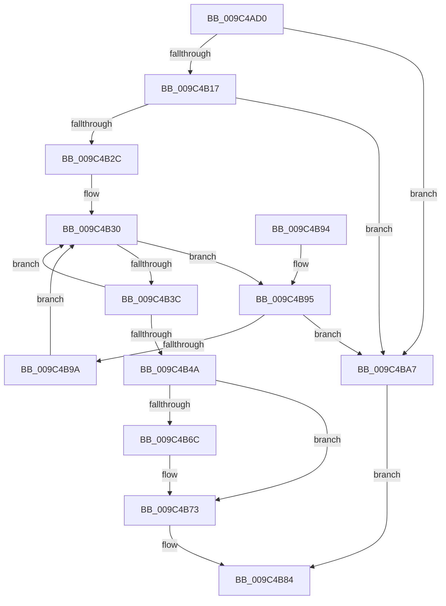

# RtlpAtomMapAtomToHandleEntry

- RVA: `0x009C4AD0`–`0x009C4BB9` (길이 `233` bytes)
- VA: `0x00000001409C4AD0`
- 실행 섹션: `PAGE`
- PDB 이름 있음: `예`; PDB Function 태그: `아니요`
- unwind 정보 RVA: `0x0009FD1C`
- 디코드: `59`개 명령, `233/233` bytes 표시
- 미해석 바이트: `0` (있으면 어셈블리에 `.byte`로 보존)

> 이 문서는 커널 이미지의 기계어와 PDB 기호를 분석해 생성했습니다. 4번과 5번은 함수 원형과 자료형을 바이너리 사용 방식에서 추정한 C 해석이며 원본 소스 복구 결과는 아닙니다.

## 1. Dependencies

- 직접 호출 지점: **6**; 고유 호출 대상: **5**
- 직접 호출자로 확인된 함수: **2**
- RIP 상대 이미지 참조: **0**

### Outgoing calls
- `0x009C4B1F` → [ExpLookupHandleTableEntry](../86/ExpLookupHandleTableEntry_function_00869DB0.md) (function, `0x00869DB0`)
- `0x009C4B4D` → [ExGetHandlePointer](../../text/43/ExGetHandlePointer_function_00430C90.md) (function, `0x00430C90`)
- `0x009C4B6E` → [ExfUnblockPushLock](../../text/2A/ExfUnblockPushLock_function_002A3FE0.md) (function, `0x002A3FE0`)
- `0x009C4B7C` → [KeLeaveCriticalRegionThread](../../text/25/KeLeaveCriticalRegionThread_function_0025EFF0.md) (function, `0x0025EFF0`)
- `0x009C4BA0` → [ExpBlockOnLockedHandleEntry](../86/ExpBlockOnLockedHandleEntry_function_00868838.md) (function, `0x00868838`)
- `0x009C4BB0` → [KeLeaveCriticalRegionThread](../../text/25/KeLeaveCriticalRegionThread_function_0025EFF0.md) (function, `0x0025EFF0`)

### Direct callers
- [RtlPinAtomInAtomTable](RtlPinAtomInAtomTable_function_009C44F0.md) at `0x009C453D`
- [RtlDeleteAtomFromAtomTable](RtlDeleteAtomFromAtomTable_function_009C45C0.md) at `0x009C4609`

### Static image references
- 디코드된 RIP-relative 메모리 참조가 없습니다.

## 2. Other-region calls and transfers

- 다른 실행 섹션으로 향하는 call: **4**
  - `0x009C4B4D` → [ExGetHandlePointer](../../text/43/ExGetHandlePointer_function_00430C90.md) (`PAGE` → `.text`)
  - `0x009C4B6E` → [ExfUnblockPushLock](../../text/2A/ExfUnblockPushLock_function_002A3FE0.md) (`PAGE` → `.text`)
  - `0x009C4B7C` → [KeLeaveCriticalRegionThread](../../text/25/KeLeaveCriticalRegionThread_function_0025EFF0.md) (`PAGE` → `.text`)
  - `0x009C4BB0` → [KeLeaveCriticalRegionThread](../../text/25/KeLeaveCriticalRegionThread_function_0025EFF0.md) (`PAGE` → `.text`)
- 별도 외부 분기/꼬리 이동을 확인하지 못했습니다.

## 3. Assembly (complete function range)

```asm
009C4AD0  48 89 5C 24 10                  mov qword ptr [rsp + 0x10], rbx
009C4AD5  48 89 74 24 18                  mov qword ptr [rsp + 0x18], rsi
009C4ADA  57                              push rdi
009C4ADB  48 83 EC 20                     sub rsp, 0x20
009C4ADF  65 48 8B 04 25 88 01 00 00      mov rax, qword ptr gs:[0x188]
009C4AE8  8D 14 95 00 00 00 00            lea edx, [rdx*4]
009C4AEF  48 C7 44 24 30 00 00 00 00      mov qword ptr [rsp + 0x30], 0
009C4AF8  48 8B F1                        mov rsi, rcx
009C4AFB  89 54 24 30                     mov dword ptr [rsp + 0x30], edx
009C4AFF  66 FF 88 E4 01 00 00            dec word ptr [rax + 0x1e4]
009C4B06  90                              nop
009C4B07  48 8B 79 10                     mov rdi, qword ptr [rcx + 0x10]
009C4B0B  F7 C2 FC 03 00 00               test edx, 0x3fc
009C4B11  0F 84 90 00 00 00               je 0x1409c4ba7
009C4B17  48 8B 54 24 30                  mov rdx, qword ptr [rsp + 0x30]
009C4B1C  48 8B CF                        mov rcx, rdi
009C4B1F  E8 8C 52 EA FF                  call 0x140869db0
009C4B24  48 8B D8                        mov rbx, rax
009C4B27  48 85 C0                        test rax, rax
009C4B2A  74 7B                           je 0x1409c4ba7
009C4B2C  0F 1F 40 00                     nop dword ptr [rax]
009C4B30  0F 0D 0B                        prefetchw byte ptr [rbx]
009C4B33  4C 8B 03                        mov r8, qword ptr [rbx]
009C4B36  41 F6 C0 01                     test r8b, 1
009C4B3A  74 59                           je 0x1409c4b95
009C4B3C  49 8D 48 FF                     lea rcx, [r8 - 1]
009C4B40  49 8B C0                        mov rax, r8
009C4B43  F0 48 0F B1 0B                  lock cmpxchg qword ptr [rbx], rcx
009C4B48  75 E6                           jne 0x1409c4b30
009C4B4A  48 8B CB                        mov rcx, rbx
009C4B4D  E8 3E C1 A6 FF                  call 0x140430c90
009C4B52  48 8B 4E 10                     mov rcx, qword ptr [rsi + 0x10]
009C4B56  48 8B F8                        mov rdi, rax
009C4B59  F0 48 FF 03                     lock inc qword ptr [rbx]
009C4B5D  48 83 C1 30                     add rcx, 0x30
009C4B61  F0 83 0C 24 00                  lock or dword ptr [rsp], 0
009C4B66  48 83 39 00                     cmp qword ptr [rcx], 0
009C4B6A  74 07                           je 0x1409c4b73
009C4B6C  33 D2                           xor edx, edx
009C4B6E  E8 6D F4 8D FF                  call 0x1402a3fe0
009C4B73  65 48 8B 0C 25 88 01 00 00      mov rcx, qword ptr gs:[0x188]
009C4B7C  E8 6F A4 89 FF                  call 0x14025eff0
009C4B81  48 8B C7                        mov rax, rdi
009C4B84  48 8B 5C 24 38                  mov rbx, qword ptr [rsp + 0x38]
009C4B89  48 8B 74 24 40                  mov rsi, qword ptr [rsp + 0x40]
009C4B8E  48 83 C4 20                     add rsp, 0x20
009C4B92  5F                              pop rdi
009C4B93  C3                              ret
009C4B94  CC                              int3
009C4B95  4D 85 C0                        test r8, r8
009C4B98  74 0D                           je 0x1409c4ba7
009C4B9A  48 8B D3                        mov rdx, rbx
009C4B9D  48 8B CF                        mov rcx, rdi
009C4BA0  E8 93 3C EA FF                  call 0x140868838
009C4BA5  EB 89                           jmp 0x1409c4b30
009C4BA7  65 48 8B 0C 25 88 01 00 00      mov rcx, qword ptr gs:[0x188]
009C4BB0  E8 3B A4 89 FF                  call 0x14025eff0
009C4BB5  33 C0                           xor eax, eax
009C4BB7  EB CB                           jmp 0x1409c4b84
```

## 4. C-style interpretation (structured pseudocode)

```c
__int64 __fastcall RtlpAtomMapAtomToHandleEntry(__int64 a1, __int64 a2)
{
    __int64 result;
    __int64 v_rsp;
    unsigned int v_stack_m28;
    unsigned __int64 v_stack_p10;
    unsigned __int64 v_stack_p18;
    unsigned __int64 v_stack_p8;

    v_stack_p10 = v_rbx;
    v_stack_p18 = v_rsi;
    v_rsp = (v_rsp) - (32);
    v_stack_p8 = 0;
    v_stack_p8 = (unsigned int)(a2 * 4);
    if ((((unsigned int)(a2 * 4)) & (0x3FCULL)) == 0) goto loc_009C4BA7;
    result = ExpLookupHandleTableEntry(*(unsigned __int64 *)(a1 + 16), v_stack_p8, a3, a4);
    if (result == 0) goto loc_009C4BA7;
loc_009C4B30:
    if ((((unsigned __int8)(*(unsigned __int64 *)(result))) & (1)) == 0) goto loc_009C4B95;
    if ((((unsigned __int8)(*(unsigned __int64 *)(result))) & (1)) != 0) goto loc_009C4B30;
    result = ExGetHandlePointer(result, v_stack_p8, *(unsigned __int64 *)(result), a4);
    a1 = (*(unsigned __int64 *)(a1 + 16)) + (48);
    if ((*(unsigned __int64 *)(a1)) != 0) {
        a2 = 0;
        result = ExfUnblockPushLock(a1, a2, *(unsigned __int64 *)(result), a4);
    }
    result = KeLeaveCriticalRegionThread(*(unsigned __int64 *)(gs_base + (0 + 392)), a2, *(unsigned __int64 *)(result), a4);
loc_009C4B84:
    v_rsp = (v_rsp) + (32);
    return result;
loc_009C4B95:
    if (*(unsigned __int64 *)(result) == 0) goto loc_009C4BA7;
    result = ExpBlockOnLockedHandleEntry(result, v_stack_p10, *(unsigned __int64 *)(result), a4);
    goto loc_009C4B30;
loc_009C4BA7:
    result = KeLeaveCriticalRegionThread(*(unsigned __int64 *)(gs_base + (0 + 392)), v_stack_p10, *(unsigned __int64 *)(result), a4);
    result = 0;
    goto loc_009C4B84;
}
```

## 5. (Beta) C Style

```c
int64_t RtlpAtomMapAtomToHandleEntry(void *Arg1, int64_t Arg2)
{
    uint8_t *arg1 = (uint8_t *)Arg1;

    int64_t result;
    int64_t local_rsp;
    uint32_t v_stack_m28;
    uint64_t v_stack_p10;
    uint64_t v_stack_p18;
    uint64_t v_stack_p8;

    v_stack_p10 = local_rbx;
    v_stack_p18 = local_rsi;
    local_rsp = (local_rsp) - (32);
    v_stack_p8 = 0;
    v_stack_p8 = (uint32_t)(Arg2 * 4);
    if ((((uint32_t)(Arg2 * 4)) & (0x3FCULL)) == 0) goto loc_009C4BA7;
    result = ExpLookupHandleTableEntry(*(uint64_t *)(arg1 + 0x10), v_stack_p8, a3, a4);
    if (result == 0) goto loc_009C4BA7;
loc_009C4B30:
    if ((((uint8_t)(*(uint64_t *)(result))) & (1)) == 0) goto loc_009C4B95;
    if ((((uint8_t)(*(uint64_t *)(result))) & (1)) != 0) goto loc_009C4B30;
    result = ExGetHandlePointer(result, v_stack_p8, *(uint64_t *)(result), a4);
    Arg1 = (*(uint64_t *)(arg1 + 0x10)) + (48);
    if ((*(uint64_t *)(arg1)) != 0) {
        Arg2 = 0;
        result = ExfUnblockPushLock(Arg1, Arg2, *(uint64_t *)(result), a4);
    }
    result = KeLeaveCriticalRegionThread(*(uint64_t *)(gs_base + (0 + 0x188)), Arg2, *(uint64_t *)(result), a4);
loc_009C4B84:
    local_rsp = (local_rsp) + (32);
    return result;
loc_009C4B95:
    if (*(uint64_t *)(result) == 0) goto loc_009C4BA7;
    result = ExpBlockOnLockedHandleEntry(result, v_stack_p10, *(uint64_t *)(result), a4);
    goto loc_009C4B30;
loc_009C4BA7:
    result = KeLeaveCriticalRegionThread(*(uint64_t *)(gs_base + (0 + 0x188)), v_stack_p10, *(uint64_t *)(result), a4);
    result = 0;
    goto loc_009C4B84;
}
```

### 관측된 메모리 오프셋

구조체 형식이 확인되지 않은 접근은 인자 기준의 오프셋으로만 기록했습니다.

| 기준 인자 | 오프셋 표현 | 폭 (bit) | 접근 |
|---|---:|---:|---|
| `Arg1` | `+ 0x10` | `64` | `R` |

## 6. Execution-region graph

[열기: 2D/3D 그래프와 함수 탐색 컨트롤 패널](../../../control-panel.html?section=page&rva=0x009C4AD0&view=graph)

- 2D 그래프는 위에서 아래로 흐르고, 3D 그래프는 빈 공간을 드래그해 회전합니다. Shift+드래그는 이동, 휠은 확대·축소, 함수 노드 선택은 대상 보고서 이동입니다.

### Static fallback


