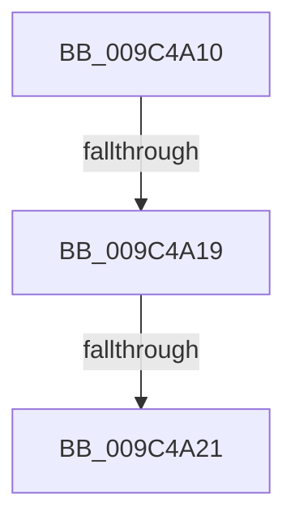

# RtlpLockAtomTable

- RVA: `0x009C4A10`–`0x009C4A2D` (길이 `29` bytes)
- VA: `0x00000001409C4A10`
- 실행 섹션: `PAGE`
- PDB 이름 있음: `예`; PDB Function 태그: `아니요`
- unwind 정보 RVA: `0x0009FCC8`
- 디코드: `7`개 명령, `29/29` bytes 표시
- 미해석 바이트: `0` (있으면 어셈블리에 `.byte`로 보존)

> 이 문서는 커널 이미지의 기계어와 PDB 기호를 분석해 생성했습니다. 4번과 5번은 함수 원형과 자료형을 바이너리 사용 방식에서 추정한 C 해석이며 원본 소스 복구 결과는 아닙니다.

## 1. Dependencies

- 직접 호출 지점: **0**; 고유 호출 대상: **0**
- 직접 호출자로 확인된 함수: **8**
- RIP 상대 이미지 참조: **0**

### Outgoing calls
- 직접 디코드된 call 명령이 없습니다.

### Direct callers
- [RtlAddAtomToAtomTableEx](../../text/43/RtlAddAtomToAtomTableEx_function_00438550.md) at `0x0043858D`
- [RtlDestroyLowBoxAtoms](../../text/47/RtlDestroyLowBoxAtoms_function_004790E0.md) at `0x00479102`
- [RtlEmptyAtomTable](../78/RtlEmptyAtomTable_function_0078E1B0.md) at `0x0078E1D3`
- [RtlQueryAtomsInAtomTable](../78/RtlQueryAtomsInAtomTable_function_0078E298.md) at `0x0078E2C2`
- [RtlDestroyAtomTable](RtlDestroyAtomTable_function_009C43F0.md) at `0x009C4434`
- [RtlPinAtomInAtomTable](RtlPinAtomInAtomTable_function_009C44F0.md) at `0x009C450F`
- [RtlDeleteAtomFromAtomTable](RtlDeleteAtomFromAtomTable_function_009C45C0.md) at `0x009C45DF`
- [RtlQueryAtomInAtomTable](RtlQueryAtomInAtomTable_function_009C4690.md) at `0x009C46E6`

### Static image references
- 디코드된 RIP-relative 메모리 참조가 없습니다.

## 2. Other-region calls and transfers

- 다른 실행 섹션으로 향하는 call: **0**
- call이 아닌 외부 분기/꼬리 이동: **2**
  - `0x009C4A17` → [sub_009C4A7B + 0x6](Unknown_function_009C4A7B.md) (`tail-transfer`)
  - `0x009C4A1F` → [sub_009C4A7B + 0x6](Unknown_function_009C4A7B.md) (`tail-transfer`)

## 3. Assembly (complete function range)

```asm
009C4A10  48 83 EC 28                     sub rsp, 0x28
009C4A14  48 85 C9                        test rcx, rcx
009C4A17  74 68                           je 0x1409c4a81
009C4A19  81 39 41 74 6F 6D               cmp dword ptr [rcx], 0x6d6f7441
009C4A1F  75 60                           jne 0x1409c4a81
009C4A21  65 48 8B 04 25 88 01 00 00      mov rax, qword ptr gs:[0x188]
009C4A2A  45 33 C0                        xor r8d, r8d
```

## 4. C-style interpretation (structured pseudocode)

```c
__int64 __fastcall RtlpLockAtomTable(__int64 a1, __int64 a2, int a3)
{
    __int64 v_rsp;

    v_rsp = (v_rsp) - (40);
    a3 = 0;
    return *(unsigned __int64 *)(gs_base + (0 + 392));
}
```

## 5. (Beta) C Style

```c
int64_t RtlpLockAtomTable(int64_t Arg1, int64_t Arg2, int32_t Arg3)
{
    int64_t local_rsp;

    local_rsp = (local_rsp) - (40);
    Arg3 = 0;
    return *(uint64_t *)(gs_base + (0 + 0x188));
}
```

## 6. Execution-region graph

[열기: 2D/3D 그래프와 함수 탐색 컨트롤 패널](../../../control-panel.html?section=page&rva=0x009C4A10&view=graph)

- 2D 그래프는 위에서 아래로 흐르고, 3D 그래프는 빈 공간을 드래그해 회전합니다. Shift+드래그는 이동, 휠은 확대·축소, 함수 노드 선택은 대상 보고서 이동입니다.

### Static fallback


