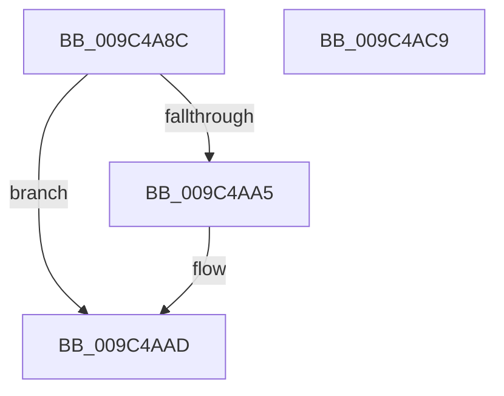

# RtlpUnlockAtomTable

- RVA: `0x009C4A8C`–`0x009C4ACA` (길이 `62` bytes)
- VA: `0x00000001409C4A8C`
- 실행 섹션: `PAGE`
- PDB 이름 있음: `예`; PDB Function 태그: `아니요`
- unwind 정보 RVA: `0x0005CF00`
- 디코드: `18`개 명령, `62/62` bytes 표시
- 미해석 바이트: `0` (있으면 어셈블리에 `.byte`로 보존)

> 이 문서는 커널 이미지의 기계어와 PDB 기호를 분석해 생성했습니다. 4번과 5번은 함수 원형과 자료형을 바이너리 사용 방식에서 추정한 C 해석이며 원본 소스 복구 결과는 아닙니다.

## 1. Dependencies

- 직접 호출 지점: **3**; 고유 호출 대상: **3**
- 직접 호출자로 확인된 함수: **7**
- RIP 상대 이미지 참조: **0**

### Outgoing calls
- `0x009C4AA8` → [ExfTryToWakePushLock](../../text/26/ExfTryToWakePushLock_function_00265DD0.md) (function, `0x00265DD0`)
- `0x009C4AB0` → [KeAbPostRelease](../../text/2E/KeAbPostRelease_function_002E1600.md) (function, `0x002E1600`)
- `0x009C4ABE` → [KeLeaveCriticalRegionThread](../../text/25/KeLeaveCriticalRegionThread_function_0025EFF0.md) (function, `0x0025EFF0`)

### Direct callers
- [RtlAddAtomToAtomTableEx](../../text/43/RtlAddAtomToAtomTableEx_function_00438550.md) at `0x0043879A`
- [RtlDestroyLowBoxAtoms](../../text/47/RtlDestroyLowBoxAtoms_function_004790E0.md) at `0x00479141`
- [RtlEmptyAtomTable](../78/RtlEmptyAtomTable_function_0078E1B0.md) at `0x0078E262`
- [RtlQueryAtomsInAtomTable](../78/RtlQueryAtomsInAtomTable_function_0078E298.md) at `0x0078E344`
- [RtlDestroyAtomTable](RtlDestroyAtomTable_function_009C43F0.md) at `0x009C446C`
- [RtlPinAtomInAtomTable](RtlPinAtomInAtomTable_function_009C44F0.md) at `0x009C4590`
- [RtlDeleteAtomFromAtomTable](RtlDeleteAtomFromAtomTable_function_009C45C0.md) at `0x009C4649`

### Static image references
- 디코드된 RIP-relative 메모리 참조가 없습니다.

## 2. Other-region calls and transfers

- 다른 실행 섹션으로 향하는 call: **3**
  - `0x009C4AA8` → [ExfTryToWakePushLock](../../text/26/ExfTryToWakePushLock_function_00265DD0.md) (`PAGE` → `.text`)
  - `0x009C4AB0` → [KeAbPostRelease](../../text/2E/KeAbPostRelease_function_002E1600.md) (`PAGE` → `.text`)
  - `0x009C4ABE` → [KeLeaveCriticalRegionThread](../../text/25/KeLeaveCriticalRegionThread_function_0025EFF0.md) (`PAGE` → `.text`)
- 별도 외부 분기/꼬리 이동을 확인하지 못했습니다.

## 3. Assembly (complete function range)

```asm
009C4A8C  40 53                           push rbx
009C4A8E  48 83 EC 20                     sub rsp, 0x20
009C4A92  48 8D 59 08                     lea rbx, [rcx + 8]
009C4A96  48 83 C8 FF                     or rax, 0xffffffffffffffff
009C4A9A  F0 48 0F C1 03                  lock xadd qword ptr [rbx], rax
009C4A9F  24 06                           and al, 6
009C4AA1  3C 02                           cmp al, 2
009C4AA3  75 08                           jne 0x1409c4aad
009C4AA5  48 8B CB                        mov rcx, rbx
009C4AA8  E8 23 13 8A FF                  call 0x140265dd0
009C4AAD  48 8B CB                        mov rcx, rbx
009C4AB0  E8 4B CB 91 FF                  call 0x1402e1600
009C4AB5  65 48 8B 0C 25 88 01 00 00      mov rcx, qword ptr gs:[0x188]
009C4ABE  E8 2D A5 89 FF                  call 0x14025eff0
009C4AC3  48 83 C4 20                     add rsp, 0x20
009C4AC7  5B                              pop rbx
009C4AC8  C3                              ret
009C4AC9  CC                              int3
```

## 4. C-style interpretation (structured pseudocode)

```c
__int64 __fastcall RtlpUnlockAtomTable(__int64 a1)
{
    __int64 result;
    __int64 v_rsp;

    v_rsp = (v_rsp) - (32);
    result = (result) | (-1);
    result = (unsigned __int8)((result) & (6));
    if (((unsigned __int8)(result)) == 2) {
        a1 = a1 + 8;
        result = ExfTryToWakePushLock(a1, a2, a3, a4);
    }
    result = KeAbPostRelease(a1 + 8, a2, a3, a4);
    result = KeLeaveCriticalRegionThread(*(unsigned __int64 *)(gs_base + (0 + 392)), a2, a3, a4);
    v_rsp = (v_rsp) + (32);
    return result;
}
```

## 5. (Beta) C Style

```c
int64_t RtlpUnlockAtomTable(void *Arg1)
{
    uint8_t *arg1 = (uint8_t *)Arg1;

    int64_t result;
    int64_t local_rsp;

    local_rsp = (local_rsp) - (32);
    result = (result) | (-1);
    result = (uint8_t)((result) & (6));
    if (((uint8_t)(result)) == 2) {
        Arg1 = Arg1 + 8;
        result = ExfTryToWakePushLock(Arg1, a2, a3, a4);
    }
    result = KeAbPostRelease(Arg1 + 8, a2, a3, a4);
    result = KeLeaveCriticalRegionThread(*(uint64_t *)(gs_base + (0 + 0x188)), a2, a3, a4);
    local_rsp = (local_rsp) + (32);
    return result;
}
```

### 관측된 메모리 오프셋

구조체 형식이 확인되지 않은 접근은 인자 기준의 오프셋으로만 기록했습니다.

| 기준 인자 | 오프셋 표현 | 폭 (bit) | 접근 |
|---|---:|---:|---|
| `Arg1` | `+ 0x0` | `64` | `R/W` |
| `Arg1` | `+ 0x8` | `64` | `R` |

## 6. Execution-region graph

[열기: 2D/3D 그래프와 함수 탐색 컨트롤 패널](../../../control-panel.html?section=page&rva=0x009C4A8C&view=graph)

- 2D 그래프는 위에서 아래로 흐르고, 3D 그래프는 빈 공간을 드래그해 회전합니다. Shift+드래그는 이동, 휠은 확대·축소, 함수 노드 선택은 대상 보고서 이동입니다.

### Static fallback


