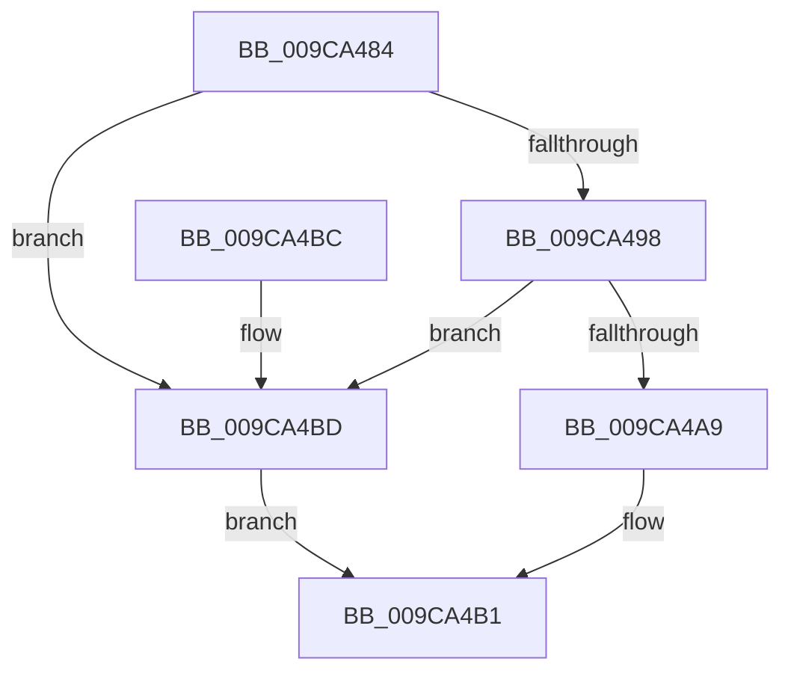

# RtlpValidateSidBuffer

- RVA: `0x009CA484`–`0x009CA4C1` (길이 `61` bytes)
- VA: `0x00000001409CA484`
- 실행 섹션: `PAGE`
- PDB 이름 있음: `예`; PDB Function 태그: `아니요`
- unwind 정보 RVA: `0x00065BB8`
- 디코드: `21`개 명령, `61/61` bytes 표시
- 미해석 바이트: `0` (있으면 어셈블리에 `.byte`로 보존)

> 이 문서는 커널 이미지의 기계어와 PDB 기호를 분석해 생성했습니다. 4번과 5번은 함수 원형과 자료형을 바이너리 사용 방식에서 추정한 C 해석이며 원본 소스 복구 결과는 아닙니다.

## 1. Dependencies

- 직접 호출 지점: **3**; 고유 호출 대상: **3**
- 직접 호출자로 확인된 함수: **1**
- RIP 상대 이미지 참조: **0**

### Outgoing calls
- `0x009CA498` → [RtlSubAuthorityCountSid](../../text/46/RtlSubAuthorityCountSid_function_00468F10.md) (function, `0x00468F10`)
- `0x009CA4A0` → [RtlLengthRequiredSid](RtlLengthRequiredSid_function_009CA4D0.md) (function, `0x009CA4D0`)
- `0x009CA4AC` → [RtlValidSid](../92/RtlValidSid_function_00929710.md) (function, `0x00929710`)

### Direct callers
- [RtlEnumerateBoundaryDescriptorEntries](RtlEnumerateBoundaryDescriptorEntries_function_009CA278.md) at `0x009CA415`

### Static image references
- 디코드된 RIP-relative 메모리 참조가 없습니다.

## 2. Other-region calls and transfers

- 다른 실행 섹션으로 향하는 call: **1**
  - `0x009CA498` → [RtlSubAuthorityCountSid](../../text/46/RtlSubAuthorityCountSid_function_00468F10.md) (`PAGE` → `.text`)
- 별도 외부 분기/꼬리 이동을 확인하지 못했습니다.

## 3. Assembly (complete function range)

```asm
009CA484  48 89 5C 24 08                  mov qword ptr [rsp + 8], rbx
009CA489  57                              push rdi
009CA48A  48 83 EC 20                     sub rsp, 0x20
009CA48E  8B DA                           mov ebx, edx
009CA490  48 8B F9                        mov rdi, rcx
009CA493  83 FA 08                        cmp edx, 8
009CA496  72 25                           jb 0x1409ca4bd
009CA498  E8 73 EA A9 FF                  call 0x140468f10
009CA49D  0F B6 08                        movzx ecx, byte ptr [rax]
009CA4A0  E8 2B 00 00 00                  call 0x1409ca4d0
009CA4A5  3B D8                           cmp ebx, eax
009CA4A7  72 14                           jb 0x1409ca4bd
009CA4A9  48 8B CF                        mov rcx, rdi
009CA4AC  E8 5F F2 F5 FF                  call 0x140929710
009CA4B1  48 8B 5C 24 30                  mov rbx, qword ptr [rsp + 0x30]
009CA4B6  48 83 C4 20                     add rsp, 0x20
009CA4BA  5F                              pop rdi
009CA4BB  C3                              ret
009CA4BC  CC                              int3
009CA4BD  32 C0                           xor al, al
009CA4BF  EB F0                           jmp 0x1409ca4b1
```

## 4. C-style interpretation (structured pseudocode)

```c
__int64 __fastcall RtlpValidateSidBuffer(__int64 a1, int a2)
{
    __int64 result;
    __int64 v_rsp;
    unsigned __int64 v_stack_p8;

    v_stack_p8 = v_rbx;
    v_rsp = (v_rsp) - (32);
    if (a2 < 8) goto loc_009CA4BD;
    result = RtlSubAuthorityCountSid(a1, a2, a3, a4);
    result = RtlLengthRequiredSid(*(unsigned __int8 *)(result), a2, a3, a4);
    if (((unsigned int)((unsigned int)(a2))) < ((unsigned int)(result))) goto loc_009CA4BD;
    result = RtlValidSid(a1, a2, a3, a4);
loc_009CA4B1:
    v_rsp = (v_rsp) + (32);
    return result;
loc_009CA4BD:
    result = 0;
    goto loc_009CA4B1;
}
```

## 5. (Beta) C Style

```c
int64_t RtlpValidateSidBuffer(int64_t Arg1, int32_t Arg2)
{
    int64_t result;
    int64_t local_rsp;
    uint64_t v_stack_p8;

    v_stack_p8 = local_rbx;
    local_rsp = (local_rsp) - (32);
    if (Arg2 < 8) goto loc_009CA4BD;
    result = RtlSubAuthorityCountSid(Arg1, Arg2, a3, a4);
    result = RtlLengthRequiredSid(*(uint8_t *)(result), Arg2, a3, a4);
    if (((uint32_t)((uint32_t)(Arg2))) < ((uint32_t)(result))) goto loc_009CA4BD;
    result = RtlValidSid(Arg1, Arg2, a3, a4);
loc_009CA4B1:
    local_rsp = (local_rsp) + (32);
    return result;
loc_009CA4BD:
    result = 0;
    goto loc_009CA4B1;
}
```

## 6. Execution-region graph

[열기: 2D/3D 그래프와 함수 탐색 컨트롤 패널](../../../control-panel.html?section=page&rva=0x009CA484&view=graph)

- 2D 그래프는 위에서 아래로 흐르고, 3D 그래프는 빈 공간을 드래그해 회전합니다. Shift+드래그는 이동, 휠은 확대·축소, 함수 노드 선택은 대상 보고서 이동입니다.

### Static fallback


