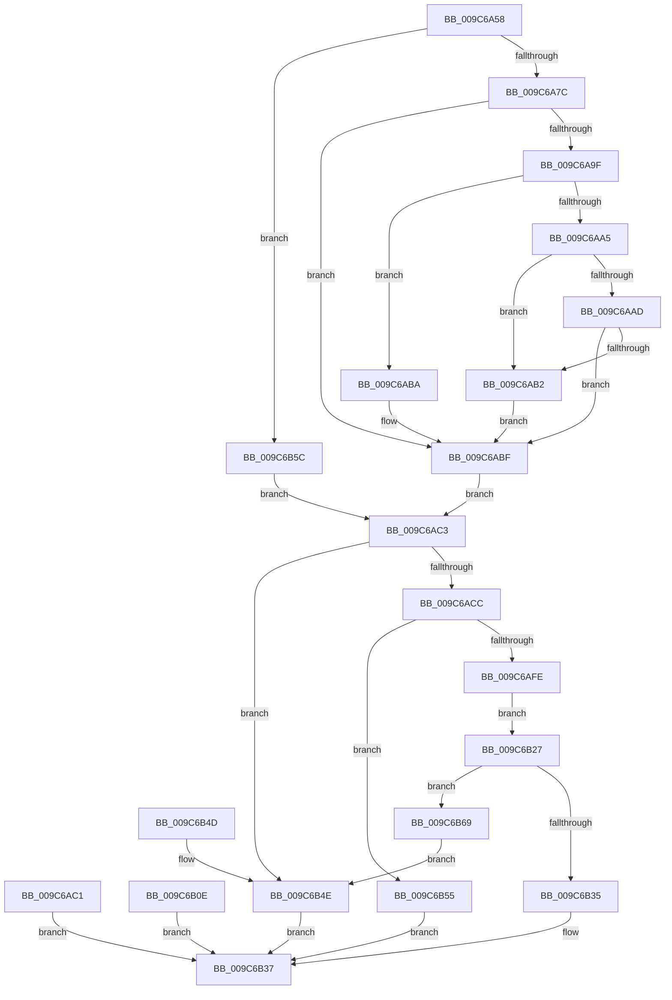

# SeCaptureAcl

- RVA: `0x009C6A58`–`0x009C6B79` (길이 `289` bytes)
- VA: `0x00000001409C6A58`
- 실행 섹션: `PAGE`
- PDB 이름 있음: `예`; PDB Function 태그: `아니요`
- unwind 정보 RVA: `0x000A07A8`
- 디코드: `87`개 명령, `289/289` bytes 표시
- 미해석 바이트: `0` (있으면 어셈블리에 `.byte`로 보존)

> 이 문서는 커널 이미지의 기계어와 PDB 기호를 분석해 생성했습니다. 4번과 5번은 함수 원형과 자료형을 바이너리 사용 방식에서 추정한 C 해석이며 원본 소스 복구 결과는 아닙니다.

## 1. Dependencies

- 직접 호출 지점: **6**; 고유 호출 대상: **5**
- 직접 호출자로 확인된 함수: **2**
- RIP 상대 이미지 참조: **0**

### Outgoing calls
- `0x009C6ABA` → [ExRaiseDatatypeMisalignment](../89/ExRaiseDatatypeMisalignment_function_00899FD0.md) (function, `0x00899FD0`)
- `0x009C6AEC` → [ExAllocatePoolWithTag](../../poolcode/B8/ExAllocatePoolWithTag_function_00B82010.md) (function, `0x00B82010`)
- `0x009C6B07` → [memcpy](../../text/6C/memcpy_function_006C6840.md) (function, `0x006C6840`)
- `0x009C6B1A` → [ExFreePoolWithTag](../../poolcode/B8/ExFreePoolWithTag_function_00B82870.md) (function, `0x00B82870`)
- `0x009C6B2C` → [SepCheckAcl](../92/SepCheckAcl_function_0092A770.md) (function, `0x0092A770`)
- `0x009C6B6E` → [ExFreePoolWithTag](../../poolcode/B8/ExFreePoolWithTag_function_00B82870.md) (function, `0x00B82870`)

### Direct callers
- [NtCreateTokenEx](NtCreateTokenEx_function_009C7C80.md) at `0x009C81EC`
- [NtSetInformationToken](../AF/NtSetInformationToken_function_00AF0530.md) at `0x00AF0764`
- [NtSetInformationToken](../AF/NtSetInformationToken_function_00AF0530.md) at `0x00AF087D`

### Static image references
- 디코드된 RIP-relative 메모리 참조가 없습니다.

## 2. Other-region calls and transfers

- 다른 실행 섹션으로 향하는 call: **4**
  - `0x009C6AEC` → [ExAllocatePoolWithTag](../../poolcode/B8/ExAllocatePoolWithTag_function_00B82010.md) (`PAGE` → `POOLCODE`)
  - `0x009C6B07` → [memcpy](../../text/6C/memcpy_function_006C6840.md) (`PAGE` → `.text`)
  - `0x009C6B1A` → [ExFreePoolWithTag](../../poolcode/B8/ExFreePoolWithTag_function_00B82870.md) (`PAGE` → `POOLCODE`)
  - `0x009C6B6E` → [ExFreePoolWithTag](../../poolcode/B8/ExFreePoolWithTag_function_00B82870.md) (`PAGE` → `POOLCODE`)
- 별도 외부 분기/꼬리 이동을 확인하지 못했습니다.

## 3. Assembly (complete function range)

```asm
009C6A58  48 8B C4                        mov rax, rsp
009C6A5B  48 89 58 08                     mov qword ptr [rax + 8], rbx
009C6A5F  48 89 70 10                     mov qword ptr [rax + 0x10], rsi
009C6A63  48 89 78 18                     mov qword ptr [rax + 0x18], rdi
009C6A67  41 56                           push r14
009C6A69  48 83 EC 30                     sub rsp, 0x30
009C6A6D  48 8B F9                        mov rdi, rcx
009C6A70  83 60 E8 00                     and dword ptr [rax - 0x18], 0
009C6A74  84 D2                           test dl, dl
009C6A76  0F 84 E0 00 00 00               je 0x1409c6b5c
009C6A7C  48 8D 41 02                     lea rax, [rcx + 2]
009C6A80  48 BA 00 00 FF FF FF 7F 00 00   movabs rdx, 0x7fffffff0000
009C6A8A  48 3B C2                        cmp rax, rdx
009C6A8D  48 0F 43 C2                     cmovae rax, rdx
009C6A91  90                              nop
009C6A92  0F B7 00                        movzx eax, word ptr [rax]
009C6A95  8B D8                           mov ebx, eax
009C6A97  89 44 24 20                     mov dword ptr [rsp + 0x20], eax
009C6A9B  85 C0                           test eax, eax
009C6A9D  74 20                           je 0x1409c6abf
009C6A9F  40 F6 C7 03                     test dil, 3
009C6AA3  75 15                           jne 0x1409c6aba
009C6AA5  48 03 C8                        add rcx, rax
009C6AA8  48 3B CA                        cmp rcx, rdx
009C6AAB  77 05                           ja 0x1409c6ab2
009C6AAD  48 3B CF                        cmp rcx, rdi
009C6AB0  73 0D                           jae 0x1409c6abf
009C6AB2  8A 02                           mov al, byte ptr [rdx]
009C6AB4  8B 5C 24 20                     mov ebx, dword ptr [rsp + 0x20]
009C6AB8  EB 05                           jmp 0x1409c6abf
009C6ABA  E8 11 35 ED FF                  call 0x140899fd0
009C6ABF  EB 02                           jmp 0x1409c6ac3
009C6AC1  EB 74                           jmp 0x1409c6b37
009C6AC3  83 FB 08                        cmp ebx, 8
009C6AC6  0F 82 82 00 00 00               jb 0x1409c6b4e
009C6ACC  8D 4B 03                        lea ecx, [rbx + 3]
009C6ACF  83 E1 FC                        and ecx, 0xfffffffc
009C6AD2  48 8B 44 24 78                  mov rax, qword ptr [rsp + 0x78]
009C6AD7  89 08                           mov dword ptr [rax], ecx
009C6AD9  44 8B F3                        mov r14d, ebx
009C6ADC  8B 4C 24 60                     mov ecx, dword ptr [rsp + 0x60]
009C6AE0  0F BA E9 0A                     bts ecx, 0xa
009C6AE4  41 B8 53 65 41 63               mov r8d, 0x63416553
009C6AEA  8B D3                           mov edx, ebx
009C6AEC  E8 1F B5 1B 00                  call 0x140b82010
009C6AF1  48 8B 74 24 70                  mov rsi, qword ptr [rsp + 0x70]
009C6AF6  48 89 06                        mov qword ptr [rsi], rax
009C6AF9  48 85 C0                        test rax, rax
009C6AFC  74 57                           je 0x1409c6b55
009C6AFE  45 8B C6                        mov r8d, r14d
009C6B01  48 8B D7                        mov rdx, rdi
009C6B04  48 8B C8                        mov rcx, rax
009C6B07  E8 34 FD CF FF                  call 0x1406c6840
009C6B0C  EB 19                           jmp 0x1409c6b27
009C6B0E  8B F8                           mov edi, eax
009C6B10  33 D2                           xor edx, edx
009C6B12  48 8B 5C 24 70                  mov rbx, qword ptr [rsp + 0x70]
009C6B17  48 8B 0B                        mov rcx, qword ptr [rbx]
009C6B1A  E8 51 BD 1B 00                  call 0x140b82870
009C6B1F  48 83 23 00                     and qword ptr [rbx], 0
009C6B23  8B C7                           mov eax, edi
009C6B25  EB 10                           jmp 0x1409c6b37
009C6B27  8B D3                           mov edx, ebx
009C6B29  48 8B 0E                        mov rcx, qword ptr [rsi]
009C6B2C  E8 3F 3C F6 FF                  call 0x14092a770
009C6B31  84 C0                           test al, al
009C6B33  74 34                           je 0x1409c6b69
009C6B35  33 C0                           xor eax, eax
009C6B37  48 8B 5C 24 40                  mov rbx, qword ptr [rsp + 0x40]
009C6B3C  48 8B 74 24 48                  mov rsi, qword ptr [rsp + 0x48]
009C6B41  48 8B 7C 24 50                  mov rdi, qword ptr [rsp + 0x50]
009C6B46  48 83 C4 30                     add rsp, 0x30
009C6B4A  41 5E                           pop r14
009C6B4C  C3                              ret
009C6B4D  CC                              int3
009C6B4E  B8 77 00 00 C0                  mov eax, 0xc0000077
009C6B53  EB E2                           jmp 0x1409c6b37
009C6B55  B8 9A 00 00 C0                  mov eax, 0xc000009a
009C6B5A  EB DB                           jmp 0x1409c6b37
009C6B5C  0F B7 59 02                     movzx ebx, word ptr [rcx + 2]
009C6B60  89 5C 24 20                     mov dword ptr [rsp + 0x20], ebx
009C6B64  E9 5A FF FF FF                  jmp 0x1409c6ac3
009C6B69  33 D2                           xor edx, edx
009C6B6B  48 8B 0E                        mov rcx, qword ptr [rsi]
009C6B6E  E8 FD BC 1B 00                  call 0x140b82870
009C6B73  48 83 26 00                     and qword ptr [rsi], 0
009C6B77  EB D5                           jmp 0x1409c6b4e
```

## 4. C-style interpretation (structured pseudocode)

```c
__int64 __fastcall SeCaptureAcl(__int64 a1, unsigned __int8 a2, __int64 a3, __int64 a4, unsigned int a5, __int64 a6, __int64 a7, __int64 a8)
{
    __int64 result;
    __int64 v_rsp;
    unsigned int v_stack_m18;
    unsigned __int64 v_stack_p10;
    unsigned __int64 v_stack_p18;
    unsigned int v_stack_p20;
    unsigned __int64 v_stack_p38;
    unsigned __int64 v_stack_p8;

    *(unsigned __int64 *)(v_rsp + 8) = v_rbx;
    *(unsigned __int64 *)(v_rsp + 16) = v_rsi;
    *(unsigned __int64 *)(v_rsp + 24) = v_rdi;
    v_rsp = (v_rsp) - (48);
    if (a2 == 0) goto loc_009C6B5C;
    result = a1 + 2;
    if ((a1 + 2) >= a2) { result = a2; }
    v_stack_m18 = (unsigned int)(*(unsigned __int16 *)(result));
    if ((unsigned int)(*(unsigned __int16 *)(result)) == 0) goto loc_009C6ABF;
    if ((((unsigned __int8)(a1)) & (3)) != 0) goto loc_009C6ABA;
    a1 = (a1) + (*(unsigned __int16 *)(result));
    if (a1 > a2) goto loc_009C6AB2;
    if (a1 >= a1) goto loc_009C6ABF;
loc_009C6AB2:
    goto loc_009C6ABF;
loc_009C6ABA:
    result = ExRaiseDatatypeMisalignment(a1, a2, a3, a4);
loc_009C6ABF:
    goto loc_009C6AC3;
loc_009C6AC3:
    if (((unsigned int)((unsigned int)(v_stack_m18))) < 8) goto loc_009C6B4E;
    a1 = (unsigned int)(((unsigned int)(v_stack_m18) + 3) & (0xFFFFFFFCULL));
    *(unsigned int *)(a8) = (unsigned int)(a1);
    result = ExAllocatePoolWithTag((unsigned int)(a5), (unsigned int)((unsigned int)((unsigned int)(v_stack_m18))), (unsigned int)(0x63416553ULL), a4);
    *(unsigned __int64 *)(a7) = result;
    if (result == 0) goto loc_009C6B55;
    result = memcpy(result, a1, (unsigned int)((unsigned int)((unsigned int)((unsigned int)((unsigned int)(v_stack_m18))))), a4);
    goto loc_009C6B27;
loc_009C6B27:
    result = SepCheckAcl(*(unsigned __int64 *)(a7), (unsigned int)((unsigned int)((unsigned int)(v_stack_m18))), (unsigned int)((unsigned int)((unsigned int)((unsigned int)((unsigned int)(v_stack_m18))))), a4);
    if ((unsigned __int8)(result) == 0) goto loc_009C6B69;
    result = 0;
loc_009C6B37:
    v_rsp = (v_rsp) + (48);
    return result;
loc_009C6B4E:
    goto loc_009C6B37;
loc_009C6B55:
    goto loc_009C6B37;
loc_009C6B5C:
    v_stack_p20 = (unsigned int)(*(unsigned __int16 *)(*(unsigned __int64 *)(a7) + 2));
    goto loc_009C6AC3;
loc_009C6B69:
    a2 = 0;
    result = ExFreePoolWithTag(*(unsigned __int64 *)(v_stack_p10), a2, (unsigned int)((unsigned int)((unsigned int)((unsigned int)((unsigned int)(v_stack_m18))))), a4);
    goto loc_009C6B4E;
}
```

## 5. (Beta) C Style

```c
int64_t SeCaptureAcl(void *Arg1, uint8_t Arg2, int64_t Arg3, int64_t Arg4, uint32_t Arg5, uint64_t Arg6, void *Arg7, void *Arg8)
{
    uint8_t *arg1 = (uint8_t *)Arg1;
    uint8_t *arg7 = (uint8_t *)Arg7;
    uint8_t *arg8 = (uint8_t *)Arg8;

    int64_t result;
    int64_t local_rsp;
    uint32_t v_stack_m18;
    uint64_t v_stack_p10;
    uint64_t v_stack_p18;
    uint32_t v_stack_p20;
    uint64_t v_stack_p38;
    uint64_t v_stack_p8;

    *(uint64_t *)(local_rsp + 0x8) = local_rbx;
    *(uint64_t *)(local_rsp + 0x10) = local_rsi;
    *(uint64_t *)(local_rsp + 0x18) = local_rdi;
    local_rsp = (local_rsp) - (48);
    if (Arg2 == 0) goto loc_009C6B5C;
    result = Arg1 + 2;
    if ((Arg1 + 2) >= Arg2) { result = Arg2; }
    v_stack_m18 = (uint32_t)(*(uint16_t *)(result));
    if ((uint32_t)(*(uint16_t *)(result)) == 0) goto loc_009C6ABF;
    if ((((uint8_t)(Arg1)) & (3)) != 0) goto loc_009C6ABA;
    Arg1 = (Arg1) + (*(uint16_t *)(result));
    if (Arg1 > Arg2) goto loc_009C6AB2;
    if (Arg1 >= Arg1) goto loc_009C6ABF;
loc_009C6AB2:
    goto loc_009C6ABF;
loc_009C6ABA:
    result = ExRaiseDatatypeMisalignment(Arg1, Arg2, Arg3, Arg4);
loc_009C6ABF:
    goto loc_009C6AC3;
loc_009C6AC3:
    if (((uint32_t)((uint32_t)(v_stack_m18))) < 8) goto loc_009C6B4E;
    Arg1 = (uint32_t)(((uint32_t)(v_stack_m18) + 3) & (0xFFFFFFFCULL));
    *(uint32_t *)(arg8) = (uint32_t)(Arg1);
    result = ExAllocatePoolWithTag((uint32_t)(Arg5), (uint32_t)((uint32_t)((uint32_t)(v_stack_m18))), (uint32_t)(0x63416553ULL), Arg4);
    *(uint64_t *)(arg7) = result;
    if (result == 0) goto loc_009C6B55;
    result = memcpy(result, Arg1, (uint32_t)((uint32_t)((uint32_t)((uint32_t)((uint32_t)(v_stack_m18))))), Arg4);
    goto loc_009C6B27;
loc_009C6B27:
    result = SepCheckAcl(*(uint64_t *)(arg7), (uint32_t)((uint32_t)((uint32_t)(v_stack_m18))), (uint32_t)((uint32_t)((uint32_t)((uint32_t)((uint32_t)(v_stack_m18))))), Arg4);
    if ((uint8_t)(result) == 0) goto loc_009C6B69;
    result = 0;
loc_009C6B37:
    local_rsp = (local_rsp) + (48);
    return result;
loc_009C6B4E:
    goto loc_009C6B37;
loc_009C6B55:
    goto loc_009C6B37;
loc_009C6B5C:
    v_stack_p20 = (uint32_t)(*(uint16_t *)(*(uint64_t *)(arg7) + 0x2));
    goto loc_009C6AC3;
loc_009C6B69:
    Arg2 = 0;
    result = ExFreePoolWithTag(*(uint64_t *)(v_stack_p10), Arg2, (uint32_t)((uint32_t)((uint32_t)((uint32_t)((uint32_t)(v_stack_m18))))), Arg4);
    goto loc_009C6B4E;
}
```

### 관측된 메모리 오프셋

구조체 형식이 확인되지 않은 접근은 인자 기준의 오프셋으로만 기록했습니다.

| 기준 인자 | 오프셋 표현 | 폭 (bit) | 접근 |
|---|---:|---:|---|
| `Arg1` | `+ 0x2` | `16` | `R` |
| `Arg1` | `+ 0x2` | `64` | `R` |
| `Arg7` | `+ 0x0` | `64` | `R` |
| `Arg7` | `+ 0x0` | `64` | `R/W` |
| `Arg7` | `+ 0x0` | `64` | `W` |
| `Arg8` | `+ 0x0` | `32` | `W` |

## 6. Execution-region graph

[열기: 2D/3D 그래프와 함수 탐색 컨트롤 패널](../../../control-panel.html?section=page&rva=0x009C6A58&view=graph)

- 2D 그래프는 위에서 아래로 흐르고, 3D 그래프는 빈 공간을 드래그해 회전합니다. Shift+드래그는 이동, 휠은 확대·축소, 함수 노드 선택은 대상 보고서 이동입니다.

### Static fallback


