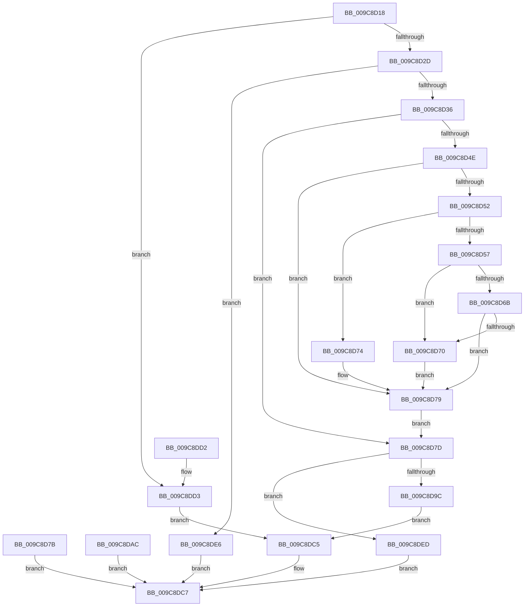

# SeCaptureLuidAndAttributesArray

- RVA: `0x009C8D18`–`0x009C8DF4` (길이 `220` bytes)
- VA: `0x00000001409C8D18`
- 실행 섹션: `PAGE`
- PDB 이름 있음: `예`; PDB Function 태그: `아니요`
- unwind 정보 RVA: `0x000A094C`
- 디코드: `68`개 명령, `220/220` bytes 표시
- 미해석 바이트: `0` (있으면 어셈블리에 `.byte`로 보존)

> 이 문서는 커널 이미지의 기계어와 PDB 기호를 분석해 생성했습니다. 4번과 5번은 함수 원형과 자료형을 바이너리 사용 방식에서 추정한 C 해석이며 원본 소스 복구 결과는 아닙니다.

## 1. Dependencies

- 직접 호출 지점: **4**; 고유 호출 대상: **4**
- 직접 호출자로 확인된 함수: **4**
- RIP 상대 이미지 참조: **0**

### Outgoing calls
- `0x009C8D74` → [ExRaiseDatatypeMisalignment](../89/ExRaiseDatatypeMisalignment_function_00899FD0.md) (function, `0x00899FD0`)
- `0x009C8D8A` → [ExAllocatePoolWithTag](../../poolcode/B8/ExAllocatePoolWithTag_function_00B82010.md) (function, `0x00B82010`)
- `0x009C8DA5` → [memcpy](../../text/6C/memcpy_function_006C6840.md) (function, `0x006C6840`)
- `0x009C8DB8` → [ExFreePoolWithTag](../../poolcode/B8/ExFreePoolWithTag_function_00B82870.md) (function, `0x00B82870`)

### Direct callers
- [NtFilterToken](NtFilterToken_function_009C7890.md) at `0x009C797B`
- [NtCreateTokenEx](NtCreateTokenEx_function_009C7C80.md) at `0x009C816A`
- [NtAdjustPrivilegesToken](NtAdjustPrivilegesToken_function_009C86C0.md) at `0x009C87F1`
- [NtPrivilegeCheck](NtPrivilegeCheck_function_009C8AE0.md) at `0x009C8C69`

### Static image references
- 디코드된 RIP-relative 메모리 참조가 없습니다.

## 2. Other-region calls and transfers

- 다른 실행 섹션으로 향하는 call: **3**
  - `0x009C8D8A` → [ExAllocatePoolWithTag](../../poolcode/B8/ExAllocatePoolWithTag_function_00B82010.md) (`PAGE` → `POOLCODE`)
  - `0x009C8DA5` → [memcpy](../../text/6C/memcpy_function_006C6840.md) (`PAGE` → `.text`)
  - `0x009C8DB8` → [ExFreePoolWithTag](../../poolcode/B8/ExFreePoolWithTag_function_00B82870.md) (`PAGE` → `POOLCODE`)
- 별도 외부 분기/꼬리 이동을 확인하지 못했습니다.

## 3. Assembly (complete function range)

```asm
009C8D18  48 89 5C 24 08                  mov qword ptr [rsp + 8], rbx
009C8D1D  57                              push rdi
009C8D1E  48 83 EC 20                     sub rsp, 0x20
009C8D22  48 8B D9                        mov rbx, rcx
009C8D25  85 D2                           test edx, edx
009C8D27  0F 84 A6 00 00 00               je 0x1409c8dd3
009C8D2D  83 FA 42                        cmp edx, 0x42
009C8D30  0F 87 B0 00 00 00               ja 0x1409c8de6
009C8D36  8D 14 52                        lea edx, [rdx + rdx*2]
009C8D39  C1 E2 02                        shl edx, 2
009C8D3C  8D 4A 03                        lea ecx, [rdx + 3]
009C8D3F  83 E1 FC                        and ecx, 0xfffffffc
009C8D42  48 8B 44 24 70                  mov rax, qword ptr [rsp + 0x70]
009C8D47  89 08                           mov dword ptr [rax], ecx
009C8D49  45 84 C0                        test r8b, r8b
009C8D4C  74 2F                           je 0x1409c8d7d
009C8D4E  85 D2                           test edx, edx
009C8D50  74 27                           je 0x1409c8d79
009C8D52  F6 C3 03                        test bl, 3
009C8D55  75 1D                           jne 0x1409c8d74
009C8D57  8B CA                           mov ecx, edx
009C8D59  48 03 CB                        add rcx, rbx
009C8D5C  48 B8 00 00 FF FF FF 7F 00 00   movabs rax, 0x7fffffff0000
009C8D66  48 3B C8                        cmp rcx, rax
009C8D69  77 05                           ja 0x1409c8d70
009C8D6B  48 3B CB                        cmp rcx, rbx
009C8D6E  73 09                           jae 0x1409c8d79
009C8D70  8A 00                           mov al, byte ptr [rax]
009C8D72  EB 05                           jmp 0x1409c8d79
009C8D74  E8 57 12 ED FF                  call 0x140899fd0
009C8D79  EB 02                           jmp 0x1409c8d7d
009C8D7B  EB 4A                           jmp 0x1409c8dc7
009C8D7D  8B FA                           mov edi, edx
009C8D7F  B9 01 04 00 00                  mov ecx, 0x401
009C8D84  41 B8 53 65 4C 75               mov r8d, 0x754c6553
009C8D8A  E8 81 92 1B 00                  call 0x140b82010
009C8D8F  48 8B 4C 24 68                  mov rcx, qword ptr [rsp + 0x68]
009C8D94  48 89 01                        mov qword ptr [rcx], rax
009C8D97  48 85 C0                        test rax, rax
009C8D9A  74 51                           je 0x1409c8ded
009C8D9C  44 8B C7                        mov r8d, edi
009C8D9F  48 8B D3                        mov rdx, rbx
009C8DA2  48 8B C8                        mov rcx, rax
009C8DA5  E8 96 DA CF FF                  call 0x1406c6840
009C8DAA  EB 19                           jmp 0x1409c8dc5
009C8DAC  8B F8                           mov edi, eax
009C8DAE  33 D2                           xor edx, edx
009C8DB0  48 8B 5C 24 68                  mov rbx, qword ptr [rsp + 0x68]
009C8DB5  48 8B 0B                        mov rcx, qword ptr [rbx]
009C8DB8  E8 B3 9A 1B 00                  call 0x140b82870
009C8DBD  48 83 23 00                     and qword ptr [rbx], 0
009C8DC1  8B C7                           mov eax, edi
009C8DC3  EB 02                           jmp 0x1409c8dc7
009C8DC5  33 C0                           xor eax, eax
009C8DC7  48 8B 5C 24 30                  mov rbx, qword ptr [rsp + 0x30]
009C8DCC  48 83 C4 20                     add rsp, 0x20
009C8DD0  5F                              pop rdi
009C8DD1  C3                              ret
009C8DD2  CC                              int3
009C8DD3  48 8B 44 24 68                  mov rax, qword ptr [rsp + 0x68]
009C8DD8  48 83 20 00                     and qword ptr [rax], 0
009C8DDC  48 8B 44 24 70                  mov rax, qword ptr [rsp + 0x70]
009C8DE1  83 20 00                        and dword ptr [rax], 0
009C8DE4  EB DF                           jmp 0x1409c8dc5
009C8DE6  B8 0D 00 00 C0                  mov eax, 0xc000000d
009C8DEB  EB DA                           jmp 0x1409c8dc7
009C8DED  B8 9A 00 00 C0                  mov eax, 0xc000009a
009C8DF2  EB D3                           jmp 0x1409c8dc7
```

## 4. C-style interpretation (structured pseudocode)

```c
__int64 __fastcall SeCaptureLuidAndAttributesArray(__int64 a1, __int64 a2, unsigned __int8 a3, __int64 a4, __int64 a5, __int64 a6, __int64 a7, __int64 a8, __int64 a9)
{
    __int64 result;
    __int64 v_rsp;
    unsigned __int64 v_stack_p40;
    unsigned __int64 v_stack_p8;

    v_stack_p8 = v_rbx;
    v_rsp = (v_rsp) - (32);
    if ((unsigned int)(a2) == 0) goto loc_009C8DD3;
    if (((unsigned int)(a2)) > 66) goto loc_009C8DE6;
    a2 = (unsigned int)((a2 + a2 * 2) << (2));
    a1 = (unsigned int)((a2 + 3) & (0xFFFFFFFCULL));
    *(unsigned int *)(a9) = (unsigned int)(a1);
    if (a3 == 0) goto loc_009C8D7D;
    if ((unsigned int)(a2) == 0) goto loc_009C8D79;
    if ((((unsigned __int8)(a1)) & (3)) != 0) goto loc_009C8D74;
    a1 = ((unsigned int)((unsigned int)(a2))) + (a1);
    if (a1 > a9) goto loc_009C8D70;
    if (a1 >= a1) goto loc_009C8D79;
loc_009C8D70:
    goto loc_009C8D79;
loc_009C8D74:
    result = ExRaiseDatatypeMisalignment(a1, a2, a3, a4);
loc_009C8D79:
    goto loc_009C8D7D;
loc_009C8D7D:
    result = ExAllocatePoolWithTag((unsigned int)(0x401ULL), a2, (unsigned int)(0x754C6553ULL), a4);
    *(unsigned __int64 *)(a8) = result;
    if (result == 0) goto loc_009C8DED;
    result = memcpy(result, a1, (unsigned int)((unsigned int)((unsigned int)((unsigned int)(a2)))), a4);
    goto loc_009C8DC5;
loc_009C8DC5:
    result = 0;
loc_009C8DC7:
    v_rsp = (v_rsp) + (32);
    return result;
loc_009C8DD3:
    goto loc_009C8DC5;
loc_009C8DE6:
    goto loc_009C8DC7;
loc_009C8DED:
    goto loc_009C8DC7;
}
```

## 5. (Beta) C Style

```c
int64_t SeCaptureLuidAndAttributesArray(int64_t Arg1, int64_t Arg2, uint8_t Arg3, int64_t Arg4, uint64_t Arg5, uint64_t Arg6, uint64_t Arg7, void *Arg8, void *Arg9)
{
    uint8_t *arg8 = (uint8_t *)Arg8;
    uint8_t *arg9 = (uint8_t *)Arg9;

    int64_t result;
    int64_t local_rsp;
    uint64_t v_stack_p40;
    uint64_t v_stack_p8;

    v_stack_p8 = local_rbx;
    local_rsp = (local_rsp) - (32);
    if ((uint32_t)(Arg2) == 0) goto loc_009C8DD3;
    if (((uint32_t)(Arg2)) > 66) goto loc_009C8DE6;
    Arg2 = (uint32_t)((Arg2 + Arg2 * 2) << (2));
    Arg1 = (uint32_t)((Arg2 + 3) & (0xFFFFFFFCULL));
    *(uint32_t *)(arg9) = (uint32_t)(Arg1);
    if (Arg3 == 0) goto loc_009C8D7D;
    if ((uint32_t)(Arg2) == 0) goto loc_009C8D79;
    if ((((uint8_t)(Arg1)) & (3)) != 0) goto loc_009C8D74;
    Arg1 = ((uint32_t)((uint32_t)(Arg2))) + (Arg1);
    if (Arg1 > Arg9) goto loc_009C8D70;
    if (Arg1 >= Arg1) goto loc_009C8D79;
loc_009C8D70:
    goto loc_009C8D79;
loc_009C8D74:
    result = ExRaiseDatatypeMisalignment(Arg1, Arg2, Arg3, Arg4);
loc_009C8D79:
    goto loc_009C8D7D;
loc_009C8D7D:
    result = ExAllocatePoolWithTag((uint32_t)(0x401ULL), Arg2, (uint32_t)(0x754C6553ULL), Arg4);
    *(uint64_t *)(arg8) = result;
    if (result == 0) goto loc_009C8DED;
    result = memcpy(result, Arg1, (uint32_t)((uint32_t)((uint32_t)((uint32_t)(Arg2)))), Arg4);
    goto loc_009C8DC5;
loc_009C8DC5:
    result = 0;
loc_009C8DC7:
    local_rsp = (local_rsp) + (32);
    return result;
loc_009C8DD3:
    goto loc_009C8DC5;
loc_009C8DE6:
    goto loc_009C8DC7;
loc_009C8DED:
    goto loc_009C8DC7;
}
```

### 관측된 메모리 오프셋

구조체 형식이 확인되지 않은 접근은 인자 기준의 오프셋으로만 기록했습니다.

| 기준 인자 | 오프셋 표현 | 폭 (bit) | 접근 |
|---|---:|---:|---|
| `Arg8` | `+ 0x0` | `64` | `R/W` |
| `Arg8` | `+ 0x0` | `64` | `W` |
| `Arg9` | `+ 0x0` | `32` | `R/W` |
| `Arg9` | `+ 0x0` | `32` | `W` |

## 6. Execution-region graph

[열기: 2D/3D 그래프와 함수 탐색 컨트롤 패널](../../../control-panel.html?section=page&rva=0x009C8D18&view=graph)

- 2D 그래프는 위에서 아래로 흐르고, 3D 그래프는 빈 공간을 드래그해 회전합니다. Shift+드래그는 이동, 휠은 확대·축소, 함수 노드 선택은 대상 보고서 이동입니다.

### Static fallback


