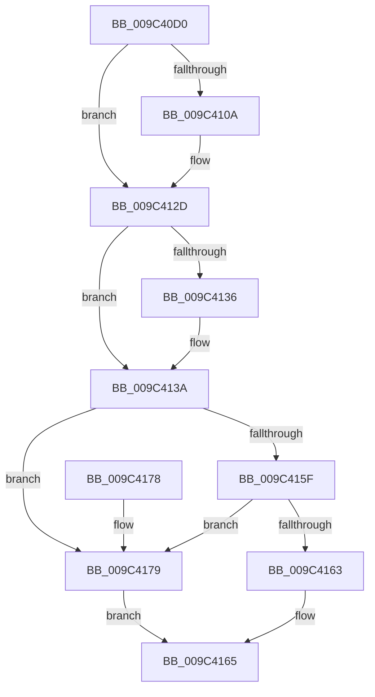

# SeShouldCheckForAccessRightsFromParent

- RVA: `0x009C40D0`–`0x009C417D` (길이 `173` bytes)
- VA: `0x00000001409C40D0`
- 실행 섹션: `PAGE`
- PDB 이름 있음: `예`; PDB Function 태그: `아니요`
- unwind 정보 RVA: `0x0009F8DC`
- 디코드: `54`개 명령, `173/173` bytes 표시
- 미해석 바이트: `0` (있으면 어셈블리에 `.byte`로 보존)

> 이 문서는 커널 이미지의 기계어와 PDB 기호를 분석해 생성했습니다. 4번과 5번은 함수 원형과 자료형을 바이너리 사용 방식에서 추정한 C 해석이며 원본 소스 복구 결과는 아닙니다.

## 1. Dependencies

- 직접 호출 지점: **4**; 고유 호출 대상: **4**
- 직접 호출자로 확인된 함수: **0**
- RIP 상대 이미지 참조: **0**

### Outgoing calls
- `0x009C40F5` → [SeGetTrustLabelAce](../../text/3F/SeGetTrustLabelAce_function_003FDB20.md) (function, `0x003FDB20`)
- `0x009C4113` → [SepLocateTokenTrustLevel](../../text/3E/SepLocateTokenTrustLevel_function_003EDA40.md) (function, `0x003EDA40`)
- `0x009C4123` → [RtlSidDominatesForTrust](../../text/3E/RtlSidDominatesForTrust_function_003EDFE0.md) (function, `0x003EDFE0`)
- `0x009C414C` → [SepFilterCheck](../../text/30/SepFilterCheck_function_00301B60.md) (function, `0x00301B60`)

### Direct callers
- 이 함수 시작 RVA로 연결되는 직접 call은 확인되지 않았습니다. 간접 호출은 완전히 역산할 수 없습니다.

### Static image references
- 디코드된 RIP-relative 메모리 참조가 없습니다.

## 2. Other-region calls and transfers

- 다른 실행 섹션으로 향하는 call: **4**
  - `0x009C40F5` → [SeGetTrustLabelAce](../../text/3F/SeGetTrustLabelAce_function_003FDB20.md) (`PAGE` → `.text`)
  - `0x009C4113` → [SepLocateTokenTrustLevel](../../text/3E/SepLocateTokenTrustLevel_function_003EDA40.md) (`PAGE` → `.text`)
  - `0x009C4123` → [RtlSidDominatesForTrust](../../text/3E/RtlSidDominatesForTrust_function_003EDFE0.md) (`PAGE` → `.text`)
  - `0x009C414C` → [SepFilterCheck](../../text/30/SepFilterCheck_function_00301B60.md) (`PAGE` → `.text`)
- 별도 외부 분기/꼬리 이동을 확인하지 못했습니다.

## 3. Assembly (complete function range)

```asm
009C40D0  48 89 5C 24 08                  mov qword ptr [rsp + 8], rbx
009C40D5  48 89 6C 24 10                  mov qword ptr [rsp + 0x10], rbp
009C40DA  56                              push rsi
009C40DB  57                              push rdi
009C40DC  41 56                           push r14
009C40DE  48 83 EC 30                     sub rsp, 0x30
009C40E2  33 FF                           xor edi, edi
009C40E4  48 8B CA                        mov rcx, rdx
009C40E7  48 89 7C 24 68                  mov qword ptr [rsp + 0x68], rdi
009C40EC  49 8B D8                        mov rbx, r8
009C40EF  4C 8B F2                        mov r14, rdx
009C40F2  40 B5 01                        mov bpl, 1
009C40F5  E8 26 9A A3 FF                  call 0x1403fdb20
009C40FA  48 85 C0                        test rax, rax
009C40FD  48 8D 70 08                     lea rsi, [rax + 8]
009C4101  48 0F 44 F7                     cmove rsi, rdi
009C4105  48 85 F6                        test rsi, rsi
009C4108  74 23                           je 0x1409c412d
009C410A  48 8D 4B 20                     lea rcx, [rbx + 0x20]
009C410E  40 88 7C 24 60                  mov byte ptr [rsp + 0x60], dil
009C4113  E8 28 99 A2 FF                  call 0x1403eda40
009C4118  4C 8D 44 24 60                  lea r8, [rsp + 0x60]
009C411D  48 8B D6                        mov rdx, rsi
009C4120  48 8B C8                        mov rcx, rax
009C4123  E8 B8 9E A2 FF                  call 0x1403edfe0
009C4128  0F B6 6C 24 60                  movzx ebp, byte ptr [rsp + 0x60]
009C412D  4C 8B 43 20                     mov r8, qword ptr [rbx + 0x20]
009C4131  4D 85 C0                        test r8, r8
009C4134  75 04                           jne 0x1409c413a
009C4136  4C 8B 43 30                     mov r8, qword ptr [rbx + 0x30]
009C413A  48 8D 44 24 68                  lea rax, [rsp + 0x68]
009C413F  41 B1 01                        mov r9b, 1
009C4142  33 D2                           xor edx, edx
009C4144  48 89 44 24 20                  mov qword ptr [rsp + 0x20], rax
009C4149  49 8B CE                        mov rcx, r14
009C414C  E8 0F DA 93 FF                  call 0x140301b60
009C4151  8B 4B 10                        mov ecx, dword ptr [rbx + 0x10]
009C4154  8B C1                           mov eax, ecx
009C4156  23 44 24 68                     and eax, dword ptr [rsp + 0x68]
009C415A  40 84 ED                        test bpl, bpl
009C415D  74 1A                           je 0x1409c4179
009C415F  3B C1                           cmp eax, ecx
009C4161  75 16                           jne 0x1409c4179
009C4163  B0 01                           mov al, 1
009C4165  48 8B 5C 24 50                  mov rbx, qword ptr [rsp + 0x50]
009C416A  48 8B 6C 24 58                  mov rbp, qword ptr [rsp + 0x58]
009C416F  48 83 C4 30                     add rsp, 0x30
009C4173  41 5E                           pop r14
009C4175  5F                              pop rdi
009C4176  5E                              pop rsi
009C4177  C3                              ret
009C4178  CC                              int3
009C4179  32 C0                           xor al, al
009C417B  EB E8                           jmp 0x1409c4165
```

## 4. C-style interpretation (structured pseudocode)

```c
__int64 __fastcall SeShouldCheckForAccessRightsFromParent(__int64 a1, __int64 a2, __int64 a3)
{
    __int64 result;
    __int64 v_rbp;
    __int64 v_rdi;
    __int64 v_rsi;
    __int64 v_rsp;
    unsigned __int64 v_stack_m28;
    unsigned __int64 v_stack_p10;
    unsigned __int8 v_stack_p18;
    unsigned __int64 v_stack_p20;
    unsigned __int64 v_stack_p8;

    v_stack_p8 = v_rbx;
    v_stack_p10 = v_rbp;
    v_rsp = (v_rsp) - (48);
    v_rdi = 0;
    v_stack_p20 = 0;
    result = SeGetTrustLabelAce(a2, a2, a3, a4);
    v_rsi = result + 8;
    if (result == 0) { v_rsi = 0; }
    v_rbp = 1;
    if (v_rsi != 0) {
        a1 = a3 + 32;
        v_stack_p18 = 0;
        result = SepLocateTokenTrustLevel(a1, a2, a3, a4);
        a3 = v_stack_p18;
        a2 = v_rsi;
        a1 = result;
        result = RtlSidDominatesForTrust(a1, a2, a3, a4);
        v_rbp = v_stack_p18;
    }
    if (*(unsigned __int64 *)(a3 + 32) == 0) {
        a3 = *(unsigned __int64 *)(a3 + 48);
    }
    a2 = 0;
    v_stack_m28 = v_stack_p20;
    result = SepFilterCheck(0, a2, a3, 1);
    result = (unsigned int)(((unsigned int)((unsigned int)((unsigned int)(*(unsigned int *)(a3 + 16))))) & (v_stack_p20));
    if ((unsigned __int8)(v_rbp) == 0) goto loc_009C4179;
    if (((unsigned int)(result)) != ((unsigned int)((unsigned int)(*(unsigned int *)(a3 + 16))))) goto loc_009C4179;
loc_009C4165:
    v_rsp = (v_rsp) + (48);
    return 1;
loc_009C4179:
    result = 0;
    goto loc_009C4165;
}
```

## 5. (Beta) C Style

```c
int64_t SeShouldCheckForAccessRightsFromParent(int64_t Arg1, int64_t Arg2, void *Arg3)
{
    uint8_t *arg3 = (uint8_t *)Arg3;

    int64_t result;
    int64_t local_rbp;
    int64_t local_rdi;
    int64_t local_rsi;
    int64_t local_rsp;
    uint64_t v_stack_m28;
    uint64_t v_stack_p10;
    uint8_t v_stack_p18;
    uint64_t v_stack_p20;
    uint64_t v_stack_p8;

    v_stack_p8 = local_rbx;
    v_stack_p10 = local_rbp;
    local_rsp = (local_rsp) - (48);
    local_rdi = 0;
    v_stack_p20 = 0;
    result = SeGetTrustLabelAce(Arg2, Arg2, Arg3, a4);
    local_rsi = result + 8;
    if (result == 0) { local_rsi = 0; }
    local_rbp = 1;
    if (local_rsi != 0) {
        Arg1 = Arg3 + 32;
        v_stack_p18 = 0;
        result = SepLocateTokenTrustLevel(Arg1, Arg2, Arg3, a4);
        Arg3 = v_stack_p18;
        Arg2 = local_rsi;
        Arg1 = result;
        result = RtlSidDominatesForTrust(Arg1, Arg2, Arg3, a4);
        local_rbp = v_stack_p18;
    }
    if (*(uint64_t *)(arg3 + 0x20) == 0) {
        Arg3 = *(uint64_t *)(arg3 + 0x30);
    }
    Arg2 = 0;
    v_stack_m28 = v_stack_p20;
    result = SepFilterCheck(0, Arg2, Arg3, 1);
    result = (uint32_t)(((uint32_t)((uint32_t)((uint32_t)(*(uint32_t *)(arg3 + 0x10))))) & (v_stack_p20));
    if ((uint8_t)(local_rbp) == 0) goto loc_009C4179;
    if (((uint32_t)(result)) != ((uint32_t)((uint32_t)(*(uint32_t *)(arg3 + 0x10))))) goto loc_009C4179;
loc_009C4165:
    local_rsp = (local_rsp) + (48);
    return 1;
loc_009C4179:
    result = 0;
    goto loc_009C4165;
}
```

### 관측된 메모리 오프셋

구조체 형식이 확인되지 않은 접근은 인자 기준의 오프셋으로만 기록했습니다.

| 기준 인자 | 오프셋 표현 | 폭 (bit) | 접근 |
|---|---:|---:|---|
| `Arg3` | `+ 0x10` | `32` | `R` |
| `Arg3` | `+ 0x20` | `64` | `R` |
| `Arg3` | `+ 0x30` | `64` | `R` |

## 6. Execution-region graph

[열기: 2D/3D 그래프와 함수 탐색 컨트롤 패널](../../../control-panel.html?section=page&rva=0x009C40D0&view=graph)

- 2D 그래프는 위에서 아래로 흐르고, 3D 그래프는 빈 공간을 드래그해 회전합니다. Shift+드래그는 이동, 휠은 확대·축소, 함수 노드 선택은 대상 보고서 이동입니다.

### Static fallback


