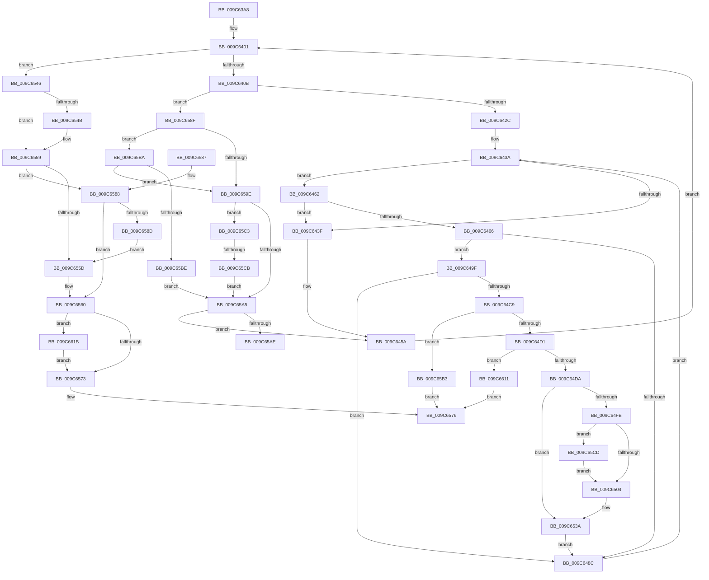

# SepAdjustGroups

- RVA: `0x009C63A8`–`0x009C6635` (길이 `653` bytes)
- VA: `0x00000001409C63A8`
- 실행 섹션: `PAGE`
- PDB 이름 있음: `예`; PDB Function 태그: `예`
- unwind 정보 RVA: `0x000A0708`
- 디코드: `175`개 명령, `653/653` bytes 표시
- 미해석 바이트: `0` (있으면 어셈블리에 `.byte`로 보존)

> 이 문서는 커널 이미지의 기계어와 PDB 기호를 분석해 생성했습니다. 4번과 5번은 함수 원형과 자료형을 바이너리 사용 방식에서 추정한 C 해석이며 원본 소스 복구 결과는 아닙니다.

## 1. Dependencies

- 직접 호출 지점: **2**; 고유 호출 대상: **2**
- 직접 호출자로 확인된 함수: **1**
- RIP 상대 이미지 참조: **0**

### Outgoing calls
- `0x009C647B` → [RtlEqualSid](../../text/40/RtlEqualSid_function_00400AD0.md) (function, `0x00400AD0`)
- `0x009C65F5` → [RtlCopySid](../9A/RtlCopySid_function_009A9A50.md) (function, `0x009A9A50`)

### Direct callers
- [NtAdjustGroupsToken](NtAdjustGroupsToken_function_009C6640.md) at `0x009C681A`
- [NtAdjustGroupsToken](NtAdjustGroupsToken_function_009C6640.md) at `0x009C687A`

### Static image references
- 디코드된 RIP-relative 메모리 참조가 없습니다.

## 2. Other-region calls and transfers

- 다른 실행 섹션으로 향하는 call: **1**
  - `0x009C647B` → [RtlEqualSid](../../text/40/RtlEqualSid_function_00400AD0.md) (`PAGE` → `.text`)
- call이 아닌 외부 분기/꼬리 이동: **2**
  - `0x009C65AE` → [sub_00B2F480](../B2/Unknown_function_00B2F480.md) (`tail-transfer`)
  - `0x009C65C5` → [sub_00B2F480](../B2/Unknown_function_00B2F480.md) (`tail-transfer`)

## 3. Assembly (complete function range)

```asm
009C63A8  48 8B C4                        mov rax, rsp
009C63AB  44 89 48 20                     mov dword ptr [rax + 0x20], r9d
009C63AF  44 88 40 18                     mov byte ptr [rax + 0x18], r8b
009C63B3  88 50 10                        mov byte ptr [rax + 0x10], dl
009C63B6  48 89 48 08                     mov qword ptr [rax + 8], rcx
009C63BA  53                              push rbx
009C63BB  55                              push rbp
009C63BC  56                              push rsi
009C63BD  57                              push rdi
009C63BE  41 54                           push r12
009C63C0  41 55                           push r13
009C63C2  41 56                           push r14
009C63C4  41 57                           push r15
009C63C6  48 83 EC 48                     sub rsp, 0x48
009C63CA  48 8B BC 24 D0 00 00 00         mov rdi, qword ptr [rsp + 0xd0]
009C63D2  33 ED                           xor ebp, ebp
009C63D4  4C 8B AC 24 B8 00 00 00         mov r13, qword ptr [rsp + 0xb8]
009C63DC  45 8B E1                        mov r12d, r9d
009C63DF  45 8A D8                        mov r11b, r8b
009C63E2  89 6C 24 20                     mov dword ptr [rsp + 0x20], ebp
009C63E6  44 8A D2                        mov r10b, dl
009C63E9  89 6C 24 28                     mov dword ptr [rsp + 0x28], ebp
009C63ED  8D 5D 01                        lea ebx, [rbp + 1]
009C63F0  89 2F                           mov dword ptr [rdi], ebp
009C63F2  8B D3                           mov edx, ebx
009C63F4  89 5C 24 24                     mov dword ptr [rsp + 0x24], ebx
009C63F8  4C 8B C1                        mov r8, rcx
009C63FB  44 8B FD                        mov r15d, ebp
009C63FE  44 8B CD                        mov r9d, ebp
009C6401  41 3B 50 7C                     cmp edx, dword ptr [r8 + 0x7c]
009C6405  0F 83 3B 01 00 00               jae 0x1409c6546
009C640B  49 8B 80 98 00 00 00            mov rax, qword ptr [r8 + 0x98]
009C6412  44 8B F2                        mov r14d, edx
009C6415  4D 03 F6                        add r14, r14
009C6418  42 0F 10 04 F0                  movups xmm0, xmmword ptr [rax + r14*8]
009C641D  F3 0F 7F 44 24 30               movdqu xmmword ptr [rsp + 0x30], xmm0
009C6423  45 84 DB                        test r11b, r11b
009C6426  0F 85 63 01 00 00               jne 0x1409c658f
009C642C  48 8B 74 24 30                  mov rsi, qword ptr [rsp + 0x30]
009C6431  32 C0                           xor al, al
009C6433  88 84 24 D0 00 00 00            mov byte ptr [rsp + 0xd0], al
009C643A  41 3B EC                        cmp ebp, r12d
009C643D  72 23                           jb 0x1409c6462
009C643F  44 8A 9C 24 A0 00 00 00         mov r11b, byte ptr [rsp + 0xa0]
009C6447  33 ED                           xor ebp, ebp
009C6449  44 8A 94 24 98 00 00 00         mov r10b, byte ptr [rsp + 0x98]
009C6451  44 8B 4C 24 20                  mov r9d, dword ptr [rsp + 0x20]
009C6456  8B 54 24 24                     mov edx, dword ptr [rsp + 0x24]
009C645A  03 D3                           add edx, ebx
009C645C  89 54 24 24                     mov dword ptr [rsp + 0x24], edx
009C6460  EB 9F                           jmp 0x1409c6401
009C6462  84 C0                           test al, al
009C6464  75 D9                           jne 0x1409c643f
009C6466  48 8B 84 24 B0 00 00 00         mov rax, qword ptr [rsp + 0xb0]
009C646E  48 8B CE                        mov rcx, rsi
009C6471  44 8B E5                        mov r12d, ebp
009C6474  4D 03 E4                        add r12, r12
009C6477  4A 8B 14 E0                     mov rdx, qword ptr [rax + r12*8]
009C647B  E8 50 A6 A3 FF                  call 0x140400ad0
009C6480  4C 8B 84 24 90 00 00 00         mov r8, qword ptr [rsp + 0x90]
009C6488  84 C0                           test al, al
009C648A  75 13                           jne 0x1409c649f
009C648C  8A 84 24 D0 00 00 00            mov al, byte ptr [rsp + 0xd0]
009C6493  03 EB                           add ebp, ebx
009C6495  44 8B A4 24 A8 00 00 00         mov r12d, dword ptr [rsp + 0xa8]
009C649D  EB 9B                           jmp 0x1409c643a
009C649F  49 8B 80 98 00 00 00            mov rax, qword ptr [r8 + 0x98]
009C64A6  48 8B 94 24 B0 00 00 00         mov rdx, qword ptr [rsp + 0xb0]
009C64AE  01 5C 24 28                     add dword ptr [rsp + 0x28], ebx
009C64B2  88 9C 24 D0 00 00 00            mov byte ptr [rsp + 0xd0], bl
009C64B9  42 8B 4C F0 08                  mov ecx, dword ptr [rax + r14*8 + 8]
009C64BE  8B C1                           mov eax, ecx
009C64C0  42 33 44 E2 08                  xor eax, dword ptr [rdx + r12*8 + 8]
009C64C5  A8 04                           test al, 4
009C64C7  74 C3                           je 0x1409c648c
009C64C9  84 CB                           test bl, cl
009C64CB  0F 85 E2 00 00 00               jne 0x1409c65b3
009C64D1  F6 C1 10                        test cl, 0x10
009C64D4  0F 85 37 01 00 00               jne 0x1409c6611
009C64DA  48 8B 4C 24 30                  mov rcx, qword ptr [rsp + 0x30]
009C64DF  0F B6 41 01                     movzx eax, byte ptr [rcx + 1]
009C64E3  8D 34 85 0B 00 00 00            lea esi, [rax*4 + 0xb]
009C64EA  83 E6 FC                        and esi, 0xfffffffc
009C64ED  01 74 24 20                     add dword ptr [rsp + 0x20], esi
009C64F1  44 38 BC 24 98 00 00 00         cmp byte ptr [rsp + 0x98], r15b
009C64F9  74 3F                           je 0x1409c653a
009C64FB  4D 85 ED                        test r13, r13
009C64FE  0F 85 C9 00 00 00               jne 0x1409c65cd
009C6504  49 8B 90 98 00 00 00            mov rdx, qword ptr [r8 + 0x98]
009C650B  42 8B 44 F2 08                  mov eax, dword ptr [rdx + r14*8 + 8]
009C6510  8B C8                           mov ecx, eax
009C6512  83 E1 04                        and ecx, 4
009C6515  F7 D1                           not ecx
009C6517  23 C8                           and ecx, eax
009C6519  48 8B 84 24 B0 00 00 00         mov rax, qword ptr [rsp + 0xb0]
009C6521  42 89 4C F2 08                  mov dword ptr [rdx + r14*8 + 8], ecx
009C6526  49 8B 88 98 00 00 00            mov rcx, qword ptr [r8 + 0x98]
009C652D  42 8B 44 E0 08                  mov eax, dword ptr [rax + r12*8 + 8]
009C6532  83 E0 04                        and eax, 4
009C6535  42 09 44 F1 08                  or dword ptr [rcx + r14*8 + 8], eax
009C653A  01 1F                           add dword ptr [rdi], ebx
009C653C  48 8B 74 24 30                  mov rsi, qword ptr [rsp + 0x30]
009C6541  E9 46 FF FF FF                  jmp 0x1409c648c
009C6546  45 84 DB                        test r11b, r11b
009C6549  75 0E                           jne 0x1409c6559
009C654B  44 39 64 24 28                  cmp dword ptr [rsp + 0x28], r12d
009C6550  B8 06 01 00 00                  mov eax, 0x106
009C6555  44 0F 42 F8                     cmovb r15d, eax
009C6559  39 2F                           cmp dword ptr [rdi], ebp
009C655B  77 2B                           ja 0x1409c6588
009C655D  40 8A DD                        mov bl, bpl
009C6560  48 8B 8C 24 D8 00 00 00         mov rcx, qword ptr [rsp + 0xd8]
009C6568  88 19                           mov byte ptr [rcx], bl
009C656A  4D 85 ED                        test r13, r13
009C656D  0F 85 A8 00 00 00               jne 0x1409c661b
009C6573  41 8B C7                        mov eax, r15d
009C6576  48 83 C4 48                     add rsp, 0x48
009C657A  41 5F                           pop r15
009C657C  41 5E                           pop r14
009C657E  41 5D                           pop r13
009C6580  41 5C                           pop r12
009C6582  5F                              pop rdi
009C6583  5E                              pop rsi
009C6584  5D                              pop rbp
009C6585  5B                              pop rbx
009C6586  C3                              ret
009C6587  CC                              int3
009C6588  45 84 D2                        test r10b, r10b
009C658B  75 D3                           jne 0x1409c6560
009C658D  EB CE                           jmp 0x1409c655d
009C658F  42 8B 44 F0 08                  mov eax, dword ptr [rax + r14*8 + 8]
009C6594  8B C8                           mov ecx, eax
009C6596  83 E0 04                        and eax, 4
009C6599  83 E1 02                        and ecx, 2
009C659C  75 1C                           jne 0x1409c65ba
009C659E  40 8A F5                        mov sil, bpl
009C65A1  85 C9                           test ecx, ecx
009C65A3  74 1E                           je 0x1409c65c3
009C65A5  40 84 F6                        test sil, sil
009C65A8  0F 84 AC FE FF FF               je 0x1409c645a
009C65AE  E9 CD 8E 16 00                  jmp 0x140b2f480
009C65B3  B8 5D 00 00 C0                  mov eax, 0xc000005d
009C65B8  EB BC                           jmp 0x1409c6576
009C65BA  85 C0                           test eax, eax
009C65BC  75 E0                           jne 0x1409c659e
009C65BE  40 8A F3                        mov sil, bl
009C65C1  EB E2                           jmp 0x1409c65a5
009C65C3  85 C0                           test eax, eax
009C65C5  0F 85 B5 8E 16 00               jne 0x140b2f480
009C65CB  EB D8                           jmp 0x1409c65a5
009C65CD  8B 07                           mov eax, dword ptr [rdi]
009C65CF  4C 8B C1                        mov r8, rcx
009C65D2  8B 54 24 38                     mov edx, dword ptr [rsp + 0x38]
009C65D6  48 03 C3                        add rax, rbx
009C65D9  48 03 C0                        add rax, rax
009C65DC  8B CE                           mov ecx, esi
009C65DE  41 89 54 C5 00                  mov dword ptr [r13 + rax*8], edx
009C65E3  8B 07                           mov eax, dword ptr [rdi]
009C65E5  48 8B 94 24 C0 00 00 00         mov rdx, qword ptr [rsp + 0xc0]
009C65ED  48 03 C0                        add rax, rax
009C65F0  49 89 54 C5 08                  mov qword ptr [r13 + rax*8 + 8], rdx
009C65F5  E8 56 34 FE FF                  call 0x1409a9a50
009C65FA  4C 8B 84 24 90 00 00 00         mov r8, qword ptr [rsp + 0x90]
009C6602  8B C6                           mov eax, esi
009C6604  48 01 84 24 C0 00 00 00         add qword ptr [rsp + 0xc0], rax
009C660C  E9 F3 FE FF FF                  jmp 0x1409c6504
009C6611  B8 B3 02 00 C0                  mov eax, 0xc00002b3
009C6616  E9 5B FF FF FF                  jmp 0x1409c6576
009C661B  8B 17                           mov edx, dword ptr [rdi]
009C661D  48 8B 8C 24 C8 00 00 00         mov rcx, qword ptr [rsp + 0xc8]
009C6625  C1 E2 04                        shl edx, 4
009C6628  83 C2 08                        add edx, 8
009C662B  41 03 D1                        add edx, r9d
009C662E  89 11                           mov dword ptr [rcx], edx
009C6630  E9 3E FF FF FF                  jmp 0x1409c6573
```

## 4. C-style interpretation (structured pseudocode)

```c
__int64 __fastcall SepAdjustGroups(__int64 a1, unsigned __int8 a2, unsigned __int8 a3, int a4, __int64 a5, __int64 a6, __int64 a7, __int64 a8, unsigned __int8 a9, __int64 a10)
{
    __int64 result;
    __int64 v_r12;
    __int64 v_r14;
    __int64 v_r15;
    __int64 v_rbp;
    __int64 v_rsi;
    __int64 v_rsp;
    unsigned __int64 v_stack_m58;
    unsigned int v_stack_m60;
    unsigned int v_stack_m64;
    unsigned int v_stack_m68;
    unsigned __int8 v_stack_p10;
    unsigned __int8 v_stack_p18;
    unsigned int v_stack_p20;
    unsigned int v_stack_p38;
    unsigned __int8 v_stack_p48;
    unsigned __int64 v_stack_p8;
    unsigned __int64 v_stack_p90;

    *(unsigned int *)(v_rsp + 32) = a4;
    *(unsigned __int8 *)(v_rsp + 24) = a3;
    *(unsigned __int8 *)(v_rsp + 16) = a2;
    *(unsigned __int64 *)(v_rsp + 8) = a1;
    v_rsp = (v_rsp) - (72);
    v_rbp = 0;
    v_stack_m68 = 0;
    v_stack_m60 = 0;
    *(unsigned int *)(a9) = 0;
    v_stack_m64 = (unsigned int)(v_rbp + 1);
loc_009C6401:
    if (((unsigned int)((unsigned int)((unsigned int)(v_rbp + 1)))) >= (*(unsigned int *)(a1 + 124))) goto loc_009C6546;
    v_r14 = ((unsigned int)((unsigned int)((unsigned int)((unsigned int)(v_rbp + 1))))) + ((unsigned int)((unsigned int)((unsigned int)((unsigned int)(v_rbp + 1)))));
    v_stack_m58 = v_xmm0;
    if (a3 != 0) goto loc_009C658F;
    result = 0;
    v_stack_p48 = 0;
loc_009C643A:
    if (0 < ((unsigned int)((unsigned int)(a4)))) goto loc_009C6462;
loc_009C643F:
    v_rbp = 0;
loc_009C645A:
    a2 = (unsigned int)(((unsigned int)(v_stack_m64)) + ((unsigned int)(v_rbp + 1)));
    v_stack_m64 = a2;
    goto loc_009C6401;
loc_009C6462:
    if (0 != 0) goto loc_009C643F;
    v_r12 = (0) + (0);
    result = RtlEqualSid(v_stack_m58, *(unsigned __int64 *)(a5 + v_r12 * 8), a1, (unsigned int)(v_stack_m68));
    if ((unsigned __int8)(result) != 0) goto loc_009C649F;
loc_009C648C:
    v_rbp = (unsigned int)((v_rbp) + ((unsigned int)(v_rbp + 1)));
    goto loc_009C643A;
loc_009C649F:
    v_stack_p48 = (unsigned __int8)(v_rbp + 1);
    result = (unsigned int)(((unsigned int)((unsigned int)((unsigned int)(*(unsigned int *)(*(unsigned __int64 *)(v_stack_p8 + 152) + v_r14 * 8 + 8))))) ^ (*(unsigned int *)(a5 + (unsigned int)(v_stack_p20) * 8 + 8)));
    if ((((unsigned __int8)(result)) & (4)) == 0) goto loc_009C648C;
    if ((((unsigned __int8)(v_rbp + 1)) & ((unsigned __int8)((unsigned int)(*(unsigned int *)(*(unsigned __int64 *)(v_stack_p8 + 152) + v_r14 * 8 + 8))))) != 0) goto loc_009C65B3;
    if ((((unsigned __int8)((unsigned int)(*(unsigned int *)(*(unsigned __int64 *)(v_stack_p8 + 152) + v_r14 * 8 + 8)))) & (16)) != 0) goto loc_009C6611;
    v_rsi = (unsigned int)((*(unsigned __int8 *)(v_stack_m58 + 1) * 4 + 11) & (0xFFFFFFFCULL));
    if (v_stack_p10 == 0) goto loc_009C653A;
    if (a6 != 0) goto loc_009C65CD;
loc_009C6504:
    a1 = (unsigned int)(((unsigned int)((unsigned int)((unsigned int)(*(unsigned int *)(*(unsigned __int64 *)(v_stack_p8 + 152) + v_r14 * 8 + 8))))) & (4));
    a1 = (unsigned int)(~(a1));
    a1 = (unsigned int)((a1) & ((unsigned int)((unsigned int)(*(unsigned int *)(*(unsigned __int64 *)(v_stack_p8 + 152) + v_r14 * 8 + 8)))));
    *(unsigned int *)(*(unsigned __int64 *)(v_stack_p8 + 152) + v_r14 * 8 + 8) = (unsigned int)(a1);
    result = (unsigned int)(((unsigned int)(*(unsigned int *)(a5 + (unsigned int)(v_stack_p20) * 8 + 8))) & (4));
loc_009C653A:
    goto loc_009C648C;
loc_009C6546:
    v_r15 = 0;
    if ((unsigned __int8)(v_stack_p18) == 0) {
        result = 262;
        v_r15 = 0;
        if (v_stack_m60 < ((unsigned int)((unsigned int)(v_stack_p20)))) { v_r15 = (unsigned int)(result); }
    }
    if ((*(unsigned int *)(a9)) > ((unsigned int)(v_rbp))) goto loc_009C6588;
loc_009C655D:
loc_009C6560:
    *(unsigned __int8 *)(a10) = (unsigned __int8)((unsigned __int8)(v_rbp));
    if (a6 != 0) goto loc_009C661B;
loc_009C6573:
loc_009C6576:
    v_rsp = (v_rsp) + (72);
    return (unsigned int)((unsigned int)(v_r15));
loc_009C6588:
    if ((unsigned __int8)(v_stack_p10) != 0) goto loc_009C6560;
    goto loc_009C655D;
loc_009C658F:
    result = (unsigned int)(((unsigned int)(*(unsigned int *)((unsigned int)((unsigned int)(v_r15)) + v_r14 * 8 + 8))) & (4));
    a1 = (unsigned int)(((unsigned int)((unsigned int)((unsigned int)(*(unsigned int *)((unsigned int)((unsigned int)(v_r15)) + v_r14 * 8 + 8))))) & (2));
    if (condition_is_not_equal) goto loc_009C65BA;
loc_009C659E:
    if ((unsigned int)(a1) == 0) goto loc_009C65C3;
loc_009C65A5:
    if ((unsigned __int8)((unsigned __int8)(v_rbp)) == 0) goto loc_009C645A;
loc_009C65B3:
    goto loc_009C6576;
loc_009C65BA:
    if ((unsigned int)((unsigned int)(0xC000005DULL)) != 0) goto loc_009C659E;
    goto loc_009C65A5;
loc_009C65C3:
    goto loc_009C65A5;
loc_009C65CD:
    result = ((unsigned int)(*(unsigned int *)(a9))) + ((unsigned __int8)(v_rbp));
    result = (result) + (result);
    *(unsigned int *)(a6 + result * 8) = (unsigned int)((unsigned int)(v_stack_p38));
    result = ((unsigned int)(*(unsigned int *)(a9))) + ((unsigned int)(*(unsigned int *)(a9)));
    *(unsigned __int64 *)(a6 + result * 8 + 8) = a7;
    result = RtlCopySid((unsigned int)((unsigned int)((unsigned __int8)((unsigned __int8)(v_rbp)))), a7, a1, (unsigned int)(v_stack_m68));
    goto loc_009C6504;
loc_009C6611:
    goto loc_009C6576;
loc_009C661B:
    a2 = (unsigned int)(((unsigned int)(*(unsigned int *)(a9))) << (4));
    a2 = (unsigned int)((a2) + (8));
    a2 = (unsigned int)((a2) + ((unsigned int)((unsigned int)(v_stack_m68))));
    *(unsigned int *)(a8) = a2;
    goto loc_009C6573;
}
```

## 5. (Beta) C Style

```c
int64_t SepAdjustGroups(int64_t Arg1, uint8_t Arg2, uint8_t Arg3, int32_t Arg4, void *Arg5, int64_t Arg6, int64_t Arg7, void *Arg8, void *Arg9, void *Arg10)
{
    uint8_t *arg5 = (uint8_t *)Arg5;
    uint8_t *arg8 = (uint8_t *)Arg8;
    uint8_t *arg9 = (uint8_t *)Arg9;
    uint8_t *arg10 = (uint8_t *)Arg10;

    int64_t result;
    int64_t local_r12;
    int64_t local_r14;
    int64_t local_r15;
    int64_t local_rbp;
    int64_t local_rsi;
    int64_t local_rsp;
    uint64_t v_stack_m58;
    uint32_t v_stack_m60;
    uint32_t v_stack_m64;
    uint32_t v_stack_m68;
    uint8_t v_stack_p10;
    uint8_t v_stack_p18;
    uint32_t v_stack_p20;
    uint32_t v_stack_p38;
    uint8_t v_stack_p48;
    uint64_t v_stack_p8;
    uint64_t v_stack_p90;

    *(uint32_t *)(local_rsp + 0x20) = Arg4;
    *(uint8_t *)(local_rsp + 0x18) = Arg3;
    *(uint8_t *)(local_rsp + 0x10) = Arg2;
    *(uint64_t *)(local_rsp + 0x8) = Arg1;
    local_rsp = (local_rsp) - (72);
    local_rbp = 0;
    v_stack_m68 = 0;
    v_stack_m60 = 0;
    *(uint32_t *)(arg9) = 0;
    v_stack_m64 = (uint32_t)(local_rbp + 1);
loc_009C6401:
    if (((uint32_t)((uint32_t)((uint32_t)(local_rbp + 1)))) >= (*(uint32_t *)(Arg1 + 0x7C))) goto loc_009C6546;
    local_r14 = ((uint32_t)((uint32_t)((uint32_t)((uint32_t)(local_rbp + 1))))) + ((uint32_t)((uint32_t)((uint32_t)((uint32_t)(local_rbp + 1)))));
    v_stack_m58 = v_xmm0;
    if (Arg3 != 0) goto loc_009C658F;
    result = 0;
    v_stack_p48 = 0;
loc_009C643A:
    if (0 < ((uint32_t)((uint32_t)(Arg4)))) goto loc_009C6462;
loc_009C643F:
    local_rbp = 0;
loc_009C645A:
    Arg2 = (uint32_t)(((uint32_t)(v_stack_m64)) + ((uint32_t)(local_rbp + 1)));
    v_stack_m64 = Arg2;
    goto loc_009C6401;
loc_009C6462:
    if (0 != 0) goto loc_009C643F;
    local_r12 = (0) + (0);
    result = RtlEqualSid(v_stack_m58, *(uint64_t *)(arg5 + local_r12 * 8), Arg1, (uint32_t)(v_stack_m68));
    if ((uint8_t)(result) != 0) goto loc_009C649F;
loc_009C648C:
    local_rbp = (uint32_t)((local_rbp) + ((uint32_t)(local_rbp + 1)));
    goto loc_009C643A;
loc_009C649F:
    v_stack_p48 = (uint8_t)(local_rbp + 1);
    result = (uint32_t)(((uint32_t)((uint32_t)((uint32_t)(*(uint32_t *)(*(uint64_t *)(v_stack_p8 + 0x98) + local_r14 * 8 + 0x8))))) ^ (*(uint32_t *)(arg5 + (uint32_t)(v_stack_p20) * 8 + 0x8)));
    if ((((uint8_t)(result)) & (4)) == 0) goto loc_009C648C;
    if ((((uint8_t)(local_rbp + 1)) & ((uint8_t)((uint32_t)(*(uint32_t *)(*(uint64_t *)(v_stack_p8 + 0x98) + local_r14 * 8 + 0x8))))) != 0) goto loc_009C65B3;
    if ((((uint8_t)((uint32_t)(*(uint32_t *)(*(uint64_t *)(v_stack_p8 + 0x98) + local_r14 * 8 + 0x8)))) & (16)) != 0) goto loc_009C6611;
    local_rsi = (uint32_t)((*(uint8_t *)(v_stack_m58 + 0x1) * 4 + 11) & (0xFFFFFFFCULL));
    if (v_stack_p10 == 0) goto loc_009C653A;
    if (Arg6 != 0) goto loc_009C65CD;
loc_009C6504:
    Arg1 = (uint32_t)(((uint32_t)((uint32_t)((uint32_t)(*(uint32_t *)(*(uint64_t *)(v_stack_p8 + 0x98) + local_r14 * 8 + 0x8))))) & (4));
    Arg1 = (uint32_t)(~(Arg1));
    Arg1 = (uint32_t)((Arg1) & ((uint32_t)((uint32_t)(*(uint32_t *)(*(uint64_t *)(v_stack_p8 + 0x98) + local_r14 * 8 + 0x8)))));
    *(uint32_t *)(*(uint64_t *)(v_stack_p8 + 0x98) + local_r14 * 8 + 0x8) = (uint32_t)(Arg1);
    result = (uint32_t)(((uint32_t)(*(uint32_t *)(arg5 + (uint32_t)(v_stack_p20) * 8 + 0x8))) & (4));
loc_009C653A:
    goto loc_009C648C;
loc_009C6546:
    local_r15 = 0;
    if ((uint8_t)(v_stack_p18) == 0) {
        result = 262;
        local_r15 = 0;
        if (v_stack_m60 < ((uint32_t)((uint32_t)(v_stack_p20)))) { local_r15 = (uint32_t)(result); }
    }
    if ((*(uint32_t *)(arg9)) > ((uint32_t)(local_rbp))) goto loc_009C6588;
loc_009C655D:
loc_009C6560:
    *(uint8_t *)(arg10) = (uint8_t)((uint8_t)(local_rbp));
    if (Arg6 != 0) goto loc_009C661B;
loc_009C6573:
loc_009C6576:
    local_rsp = (local_rsp) + (72);
    return (uint32_t)((uint32_t)(local_r15));
loc_009C6588:
    if ((uint8_t)(v_stack_p10) != 0) goto loc_009C6560;
    goto loc_009C655D;
loc_009C658F:
    result = (uint32_t)(((uint32_t)(*(uint32_t *)((uint32_t)((uint32_t)(local_r15)) + local_r14 * 8 + 0x8))) & (4));
    Arg1 = (uint32_t)(((uint32_t)((uint32_t)((uint32_t)(*(uint32_t *)((uint32_t)((uint32_t)(local_r15)) + local_r14 * 8 + 0x8))))) & (2));
    if (condition_is_not_equal) goto loc_009C65BA;
loc_009C659E:
    if ((uint32_t)(Arg1) == 0) goto loc_009C65C3;
loc_009C65A5:
    if ((uint8_t)((uint8_t)(local_rbp)) == 0) goto loc_009C645A;
loc_009C65B3:
    goto loc_009C6576;
loc_009C65BA:
    if ((uint32_t)((uint32_t)(0xC000005DULL)) != 0) goto loc_009C659E;
    goto loc_009C65A5;
loc_009C65C3:
    goto loc_009C65A5;
loc_009C65CD:
    result = ((uint32_t)(*(uint32_t *)(arg9))) + ((uint8_t)(local_rbp));
    result = (result) + (result);
    *(uint32_t *)(Arg6 + result * 8) = (uint32_t)((uint32_t)(v_stack_p38));
    result = ((uint32_t)(*(uint32_t *)(arg9))) + ((uint32_t)(*(uint32_t *)(arg9)));
    *(uint64_t *)(Arg6 + result * 8 + 0x8) = Arg7;
    result = RtlCopySid((uint32_t)((uint32_t)((uint8_t)((uint8_t)(local_rbp)))), Arg7, Arg1, (uint32_t)(v_stack_m68));
    goto loc_009C6504;
loc_009C6611:
    goto loc_009C6576;
loc_009C661B:
    Arg2 = (uint32_t)(((uint32_t)(*(uint32_t *)(arg9))) << (4));
    Arg2 = (uint32_t)((Arg2) + (8));
    Arg2 = (uint32_t)((Arg2) + ((uint32_t)((uint32_t)(v_stack_m68))));
    *(uint32_t *)(arg8) = Arg2;
    goto loc_009C6573;
}
```

### 관측된 메모리 오프셋

구조체 형식이 확인되지 않은 접근은 인자 기준의 오프셋으로만 기록했습니다.

| 기준 인자 | 오프셋 표현 | 폭 (bit) | 접근 |
|---|---:|---:|---|
| `Arg5` | `+ 0x0 + r12*8` | `64` | `R` |
| `Arg5` | `+ 0x8 + r12*8` | `32` | `R` |
| `Arg8` | `+ 0x0` | `32` | `W` |
| `Arg9` | `+ 0x0` | `32` | `R` |
| `Arg9` | `+ 0x0` | `32` | `R/W` |
| `Arg9` | `+ 0x0` | `32` | `W` |
| `Arg10` | `+ 0x0` | `8` | `W` |

## 6. Execution-region graph

[열기: 2D/3D 그래프와 함수 탐색 컨트롤 패널](../../../control-panel.html?section=page&rva=0x009C63A8&view=graph)

- 2D 그래프는 위에서 아래로 흐르고, 3D 그래프는 빈 공간을 드래그해 회전합니다. Shift+드래그는 이동, 휠은 확대·축소, 함수 노드 선택은 대상 보고서 이동입니다.

### Static fallback


