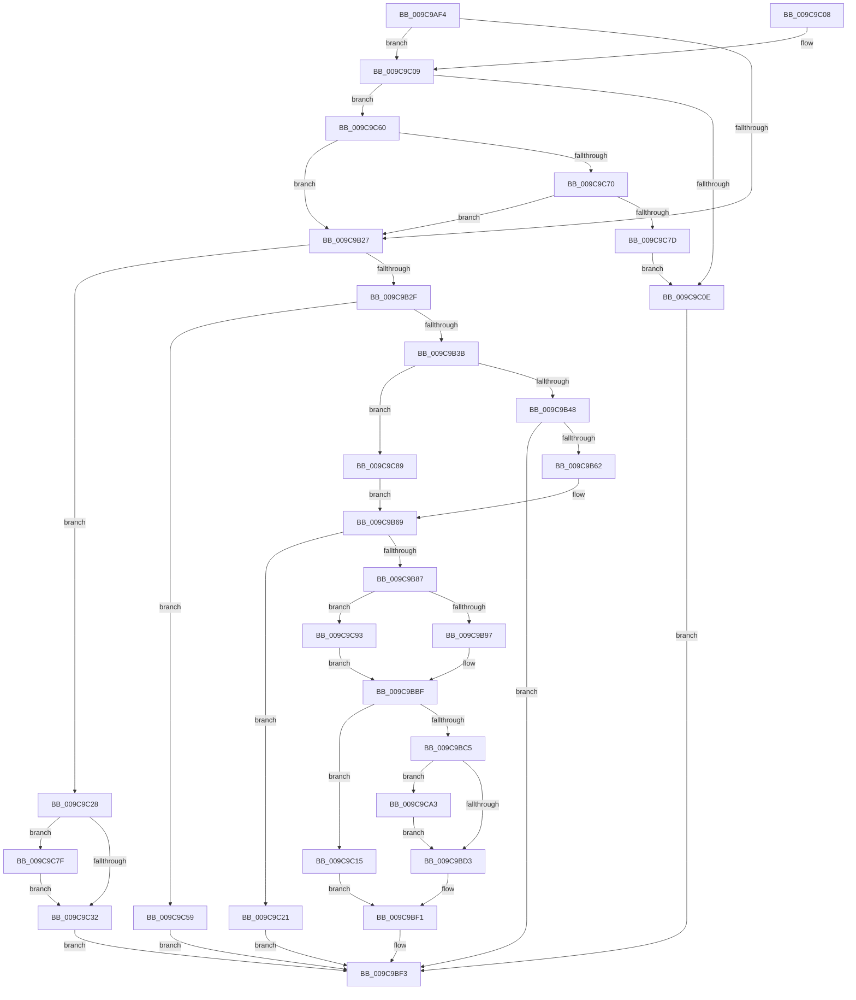

# SepSetTokenCapabilities

- RVA: `0x009C9AF4`–`0x009C9CB0` (길이 `444` bytes)
- VA: `0x00000001409C9AF4`
- 실행 섹션: `PAGE`
- PDB 이름 있음: `예`; PDB Function 태그: `아니요`
- unwind 정보 RVA: `0x000A0A64`
- 디코드: `109`개 명령, `444/444` bytes 표시
- 미해석 바이트: `0` (있으면 어셈블리에 `.byte`로 보존)

> 이 문서는 커널 이미지의 기계어와 PDB 기호를 분석해 생성했습니다. 4번과 5번은 함수 원형과 자료형을 바이너리 사용 방식에서 추정한 C 해석이며 원본 소스 복구 결과는 아닙니다.

## 1. Dependencies

- 직접 호출 지점: **10**; 고유 호출 대상: **9**
- 직접 호출자로 확인된 함수: **5**
- RIP 상대 이미지 참조: **1**

### Outgoing calls
- `0x009C9B55` → [SepLengthSidAndAttributesArray](SepLengthSidAndAttributesArray_function_009C9CB8.md) (function, `0x009C9CB8`)
- `0x009C9B76` → [ExAllocatePool2](../../poolcode/B8/ExAllocatePool2_function_00B820F0.md) (function, `0x00B820F0`)
- `0x009C9BBA` → [SeCaptureSidAndAttributesArray](SeCaptureSidAndAttributesArray_function_009C9D70.md) (function, `0x009C9D70`)
- `0x009C9BEC` → [RtlSidHashInitialize](../../text/41/RtlSidHashInitialize_function_00416EA0.md) (function, `0x00416EA0`)
- `0x009C9C1A` → [ExFreePoolWithTag](../../poolcode/B8/ExFreePoolWithTag_function_00B82870.md) (function, `0x00B82870`)
- `0x009C9C50` → [memset](../../text/6C/memset_function_006C6C40.md) (function, `0x006C6C40`)
- `0x009C9C70` → [RtlIsParentOfChildAppContainer](../70/RtlIsParentOfChildAppContainer_function_007047CC.md) (function, `0x007047CC`)
- `0x009C9C82` → [SepFreeTokenCapabilities](../../text/47/SepFreeTokenCapabilities_function_0047BB70.md) (function, `0x0047BB70`)
- `0x009C9C99` → [SepInsertOrReferenceSharedSidEntries](../7A/SepInsertOrReferenceSharedSidEntries_function_007A32A8.md) (function, `0x007A32A8`)
- `0x009C9CA6` → [SepFreeTokenCapabilities](../../text/47/SepFreeTokenCapabilities_function_0047BB70.md) (function, `0x0047BB70`)

### Direct callers
- [SepGetAnonymousToken](../../text/30/SepGetAnonymousToken_function_00301830.md) at `0x0030190E`
- [SepCreateAppContainerToken](../../text/4F/SepCreateAppContainerToken_function_004F43AC.md) at `0x004F4ACC`
- [SepDuplicateToken](../8B/SepDuplicateToken_function_008B87EC.md) at `0x008B8E10`
- [SepFilterToken](SepFilterToken_function_009C6B80.md) at `0x009C7587`
- [NtCreateLowBoxToken](../AB/NtCreateLowBoxToken_function_00AB9880.md) at `0x00ABA15D`

### Static image references
- `0x009C9B3B` → RVA `0x00E67BF1` (`.data`; read)

## 2. Other-region calls and transfers

- 다른 실행 섹션으로 향하는 call: **6**
  - `0x009C9B76` → [ExAllocatePool2](../../poolcode/B8/ExAllocatePool2_function_00B820F0.md) (`PAGE` → `POOLCODE`)
  - `0x009C9BEC` → [RtlSidHashInitialize](../../text/41/RtlSidHashInitialize_function_00416EA0.md) (`PAGE` → `.text`)
  - `0x009C9C1A` → [ExFreePoolWithTag](../../poolcode/B8/ExFreePoolWithTag_function_00B82870.md) (`PAGE` → `POOLCODE`)
  - `0x009C9C50` → [memset](../../text/6C/memset_function_006C6C40.md) (`PAGE` → `.text`)
  - `0x009C9C82` → [SepFreeTokenCapabilities](../../text/47/SepFreeTokenCapabilities_function_0047BB70.md) (`PAGE` → `.text`)
  - `0x009C9CA6` → [SepFreeTokenCapabilities](../../text/47/SepFreeTokenCapabilities_function_0047BB70.md) (`PAGE` → `.text`)
- 별도 외부 분기/꼬리 이동을 확인하지 못했습니다.

## 3. Assembly (complete function range)

```asm
009C9AF4  48 8B C4                        mov rax, rsp
009C9AF7  48 89 58 10                     mov qword ptr [rax + 0x10], rbx
009C9AFB  48 89 68 18                     mov qword ptr [rax + 0x18], rbp
009C9AFF  56                              push rsi
009C9B00  57                              push rdi
009C9B01  41 56                           push r14
009C9B03  48 83 EC 60                     sub rsp, 0x60
009C9B07  83 60 08 00                     and dword ptr [rax + 8], 0
009C9B0B  41 8B F9                        mov edi, r9d
009C9B0E  48 83 60 D8 00                  and qword ptr [rax - 0x28], 0
009C9B13  4D 8B F0                        mov r14, r8
009C9B16  48 83 B9 18 03 00 00 00         cmp qword ptr [rcx + 0x318], 0
009C9B1E  48 8B D9                        mov rbx, rcx
009C9B21  0F 85 E2 00 00 00               jne 0x1409c9c09
009C9B27  85 FF                           test edi, edi
009C9B29  0F 84 F9 00 00 00               je 0x1409c9c28
009C9B2F  81 FF 00 10 00 00               cmp edi, 0x1000
009C9B35  0F 87 1E 01 00 00               ja 0x1409c9c59
009C9B3B  80 3D AF E0 49 00 00            cmp byte ptr [rip + 0x49e0af], 0
009C9B42  0F 85 41 01 00 00               jne 0x1409c9c89
009C9B48  4C 8D 84 24 80 00 00 00         lea r8, [rsp + 0x80]
009C9B50  8B D7                           mov edx, edi
009C9B52  49 8B CE                        mov rcx, r14
009C9B55  E8 5E 01 00 00                  call 0x1409c9cb8
009C9B5A  85 C0                           test eax, eax
009C9B5C  0F 88 91 00 00 00               js 0x1409c9bf3
009C9B62  8B AC 24 80 00 00 00            mov ebp, dword ptr [rsp + 0x80]
009C9B69  8B D5                           mov edx, ebp
009C9B6B  B9 00 01 00 00                  mov ecx, 0x100
009C9B70  41 B8 53 65 53 73               mov r8d, 0x73536553
009C9B76  E8 75 85 1B 00                  call 0x140b820f0
009C9B7B  48 8B F0                        mov rsi, rax
009C9B7E  48 85 C0                        test rax, rax
009C9B81  0F 84 9A 00 00 00               je 0x1409c9c21
009C9B87  80 3D 63 E0 49 00 00            cmp byte ptr [rip + 0x49e063], 0
009C9B8E  49 8B CE                        mov rcx, r14
009C9B91  0F 85 FC 00 00 00               jne 0x1409c9c93
009C9B97  48 8D 84 24 80 00 00 00         lea rax, [rsp + 0x80]
009C9B9F  4C 8B CE                        mov r9, rsi
009C9BA2  48 89 44 24 40                  mov qword ptr [rsp + 0x40], rax
009C9BA7  45 33 C0                        xor r8d, r8d
009C9BAA  48 8D 44 24 50                  lea rax, [rsp + 0x50]
009C9BAF  8B D7                           mov edx, edi
009C9BB1  48 89 44 24 38                  mov qword ptr [rsp + 0x38], rax
009C9BB6  89 6C 24 20                     mov dword ptr [rsp + 0x20], ebp
009C9BBA  E8 B1 01 00 00                  call 0x1409c9d70
009C9BBF  8B E8                           mov ebp, eax
009C9BC1  85 C0                           test eax, eax
009C9BC3  78 50                           js 0x1409c9c15
009C9BC5  48 83 BB 18 03 00 00 00         cmp qword ptr [rbx + 0x318], 0
009C9BCD  0F 85 D0 00 00 00               jne 0x1409c9ca3
009C9BD3  4C 8D 83 28 03 00 00            lea r8, [rbx + 0x328]
009C9BDA  48 89 B3 18 03 00 00            mov qword ptr [rbx + 0x318], rsi
009C9BE1  8B D7                           mov edx, edi
009C9BE3  89 BB 20 03 00 00               mov dword ptr [rbx + 0x320], edi
009C9BE9  48 8B CE                        mov rcx, rsi
009C9BEC  E8 AF D2 A4 FF                  call 0x140416ea0
009C9BF1  8B C5                           mov eax, ebp
009C9BF3  4C 8D 5C 24 60                  lea r11, [rsp + 0x60]
009C9BF8  49 8B 5B 28                     mov rbx, qword ptr [r11 + 0x28]
009C9BFC  49 8B 6B 30                     mov rbp, qword ptr [r11 + 0x30]
009C9C00  49 8B E3                        mov rsp, r11
009C9C03  41 5E                           pop r14
009C9C05  5F                              pop rdi
009C9C06  5E                              pop rsi
009C9C07  C3                              ret
009C9C08  CC                              int3
009C9C09  48 85 D2                        test rdx, rdx
009C9C0C  75 52                           jne 0x1409c9c60
009C9C0E  B8 22 00 00 C0                  mov eax, 0xc0000022
009C9C13  EB DE                           jmp 0x1409c9bf3
009C9C15  33 D2                           xor edx, edx
009C9C17  48 8B CE                        mov rcx, rsi
009C9C1A  E8 51 8C 1B 00                  call 0x140b82870
009C9C1F  EB D0                           jmp 0x1409c9bf1
009C9C21  B8 9A 00 00 C0                  mov eax, 0xc000009a
009C9C26  EB CB                           jmp 0x1409c9bf3
009C9C28  48 83 BB 18 03 00 00 00         cmp qword ptr [rbx + 0x318], 0
009C9C30  75 4D                           jne 0x1409c9c7f
009C9C32  48 83 A3 18 03 00 00 00         and qword ptr [rbx + 0x318], 0
009C9C3A  48 8D 8B 28 03 00 00            lea rcx, [rbx + 0x328]
009C9C41  83 A3 20 03 00 00 00            and dword ptr [rbx + 0x320], 0
009C9C48  33 D2                           xor edx, edx
009C9C4A  41 B8 10 01 00 00               mov r8d, 0x110
009C9C50  E8 EB CF CF FF                  call 0x1406c6c40
009C9C55  33 C0                           xor eax, eax
009C9C57  EB 9A                           jmp 0x1409c9bf3
009C9C59  B8 0D 00 00 C0                  mov eax, 0xc000000d
009C9C5E  EB 93                           jmp 0x1409c9bf3
009C9C60  48 8B 89 10 03 00 00            mov rcx, qword ptr [rcx + 0x310]
009C9C67  48 85 C9                        test rcx, rcx
009C9C6A  0F 84 B7 FE FF FF               je 0x1409c9b27
009C9C70  E8 57 AB D3 FF                  call 0x1407047cc
009C9C75  84 C0                           test al, al
009C9C77  0F 85 AA FE FF FF               jne 0x1409c9b27
009C9C7D  EB 8F                           jmp 0x1409c9c0e
009C9C7F  48 8B CB                        mov rcx, rbx
009C9C82  E8 E9 1E AB FF                  call 0x14047bb70
009C9C87  EB A9                           jmp 0x1409c9c32
009C9C89  8B EF                           mov ebp, edi
009C9C8B  C1 E5 05                        shl ebp, 5
009C9C8E  E9 D6 FE FF FF                  jmp 0x1409c9b69
009C9C93  44 8B C7                        mov r8d, edi
009C9C96  48 8B D6                        mov rdx, rsi
009C9C99  E8 0A 96 DD FF                  call 0x1407a32a8
009C9C9E  E9 1C FF FF FF                  jmp 0x1409c9bbf
009C9CA3  48 8B CB                        mov rcx, rbx
009C9CA6  E8 C5 1E AB FF                  call 0x14047bb70
009C9CAB  E9 23 FF FF FF                  jmp 0x1409c9bd3
```

## 4. C-style interpretation (structured pseudocode)

```c
__int64 __fastcall SepSetTokenCapabilities(__int64 a1, __int64 a2, __int64 a3, int a4)
{
    __int64 result;
    __int64 v_rbp;
    __int64 v_rsp;
    unsigned __int64 v_stack_m18;
    unsigned __int64 v_stack_m28;
    unsigned __int64 v_stack_m38;
    unsigned __int64 v_stack_m40;
    unsigned int v_stack_m58;
    unsigned __int64 v_stack_p8;

    *(unsigned __int64 *)(v_rsp + 16) = v_rbx;
    *(unsigned __int64 *)(v_rsp + 24) = v_rbp;
    v_rsp = (v_rsp) - (96);
    if ((*(unsigned __int64 *)(a1 + 792)) != 0) goto loc_009C9C09;
loc_009C9B27:
    if ((unsigned int)((unsigned int)(a4)) == 0) goto loc_009C9C28;
    if (((unsigned int)((unsigned int)(a4))) > 0x1000ULL) goto loc_009C9C59;
    if ((*(unsigned __int8 *)(v_rip + 4841647)) != 0) goto loc_009C9C89;
    result = SepLengthSidAndAttributesArray(a3, (unsigned int)((unsigned int)((unsigned int)(a4))), v_stack_p8, a4);
    if (sign_flag) goto loc_009C9BF3;
loc_009C9B69:
    result = ExAllocatePool2(256, (unsigned int)((unsigned int)((unsigned int)(v_stack_p8))), (unsigned int)(0x73536553ULL), a4);
    if (result == 0) goto loc_009C9C21;
    if ((*(unsigned __int8 *)(v_rip + 4841571)) != 0) goto loc_009C9C93;
    v_stack_m38 = v_stack_p8;
    a3 = 0;
    v_stack_m40 = v_stack_m28;
    v_stack_m58 = (unsigned int)((unsigned int)(v_stack_p8));
    result = SeCaptureSidAndAttributesArray(a3, (unsigned int)((unsigned int)((unsigned int)(a4))), a3, result);
loc_009C9BBF:
    if (sign_flag) goto loc_009C9C15;
    if ((*(unsigned __int64 *)(a1 + 792)) != 0) goto loc_009C9CA3;
loc_009C9BD3:
    *(unsigned __int64 *)(a1 + 792) = result;
    *(unsigned int *)(a1 + 800) = (unsigned int)((unsigned int)(a4));
    result = RtlSidHashInitialize(result, (unsigned int)((unsigned int)((unsigned int)(a4))), a1 + 808, result);
loc_009C9BF1:
loc_009C9BF3:
    return (unsigned int)((unsigned int)((unsigned int)((unsigned int)(result))));
loc_009C9C09:
    if ((unsigned int)((unsigned int)((unsigned int)(a4))) != 0) goto loc_009C9C60;
loc_009C9C0E:
    goto loc_009C9BF3;
loc_009C9C15:
    a2 = 0;
    result = ExFreePoolWithTag(result, a2, a1 + 808, result);
    goto loc_009C9BF1;
loc_009C9C21:
    goto loc_009C9BF3;
loc_009C9C28:
    if ((*(unsigned __int64 *)(*(unsigned __int64 *)(v_stack_m18 + 40) + 792)) != 0) goto loc_009C9C7F;
loc_009C9C32:
    a2 = 0;
    result = memset(*(unsigned __int64 *)(v_stack_m18 + 40) + 808, a2, 272, result);
    result = 0;
    goto loc_009C9BF3;
loc_009C9C59:
    goto loc_009C9BF3;
loc_009C9C60:
    if (*(unsigned __int64 *)(*(unsigned __int64 *)(v_stack_m18 + 40) + 808 + 784) == 0) goto loc_009C9B27;
    result = RtlIsParentOfChildAppContainer(*(unsigned __int64 *)(*(unsigned __int64 *)(v_stack_m18 + 40) + 808 + 784), a2, 272, result);
    if ((unsigned __int8)(result) != 0) goto loc_009C9B27;
    goto loc_009C9C0E;
loc_009C9C7F:
    result = SepFreeTokenCapabilities(*(unsigned __int64 *)(v_stack_m18 + 40), a2, 272, result);
    goto loc_009C9C32;
loc_009C9C89:
    v_rbp = (unsigned int)(((unsigned int)((unsigned int)((unsigned int)(a4)))) << (5));
    goto loc_009C9B69;
loc_009C9C93:
    result = SepInsertOrReferenceSharedSidEntries(*(unsigned __int64 *)(v_stack_m18 + 40), result, (unsigned int)((unsigned int)((unsigned int)(a4))), result);
    goto loc_009C9BBF;
loc_009C9CA3:
    result = SepFreeTokenCapabilities(*(unsigned __int64 *)(v_stack_m18 + 40), result, (unsigned int)((unsigned int)((unsigned int)(a4))), result);
    goto loc_009C9BD3;
}
```

## 5. (Beta) C Style

```c
int64_t SepSetTokenCapabilities(void *Arg1, int64_t Arg2, int64_t Arg3, int32_t Arg4)
{
    uint8_t *arg1 = (uint8_t *)Arg1;

    int64_t result;
    int64_t local_rbp;
    int64_t local_rsp;
    uint64_t v_stack_m18;
    uint64_t v_stack_m28;
    uint64_t v_stack_m38;
    uint64_t v_stack_m40;
    uint32_t v_stack_m58;
    uint64_t v_stack_p8;

    *(uint64_t *)(local_rsp + 0x10) = local_rbx;
    *(uint64_t *)(local_rsp + 0x18) = local_rbp;
    local_rsp = (local_rsp) - (96);
    if ((*(uint64_t *)(arg1 + 0x318)) != 0) goto loc_009C9C09;
loc_009C9B27:
    if ((uint32_t)((uint32_t)(Arg4)) == 0) goto loc_009C9C28;
    if (((uint32_t)((uint32_t)(Arg4))) > 0x1000ULL) goto loc_009C9C59;
    if ((*(uint8_t *)(v_rip + 0x49E0AF)) != 0) goto loc_009C9C89;
    result = SepLengthSidAndAttributesArray(Arg3, (uint32_t)((uint32_t)((uint32_t)(Arg4))), v_stack_p8, Arg4);
    if (sign_flag) goto loc_009C9BF3;
loc_009C9B69:
    result = ExAllocatePool2(256, (uint32_t)((uint32_t)((uint32_t)(v_stack_p8))), (uint32_t)(0x73536553ULL), Arg4);
    if (result == 0) goto loc_009C9C21;
    if ((*(uint8_t *)(v_rip + 0x49E063)) != 0) goto loc_009C9C93;
    v_stack_m38 = v_stack_p8;
    Arg3 = 0;
    v_stack_m40 = v_stack_m28;
    v_stack_m58 = (uint32_t)((uint32_t)(v_stack_p8));
    result = SeCaptureSidAndAttributesArray(Arg3, (uint32_t)((uint32_t)((uint32_t)(Arg4))), Arg3, result);
loc_009C9BBF:
    if (sign_flag) goto loc_009C9C15;
    if ((*(uint64_t *)(arg1 + 0x318)) != 0) goto loc_009C9CA3;
loc_009C9BD3:
    *(uint64_t *)(arg1 + 0x318) = result;
    *(uint32_t *)(arg1 + 0x320) = (uint32_t)((uint32_t)(Arg4));
    result = RtlSidHashInitialize(result, (uint32_t)((uint32_t)((uint32_t)(Arg4))), Arg1 + 808, result);
loc_009C9BF1:
loc_009C9BF3:
    return (uint32_t)((uint32_t)((uint32_t)((uint32_t)(result))));
loc_009C9C09:
    if ((uint32_t)((uint32_t)((uint32_t)(Arg4))) != 0) goto loc_009C9C60;
loc_009C9C0E:
    goto loc_009C9BF3;
loc_009C9C15:
    Arg2 = 0;
    result = ExFreePoolWithTag(result, Arg2, Arg1 + 808, result);
    goto loc_009C9BF1;
loc_009C9C21:
    goto loc_009C9BF3;
loc_009C9C28:
    if ((*(uint64_t *)(*(uint64_t *)(v_stack_m18 + 0x28) + 0x318)) != 0) goto loc_009C9C7F;
loc_009C9C32:
    Arg2 = 0;
    result = memset(*(uint64_t *)(v_stack_m18 + 0x28) + 808, Arg2, 272, result);
    result = 0;
    goto loc_009C9BF3;
loc_009C9C59:
    goto loc_009C9BF3;
loc_009C9C60:
    if (*(uint64_t *)(*(uint64_t *)(v_stack_m18 + 0x28) + 0x328 + 0x310) == 0) goto loc_009C9B27;
    result = RtlIsParentOfChildAppContainer(*(uint64_t *)(*(uint64_t *)(v_stack_m18 + 0x28) + 0x328 + 0x310), Arg2, 272, result);
    if ((uint8_t)(result) != 0) goto loc_009C9B27;
    goto loc_009C9C0E;
loc_009C9C7F:
    result = SepFreeTokenCapabilities(*(uint64_t *)(v_stack_m18 + 0x28), Arg2, 272, result);
    goto loc_009C9C32;
loc_009C9C89:
    local_rbp = (uint32_t)(((uint32_t)((uint32_t)((uint32_t)(Arg4)))) << (5));
    goto loc_009C9B69;
loc_009C9C93:
    result = SepInsertOrReferenceSharedSidEntries(*(uint64_t *)(v_stack_m18 + 0x28), result, (uint32_t)((uint32_t)((uint32_t)(Arg4))), result);
    goto loc_009C9BBF;
loc_009C9CA3:
    result = SepFreeTokenCapabilities(*(uint64_t *)(v_stack_m18 + 0x28), result, (uint32_t)((uint32_t)((uint32_t)(Arg4))), result);
    goto loc_009C9BD3;
}
```

### 관측된 메모리 오프셋

구조체 형식이 확인되지 않은 접근은 인자 기준의 오프셋으로만 기록했습니다.

| 기준 인자 | 오프셋 표현 | 폭 (bit) | 접근 |
|---|---:|---:|---|
| `Arg1` | `+ 0x310` | `64` | `R` |
| `Arg1` | `+ 0x318` | `64` | `R` |
| `Arg1` | `+ 0x318` | `64` | `R/W` |
| `Arg1` | `+ 0x318` | `64` | `W` |
| `Arg1` | `+ 0x320` | `32` | `R/W` |
| `Arg1` | `+ 0x320` | `32` | `W` |
| `Arg1` | `+ 0x328` | `64` | `R` |

## 6. Execution-region graph

[열기: 2D/3D 그래프와 함수 탐색 컨트롤 패널](../../../control-panel.html?section=page&rva=0x009C9AF4&view=graph)

- 2D 그래프는 위에서 아래로 흐르고, 3D 그래프는 빈 공간을 드래그해 회전합니다. Shift+드래그는 이동, 휠은 확대·축소, 함수 노드 선택은 대상 보고서 이동입니다.

### Static fallback


