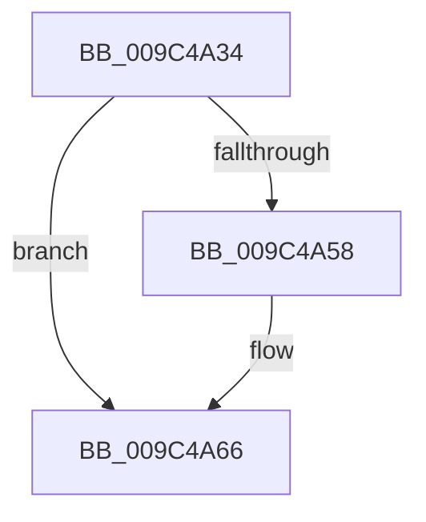

# sub_009C4A34

- RVA: `0x009C4A34`–`0x009C4A70` (길이 `60` bytes)
- VA: `0x00000001409C4A34`
- 실행 섹션: `PAGE`
- PDB 이름 있음: `아니요`; PDB Function 태그: `아니요`
- unwind 정보 RVA: `0x0009FCE4`
- 디코드: `16`개 명령, `60/60` bytes 표시
- 미해석 바이트: `0` (있으면 어셈블리에 `.byte`로 보존)

> 이 문서는 커널 이미지의 기계어와 PDB 기호를 분석해 생성했습니다. 4번과 5번은 함수 원형과 자료형을 바이너리 사용 방식에서 추정한 C 해석이며 원본 소스 복구 결과는 아닙니다.

## 1. Dependencies

- 직접 호출 지점: **2**; 고유 호출 대상: **2**
- 직접 호출자로 확인된 함수: **0**
- RIP 상대 이미지 참조: **0**

### Outgoing calls
- `0x009C4A48` → [KeAbPreAcquire](../../text/21/KeAbPreAcquire_function_00210230.md) (function, `0x00210230`)
- `0x009C4A61` → [ExfAcquirePushLockExclusiveEx](../../text/20/ExfAcquirePushLockExclusiveEx_function_0020FC90.md) (function, `0x0020FC90`)

### Direct callers
- 이 함수 시작 RVA로 연결되는 직접 call은 확인되지 않았습니다. 간접 호출은 완전히 역산할 수 없습니다.

### Static image references
- 디코드된 RIP-relative 메모리 참조가 없습니다.

## 2. Other-region calls and transfers

- 다른 실행 섹션으로 향하는 call: **2**
  - `0x009C4A48` → [KeAbPreAcquire](../../text/21/KeAbPreAcquire_function_00210230.md) (`PAGE` → `.text`)
  - `0x009C4A61` → [ExfAcquirePushLockExclusiveEx](../../text/20/ExfAcquirePushLockExclusiveEx_function_0020FC90.md) (`PAGE` → `.text`)
- call이 아닌 외부 분기/꼬리 이동: **1**
  - `0x009C4A6E` → [sub_009C4A70 + 0x4](Unknown_function_009C4A70.md) (`tail-transfer`)

## 3. Assembly (complete function range)

```asm
009C4A34  48 89 7C 24 20                  mov qword ptr [rsp + 0x20], rdi
009C4A39  48 8D 79 08                     lea rdi, [rcx + 8]
009C4A3D  48 8B CF                        mov rcx, rdi
009C4A40  66 FF 88 E4 01 00 00            dec word ptr [rax + 0x1e4]
009C4A47  90                              nop
009C4A48  E8 E3 B7 84 FF                  call 0x140210230
009C4A4D  F0 48 0F BA 2F 00               lock bts qword ptr [rdi], 0
009C4A53  48 8B D8                        mov rbx, rax
009C4A56  73 0E                           jae 0x1409c4a66
009C4A58  4C 8B C7                        mov r8, rdi
009C4A5B  48 8B D0                        mov rdx, rax
009C4A5E  48 8B CF                        mov rcx, rdi
009C4A61  E8 2A B2 84 FF                  call 0x14020fc90
009C4A66  48 8B 7C 24 20                  mov rdi, qword ptr [rsp + 0x20]
009C4A6B  48 85 DB                        test rbx, rbx
009C4A6E  74 04                           je 0x1409c4a74
```

## 4. C-style interpretation (structured pseudocode)

```c
__int64 __fastcall sub_009C4A34(__int64 a1)
{
    __int64 result;
    unsigned __int64 v_stack_p20;

    v_stack_p20 = v_rdi;
    result = KeAbPreAcquire(a1 + 8, a2, a3, a4);
    if (!(condition_is_above_or_equal)) {
        a3 = a1 + 8;
        a2 = result;
        a1 = a1 + 8;
        result = ExfAcquirePushLockExclusiveEx(a1, a2, a3, a4);
    }
}
```

## 5. (Beta) C Style

```c
int64_t sub_009C4A34(void *Arg1)
{
    uint8_t *arg1 = (uint8_t *)Arg1;

    int64_t result;
    uint64_t v_stack_p20;

    v_stack_p20 = local_rdi;
    result = KeAbPreAcquire(Arg1 + 8, a2, a3, a4);
    if (!(condition_is_above_or_equal)) {
        a3 = Arg1 + 8;
        a2 = result;
        Arg1 = Arg1 + 8;
        result = ExfAcquirePushLockExclusiveEx(Arg1, a2, a3, a4);
    }
}
```

### 관측된 메모리 오프셋

구조체 형식이 확인되지 않은 접근은 인자 기준의 오프셋으로만 기록했습니다.

| 기준 인자 | 오프셋 표현 | 폭 (bit) | 접근 |
|---|---:|---:|---|
| `Arg1` | `+ 0x0` | `64` | `R/W` |
| `Arg1` | `+ 0x8` | `64` | `R` |

## 6. Execution-region graph

[열기: 2D/3D 그래프와 함수 탐색 컨트롤 패널](../../../control-panel.html?section=page&rva=0x009C4A34&view=graph)

- 2D 그래프는 위에서 아래로 흐르고, 3D 그래프는 빈 공간을 드래그해 회전합니다. Shift+드래그는 이동, 휠은 확대·축소, 함수 노드 선택은 대상 보고서 이동입니다.

### Static fallback


