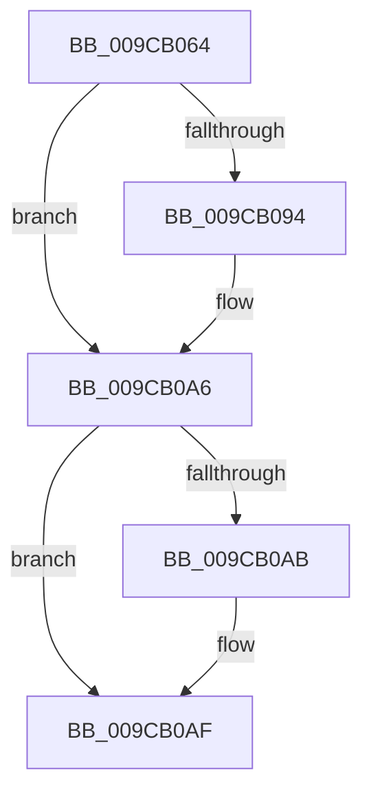

# sub_009CB064

- RVA: `0x009CB064`–`0x009CB0C2` (길이 `94` bytes)
- VA: `0x00000001409CB064`
- 실행 섹션: `PAGE`
- PDB 이름 있음: `아니요`; PDB Function 태그: `아니요`
- unwind 정보 RVA: `0x000A0C30`
- 디코드: `25`개 명령, `94/94` bytes 표시
- 미해석 바이트: `0` (있으면 어셈블리에 `.byte`로 보존)

> 이 문서는 커널 이미지의 기계어와 PDB 기호를 분석해 생성했습니다. 4번과 5번은 함수 원형과 자료형을 바이너리 사용 방식에서 추정한 C 해석이며 원본 소스 복구 결과는 아닙니다.

## 1. Dependencies

- 직접 호출 지점: **2**; 고유 호출 대상: **2**
- 직접 호출자로 확인된 함수: **0**
- RIP 상대 이미지 참조: **0**

### Outgoing calls
- `0x009CB07C` → [KeAbPreAcquire](../../text/21/KeAbPreAcquire_function_00210230.md) (function, `0x00210230`)
- `0x009CB0A1` → [ExfAcquirePushLockSharedEx](../../text/21/ExfAcquirePushLockSharedEx_function_0021044C.md) (function, `0x0021044C`)

### Direct callers
- 이 함수 시작 RVA로 연결되는 직접 call은 확인되지 않았습니다. 간접 호출은 완전히 역산할 수 없습니다.

### Static image references
- 디코드된 RIP-relative 메모리 참조가 없습니다.

## 2. Other-region calls and transfers

- 다른 실행 섹션으로 향하는 call: **2**
  - `0x009CB07C` → [KeAbPreAcquire](../../text/21/KeAbPreAcquire_function_00210230.md) (`PAGE` → `.text`)
  - `0x009CB0A1` → [ExfAcquirePushLockSharedEx](../../text/21/ExfAcquirePushLockSharedEx_function_0021044C.md) (`PAGE` → `.text`)
- call이 아닌 외부 분기/꼬리 이동: **1**
  - `0x009CB0C0` → [sub_009CB11F](Unknown_function_009CB11F.md) (`tail-transfer`)

## 3. Assembly (complete function range)

```asm
009CB064  48 89 6C 24 58                  mov qword ptr [rsp + 0x58], rbp
009CB069  48 8D 4E F0                     lea rcx, [rsi - 0x10]
009CB06D  4C 89 64 24 28                  mov qword ptr [rsp + 0x28], r12
009CB072  45 33 C0                        xor r8d, r8d
009CB075  33 D2                           xor edx, edx
009CB077  4C 89 74 24 20                  mov qword ptr [rsp + 0x20], r14
009CB07C  E8 AF 51 84 FF                  call 0x140210230
009CB081  48 8B E8                        mov rbp, rax
009CB084  41 BC 11 00 00 00               mov r12d, 0x11
009CB08A  33 C0                           xor eax, eax
009CB08C  F0 4C 0F B1 66 F0               lock cmpxchg qword ptr [rsi - 0x10], r12
009CB092  74 12                           je 0x1409cb0a6
009CB094  4C 8D 4E F0                     lea r9, [rsi - 0x10]
009CB098  4C 8B C5                        mov r8, rbp
009CB09B  33 D2                           xor edx, edx
009CB09D  48 8D 4E F0                     lea rcx, [rsi - 0x10]
009CB0A1  E8 A6 53 84 FF                  call 0x14021044c
009CB0A6  48 85 ED                        test rbp, rbp
009CB0A9  74 04                           je 0x1409cb0af
009CB0AB  C6 45 0A 01                     mov byte ptr [rbp + 0xa], 1
009CB0AF  8B 83 A0 01 00 00               mov eax, dword ptr [rbx + 0x1a0]
009CB0B5  48 8B 6C 24 58                  mov rbp, qword ptr [rsp + 0x58]
009CB0BA  83 E0 06                        and eax, 6
009CB0BD  83 F8 04                        cmp eax, 4
009CB0C0  74 5D                           je 0x1409cb11f
```

## 4. C-style interpretation (structured pseudocode)

```c
__int64 __fastcall sub_009CB064(__int64 a1, int a2, int a3, __int64 a4, __int64 a5, __int64 a6, __int64 a7, __int64 a8, __int64 a9, __int64 a10, __int64 a11)
{
    __int64 result;
    unsigned __int64 v_stack_p20;
    unsigned __int64 v_stack_p28;
    unsigned __int64 v_stack_p58;

    v_stack_p58 = v_rbp;
    v_stack_p28 = v_r12;
    a3 = 0;
    a2 = 0;
    v_stack_p20 = v_r14;
    result = KeAbPreAcquire(v_rsi - 16, a2, a3, a4);
    result = 0;
    if (!(condition_is_equal)) {
        a4 = v_rsi - 16;
        a3 = 0;
        a2 = 0;
        a1 = v_rsi - 16;
        result = ExfAcquirePushLockSharedEx(a1, a2, a3, a4);
    }
    if (result != 0) {
        *(unsigned __int8 *)(result + 10) = 1;
    }
    result = (unsigned int)(((unsigned int)(*(unsigned int *)(v_rbx + 416))) & (6));
}
```

## 5. (Beta) C Style

```c
int64_t sub_009CB064(int64_t Arg1, int32_t Arg2, int32_t Arg3, int64_t Arg4, uint64_t Arg5, uint64_t Arg6, uint64_t Arg7, uint64_t Arg8, uint64_t Arg9, uint64_t Arg10, int64_t Arg11)
{
    int64_t result;
    uint64_t v_stack_p20;
    uint64_t v_stack_p28;
    uint64_t v_stack_p58;

    v_stack_p58 = local_rbp;
    v_stack_p28 = local_r12;
    Arg3 = 0;
    Arg2 = 0;
    v_stack_p20 = local_r14;
    result = KeAbPreAcquire(local_rsi - 16, Arg2, Arg3, Arg4);
    result = 0;
    if (!(condition_is_equal)) {
        Arg4 = local_rsi - 16;
        Arg3 = 0;
        Arg2 = 0;
        Arg1 = local_rsi - 16;
        result = ExfAcquirePushLockSharedEx(Arg1, Arg2, Arg3, Arg4);
    }
    if (result != 0) {
        *(uint8_t *)(result + 0xA) = 1;
    }
    result = (uint32_t)(((uint32_t)(*(uint32_t *)(local_rbx + 0x1A0))) & (6));
}
```

## 6. Execution-region graph

[열기: 2D/3D 그래프와 함수 탐색 컨트롤 패널](../../../control-panel.html?section=page&rva=0x009CB064&view=graph)

- 2D 그래프는 위에서 아래로 흐르고, 3D 그래프는 빈 공간을 드래그해 회전합니다. Shift+드래그는 이동, 휠은 확대·축소, 함수 노드 선택은 대상 보고서 이동입니다.

### Static fallback


