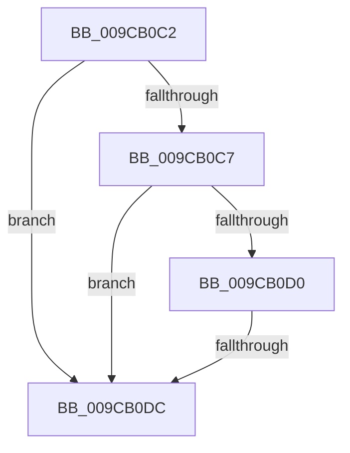

# sub_009CB0C2

- RVA: `0x009CB0C2`–`0x009CB0EC` (길이 `42` bytes)
- VA: `0x00000001409CB0C2`
- 실행 섹션: `PAGE`
- PDB 이름 있음: `아니요`; PDB Function 태그: `아니요`
- unwind 정보 RVA: `0x000A0C4C`
- 디코드: `13`개 명령, `42/42` bytes 표시
- 미해석 바이트: `0` (있으면 어셈블리에 `.byte`로 보존)

> 이 문서는 커널 이미지의 기계어와 PDB 기호를 분석해 생성했습니다. 4번과 5번은 함수 원형과 자료형을 바이너리 사용 방식에서 추정한 C 해석이며 원본 소스 복구 결과는 아닙니다.

## 1. Dependencies

- 직접 호출 지점: **1**; 고유 호출 대상: **1**
- 직접 호출자로 확인된 함수: **0**
- RIP 상대 이미지 참조: **0**

### Outgoing calls
- `0x009CB0D3` → [ObReferenceObjectSafe](../../text/41/ObReferenceObjectSafe_function_0041DAE0.md) (function, `0x0041DAE0`)

### Direct callers
- 이 함수 시작 RVA로 연결되는 직접 call은 확인되지 않았습니다. 간접 호출은 완전히 역산할 수 없습니다.

### Static image references
- 디코드된 RIP-relative 메모리 참조가 없습니다.

## 2. Other-region calls and transfers

- 다른 실행 섹션으로 향하는 call: **1**
  - `0x009CB0D3` → [ObReferenceObjectSafe](../../text/41/ObReferenceObjectSafe_function_0041DAE0.md) (`PAGE` → `.text`)
- call이 아닌 외부 분기/꼬리 이동: **2**
  - `0x009CB0DA` → [sub_009CB11F + 0x6](Unknown_function_009CB11F.md) (`tail-transfer`)
  - `0x009CB0EA` → [sub_009CB0EC + 0x9](Unknown_function_009CB0EC.md) (`tail-transfer`)

## 3. Assembly (complete function range)

```asm
009CB0C2  83 F8 06                        cmp eax, 6
009CB0C5  75 15                           jne 0x1409cb0dc
009CB0C7  48 8B 7E 10                     mov rdi, qword ptr [rsi + 0x10]
009CB0CB  48 85 FF                        test rdi, rdi
009CB0CE  74 0C                           je 0x1409cb0dc
009CB0D0  48 8B CF                        mov rcx, rdi
009CB0D3  E8 08 2A A5 FF                  call 0x14041dae0
009CB0D8  84 C0                           test al, al
009CB0DA  74 49                           je 0x1409cb125
009CB0DC  49 8B C4                        mov rax, r12
009CB0DF  4C 8B 64 24 28                  mov r12, qword ptr [rsp + 0x28]
009CB0E4  F0 4C 0F B1 7E F0               lock cmpxchg qword ptr [rsi - 0x10], r15
009CB0EA  74 09                           je 0x1409cb0f5
```

## 4. C-style interpretation (structured pseudocode)

```c
__int64 __fastcall sub_009CB0C2(__int64 a1, __int64 a2, __int64 a3, __int64 a4, __int64 a5)
{
    __int64 result;

    if (((unsigned int)(result)) != 6) goto loc_009CB0DC;
    if (*(unsigned __int64 *)(v_rsi + 16) == 0) goto loc_009CB0DC;
    result = ObReferenceObjectSafe(*(unsigned __int64 *)(v_rsi + 16), a2, a3, a4);
loc_009CB0DC:
}
```

## 5. (Beta) C Style

```c
int64_t sub_009CB0C2(int64_t Arg1, int64_t Arg2, int64_t Arg3, int64_t Arg4, int64_t Arg5)
{
    int64_t result;

    if (((uint32_t)(result)) != 6) goto loc_009CB0DC;
    if (*(uint64_t *)(local_rsi + 0x10) == 0) goto loc_009CB0DC;
    result = ObReferenceObjectSafe(*(uint64_t *)(local_rsi + 0x10), Arg2, Arg3, Arg4);
loc_009CB0DC:
}
```

## 6. Execution-region graph

[열기: 2D/3D 그래프와 함수 탐색 컨트롤 패널](../../../control-panel.html?section=page&rva=0x009CB0C2&view=graph)

- 2D 그래프는 위에서 아래로 흐르고, 3D 그래프는 빈 공간을 드래그해 회전합니다. Shift+드래그는 이동, 휠은 확대·축소, 함수 노드 선택은 대상 보고서 이동입니다.

### Static fallback


