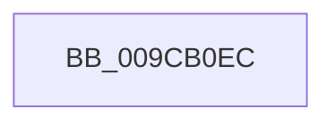

# sub_009CB0EC

- RVA: `0x009CB0EC`–`0x009CB103` (길이 `23` bytes)
- VA: `0x00000001409CB0EC`
- 실행 섹션: `PAGE`
- PDB 이름 있음: `아니요`; PDB Function 태그: `아니요`
- unwind 정보 RVA: `0x000A0C64`
- 디코드: `5`개 명령, `23/23` bytes 표시
- 미해석 바이트: `0` (있으면 어셈블리에 `.byte`로 보존)

> 이 문서는 커널 이미지의 기계어와 PDB 기호를 분석해 생성했습니다. 4번과 5번은 함수 원형과 자료형을 바이너리 사용 방식에서 추정한 C 해석이며 원본 소스 복구 결과는 아닙니다.

## 1. Dependencies

- 직접 호출 지점: **2**; 고유 호출 대상: **2**
- 직접 호출자로 확인된 함수: **0**
- RIP 상대 이미지 참조: **0**

### Outgoing calls
- `0x009CB0F0` → [ExfReleasePushLockShared](../../text/26/ExfReleasePushLockShared_function_00263440.md) (function, `0x00263440`)
- `0x009CB0F9` → [KeAbPostRelease](../../text/2E/KeAbPostRelease_function_002E1600.md) (function, `0x002E1600`)

### Direct callers
- 이 함수 시작 RVA로 연결되는 직접 call은 확인되지 않았습니다. 간접 호출은 완전히 역산할 수 없습니다.

### Static image references
- 디코드된 RIP-relative 메모리 참조가 없습니다.

## 2. Other-region calls and transfers

- 다른 실행 섹션으로 향하는 call: **2**
  - `0x009CB0F0` → [ExfReleasePushLockShared](../../text/26/ExfReleasePushLockShared_function_00263440.md) (`PAGE` → `.text`)
  - `0x009CB0F9` → [KeAbPostRelease](../../text/2E/KeAbPostRelease_function_002E1600.md) (`PAGE` → `.text`)
- 별도 외부 분기/꼬리 이동을 확인하지 못했습니다.

## 3. Assembly (complete function range)

```asm
009CB0EC  48 8D 4E F0                     lea rcx, [rsi - 0x10]
009CB0F0  E8 4B 83 89 FF                  call 0x140263440
009CB0F5  48 8D 4E F0                     lea rcx, [rsi - 0x10]
009CB0F9  E8 02 65 91 FF                  call 0x1402e1600
009CB0FE  4C 8B 74 24 20                  mov r14, qword ptr [rsp + 0x20]
```

## 4. C-style interpretation (structured pseudocode)

```c
__int64 __fastcall sub_009CB0EC(void)
{
    __int64 result;
    unsigned __int64 v_stack_p20;

    result = ExfReleasePushLockShared(v_rsi - 16, a2, a3, a4);
    result = KeAbPostRelease(v_rsi - 16, a2, a3, a4);
    return result;
}
```

## 5. (Beta) C Style

```c
void sub_009CB0EC(void)
{
    int64_t result;
    uint64_t v_stack_p20;

    result = ExfReleasePushLockShared(local_rsi - 16, a2, a3, a4);
    result = KeAbPostRelease(local_rsi - 16, a2, a3, a4);
    return result;
}
```

## 6. Execution-region graph

[열기: 2D/3D 그래프와 함수 탐색 컨트롤 패널](../../../control-panel.html?section=page&rva=0x009CB0EC&view=graph)

- 2D 그래프는 위에서 아래로 흐르고, 3D 그래프는 빈 공간을 드래그해 회전합니다. Shift+드래그는 이동, 휠은 확대·축소, 함수 노드 선택은 대상 보고서 이동입니다.

### Static fallback


