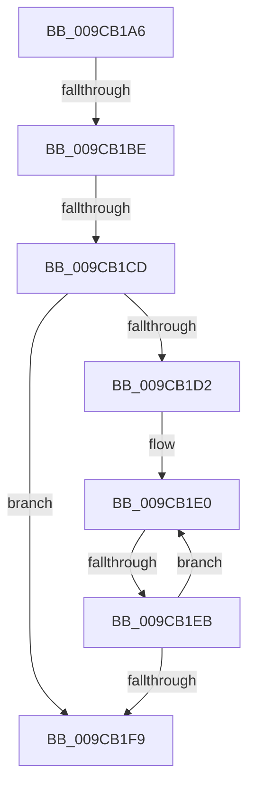

# sub_009CB1A6

- RVA: `0x009CB1A6`–`0x009CB211` (길이 `107` bytes)
- VA: `0x00000001409CB1A6`
- 실행 섹션: `PAGE`
- PDB 이름 있음: `아니요`; PDB Function 태그: `아니요`
- unwind 정보 RVA: `0x000A0CE8`
- 디코드: `30`개 명령, `107/107` bytes 표시
- 미해석 바이트: `0` (있으면 어셈블리에 `.byte`로 보존)

> 이 문서는 커널 이미지의 기계어와 PDB 기호를 분석해 생성했습니다. 4번과 5번은 함수 원형과 자료형을 바이너리 사용 방식에서 추정한 C 해석이며 원본 소스 복구 결과는 아닙니다.

## 1. Dependencies

- 직접 호출 지점: **0**; 고유 호출 대상: **0**
- 직접 호출자로 확인된 함수: **0**
- RIP 상대 이미지 참조: **0**

### Outgoing calls
- 직접 디코드된 call 명령이 없습니다.

### Direct callers
- 이 함수 시작 RVA로 연결되는 직접 call은 확인되지 않았습니다. 간접 호출은 완전히 역산할 수 없습니다.

### Static image references
- 디코드된 RIP-relative 메모리 참조가 없습니다.

## 2. Other-region calls and transfers

- 다른 실행 섹션으로 향하는 call: **0**
- call이 아닌 외부 분기/꼬리 이동: **3**
  - `0x009CB1B8` → [sub_009CB23E](Unknown_function_009CB23E.md) (`tail-transfer`)
  - `0x009CB1C7` → [sub_009CB23E + 0x46](Unknown_function_009CB23E.md) (`tail-transfer`)
  - `0x009CB1E5` → [sub_009CB23E + 0x65](Unknown_function_009CB23E.md) (`tail-transfer`)

## 3. Assembly (complete function range)

```asm
009CB1A6  48 89 5C 24 30                  mov qword ptr [rsp + 0x30], rbx
009CB1AB  48 89 7C 24 38                  mov qword ptr [rsp + 0x38], rdi
009CB1B0  4C 8D 0C 86                     lea r9, [rsi + rax*4]
009CB1B4  41 83 E2 1F                     and r10d, 0x1f
009CB1B8  0F 87 80 00 00 00               ja 0x1409cb23e
009CB1BE  B9 FF FF FF FF                  mov ecx, 0xffffffff
009CB1C3  41 83 FB 20                     cmp r11d, 0x20
009CB1C7  0F 83 B7 00 00 00               jae 0x1409cb284
009CB1CD  45 85 DB                        test r11d, r11d
009CB1D0  74 27                           je 0x1409cb1f9
009CB1D2  41 8B CB                        mov ecx, r11d
009CB1D5  D3 E2                           shl edx, cl
009CB1D7  FF CA                           dec edx
009CB1D9  41 0F 0D 09                     prefetchw byte ptr [r9]
009CB1DD  41 8B 01                        mov eax, dword ptr [r9]
009CB1E0  44 8B D0                        mov r10d, eax
009CB1E3  85 C2                           test edx, eax
009CB1E5  0F 85 B8 00 00 00               jne 0x1409cb2a3
009CB1EB  8B C8                           mov ecx, eax
009CB1ED  0B CA                           or ecx, edx
009CB1EF  F0 41 0F B1 09                  lock cmpxchg dword ptr [r9], ecx
009CB1F4  41 3B C2                        cmp eax, r10d
009CB1F7  75 E7                           jne 0x1409cb1e0
009CB1F9  41 8B C0                        mov eax, r8d
009CB1FC  48 8B 5C 24 30                  mov rbx, qword ptr [rsp + 0x30]
009CB201  48 8B 7C 24 38                  mov rdi, qword ptr [rsp + 0x38]
009CB206  48 8B 6C 24 40                  mov rbp, qword ptr [rsp + 0x40]
009CB20B  48 83 C4 20                     add rsp, 0x20
009CB20F  5E                              pop rsi
009CB210  C3                              ret
```

## 4. C-style interpretation (structured pseudocode)

```c
__int64 __fastcall sub_009CB1A6(__int64 a1, int a2, int a3, __int64 a4, __int64 a5, __int64 a6, __int64 a7, __int64 a8)
{
    __int64 v_r10;
    __int64 v_rsp;
    unsigned __int64 v_stack_p30;
    unsigned __int64 v_stack_p38;

    v_stack_p30 = v_rbx;
    v_stack_p38 = v_rdi;
    v_r10 = (unsigned int)((v_r10) & (31));
    if ((unsigned int)(v_r11) == 0) goto loc_009CB1F9;
    a2 = (unsigned int)((a2) << ((unsigned __int8)((unsigned int)((unsigned int)(v_r11)))));
    a2 = (unsigned int)((a2) - 1);
loc_009CB1E0:
    a1 = (unsigned int)(((unsigned int)((unsigned int)((unsigned int)(*(unsigned int *)(v_rsi + result * 4))))) | (a2));
    if (((unsigned int)((unsigned int)(*(unsigned int *)(v_rsi + result * 4)))) != ((unsigned int)((unsigned int)((unsigned int)((unsigned int)(*(unsigned int *)(v_rsi + result * 4))))))) goto loc_009CB1E0;
loc_009CB1F9:
    v_rsp = (v_rsp) + (32);
    return (unsigned int)(a3);
}
```

## 5. (Beta) C Style

```c
int64_t sub_009CB1A6(int64_t Arg1, int32_t Arg2, int32_t Arg3, int64_t Arg4, uint64_t Arg5, int64_t Arg6, int64_t Arg7, int64_t Arg8)
{
    int64_t local_r10;
    int64_t local_rsp;
    uint64_t v_stack_p30;
    uint64_t v_stack_p38;

    v_stack_p30 = local_rbx;
    v_stack_p38 = local_rdi;
    local_r10 = (uint32_t)((local_r10) & (31));
    if ((uint32_t)(local_r11) == 0) goto loc_009CB1F9;
    Arg2 = (uint32_t)((Arg2) << ((uint8_t)((uint32_t)((uint32_t)(local_r11)))));
    Arg2 = (uint32_t)((Arg2) - 1);
loc_009CB1E0:
    Arg1 = (uint32_t)(((uint32_t)((uint32_t)((uint32_t)(*(uint32_t *)(local_rsi + result * 4))))) | (Arg2));
    if (((uint32_t)((uint32_t)(*(uint32_t *)(local_rsi + result * 4)))) != ((uint32_t)((uint32_t)((uint32_t)((uint32_t)(*(uint32_t *)(local_rsi + result * 4))))))) goto loc_009CB1E0;
loc_009CB1F9:
    local_rsp = (local_rsp) + (32);
    return (uint32_t)(Arg3);
}
```

## 6. Execution-region graph

[열기: 2D/3D 그래프와 함수 탐색 컨트롤 패널](../../../control-panel.html?section=page&rva=0x009CB1A6&view=graph)

- 2D 그래프는 위에서 아래로 흐르고, 3D 그래프는 빈 공간을 드래그해 회전합니다. Shift+드래그는 이동, 휠은 확대·축소, 함수 노드 선택은 대상 보고서 이동입니다.

### Static fallback


