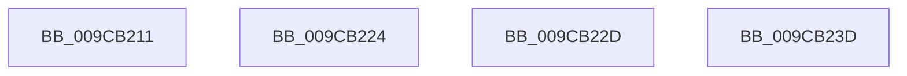

# sub_009CB211

- RVA: `0x009CB211`–`0x009CB23E` (길이 `45` bytes)
- VA: `0x00000001409CB211`
- 실행 섹션: `PAGE`
- PDB 이름 있음: `아니요`; PDB Function 태그: `아니요`
- unwind 정보 RVA: `0x000A0D04`
- 디코드: `14`개 명령, `45/45` bytes 표시
- 미해석 바이트: `0` (있으면 어셈블리에 `.byte`로 보존)

> 이 문서는 커널 이미지의 기계어와 PDB 기호를 분석해 생성했습니다. 4번과 5번은 함수 원형과 자료형을 바이너리 사용 방식에서 추정한 C 해석이며 원본 소스 복구 결과는 아닙니다.

## 1. Dependencies

- 직접 호출 지점: **0**; 고유 호출 대상: **0**
- 직접 호출자로 확인된 함수: **0**
- RIP 상대 이미지 참조: **0**

### Outgoing calls
- 직접 디코드된 call 명령이 없습니다.

### Direct callers
- 이 함수 시작 RVA로 연결되는 직접 call은 확인되지 않았습니다. 간접 호출은 완전히 역산할 수 없습니다.

### Static image references
- 디코드된 RIP-relative 메모리 참조가 없습니다.

## 2. Other-region calls and transfers

- 다른 실행 섹션으로 향하는 call: **0**
- call이 아닌 외부 분기/꼬리 이동: **2**
  - `0x009CB21F` → [AlpcpAllocateFromBitmap + 0x30](AlpcpAllocateFromBitmap_function_009CB130.md) (`tail-transfer`)
  - `0x009CB228` → [AlpcpAllocateFromBitmap + 0x1C](AlpcpAllocateFromBitmap_function_009CB130.md) (`tail-transfer`)

## 3. Assembly (complete function range)

```asm
009CB211  CC                              int3
009CB212  45 33 DB                        xor r11d, r11d
009CB215  D1 E9                           shr ecx, 1
009CB217  FF C0                           inc eax
009CB219  41 B8 FF FF FF FF               mov r8d, 0xffffffff
009CB21F  E9 3C FF FF FF                  jmp 0x1409cb160
009CB224  49 83 C1 04                     add r9, 4
009CB228  E9 1F FF FF FF                  jmp 0x1409cb14c
009CB22D  48 8B 6C 24 40                  mov rbp, qword ptr [rsp + 0x40]
009CB232  B8 FF FF FF FF                  mov eax, 0xffffffff
009CB237  48 83 C4 20                     add rsp, 0x20
009CB23B  5E                              pop rsi
009CB23C  C3                              ret
009CB23D  CC                              int3
```

## 4. C-style interpretation (structured pseudocode)

```c
__int64 __fastcall sub_009CB211(int a1, __int64 a2, __int64 a3, __int64 a4)
{
    __int64 result;
    __int64 v_r11;
    unsigned __int64 v_stack_p40;

    v_r11 = 0;
    a1 = (unsigned int)((a1) >> (1));
    result = (unsigned int)((result) + 1);
}
```

## 5. (Beta) C Style

```c
int64_t sub_009CB211(int32_t Arg1, int64_t Arg2, int64_t Arg3, int64_t Arg4)
{
    int64_t result;
    int64_t local_r11;
    uint64_t v_stack_p40;

    local_r11 = 0;
    Arg1 = (uint32_t)((Arg1) >> (1));
    result = (uint32_t)((result) + 1);
}
```

## 6. Execution-region graph

[열기: 2D/3D 그래프와 함수 탐색 컨트롤 패널](../../../control-panel.html?section=page&rva=0x009CB211&view=graph)

- 2D 그래프는 위에서 아래로 흐르고, 3D 그래프는 빈 공간을 드래그해 회전합니다. Shift+드래그는 이동, 휠은 확대·축소, 함수 노드 선택은 대상 보고서 이동입니다.

### Static fallback


