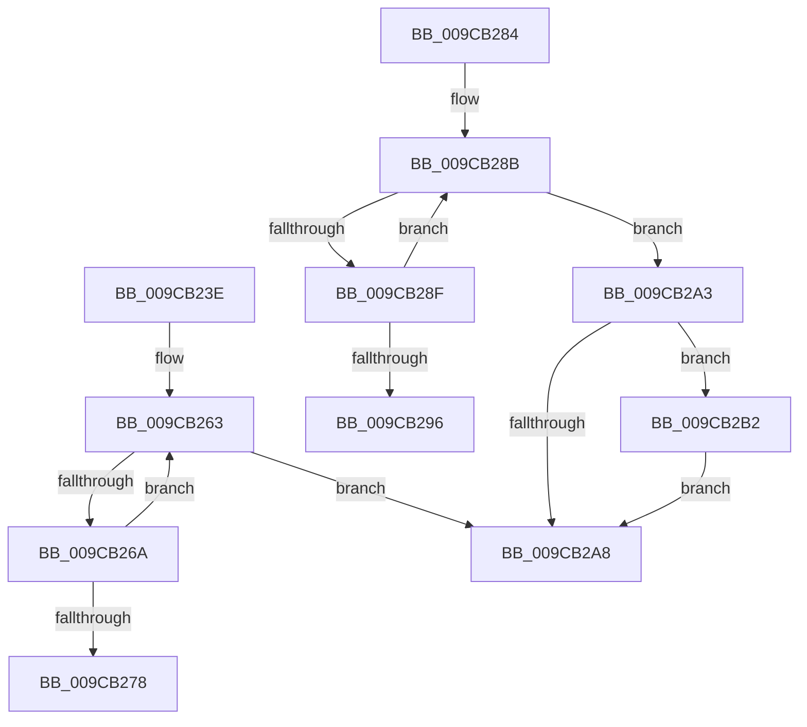

# sub_009CB23E

- RVA: `0x009CB23E`–`0x009CB2BF` (길이 `129` bytes)
- VA: `0x00000001409CB23E`
- 실행 섹션: `PAGE`
- PDB 이름 있음: `아니요`; PDB Function 태그: `아니요`
- unwind 정보 RVA: `0x000A0D18`
- 디코드: `41`개 명령, `129/129` bytes 표시
- 미해석 바이트: `0` (있으면 어셈블리에 `.byte`로 보존)

> 이 문서는 커널 이미지의 기계어와 PDB 기호를 분석해 생성했습니다. 4번과 5번은 함수 원형과 자료형을 바이너리 사용 방식에서 추정한 C 해석이며 원본 소스 복구 결과는 아닙니다.

## 1. Dependencies

- 직접 호출 지점: **1**; 고유 호출 대상: **1**
- 직접 호출자로 확인된 함수: **0**
- RIP 상대 이미지 참조: **0**

### Outgoing calls
- `0x009CB2B8` → [AlpcpFreeBitmap](../A9/AlpcpFreeBitmap_function_00A9B99C.md) (function, `0x00A9B99C`)

### Direct callers
- 이 함수 시작 RVA로 연결되는 직접 call은 확인되지 않았습니다. 간접 호출은 완전히 역산할 수 없습니다.

### Static image references
- 디코드된 RIP-relative 메모리 참조가 없습니다.

## 2. Other-region calls and transfers

- 다른 실행 섹션으로 향하는 call: **0**
- call이 아닌 외부 분기/꼬리 이동: **3**
  - `0x009CB27F` → [sub_009CB1A6 + 0x18](Unknown_function_009CB1A6.md) (`tail-transfer`)
  - `0x009CB29E` → [sub_009CB1A6 + 0x1D](Unknown_function_009CB1A6.md) (`tail-transfer`)
  - `0x009CB2AD` → [sub_009CB1A6 + 0x56](Unknown_function_009CB1A6.md) (`tail-transfer`)

## 3. Assembly (complete function range)

```asm
009CB23E  B8 20 00 00 00                  mov eax, 0x20
009CB243  41 8B FB                        mov edi, r11d
009CB246  41 2B C2                        sub eax, r10d
009CB249  8B DA                           mov ebx, edx
009CB24B  44 3B D8                        cmp r11d, eax
009CB24E  0F 43 F8                        cmovae edi, eax
009CB251  8B CF                           mov ecx, edi
009CB253  D3 E3                           shl ebx, cl
009CB255  41 8B CA                        mov ecx, r10d
009CB258  FF CB                           dec ebx
009CB25A  D3 E3                           shl ebx, cl
009CB25C  41 0F 0D 09                     prefetchw byte ptr [r9]
009CB260  41 8B 01                        mov eax, dword ptr [r9]
009CB263  44 8B D0                        mov r10d, eax
009CB266  85 C3                           test ebx, eax
009CB268  75 3E                           jne 0x1409cb2a8
009CB26A  8B C8                           mov ecx, eax
009CB26C  0B CB                           or ecx, ebx
009CB26E  F0 41 0F B1 09                  lock cmpxchg dword ptr [r9], ecx
009CB273  41 3B C2                        cmp eax, r10d
009CB276  75 EB                           jne 0x1409cb263
009CB278  44 2B DF                        sub r11d, edi
009CB27B  49 83 C1 04                     add r9, 4
009CB27F  E9 3A FF FF FF                  jmp 0x1409cb1be
009CB284  41 0F 0D 09                     prefetchw byte ptr [r9]
009CB288  41 8B 01                        mov eax, dword ptr [r9]
009CB28B  85 C0                           test eax, eax
009CB28D  75 14                           jne 0x1409cb2a3
009CB28F  F0 41 0F B1 09                  lock cmpxchg dword ptr [r9], ecx
009CB294  75 F5                           jne 0x1409cb28b
009CB296  41 83 C3 E0                     add r11d, -0x20
009CB29A  49 83 C1 04                     add r9, 4
009CB29E  E9 20 FF FF FF                  jmp 0x1409cb1c3
009CB2A3  41 2B EB                        sub ebp, r11d
009CB2A6  75 0A                           jne 0x1409cb2b2
009CB2A8  B8 FE FF FF FF                  mov eax, 0xfffffffe
009CB2AD  E9 4A FF FF FF                  jmp 0x1409cb1fc
009CB2B2  44 8B CD                        mov r9d, ebp
009CB2B5  48 8B CE                        mov rcx, rsi
009CB2B8  E8 DF 06 0D 00                  call 0x140a9b99c
009CB2BD  EB E9                           jmp 0x1409cb2a8
```

## 4. C-style interpretation (structured pseudocode)

```c
__int64 __fastcall sub_009CB23E(__int64 a1, int a2, __int64 a3, __int64 a4)
{
    __int64 result;
    __int64 v_r11;
    __int64 v_rbx;
    __int64 v_rdi;

    result = (unsigned int)((32) - ((unsigned int)(v_r10)));
    v_rdi = (unsigned int)((unsigned int)(v_r11));
    if (((unsigned int)(v_r11)) >= ((unsigned int)(result))) { v_rdi = (unsigned int)(result); }
    v_rbx = (unsigned int)(((unsigned int)(a2)) << ((unsigned __int8)((unsigned int)((unsigned int)(v_rdi)))));
    v_rbx = (unsigned int)((v_rbx) - 1);
    v_rbx = (unsigned int)((v_rbx) << ((unsigned __int8)((unsigned int)((unsigned int)(v_r10)))));
loc_009CB263:
    if ((((unsigned int)(v_rbx)) & ((unsigned int)((unsigned int)(*(unsigned int *)(a4))))) != 0) goto loc_009CB2A8;
    a1 = (unsigned int)(((unsigned int)((unsigned int)((unsigned int)(*(unsigned int *)(a4))))) | ((unsigned int)(v_rbx)));
    if (((unsigned int)((unsigned int)(*(unsigned int *)(a4)))) != ((unsigned int)((unsigned int)((unsigned int)((unsigned int)(*(unsigned int *)(a4))))))) goto loc_009CB263;
    v_r11 = (unsigned int)((v_r11) - ((unsigned int)(v_rdi)));
    a4 = (a4) + (4);
loc_009CB2A8:
}
```

## 5. (Beta) C Style

```c
int64_t sub_009CB23E(int64_t Arg1, int32_t Arg2, int64_t Arg3, void *Arg4)
{
    uint8_t *arg4 = (uint8_t *)Arg4;

    int64_t result;
    int64_t local_r11;
    int64_t local_rbx;
    int64_t local_rdi;

    result = (uint32_t)((32) - ((uint32_t)(local_r10)));
    local_rdi = (uint32_t)((uint32_t)(local_r11));
    if (((uint32_t)(local_r11)) >= ((uint32_t)(result))) { local_rdi = (uint32_t)(result); }
    local_rbx = (uint32_t)(((uint32_t)(Arg2)) << ((uint8_t)((uint32_t)((uint32_t)(local_rdi)))));
    local_rbx = (uint32_t)((local_rbx) - 1);
    local_rbx = (uint32_t)((local_rbx) << ((uint8_t)((uint32_t)((uint32_t)(local_r10)))));
loc_009CB263:
    if ((((uint32_t)(local_rbx)) & ((uint32_t)((uint32_t)(*(uint32_t *)(arg4))))) != 0) goto loc_009CB2A8;
    Arg1 = (uint32_t)(((uint32_t)((uint32_t)((uint32_t)(*(uint32_t *)(arg4))))) | ((uint32_t)(local_rbx)));
    if (((uint32_t)((uint32_t)(*(uint32_t *)(arg4)))) != ((uint32_t)((uint32_t)((uint32_t)((uint32_t)(*(uint32_t *)(arg4))))))) goto loc_009CB263;
    local_r11 = (uint32_t)((local_r11) - ((uint32_t)(local_rdi)));
    Arg4 = (Arg4) + (4);
loc_009CB2A8:
}
```

### 관측된 메모리 오프셋

구조체 형식이 확인되지 않은 접근은 인자 기준의 오프셋으로만 기록했습니다.

| 기준 인자 | 오프셋 표현 | 폭 (bit) | 접근 |
|---|---:|---:|---|
| `Arg4` | `+ 0x0` | `8` | `R` |
| `Arg4` | `+ 0x0` | `32` | `R` |

## 6. Execution-region graph

[열기: 2D/3D 그래프와 함수 탐색 컨트롤 패널](../../../control-panel.html?section=page&rva=0x009CB23E&view=graph)

- 2D 그래프는 위에서 아래로 흐르고, 3D 그래프는 빈 공간을 드래그해 회전합니다. Shift+드래그는 이동, 휠은 확대·축소, 함수 노드 선택은 대상 보고서 이동입니다.

### Static fallback


