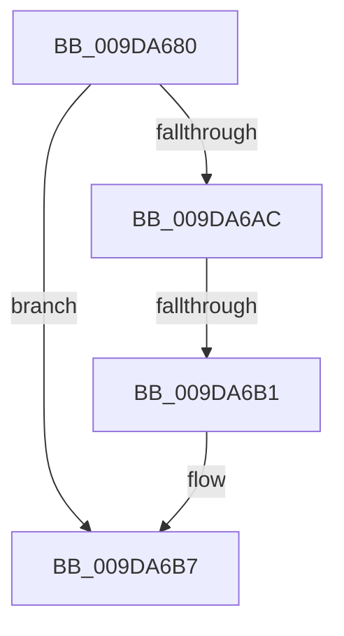

# AlpcpCaptureIdMessage

- RVA: `0x009DA680`–`0x009DA6BE` (길이 `62` bytes)
- VA: `0x00000001409DA680`
- 실행 섹션: `PAGE`
- PDB 이름 있음: `예`; PDB Function 태그: `아니요`
- unwind 정보 RVA: `0x000A3260`
- 디코드: `14`개 명령, `62/62` bytes 표시
- 미해석 바이트: `0` (있으면 어셈블리에 `.byte`로 보존)

> 이 문서는 커널 이미지의 기계어와 PDB 기호를 분석해 생성했습니다. 4번과 5번은 함수 원형과 자료형을 바이너리 사용 방식에서 추정한 C 해석이며 원본 소스 복구 결과는 아닙니다.

## 1. Dependencies

- 직접 호출 지점: **1**; 고유 호출 대상: **1**
- 직접 호출자로 확인된 함수: **1**
- RIP 상대 이미지 참조: **0**

### Outgoing calls
- `0x009DA6B1` → [ExRaiseDatatypeMisalignment](../89/ExRaiseDatatypeMisalignment_function_00899FD0.md) (function, `0x00899FD0`)

### Direct callers
- [NtAlpcImpersonateClientContainerOfPort](../74/NtAlpcImpersonateClientContainerOfPort_function_0074C1B0.md) at `0x0074C217`

### Static image references
- 디코드된 RIP-relative 메모리 참조가 없습니다.

## 2. Other-region calls and transfers

- 다른 실행 섹션으로 향하는 call: **0**
- call이 아닌 외부 분기/꼬리 이동: **1**
  - `0x009DA6AF` → [sub_009DA6CA + 0x34](Unknown_function_009DA6CA.md) (`tail-transfer`)

## 3. Assembly (complete function range)

```asm
009DA680  48 83 EC 28                     sub rsp, 0x28
009DA684  65 48 8B 04 25 88 01 00 00      mov rax, qword ptr gs:[0x188]
009DA68D  4C 8B C9                        mov r9, rcx
009DA690  41 83 E1 03                     and r9d, 3
009DA694  4C 8B D1                        mov r10, rcx
009DA697  49 BB 00 00 FF FF FF 7F 00 00   movabs r11, 0x7fffffff0000
009DA6A1  0F B6 80 32 02 00 00            movzx eax, byte ptr [rax + 0x232]
009DA6A8  84 C0                           test al, al
009DA6AA  74 0B                           je 0x1409da6b7
009DA6AC  4D 85 C9                        test r9, r9
009DA6AF  74 4D                           je 0x1409da6fe
009DA6B1  E8 1A F9 EB FF                  call 0x140899fd0
009DA6B6  CC                              int3
009DA6B7  66 41 0F BA 62 04 0C            bt word ptr [r10 + 4], 0xc
```

## 4. C-style interpretation (structured pseudocode)

```c
__int64 __fastcall AlpcpCaptureIdMessage(__int64 a1)
{
    __int64 result;
    __int64 v_rsp;

    v_rsp = (v_rsp) - (40);
    a4 = (unsigned int)((a1) & (3));
    if ((unsigned __int8)(*(unsigned __int8 *)(*(unsigned __int64 *)(gs_base + (0 + 392)) + 562)) == 0) goto loc_009DA6B7;
    result = ExRaiseDatatypeMisalignment(a1, a2, a3, a4);
loc_009DA6B7:
    return result;
}
```

## 5. (Beta) C Style

```c
int64_t AlpcpCaptureIdMessage(int64_t Arg1)
{
    int64_t result;
    int64_t local_rsp;

    local_rsp = (local_rsp) - (40);
    a4 = (uint32_t)((Arg1) & (3));
    if ((uint8_t)(*(uint8_t *)(*(uint64_t *)(gs_base + (0 + 0x188)) + 0x232)) == 0) goto loc_009DA6B7;
    result = ExRaiseDatatypeMisalignment(Arg1, a2, a3, a4);
loc_009DA6B7:
    return result;
}
```

## 6. Execution-region graph

[열기: 2D/3D 그래프와 함수 탐색 컨트롤 패널](../../../control-panel.html?section=page&rva=0x009DA680&view=graph)

- 2D 그래프는 위에서 아래로 흐르고, 3D 그래프는 빈 공간을 드래그해 회전합니다. Shift+드래그는 이동, 휠은 확대·축소, 함수 노드 선택은 대상 보고서 이동입니다.

### Static fallback


