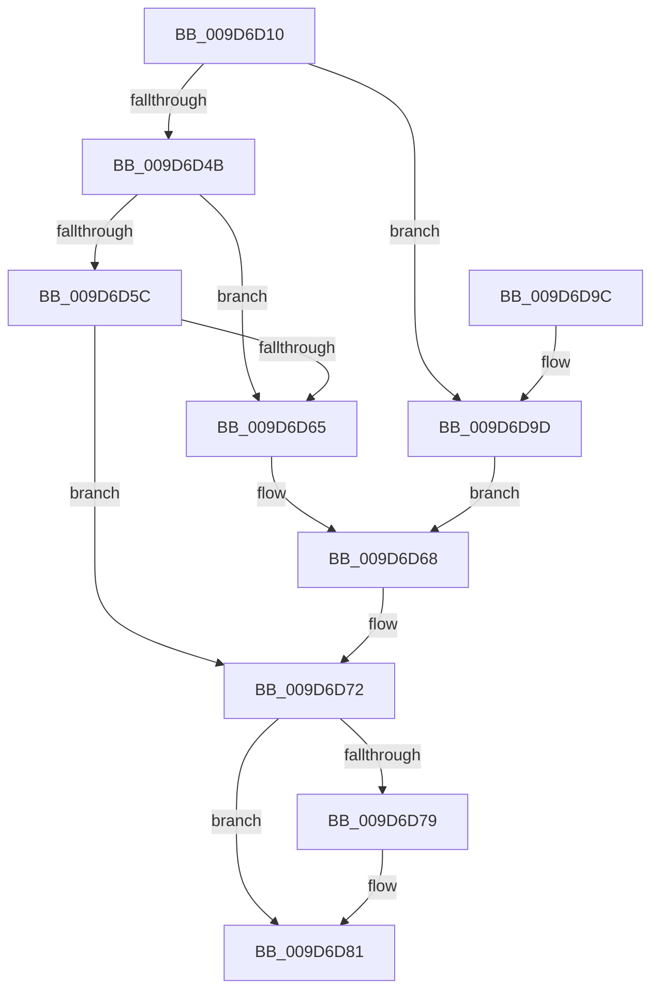

# AlpcpCaptureWorkOnBehalfAttribute

- RVA: `0x009D6D10`–`0x009D6DA2` (길이 `146` bytes)
- VA: `0x00000001409D6D10`
- 실행 섹션: `PAGE`
- PDB 이름 있음: `예`; PDB Function 태그: `아니요`
- unwind 정보 RVA: `0x000A25D4`
- 디코드: `40`개 명령, `146/146` bytes 표시
- 미해석 바이트: `0` (있으면 어셈블리에 `.byte`로 보존)

> 이 문서는 커널 이미지의 기계어와 PDB 기호를 분석해 생성했습니다. 4번과 5번은 함수 원형과 자료형을 바이너리 사용 방식에서 추정한 C 해석이며 원본 소스 복구 결과는 아닙니다.

## 1. Dependencies

- 직접 호출 지점: **5**; 고유 호출 대상: **5**
- 직접 호출자로 확인된 함수: **1**
- RIP 상대 이미지 참조: **0**

### Outgoing calls
- `0x009D6D3E` → [PsGetWorkOnBehalfThread](../../text/43/PsGetWorkOnBehalfThread_function_00439560.md) (function, `0x00439560`)
- `0x009D6D4E` → [IoThreadToProcess](../../text/44/IoThreadToProcess_function_00448540.md) (function, `0x00448540`)
- `0x009D6D5C` → [PoEnergyEstimationEnabled](../../text/45/PoEnergyEstimationEnabled_function_00450000.md) (function, `0x00450000`)
- `0x009D6D6D` → [PsEncodeThreadWorkOnBehalfTicket](../../text/44/PsEncodeThreadWorkOnBehalfTicket_function_0044BC70.md) (function, `0x0044BC70`)
- `0x009D6D7C` → [ObfDereferenceObject](../../text/2F/ObfDereferenceObject_function_002F9350.md) (function, `0x002F9350`)

### Direct callers
- [AlpcpCaptureAttributes](../88/AlpcpCaptureAttributes_function_0088CD20.md) at `0x0088D07C`

### Static image references
- 디코드된 RIP-relative 메모리 참조가 없습니다.

## 2. Other-region calls and transfers

- 다른 실행 섹션으로 향하는 call: **5**
  - `0x009D6D3E` → [PsGetWorkOnBehalfThread](../../text/43/PsGetWorkOnBehalfThread_function_00439560.md) (`PAGE` → `.text`)
  - `0x009D6D4E` → [IoThreadToProcess](../../text/44/IoThreadToProcess_function_00448540.md) (`PAGE` → `.text`)
  - `0x009D6D5C` → [PoEnergyEstimationEnabled](../../text/45/PoEnergyEstimationEnabled_function_00450000.md) (`PAGE` → `.text`)
  - `0x009D6D6D` → [PsEncodeThreadWorkOnBehalfTicket](../../text/44/PsEncodeThreadWorkOnBehalfTicket_function_0044BC70.md) (`PAGE` → `.text`)
  - `0x009D6D7C` → [ObfDereferenceObject](../../text/2F/ObfDereferenceObject_function_002F9350.md) (`PAGE` → `.text`)
- 별도 외부 분기/꼬리 이동을 확인하지 못했습니다.

## 3. Assembly (complete function range)

```asm
009D6D10  48 89 5C 24 18                  mov qword ptr [rsp + 0x18], rbx
009D6D15  48 89 74 24 20                  mov qword ptr [rsp + 0x20], rsi
009D6D1A  57                              push rdi
009D6D1B  48 83 EC 20                     sub rsp, 0x20
009D6D1F  65 48 8B 34 25 88 01 00 00      mov rsi, qword ptr gs:[0x188]
009D6D28  48 8D 54 24 30                  lea rdx, [rsp + 0x30]
009D6D2D  33 C0                           xor eax, eax
009D6D2F  48 8B F9                        mov rdi, rcx
009D6D32  48 8B CE                        mov rcx, rsi
009D6D35  89 44 24 30                     mov dword ptr [rsp + 0x30], eax
009D6D39  48 89 44 24 38                  mov qword ptr [rsp + 0x38], rax
009D6D3E  E8 1D 28 A6 FF                  call 0x140439560
009D6D43  48 8B D8                        mov rbx, rax
009D6D46  48 85 C0                        test rax, rax
009D6D49  75 52                           jne 0x1409d6d9d
009D6D4B  48 8B CE                        mov rcx, rsi
009D6D4E  E8 ED 17 A7 FF                  call 0x140448540
009D6D53  48 39 98 D8 06 00 00            cmp qword ptr [rax + 0x6d8], rbx
009D6D5A  75 09                           jne 0x1409d6d65
009D6D5C  E8 9F 92 A7 FF                  call 0x140450000
009D6D61  84 C0                           test al, al
009D6D63  74 0D                           je 0x1409d6d72
009D6D65  48 8B CE                        mov rcx, rsi
009D6D68  48 8D 54 24 38                  lea rdx, [rsp + 0x38]
009D6D6D  E8 FE 4E A7 FF                  call 0x14044bc70
009D6D72  83 7C 24 30 00                  cmp dword ptr [rsp + 0x30], 0
009D6D77  74 08                           je 0x1409d6d81
009D6D79  48 8B CB                        mov rcx, rbx
009D6D7C  E8 CF 25 92 FF                  call 0x1402f9350
009D6D81  48 8B 44 24 38                  mov rax, qword ptr [rsp + 0x38]
009D6D86  48 8B 5C 24 40                  mov rbx, qword ptr [rsp + 0x40]
009D6D8B  48 8B 74 24 48                  mov rsi, qword ptr [rsp + 0x48]
009D6D90  48 89 47 40                     mov qword ptr [rdi + 0x40], rax
009D6D94  33 C0                           xor eax, eax
009D6D96  48 83 C4 20                     add rsp, 0x20
009D6D9A  5F                              pop rdi
009D6D9B  C3                              ret
009D6D9C  CC                              int3
009D6D9D  48 8B CB                        mov rcx, rbx
009D6DA0  EB C6                           jmp 0x1409d6d68
```

## 4. C-style interpretation (structured pseudocode)

```c
__int64 __fastcall AlpcpCaptureWorkOnBehalfAttribute(__int64 a1)
{
    __int64 result;
    __int64 v_rsp;
    unsigned __int64 v_stack_p10;
    unsigned __int64 v_stack_p18;
    unsigned __int64 v_stack_p20;
    unsigned __int64 v_stack_p8;

    v_stack_p18 = v_rbx;
    v_stack_p20 = v_rsi;
    v_rsp = (v_rsp) - (32);
    result = 0;
    v_stack_p8 = 0;
    v_stack_p10 = 0;
    result = PsGetWorkOnBehalfThread(*(unsigned __int64 *)(gs_base + (0 + 392)), v_stack_p8, a3, a4);
    if (result != 0) goto loc_009D6D9D;
    result = IoThreadToProcess(*(unsigned __int64 *)(gs_base + (0 + 392)), v_stack_p8, a3, a4);
    if ((*(unsigned __int64 *)(result + 1752)) != result) goto loc_009D6D65;
    result = PoEnergyEstimationEnabled(*(unsigned __int64 *)(gs_base + (0 + 392)), v_stack_p8, a3, a4);
    if ((unsigned __int8)(result) == 0) goto loc_009D6D72;
loc_009D6D65:
loc_009D6D68:
    result = PsEncodeThreadWorkOnBehalfTicket(*(unsigned __int64 *)(gs_base + (0 + 392)), v_stack_p10, a3, a4);
loc_009D6D72:
    if (v_stack_p8 != 0) {
        a1 = result;
        result = ObfDereferenceObject(a1, v_stack_p10, a3, a4);
    }
    *(unsigned __int64 *)(a1 + 64) = v_stack_p10;
    result = 0;
    v_rsp = (v_rsp) + (32);
    return result;
loc_009D6D9D:
    goto loc_009D6D68;
}
```

## 5. (Beta) C Style

```c
int64_t AlpcpCaptureWorkOnBehalfAttribute(void *Arg1)
{
    uint8_t *arg1 = (uint8_t *)Arg1;

    int64_t result;
    int64_t local_rsp;
    uint64_t v_stack_p10;
    uint64_t v_stack_p18;
    uint64_t v_stack_p20;
    uint64_t v_stack_p8;

    v_stack_p18 = local_rbx;
    v_stack_p20 = local_rsi;
    local_rsp = (local_rsp) - (32);
    result = 0;
    v_stack_p8 = 0;
    v_stack_p10 = 0;
    result = PsGetWorkOnBehalfThread(*(uint64_t *)(gs_base + (0 + 0x188)), v_stack_p8, a3, a4);
    if (result != 0) goto loc_009D6D9D;
    result = IoThreadToProcess(*(uint64_t *)(gs_base + (0 + 0x188)), v_stack_p8, a3, a4);
    if ((*(uint64_t *)(result + 0x6D8)) != result) goto loc_009D6D65;
    result = PoEnergyEstimationEnabled(*(uint64_t *)(gs_base + (0 + 0x188)), v_stack_p8, a3, a4);
    if ((uint8_t)(result) == 0) goto loc_009D6D72;
loc_009D6D65:
loc_009D6D68:
    result = PsEncodeThreadWorkOnBehalfTicket(*(uint64_t *)(gs_base + (0 + 0x188)), v_stack_p10, a3, a4);
loc_009D6D72:
    if (v_stack_p8 != 0) {
        Arg1 = result;
        result = ObfDereferenceObject(Arg1, v_stack_p10, a3, a4);
    }
    *(uint64_t *)(arg1 + 0x40) = v_stack_p10;
    result = 0;
    local_rsp = (local_rsp) + (32);
    return result;
loc_009D6D9D:
    goto loc_009D6D68;
}
```

### 관측된 메모리 오프셋

구조체 형식이 확인되지 않은 접근은 인자 기준의 오프셋으로만 기록했습니다.

| 기준 인자 | 오프셋 표현 | 폭 (bit) | 접근 |
|---|---:|---:|---|
| `Arg1` | `+ 0x40` | `64` | `W` |

## 6. Execution-region graph

[열기: 2D/3D 그래프와 함수 탐색 컨트롤 패널](../../../control-panel.html?section=page&rva=0x009D6D10&view=graph)

- 2D 그래프는 위에서 아래로 흐르고, 3D 그래프는 빈 공간을 드래그해 회전합니다. Shift+드래그는 이동, 휠은 확대·축소, 함수 노드 선택은 대상 보고서 이동입니다.

### Static fallback


