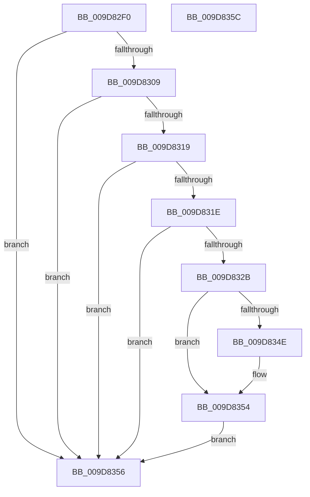

# AlpcpExposeWorkOnBehalfAttribute

- RVA: `0x009D82F0`–`0x009D835D` (길이 `109` bytes)
- VA: `0x00000001409D82F0`
- 실행 섹션: `PAGE`
- PDB 이름 있음: `예`; PDB Function 태그: `아니요`
- unwind 정보 RVA: `0x000A2D10`
- 디코드: `32`개 명령, `109/109` bytes 표시
- 미해석 바이트: `0` (있으면 어셈블리에 `.byte`로 보존)

> 이 문서는 커널 이미지의 기계어와 PDB 기호를 분석해 생성했습니다. 4번과 5번은 함수 원형과 자료형을 바이너리 사용 방식에서 추정한 C 해석이며 원본 소스 복구 결과는 아닙니다.

## 1. Dependencies

- 직접 호출 지점: **1**; 고유 호출 대상: **1**
- 직접 호출자로 확인된 함수: **1**
- RIP 상대 이미지 참조: **0**

### Outgoing calls
- `0x009D8343` → [RtlCompareMemory](../../text/6B/RtlCompareMemory_function_006BA670.md) (function, `0x006BA670`)

### Direct callers
- [AlpcpExposeAttributes](../89/AlpcpExposeAttributes_function_00897630.md) at `0x00897AA3`

### Static image references
- 디코드된 RIP-relative 메모리 참조가 없습니다.

## 2. Other-region calls and transfers

- 다른 실행 섹션으로 향하는 call: **1**
  - `0x009D8343` → [RtlCompareMemory](../../text/6B/RtlCompareMemory_function_006BA670.md) (`PAGE` → `.text`)
- 별도 외부 분기/꼬리 이동을 확인하지 못했습니다.

## 3. Assembly (complete function range)

```asm
009D82F0  40 53                           push rbx
009D82F2  48 83 EC 20                     sub rsp, 0x20
009D82F6  49 8B D9                        mov rbx, r9
009D82F9  48 C7 44 24 38 00 00 00 00      mov qword ptr [rsp + 0x38], 0
009D8302  8B 42 28                        mov eax, dword ptr [rdx + 0x28]
009D8305  84 C0                           test al, al
009D8307  78 4D                           js 0x1409d8356
009D8309  4C 8B 52 18                     mov r10, qword ptr [rdx + 0x18]
009D830D  8B 81 A0 01 00 00               mov eax, dword ptr [rcx + 0x1a0]
009D8313  24 06                           and al, 6
009D8315  3C 02                           cmp al, 2
009D8317  75 3D                           jne 0x1409d8356
009D8319  4D 85 D2                        test r10, r10
009D831C  74 38                           je 0x1409d8356
009D831E  41 8B 82 A0 01 00 00            mov eax, dword ptr [r10 + 0x1a0]
009D8325  24 06                           and al, 6
009D8327  3C 04                           cmp al, 4
009D8329  75 2B                           jne 0x1409d8356
009D832B  48 8D 8A A8 00 00 00            lea rcx, [rdx + 0xa8]
009D8332  48 8B 01                        mov rax, qword ptr [rcx]
009D8335  49 89 00                        mov qword ptr [r8], rax
009D8338  41 B8 08 00 00 00               mov r8d, 8
009D833E  48 8D 54 24 38                  lea rdx, [rsp + 0x38]
009D8343  E8 28 23 CE FF                  call 0x1406ba670
009D8348  48 83 F8 08                     cmp rax, 8
009D834C  74 06                           je 0x1409d8354
009D834E  81 0B 00 00 00 02               or dword ptr [rbx], 0x2000000
009D8354  EB 00                           jmp 0x1409d8356
009D8356  48 83 C4 20                     add rsp, 0x20
009D835A  5B                              pop rbx
009D835B  C3                              ret
009D835C  CC                              int3
```

## 4. C-style interpretation (structured pseudocode)

```c
__int64 __fastcall AlpcpExposeWorkOnBehalfAttribute(__int64 a1, __int64 a2, __int64 a3, __int64 a4)
{
    __int64 result;
    __int64 v_rsp;
    unsigned __int64 v_stack_p10;

    v_rsp = (v_rsp) - (32);
    v_stack_p10 = 0;
    if (sign_flag) goto loc_009D8356;
    result = (unsigned __int8)(((unsigned int)(*(unsigned int *)(a1 + 416))) & (6));
    if (((unsigned __int8)(result)) != 2) goto loc_009D8356;
    if (*(unsigned __int64 *)(a2 + 24) == 0) goto loc_009D8356;
    result = (unsigned __int8)(((unsigned int)(*(unsigned int *)(*(unsigned __int64 *)(a2 + 24) + 416))) & (6));
    if (((unsigned __int8)(result)) != 4) goto loc_009D8356;
    *(unsigned __int64 *)(a3) = *(unsigned __int64 *)(a2 + 168);
    result = RtlCompareMemory(a2 + 168, v_stack_p10, 8, a4);
    if (result != 8) {
    }
    goto loc_009D8356;
loc_009D8356:
    v_rsp = (v_rsp) + (32);
    return result;
}
```

## 5. (Beta) C Style

```c
int64_t AlpcpExposeWorkOnBehalfAttribute(void *Arg1, void *Arg2, void *Arg3, void *Arg4)
{
    uint8_t *arg1 = (uint8_t *)Arg1;
    uint8_t *arg2 = (uint8_t *)Arg2;
    uint8_t *arg3 = (uint8_t *)Arg3;
    uint8_t *arg4 = (uint8_t *)Arg4;

    int64_t result;
    int64_t local_rsp;
    uint64_t v_stack_p10;

    local_rsp = (local_rsp) - (32);
    v_stack_p10 = 0;
    if (sign_flag) goto loc_009D8356;
    result = (uint8_t)(((uint32_t)(*(uint32_t *)(arg1 + 0x1A0))) & (6));
    if (((uint8_t)(result)) != 2) goto loc_009D8356;
    if (*(uint64_t *)(arg2 + 0x18) == 0) goto loc_009D8356;
    result = (uint8_t)(((uint32_t)(*(uint32_t *)(*(uint64_t *)(arg2 + 0x18) + 0x1A0))) & (6));
    if (((uint8_t)(result)) != 4) goto loc_009D8356;
    *(uint64_t *)(arg3) = *(uint64_t *)(arg2 + 0xA8);
    result = RtlCompareMemory(Arg2 + 168, v_stack_p10, 8, Arg4);
    if (result != 8) {
    }
    goto loc_009D8356;
loc_009D8356:
    local_rsp = (local_rsp) + (32);
    return result;
}
```

### 관측된 메모리 오프셋

구조체 형식이 확인되지 않은 접근은 인자 기준의 오프셋으로만 기록했습니다.

| 기준 인자 | 오프셋 표현 | 폭 (bit) | 접근 |
|---|---:|---:|---|
| `Arg1` | `+ 0x1A0` | `32` | `R` |
| `Arg2` | `+ 0x0` | `64` | `R` |
| `Arg2` | `+ 0x18` | `64` | `R` |
| `Arg2` | `+ 0x28` | `32` | `R` |
| `Arg2` | `+ 0xA8` | `64` | `R` |
| `Arg3` | `+ 0x0` | `64` | `W` |
| `Arg4` | `+ 0x0` | `32` | `R/W` |

## 6. Execution-region graph

[열기: 2D/3D 그래프와 함수 탐색 컨트롤 패널](../../../control-panel.html?section=page&rva=0x009D82F0&view=graph)

- 2D 그래프는 위에서 아래로 흐르고, 3D 그래프는 빈 공간을 드래그해 회전합니다. Shift+드래그는 이동, 휠은 확대·축소, 함수 노드 선택은 대상 보고서 이동입니다.

### Static fallback


