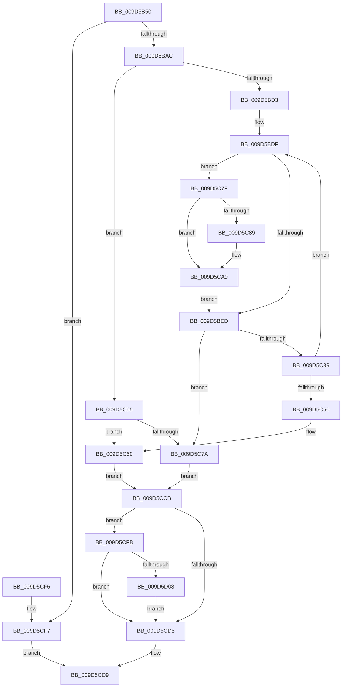

# CcPinMappedData

- RVA: `0x009D5B50`–`0x009D5D0F` (길이 `447` bytes)
- VA: `0x00000001409D5B50`
- 실행 섹션: `PAGE`
- PDB 이름 있음: `예`; PDB Function 태그: `아니요`
- unwind 정보 RVA: `0x000A1F44`
- 디코드: `119`개 명령, `447/447` bytes 표시
- 미해석 바이트: `0` (있으면 어셈블리에 `.byte`로 보존)

> 이 문서는 커널 이미지의 기계어와 PDB 기호를 분석해 생성했습니다. 4번과 5번은 함수 원형과 자료형을 바이너리 사용 방식에서 추정한 C 해석이며 원본 소스 복구 결과는 아닙니다.

## 1. Dependencies

- 직접 호출 지점: **5**; 고유 호출 대상: **5**
- 직접 호출자로 확인된 함수: **0**
- RIP 상대 이미지 참조: **0**

### Outgoing calls
- `0x009D5C30` → [CcPinFileData](../../text/33/CcPinFileData_function_0033FB40.md) (function, `0x0033FB40`)
- `0x009D5C53` → [CcFreeVirtualAddress](../../text/33/CcFreeVirtualAddress_function_0033F2C0.md) (function, `0x0033F2C0`)
- `0x009D5C71` → [ExAcquireSharedStarveExclusive](../../text/3B/ExAcquireSharedStarveExclusive_function_003BDB00.md) (function, `0x003BDB00`)
- `0x009D5C8E` → [CcAllocateObcb](../71/CcAllocateObcb_function_0071031C.md) (function, `0x0071031C`)
- `0x009D5D08` → [CcUnpinData](../9A/CcUnpinData_function_009A7A80.md) (function, `0x009A7A80`)

### Direct callers
- 이 함수 시작 RVA로 연결되는 직접 call은 확인되지 않았습니다. 간접 호출은 완전히 역산할 수 없습니다.

### Static image references
- 디코드된 RIP-relative 메모리 참조가 없습니다.

## 2. Other-region calls and transfers

- 다른 실행 섹션으로 향하는 call: **3**
  - `0x009D5C30` → [CcPinFileData](../../text/33/CcPinFileData_function_0033FB40.md) (`PAGE` → `.text`)
  - `0x009D5C53` → [CcFreeVirtualAddress](../../text/33/CcFreeVirtualAddress_function_0033F2C0.md) (`PAGE` → `.text`)
  - `0x009D5C71` → [ExAcquireSharedStarveExclusive](../../text/3B/ExAcquireSharedStarveExclusive_function_003BDB00.md) (`PAGE` → `.text`)
- 별도 외부 분기/꼬리 이동을 확인하지 못했습니다.

## 3. Assembly (complete function range)

```asm
009D5B50  4C 8B DC                        mov r11, rsp
009D5B53  49 89 5B 08                     mov qword ptr [r11 + 8], rbx
009D5B57  49 89 73 20                     mov qword ptr [r11 + 0x20], rsi
009D5B5B  45 89 43 18                     mov dword ptr [r11 + 0x18], r8d
009D5B5F  57                              push rdi
009D5B60  41 54                           push r12
009D5B62  41 55                           push r13
009D5B64  41 56                           push r14
009D5B66  41 57                           push r15
009D5B68  48 81 EC 80 00 00 00            sub rsp, 0x80
009D5B6F  45 8B E9                        mov r13d, r9d
009D5B72  4C 8B E2                        mov r12, rdx
009D5B75  48 8B F1                        mov rsi, rcx
009D5B78  33 C9                           xor ecx, ecx
009D5B7A  49 89 4B C8                     mov qword ptr [r11 - 0x38], rcx
009D5B7E  49 89 4B 10                     mov qword ptr [r11 + 0x10], rcx
009D5B82  48 8B 02                        mov rax, qword ptr [rdx]
009D5B85  49 89 43 B8                     mov qword ptr [r11 - 0x48], rax
009D5B89  49 89 4B B0                     mov qword ptr [r11 - 0x50], rcx
009D5B8D  49 8D 43 B0                     lea rax, [r11 - 0x50]
009D5B91  49 89 43 C0                     mov qword ptr [r11 - 0x40], rax
009D5B95  88 4C 24 50                     mov byte ptr [rsp + 0x50], cl
009D5B99  48 8B 9C 24 D0 00 00 00         mov rbx, qword ptr [rsp + 0xd0]
009D5BA1  48 8B 03                        mov rax, qword ptr [rbx]
009D5BA4  A8 01                           test al, 1
009D5BA6  0F 84 4B 01 00 00               je 0x1409d5cf7
009D5BAC  48 FF C8                        dec rax
009D5BAF  48 89 03                        mov qword ptr [rbx], rax
009D5BB2  48 8B 46 28                     mov rax, qword ptr [rsi + 0x28]
009D5BB6  4C 8B 78 08                     mov r15, qword ptr [rax + 8]
009D5BBA  65 FF 04 25 54 89 00 00         inc dword ptr gs:[0x8954]
009D5BC2  48 8B 0B                        mov rcx, qword ptr [rbx]
009D5BC5  B8 FD 02 00 00                  mov eax, 0x2fd
009D5BCA  66 39 01                        cmp word ptr [rcx], ax
009D5BCD  0F 84 92 00 00 00               je 0x1409d5c65
009D5BD3  41 8B 7B 18                     mov edi, dword ptr [r11 + 0x18]
009D5BD7  49 8B 43 10                     mov rax, qword ptr [r11 + 0x10]
009D5BDB  4D 8B 73 C0                     mov r14, qword ptr [r11 - 0x40]
009D5BDF  4C 8B 44 24 58                  mov r8, qword ptr [rsp + 0x58]
009D5BE4  4D 85 C0                        test r8, r8
009D5BE7  0F 85 92 00 00 00               jne 0x1409d5c7f
009D5BED  45 8B 8F 98 00 00 00            mov r9d, dword ptr [r15 + 0x98]
009D5BF4  41 C1 E9 09                     shr r9d, 9
009D5BF8  41 F6 D1                        not r9b
009D5BFB  41 80 E1 01                     and r9b, 1
009D5BFF  48 8D 84 24 B8 00 00 00         lea rax, [rsp + 0xb8]
009D5C07  48 89 44 24 40                  mov qword ptr [rsp + 0x40], rax
009D5C0C  48 8D 44 24 70                  lea rax, [rsp + 0x70]
009D5C11  48 89 44 24 38                  mov qword ptr [rsp + 0x38], rax
009D5C16  4C 89 74 24 30                  mov qword ptr [rsp + 0x30], r14
009D5C1B  44 89 6C 24 28                  mov dword ptr [rsp + 0x28], r13d
009D5C20  C6 44 24 20 00                  mov byte ptr [rsp + 0x20], 0
009D5C25  44 8B C7                        mov r8d, edi
009D5C28  48 8D 54 24 60                  lea rdx, [rsp + 0x60]
009D5C2D  48 8B CE                        mov rcx, rsi
009D5C30  E8 0B 9F 96 FF                  call 0x14033fb40
009D5C35  84 C0                           test al, al
009D5C37  74 41                           je 0x1409d5c7a
009D5C39  48 8B 84 24 B8 00 00 00         mov rax, qword ptr [rsp + 0xb8]
009D5C41  48 8B D0                        mov rdx, rax
009D5C44  48 2B 54 24 60                  sub rdx, qword ptr [rsp + 0x60]
009D5C49  8B CF                           mov ecx, edi
009D5C4B  48 3B D1                        cmp rdx, rcx
009D5C4E  7C 8F                           jl 0x1409d5bdf
009D5C50  48 8B 0B                        mov rcx, qword ptr [rbx]
009D5C53  E8 68 96 96 FF                  call 0x14033f2c0
009D5C58  48 8B 44 24 58                  mov rax, qword ptr [rsp + 0x58]
009D5C5D  48 89 03                        mov qword ptr [rbx], rax
009D5C60  40 B7 01                        mov dil, 1
009D5C63  EB 66                           jmp 0x1409d5ccb
009D5C65  41 80 E5 01                     and r13b, 1
009D5C69  48 83 C1 48                     add rcx, 0x48
009D5C6D  41 0F B6 D5                     movzx edx, r13b
009D5C71  E8 8A 7E 9E FF                  call 0x1403bdb00
009D5C76  84 C0                           test al, al
009D5C78  75 E6                           jne 0x1409d5c60
009D5C7A  40 32 FF                        xor dil, dil
009D5C7D  EB 4C                           jmp 0x1409d5ccb
009D5C7F  48 8D 4C 24 58                  lea rcx, [rsp + 0x58]
009D5C84  4C 3B F1                        cmp r14, rcx
009D5C87  75 20                           jne 0x1409d5ca9
009D5C89  8B D7                           mov edx, edi
009D5C8B  49 8B CC                        mov rcx, r12
009D5C8E  E8 89 A6 D3 FF                  call 0x14071031c
009D5C93  48 89 44 24 58                  mov qword ptr [rsp + 0x58], rax
009D5C98  4C 8D 70 10                     lea r14, [rax + 0x10]
009D5C9C  4C 89 74 24 68                  mov qword ptr [rsp + 0x68], r14
009D5CA1  48 8B 84 24 B8 00 00 00         mov rax, qword ptr [rsp + 0xb8]
009D5CA9  8B 4C 24 60                     mov ecx, dword ptr [rsp + 0x60]
009D5CAD  2B C8                           sub ecx, eax
009D5CAF  03 F9                           add edi, ecx
009D5CB1  89 BC 24 C0 00 00 00            mov dword ptr [rsp + 0xc0], edi
009D5CB8  48 89 44 24 60                  mov qword ptr [rsp + 0x60], rax
009D5CBD  49 83 C6 08                     add r14, 8
009D5CC1  4C 89 74 24 68                  mov qword ptr [rsp + 0x68], r14
009D5CC6  E9 22 FF FF FF                  jmp 0x1409d5bed
009D5CCB  40 88 7C 24 50                  mov byte ptr [rsp + 0x50], dil
009D5CD0  40 84 FF                        test dil, dil
009D5CD3  74 26                           je 0x1409d5cfb
009D5CD5  40 0F B6 C7                     movzx eax, dil
009D5CD9  4C 8D 9C 24 80 00 00 00         lea r11, [rsp + 0x80]
009D5CE1  49 8B 5B 30                     mov rbx, qword ptr [r11 + 0x30]
009D5CE5  49 8B 73 48                     mov rsi, qword ptr [r11 + 0x48]
009D5CE9  49 8B E3                        mov rsp, r11
009D5CEC  41 5F                           pop r15
009D5CEE  41 5E                           pop r14
009D5CF0  41 5D                           pop r13
009D5CF2  41 5C                           pop r12
009D5CF4  5F                              pop rdi
009D5CF5  C3                              ret
009D5CF6  CC                              int3
009D5CF7  B0 01                           mov al, 1
009D5CF9  EB DE                           jmp 0x1409d5cd9
009D5CFB  48 FF 03                        inc qword ptr [rbx]
009D5CFE  48 8B 4C 24 58                  mov rcx, qword ptr [rsp + 0x58]
009D5D03  48 85 C9                        test rcx, rcx
009D5D06  74 CD                           je 0x1409d5cd5
009D5D08  E8 73 1D FD FF                  call 0x1409a7a80
009D5D0D  EB C6                           jmp 0x1409d5cd5
```

## 4. C-style interpretation (structured pseudocode)

```c
__int64 __fastcall CcPinMappedData(__int64 a1, __int64 a2, int a3, int a4, __int64 a5)
{
    __int64 result;
    __int64 v_r13;
    __int64 v_r14;
    __int64 v_rdi;
    __int64 v_rsp;
    unsigned __int64 v_stack_m28;
    unsigned __int64 v_stack_m38;
    unsigned __int64 v_stack_m40;
    unsigned __int64 v_stack_m48;
    unsigned __int64 v_stack_m50;
    unsigned __int8 v_stack_m58;
    unsigned __int64 v_stack_m68;
    unsigned __int64 v_stack_m70;
    unsigned __int64 v_stack_m78;
    unsigned int v_stack_m80;
    unsigned __int8 v_stack_m88;
    unsigned __int64 v_stack_p10;
    unsigned int v_stack_p18;

    *(unsigned __int64 *)(v_rsp + 8) = v_rbx;
    *(unsigned __int64 *)(v_rsp + 32) = v_rsi;
    *(unsigned int *)(v_rsp + 24) = a3;
    v_rsp = (v_rsp) - (128);
    a1 = 0;
    *(unsigned __int64 *)(v_rsp - 56) = 0;
    *(unsigned __int64 *)(v_rsp + 16) = 0;
    *(unsigned __int64 *)(v_rsp - 72) = *(unsigned __int64 *)(a2);
    *(unsigned __int64 *)(v_rsp - 80) = 0;
    *(unsigned __int64 *)(v_rsp - 64) = v_rsp - 80;
    v_stack_m58 = 0;
    if ((((unsigned __int8)(*(unsigned __int64 *)(a5))) & (1)) == 0) goto loc_009D5CF7;
    result = (*(unsigned __int64 *)(a5)) - 1;
    *(unsigned __int64 *)(a5) = result;
    if ((*(unsigned __int16 *)(*(unsigned __int64 *)(a5))) == 765) goto loc_009D5C65;
loc_009D5BDF:
    if (v_stack_m50 != 0) goto loc_009D5C7F;
loc_009D5BED:
    a4 = (unsigned int)(((unsigned int)(*(unsigned int *)(*(unsigned __int64 *)(*(unsigned __int64 *)(a1 + 40) + 8) + 152))) >> (9));
    a4 = (unsigned __int8)(~(a4));
    a4 = (unsigned __int8)((a4) & (1));
    v_stack_m68 = v_stack_p10;
    v_stack_m70 = v_stack_m38;
    v_stack_m78 = *(unsigned __int64 *)(v_rsp - 64);
    v_stack_m80 = (unsigned int)((unsigned int)(a4));
    v_stack_m88 = 0;
    result = CcPinFileData(0, v_stack_m48, (unsigned int)((unsigned int)((unsigned int)(*(unsigned int *)(v_rsp + 24)))), a4);
    if ((unsigned __int8)(result) == 0) goto loc_009D5C7A;
    a2 = (v_stack_p10) - (v_stack_m48);
    if (a2 < ((unsigned int)((unsigned int)((unsigned int)(*(unsigned int *)(v_rsp + 24)))))) goto loc_009D5BDF;
    result = CcFreeVirtualAddress(*(unsigned __int64 *)(a5), a2, (unsigned int)((unsigned int)((unsigned int)(*(unsigned int *)(v_rsp + 24)))), a4);
    *(unsigned __int64 *)(a5) = v_stack_m50;
loc_009D5C60:
    goto loc_009D5CCB;
loc_009D5C65:
    v_r13 = (unsigned __int8)(((unsigned int)(a4)) & (1));
    a1 = (*(unsigned __int64 *)(a5)) + (72);
    result = ExAcquireSharedStarveExclusive(a1, (unsigned __int8)(v_r13), (unsigned int)((unsigned int)((unsigned int)(*(unsigned int *)(v_rsp + 24)))), a4);
    if ((unsigned __int8)(result) != 0) goto loc_009D5C60;
loc_009D5C7A:
    v_rdi = 0;
    goto loc_009D5CCB;
loc_009D5C7F:
    v_r14 = *(unsigned __int64 *)(v_rsp - 64);
    if ((*(unsigned __int64 *)(v_rsp - 64)) == v_stack_m50) {
        a2 = 0;
        a1 = a2;
        result = CcAllocateObcb(a1, a2, (unsigned int)((unsigned int)((unsigned int)(*(unsigned int *)(v_rsp + 24)))), a4);
        v_stack_m50 = result;
        v_r14 = result + 16;
        v_stack_m40 = v_r14;
        result = v_stack_p10;
    }
    a1 = (unsigned int)(((unsigned int)(v_stack_m48)) - ((unsigned int)(result)));
    v_rdi = (unsigned int)((v_rdi) + ((unsigned int)(a1)));
    v_stack_p18 = (unsigned int)(v_rdi);
    v_stack_m48 = result;
    v_r14 = (v_r14) + (8);
    v_stack_m40 = v_r14;
    goto loc_009D5BED;
loc_009D5CCB:
    v_stack_m58 = (unsigned __int8)(v_rdi);
    if ((unsigned __int8)(v_rdi) == 0) goto loc_009D5CFB;
loc_009D5CD5:
loc_009D5CD9:
    return (unsigned __int8)(v_rdi);
loc_009D5CF7:
    goto loc_009D5CD9;
loc_009D5CFB:
    if (v_stack_m28 == 0) goto loc_009D5CD5;
    result = CcUnpinData(v_stack_m28, a2, (unsigned int)((unsigned int)((unsigned int)(*(unsigned int *)(v_rsp + 24)))), a4);
    goto loc_009D5CD5;
}
```

## 5. (Beta) C Style

```c
int64_t CcPinMappedData(void *Arg1, void *Arg2, int32_t Arg3, int32_t Arg4, void *Arg5)
{
    uint8_t *arg1 = (uint8_t *)Arg1;
    uint8_t *arg2 = (uint8_t *)Arg2;
    uint8_t *arg5 = (uint8_t *)Arg5;

    int64_t result;
    int64_t local_r13;
    int64_t local_r14;
    int64_t local_rdi;
    int64_t local_rsp;
    uint64_t v_stack_m28;
    uint64_t v_stack_m38;
    uint64_t v_stack_m40;
    uint64_t v_stack_m48;
    uint64_t v_stack_m50;
    uint8_t v_stack_m58;
    uint64_t v_stack_m68;
    uint64_t v_stack_m70;
    uint64_t v_stack_m78;
    uint32_t v_stack_m80;
    uint8_t v_stack_m88;
    uint64_t v_stack_p10;
    uint32_t v_stack_p18;

    *(uint64_t *)(local_rsp + 0x8) = local_rbx;
    *(uint64_t *)(local_rsp + 0x20) = local_rsi;
    *(uint32_t *)(local_rsp + 0x18) = Arg3;
    local_rsp = (local_rsp) - (128);
    Arg1 = 0;
    *(uint64_t *)(local_rsp - 0x38) = 0;
    *(uint64_t *)(local_rsp + 0x10) = 0;
    *(uint64_t *)(local_rsp - 0x48) = *(uint64_t *)(arg2);
    *(uint64_t *)(local_rsp - 0x50) = 0;
    *(uint64_t *)(local_rsp - 0x40) = local_rsp - 80;
    v_stack_m58 = 0;
    if ((((uint8_t)(*(uint64_t *)(arg5))) & (1)) == 0) goto loc_009D5CF7;
    result = (*(uint64_t *)(arg5)) - 1;
    *(uint64_t *)(arg5) = result;
    if ((*(uint16_t *)(*(uint64_t *)(arg5))) == 765) goto loc_009D5C65;
loc_009D5BDF:
    if (v_stack_m50 != 0) goto loc_009D5C7F;
loc_009D5BED:
    Arg4 = (uint32_t)(((uint32_t)(*(uint32_t *)(*(uint64_t *)(*(uint64_t *)(arg1 + 0x28) + 0x8) + 0x98))) >> (9));
    Arg4 = (uint8_t)(~(Arg4));
    Arg4 = (uint8_t)((Arg4) & (1));
    v_stack_m68 = v_stack_p10;
    v_stack_m70 = v_stack_m38;
    v_stack_m78 = *(uint64_t *)(local_rsp - 0x40);
    v_stack_m80 = (uint32_t)((uint32_t)(Arg4));
    v_stack_m88 = 0;
    result = CcPinFileData(0, v_stack_m48, (uint32_t)((uint32_t)((uint32_t)(*(uint32_t *)(local_rsp + 0x18)))), Arg4);
    if ((uint8_t)(result) == 0) goto loc_009D5C7A;
    Arg2 = (v_stack_p10) - (v_stack_m48);
    if (Arg2 < ((uint32_t)((uint32_t)((uint32_t)(*(uint32_t *)(local_rsp + 0x18)))))) goto loc_009D5BDF;
    result = CcFreeVirtualAddress(*(uint64_t *)(arg5), Arg2, (uint32_t)((uint32_t)((uint32_t)(*(uint32_t *)(local_rsp + 0x18)))), Arg4);
    *(uint64_t *)(arg5) = v_stack_m50;
loc_009D5C60:
    goto loc_009D5CCB;
loc_009D5C65:
    local_r13 = (uint8_t)(((uint32_t)(Arg4)) & (1));
    Arg1 = (*(uint64_t *)(arg5)) + (72);
    result = ExAcquireSharedStarveExclusive(Arg1, (uint8_t)(local_r13), (uint32_t)((uint32_t)((uint32_t)(*(uint32_t *)(local_rsp + 0x18)))), Arg4);
    if ((uint8_t)(result) != 0) goto loc_009D5C60;
loc_009D5C7A:
    local_rdi = 0;
    goto loc_009D5CCB;
loc_009D5C7F:
    local_r14 = *(uint64_t *)(local_rsp - 0x40);
    if ((*(uint64_t *)(local_rsp - 0x40)) == v_stack_m50) {
        Arg2 = 0;
        Arg1 = Arg2;
        result = CcAllocateObcb(Arg1, Arg2, (uint32_t)((uint32_t)((uint32_t)(*(uint32_t *)(local_rsp + 0x18)))), Arg4);
        v_stack_m50 = result;
        local_r14 = result + 16;
        v_stack_m40 = local_r14;
        result = v_stack_p10;
    }
    Arg1 = (uint32_t)(((uint32_t)(v_stack_m48)) - ((uint32_t)(result)));
    local_rdi = (uint32_t)((local_rdi) + ((uint32_t)(Arg1)));
    v_stack_p18 = (uint32_t)(local_rdi);
    v_stack_m48 = result;
    local_r14 = (local_r14) + (8);
    v_stack_m40 = local_r14;
    goto loc_009D5BED;
loc_009D5CCB:
    v_stack_m58 = (uint8_t)(local_rdi);
    if ((uint8_t)(local_rdi) == 0) goto loc_009D5CFB;
loc_009D5CD5:
loc_009D5CD9:
    return (uint8_t)(local_rdi);
loc_009D5CF7:
    goto loc_009D5CD9;
loc_009D5CFB:
    if (v_stack_m28 == 0) goto loc_009D5CD5;
    result = CcUnpinData(v_stack_m28, Arg2, (uint32_t)((uint32_t)((uint32_t)(*(uint32_t *)(local_rsp + 0x18)))), Arg4);
    goto loc_009D5CD5;
}
```

### 관측된 메모리 오프셋

구조체 형식이 확인되지 않은 접근은 인자 기준의 오프셋으로만 기록했습니다.

| 기준 인자 | 오프셋 표현 | 폭 (bit) | 접근 |
|---|---:|---:|---|
| `Arg1` | `+ 0x28` | `64` | `R` |
| `Arg2` | `+ 0x0` | `64` | `R` |
| `Arg5` | `+ 0x0` | `64` | `R` |
| `Arg5` | `+ 0x0` | `64` | `R/W` |
| `Arg5` | `+ 0x0` | `64` | `W` |

## 6. Execution-region graph

[열기: 2D/3D 그래프와 함수 탐색 컨트롤 패널](../../../control-panel.html?section=page&rva=0x009D5B50&view=graph)

- 2D 그래프는 위에서 아래로 흐르고, 3D 그래프는 빈 공간을 드래그해 회전합니다. Shift+드래그는 이동, 휠은 확대·축소, 함수 노드 선택은 대상 보고서 이동입니다.

### Static fallback


