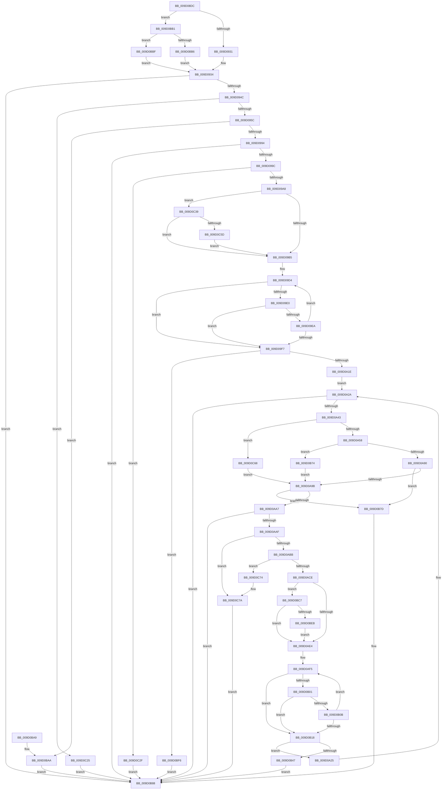

# CmGetDeviceChildren

- RVA: `0x009D08DC`–`0x009D0C84` (길이 `936` bytes)
- VA: `0x00000001409D08DC`
- 실행 섹션: `PAGE`
- PDB 이름 있음: `예`; PDB Function 태그: `아니요`
- unwind 정보 RVA: `0x000A1330`
- 디코드: `226`개 명령, `936/936` bytes 표시
- 미해석 바이트: `0` (있으면 어셈블리에 `.byte`로 보존)

> 이 문서는 커널 이미지의 기계어와 PDB 기호를 분석해 생성했습니다. 4번과 5번은 함수 원형과 자료형을 바이너리 사용 방식에서 추정한 C 해석이며 원본 소스 복구 결과는 아닙니다.

## 1. Dependencies

- 직접 호출 지점: **10**; 고유 호출 대상: **6**
- 직접 호출자로 확인된 함수: **2**
- RIP 상대 이미지 참조: **1**

### Outgoing calls
- `0x009D093F` → [RtlInitUnicodeStringEx](../../text/46/RtlInitUnicodeStringEx_function_00463960.md) (function, `0x00463960`)
- `0x009D0984` → [guard_dispatch_icall](../../text/6B/guard_dispatch_icall_function_006BAAD0.md) (function, `0x006BAAD0`)
- `0x009D0A36` → [RtlInitUnicodeStringEx](../../text/46/RtlInitUnicodeStringEx_function_00463960.md) (function, `0x00463960`)
- `0x009D0A7D` → [guard_dispatch_icall](../../text/6B/guard_dispatch_icall_function_006BAAD0.md) (function, `0x006BAAD0`)
- `0x009D0B6A` → [RtlStringExHandleOtherFlagsW](../../text/41/RtlStringExHandleOtherFlagsW_function_0041E3F0.md) (function, `0x0041E3F0`)
- `0x009D0B92` → [_security_check_cookie](../../text/6A/_security_check_cookie_function_006AC640.md) (function, `0x006AC640`)
- `0x009D0BDE` → [PnpMultiSzAppend](PnpMultiSzAppend_function_009D04D8.md) (function, `0x009D04D8`)
- `0x009D0C19` → [RtlStringExHandleOtherFlagsW](../../text/41/RtlStringExHandleOtherFlagsW_function_0041E3F0.md) (function, `0x0041E3F0`)
- `0x009D0C50` → [PnpMultiSzAppend](PnpMultiSzAppend_function_009D04D8.md) (function, `0x009D04D8`)
- `0x009D0C74` → [_report_rangecheckfailure](../../text/4F/_report_rangecheckfailure_function_004F5FDC.md) (function, `0x004F5FDC`)

### Direct callers
- [CmGetDeviceSiblings](CmGetDeviceSiblings_function_009D0734.md) at `0x009D07B0`
- [_CmGetDeviceMappedPropertyFromComposite](_CmGetDeviceMappedPropertyFromComposite_function_009D1684.md) at `0x009D225A`

### Static image references
- `0x009D08F6` → RVA `0x00E0A740` (`.data`; read)

## 2. Other-region calls and transfers

- 다른 실행 섹션으로 향하는 call: **8**
  - `0x009D093F` → [RtlInitUnicodeStringEx](../../text/46/RtlInitUnicodeStringEx_function_00463960.md) (`PAGE` → `.text`)
  - `0x009D0984` → [guard_dispatch_icall](../../text/6B/guard_dispatch_icall_function_006BAAD0.md) (`PAGE` → `.text`)
  - `0x009D0A36` → [RtlInitUnicodeStringEx](../../text/46/RtlInitUnicodeStringEx_function_00463960.md) (`PAGE` → `.text`)
  - `0x009D0A7D` → [guard_dispatch_icall](../../text/6B/guard_dispatch_icall_function_006BAAD0.md) (`PAGE` → `.text`)
  - `0x009D0B6A` → [RtlStringExHandleOtherFlagsW](../../text/41/RtlStringExHandleOtherFlagsW_function_0041E3F0.md) (`PAGE` → `.text`)
  - `0x009D0B92` → [_security_check_cookie](../../text/6A/_security_check_cookie_function_006AC640.md) (`PAGE` → `.text`)
  - `0x009D0C19` → [RtlStringExHandleOtherFlagsW](../../text/41/RtlStringExHandleOtherFlagsW_function_0041E3F0.md) (`PAGE` → `.text`)
  - `0x009D0C74` → [_report_rangecheckfailure](../../text/4F/_report_rangecheckfailure_function_004F5FDC.md) (`PAGE` → `.text`)
- 별도 외부 분기/꼬리 이동을 확인하지 못했습니다.

## 3. Assembly (complete function range)

```asm
009D08DC  40 55                           push rbp
009D08DE  53                              push rbx
009D08DF  56                              push rsi
009D08E0  57                              push rdi
009D08E1  41 54                           push r12
009D08E3  41 56                           push r14
009D08E5  41 57                           push r15
009D08E7  48 8D AC 24 50 FD FF FF         lea rbp, [rsp - 0x2b0]
009D08EF  48 81 EC B0 03 00 00            sub rsp, 0x3b0
009D08F6  48 8B 05 43 9E 43 00            mov rax, qword ptr [rip + 0x439e43]
009D08FD  48 33 C4                        xor rax, rsp
009D0900  48 89 85 A0 02 00 00            mov qword ptr [rbp + 0x2a0], rax
009D0907  33 DB                           xor ebx, ebx
009D0909  4C 89 4C 24 58                  mov qword ptr [rsp + 0x58], r9
009D090E  48 89 4C 24 70                  mov qword ptr [rsp + 0x70], rcx
009D0913  0F 57 C0                        xorps xmm0, xmm0
009D0916  89 5C 24 40                     mov dword ptr [rsp + 0x40], ebx
009D091A  4D 8B F9                        mov r15, r9
009D091D  49 8B F8                        mov rdi, r8
009D0920  48 8B F1                        mov rsi, rcx
009D0923  0F 11 44 24 60                  movups xmmword ptr [rsp + 0x60], xmm0
009D0928  4D 85 C0                        test r8, r8
009D092B  0F 85 80 02 00 00               jne 0x1409d0bb1
009D0931  41 89 19                        mov dword ptr [r9], ebx
009D0934  45 8B 31                        mov r14d, dword ptr [r9]
009D0937  48 8D 4C 24 60                  lea rcx, [rsp + 0x60]
009D093C  41 89 19                        mov dword ptr [r9], ebx
009D093F  E8 1C 30 A9 FF                  call 0x140463960
009D0944  85 C0                           test eax, eax
009D0946  0F 88 3C 02 00 00               js 0x1409d0b88
009D094C  48 8B 86 10 01 00 00            mov rax, qword ptr [rsi + 0x110]
009D0953  48 85 C0                        test rax, rax
009D0956  0F 84 C9 02 00 00               je 0x1409d0c25
009D095C  48 8D 4C 24 40                  lea rcx, [rsp + 0x40]
009D0961  89 5C 24 30                     mov dword ptr [rsp + 0x30], ebx
009D0965  48 89 4C 24 28                  mov qword ptr [rsp + 0x28], rcx
009D096A  4C 8D 4D 80                     lea r9, [rbp - 0x80]
009D096E  48 8B CE                        mov rcx, rsi
009D0971  C7 44 24 20 C8 00 00 00         mov dword ptr [rsp + 0x20], 0xc8
009D0979  41 B8 02 00 00 00               mov r8d, 2
009D097F  48 8D 54 24 60                  lea rdx, [rsp + 0x60]
009D0984  E8 47 A1 CE FF                  call 0x1406baad0
009D0989  3D 05 00 00 80                  cmp eax, 0x80000005
009D098E  0F 84 16 02 00 00               je 0x1409d0baa
009D0994  85 C0                           test eax, eax
009D0996  0F 88 EC 01 00 00               js 0x1409d0b88
009D099C  8B 44 24 40                     mov eax, dword ptr [rsp + 0x40]
009D09A0  85 C0                           test eax, eax
009D09A2  0F 84 87 02 00 00               je 0x1409d0c2f
009D09A8  44 8D 60 01                     lea r12d, [rax + 1]
009D09AC  45 85 F6                        test r14d, r14d
009D09AF  0F 85 84 02 00 00               jne 0x1409d0c39
009D09B5  4C 8D 45 80                     lea r8, [rbp - 0x80]
009D09B9  BA C8 00 00 00                  mov edx, 0xc8
009D09BE  48 8D 85 10 01 00 00            lea rax, [rbp + 0x110]
009D09C5  4C 2B C0                        sub r8, rax
009D09C8  48 8D 8D 10 01 00 00            lea rcx, [rbp + 0x110]
009D09CF  4C 89 44 24 50                  mov qword ptr [rsp + 0x50], r8
009D09D4  48 8D 82 36 FF FF 7F            lea rax, [rdx + 0x7fffff36]
009D09DB  48 85 C0                        test rax, rax
009D09DE  74 17                           je 0x1409d09f7
009D09E0  41 0F B7 04 08                  movzx eax, word ptr [r8 + rcx]
009D09E5  66 85 C0                        test ax, ax
009D09E8  74 0D                           je 0x1409d09f7
009D09EA  66 89 01                        mov word ptr [rcx], ax
009D09ED  48 83 C1 02                     add rcx, 2
009D09F1  48 83 EA 01                     sub rdx, 1
009D09F5  75 DD                           jne 0x1409d09d4
009D09F7  48 85 D2                        test rdx, rdx
009D09FA  48 8D 41 FE                     lea rax, [rcx - 2]
009D09FE  48 0F 45 C1                     cmovne rax, rcx
009D0A02  66 89 18                        mov word ptr [rax], bx
009D0A05  48 8B C2                        mov rax, rdx
009D0A08  48 F7 D8                        neg rax
009D0A0B  1B F6                           sbb esi, esi
009D0A0D  F7 D6                           not esi
009D0A0F  81 E6 05 00 00 80               and esi, 0x80000005
009D0A15  48 85 D2                        test rdx, rdx
009D0A18  0F 84 D8 01 00 00               je 0x1409d0bf6
009D0A1E  BE 23 00 00 C0                  mov esi, 0xc0000023
009D0A23  EB 05                           jmp 0x1409d0a2a
009D0A25  44 8B 64 24 48                  mov r12d, dword ptr [rsp + 0x48]
009D0A2A  48 8D 95 10 01 00 00            lea rdx, [rbp + 0x110]
009D0A31  48 8D 4C 24 60                  lea rcx, [rsp + 0x60]
009D0A36  E8 25 2F A9 FF                  call 0x140463960
009D0A3B  85 C0                           test eax, eax
009D0A3D  0F 88 45 01 00 00               js 0x1409d0b88
009D0A43  48 8B 4C 24 70                  mov rcx, qword ptr [rsp + 0x70]
009D0A48  48 8B 81 10 01 00 00            mov rax, qword ptr [rcx + 0x110]
009D0A4F  48 85 C0                        test rax, rax
009D0A52  0F 84 10 02 00 00               je 0x1409d0c68
009D0A58  48 8D 54 24 40                  lea rdx, [rsp + 0x40]
009D0A5D  89 5C 24 30                     mov dword ptr [rsp + 0x30], ebx
009D0A61  48 89 54 24 28                  mov qword ptr [rsp + 0x28], rdx
009D0A66  4C 8D 4D 80                     lea r9, [rbp - 0x80]
009D0A6A  48 8D 54 24 60                  lea rdx, [rsp + 0x60]
009D0A6F  C7 44 24 20 C8 00 00 00         mov dword ptr [rsp + 0x20], 0xc8
009D0A77  41 B8 03 00 00 00               mov r8d, 3
009D0A7D  E8 4E A0 CE FF                  call 0x1406baad0
009D0A82  48 8B C8                        mov rcx, rax
009D0A85  3D 05 00 00 80                  cmp eax, 0x80000005
009D0A8A  0F 84 E4 00 00 00               je 0x1409d0b74
009D0A90  3D 0E 00 00 C0                  cmp eax, 0xc000000e
009D0A95  0F 84 E2 00 00 00               je 0x1409d0b7d
009D0A9B  8B 54 24 40                     mov edx, dword ptr [rsp + 0x40]
009D0A9F  85 D2                           test edx, edx
009D0AA1  0F 84 D6 00 00 00               je 0x1409d0b7d
009D0AA7  85 C9                           test ecx, ecx
009D0AA9  0F 88 D9 00 00 00               js 0x1409d0b88
009D0AAF  81 FA C8 00 00 00               cmp edx, 0xc8
009D0AB5  0F 87 BF 01 00 00               ja 0x1409d0c7a
009D0ABB  8D 4A FF                        lea ecx, [rdx - 1]
009D0ABE  48 03 C9                        add rcx, rcx
009D0AC1  48 81 F9 90 01 00 00            cmp rcx, 0x190
009D0AC8  0F 83 A6 01 00 00               jae 0x1409d0c74
009D0ACE  44 03 E2                        add r12d, edx
009D0AD1  66 89 5C 0D 80                  mov word ptr [rbp + rcx - 0x80], bx
009D0AD6  44 89 64 24 48                  mov dword ptr [rsp + 0x48], r12d
009D0ADB  45 85 F6                        test r14d, r14d
009D0ADE  0F 85 E3 00 00 00               jne 0x1409d0bc7
009D0AE4  4C 8B 7C 24 50                  mov r15, qword ptr [rsp + 0x50]
009D0AE9  48 8D 8D 10 01 00 00            lea rcx, [rbp + 0x110]
009D0AF0  BA C8 00 00 00                  mov edx, 0xc8
009D0AF5  48 8D 82 36 FF FF 7F            lea rax, [rdx + 0x7fffff36]
009D0AFC  48 85 C0                        test rax, rax
009D0AFF  74 17                           je 0x1409d0b18
009D0B01  41 0F B7 04 0F                  movzx eax, word ptr [r15 + rcx]
009D0B06  66 85 C0                        test ax, ax
009D0B09  74 0D                           je 0x1409d0b18
009D0B0B  66 89 01                        mov word ptr [rcx], ax
009D0B0E  48 83 C1 02                     add rcx, 2
009D0B12  48 83 EA 01                     sub rdx, 1
009D0B16  75 DD                           jne 0x1409d0af5
009D0B18  4C 8B 7C 24 58                  mov r15, qword ptr [rsp + 0x58]
009D0B1D  48 8D 41 FE                     lea rax, [rcx - 2]
009D0B21  48 85 D2                        test rdx, rdx
009D0B24  48 0F 45 C1                     cmovne rax, rcx
009D0B28  66 89 18                        mov word ptr [rax], bx
009D0B2B  48 8B C2                        mov rax, rdx
009D0B2E  48 F7 D8                        neg rax
009D0B31  45 1B E4                        sbb r12d, r12d
009D0B34  41 F7 D4                        not r12d
009D0B37  41 81 E4 05 00 00 80            and r12d, 0x80000005
009D0B3E  48 85 D2                        test rdx, rdx
009D0B41  0F 85 DE FE FF FF               jne 0x1409d0a25
009D0B47  48 8D 44 24 58                  lea rax, [rsp + 0x58]
009D0B4C  C7 44 24 28 00 08 00 00         mov dword ptr [rsp + 0x28], 0x800
009D0B54  4C 8D 4C 24 50                  lea r9, [rsp + 0x50]
009D0B59  48 89 44 24 20                  mov qword ptr [rsp + 0x20], rax
009D0B5E  BA 90 01 00 00                  mov edx, 0x190
009D0B63  48 8D 8D 10 01 00 00            lea rcx, [rbp + 0x110]
009D0B6A  E8 81 D8 A4 FF                  call 0x14041e3f0
009D0B6F  41 8B C4                        mov eax, r12d
009D0B72  EB 14                           jmp 0x1409d0b88
009D0B74  8B CE                           mov ecx, esi
009D0B76  8B C6                           mov eax, esi
009D0B78  E9 1E FF FF FF                  jmp 0x1409d0a9b
009D0B7D  45 3B F4                        cmp r14d, r12d
009D0B80  45 89 27                        mov dword ptr [r15], r12d
009D0B83  0F 42 DE                        cmovb ebx, esi
009D0B86  8B C3                           mov eax, ebx
009D0B88  48 8B 8D A0 02 00 00            mov rcx, qword ptr [rbp + 0x2a0]
009D0B8F  48 33 CC                        xor rcx, rsp
009D0B92  E8 A9 BA CD FF                  call 0x1406ac640
009D0B97  48 81 C4 B0 03 00 00            add rsp, 0x3b0
009D0B9E  41 5F                           pop r15
009D0BA0  41 5E                           pop r14
009D0BA2  41 5C                           pop r12
009D0BA4  5F                              pop rdi
009D0BA5  5E                              pop rsi
009D0BA6  5B                              pop rbx
009D0BA7  5D                              pop rbp
009D0BA8  C3                              ret
009D0BA9  CC                              int3
009D0BAA  B8 23 00 00 C0                  mov eax, 0xc0000023
009D0BAF  EB D7                           jmp 0x1409d0b88
009D0BB1  41 39 19                        cmp dword ptr [r9], ebx
009D0BB4  74 09                           je 0x1409d0bbf
009D0BB6  66 41 89 18                     mov word ptr [r8], bx
009D0BBA  E9 75 FD FF FF                  jmp 0x1409d0934
009D0BBF  48 8B FB                        mov rdi, rbx
009D0BC2  E9 6D FD FF FF                  jmp 0x1409d0934
009D0BC7  43 8D 04 36                     lea eax, [r14 + r14]
009D0BCB  45 33 C9                        xor r9d, r9d
009D0BCE  4C 8D 45 80                     lea r8, [rbp - 0x80]
009D0BD2  89 44 24 44                     mov dword ptr [rsp + 0x44], eax
009D0BD6  48 8D 54 24 44                  lea rdx, [rsp + 0x44]
009D0BDB  48 8B CF                        mov rcx, rdi
009D0BDE  E8 F5 F8 FF FF                  call 0x1409d04d8
009D0BE3  84 C0                           test al, al
009D0BE5  0F 85 F9 FE FF FF               jne 0x1409d0ae4
009D0BEB  48 8B FB                        mov rdi, rbx
009D0BEE  44 8B F3                        mov r14d, ebx
009D0BF1  E9 EE FE FF FF                  jmp 0x1409d0ae4
009D0BF6  48 8D 44 24 58                  lea rax, [rsp + 0x58]
009D0BFB  C7 44 24 28 00 08 00 00         mov dword ptr [rsp + 0x28], 0x800
009D0C03  4C 8D 4C 24 50                  lea r9, [rsp + 0x50]
009D0C08  48 89 44 24 20                  mov qword ptr [rsp + 0x20], rax
009D0C0D  BA 90 01 00 00                  mov edx, 0x190
009D0C12  48 8D 8D 10 01 00 00            lea rcx, [rbp + 0x110]
009D0C19  E8 D2 D7 A4 FF                  call 0x14041e3f0
009D0C1E  8B C6                           mov eax, esi
009D0C20  E9 63 FF FF FF                  jmp 0x1409d0b88
009D0C25  B8 02 00 00 C0                  mov eax, 0xc0000002
009D0C2A  E9 59 FF FF FF                  jmp 0x1409d0b88
009D0C2F  B8 25 02 00 C0                  mov eax, 0xc0000225
009D0C34  E9 4F FF FF FF                  jmp 0x1409d0b88
009D0C39  43 8D 04 36                     lea eax, [r14 + r14]
009D0C3D  45 33 C9                        xor r9d, r9d
009D0C40  4C 8D 45 80                     lea r8, [rbp - 0x80]
009D0C44  89 44 24 44                     mov dword ptr [rsp + 0x44], eax
009D0C48  48 8D 54 24 44                  lea rdx, [rsp + 0x44]
009D0C4D  48 8B CF                        mov rcx, rdi
009D0C50  E8 83 F8 FF FF                  call 0x1409d04d8
009D0C55  84 C0                           test al, al
009D0C57  0F 85 58 FD FF FF               jne 0x1409d09b5
009D0C5D  48 8B FB                        mov rdi, rbx
009D0C60  44 8B F3                        mov r14d, ebx
009D0C63  E9 4D FD FF FF                  jmp 0x1409d09b5
009D0C68  B9 02 00 00 C0                  mov ecx, 0xc0000002
009D0C6D  8B C1                           mov eax, ecx
009D0C6F  E9 27 FE FF FF                  jmp 0x1409d0a9b
009D0C74  E8 63 53 B2 FF                  call 0x1404f5fdc
009D0C79  CC                              int3
009D0C7A  B8 0D 00 00 C0                  mov eax, 0xc000000d
009D0C7F  E9 04 FF FF FF                  jmp 0x1409d0b88
```

## 4. C-style interpretation (structured pseudocode)

```c
__int64 __fastcall CmGetDeviceChildren(__int64 a1, __int64 a2, __int64 a3, __int64 a4)
{
    __int64 result;
    __int64 v_r12;
    __int64 v_rbx;
    __int64 v_rsi;
    __int64 v_rsp;
    unsigned __int64 v_stack_m1D8;
    unsigned __int64 v_stack_m2E8;
    unsigned __int64 v_stack_m368;
    unsigned __int64 v_stack_m378;
    unsigned __int64 v_stack_m388;
    unsigned __int64 v_stack_m390;
    unsigned __int64 v_stack_m398;
    unsigned int v_stack_m3A0;
    unsigned int v_stack_m3A8;
    unsigned int v_stack_m3B8;
    unsigned __int64 v_stack_m3C0;
    unsigned int v_stack_m3C8;
    unsigned __int64 v_stack_m48;
    unsigned __int64 v_stack_p20;
    unsigned int v_stack_p28;
    unsigned int v_stack_p44;
    unsigned __int64 v_stack_p50;
    unsigned __int64 v_stack_p58;

    v_rsp = (v_rsp) - (944);
    result = (*(unsigned __int64 *)(v_rip + 4431427)) ^ (v_rsp);
    v_stack_m48 = result;
    v_rbx = 0;
    v_stack_m390 = a4;
    v_stack_m378 = a1;
    v_stack_m3A8 = 0;
    v_stack_m388 = v_xmm0;
    if (a3 != 0) goto loc_009D0BB1;
    *(unsigned int *)(a4) = 0;
loc_009D0934:
    *(unsigned int *)(a4) = 0;
    result = RtlInitUnicodeStringEx(v_stack_m388, a2, a3, a4);
    if (sign_flag) goto loc_009D0B88;
    if (*(unsigned __int64 *)(a1 + 272) == 0) goto loc_009D0C25;
    v_stack_m3B8 = 0;
    v_stack_m3C0 = v_stack_m3A8;
    v_stack_m3C8 = 200;
    result = guard_dispatch_icall(a1, v_stack_m388, 2, v_stack_m368);
    if (((unsigned int)(result)) == 0x80000005ULL) goto loc_009D0BAA;
    if (sign_flag) goto loc_009D0B88;
    if ((unsigned int)((unsigned int)(v_stack_m3A8)) == 0) goto loc_009D0C2F;
    if ((unsigned int)((unsigned int)(*(unsigned int *)(a4))) != 0) goto loc_009D0C39;
loc_009D09B5:
    a3 = (v_stack_m368) - (v_stack_m1D8);
    v_stack_m398 = a3;
loc_009D09D4:
    if (200 + 2147483446 == 0) goto loc_009D09F7;
    if ((unsigned __int16)(*(unsigned __int16 *)(a3 + v_stack_m1D8 * 1)) == 0) goto loc_009D09F7;
    *(unsigned __int16 *)(v_stack_m1D8) = (unsigned __int16)(*(unsigned __int16 *)(a3 + v_stack_m1D8 * 1));
    a1 = (v_stack_m1D8) + (2);
    a2 = (200) - (1);
    if (condition_is_not_equal) goto loc_009D09D4;
loc_009D09F7:
    result = a1 - 2;
    if (a2 != 0) { result = a1; }
    *(unsigned __int16 *)(result) = 0;
    result = -(a2);
    v_rsi = (unsigned int)(~(a1));
    v_rsi = (unsigned int)((v_rsi) & (0x80000005ULL));
    if (a2 == 0) goto loc_009D0BF6;
    goto loc_009D0A2A;
loc_009D0A25:
loc_009D0A2A:
    result = RtlInitUnicodeStringEx(v_stack_m388, v_stack_m1D8, a3, v_stack_m368);
    if (sign_flag) goto loc_009D0B88;
    if (*(unsigned __int64 *)(v_stack_m378 + 272) == 0) goto loc_009D0C68;
    v_stack_m3B8 = 0;
    v_stack_m3C0 = v_stack_m3A8;
    v_stack_m3C8 = 200;
    result = guard_dispatch_icall(v_stack_m378, v_stack_m388, 3, v_stack_m368);
    if (((unsigned int)(result)) == 0x80000005ULL) goto loc_009D0B74;
    if (((unsigned int)(result)) == 0xC000000EULL) goto loc_009D0B7D;
loc_009D0A9B:
    if ((unsigned int)((unsigned int)(v_stack_m3A8)) == 0) goto loc_009D0B7D;
    if (sign_flag) goto loc_009D0B88;
    if (((unsigned int)((unsigned int)(v_stack_m3A8))) > 200) goto loc_009D0C7A;
    a1 = ((unsigned int)(v_stack_m3A8) - 1) + ((unsigned int)(v_stack_m3A8) - 1);
    if (a1 >= 400) goto loc_009D0C74;
    v_r12 = (unsigned int)(((unsigned int)(v_stack_m3A0)) + ((unsigned int)((unsigned int)(v_stack_m3A8))));
    *(unsigned __int16 *)(v_stack_m2E8 + a1 * 1 - 128) = 0;
    v_stack_m3A0 = (unsigned int)(v_r12);
    if ((unsigned int)((unsigned int)(*(unsigned int *)(a4))) != 0) goto loc_009D0BC7;
loc_009D0AE4:
loc_009D0AF5:
    if (200 + 2147483446 == 0) goto loc_009D0B18;
    if ((unsigned __int16)(*(unsigned __int16 *)(v_stack_m398 + v_stack_m1D8 * 1)) == 0) goto loc_009D0B18;
    *(unsigned __int16 *)(v_stack_m1D8) = (unsigned __int16)(*(unsigned __int16 *)(v_stack_m398 + v_stack_m1D8 * 1));
    a1 = (v_stack_m1D8) + (2);
    a2 = (200) - (1);
    if (condition_is_not_equal) goto loc_009D0AF5;
loc_009D0B18:
    result = a1 - 2;
    if (a2 != 0) { result = a1; }
    *(unsigned __int16 *)(result) = 0;
    result = -(a2);
    v_r12 = (unsigned int)(~(v_r12));
    v_r12 = (unsigned int)((v_r12) & (0x80000005ULL));
    if (a2 != 0) goto loc_009D0A25;
    v_stack_m3C0 = 0x800ULL;
    v_stack_m3C8 = v_stack_m390;
    result = RtlStringExHandleOtherFlagsW(v_stack_m1D8, 400, 3, v_stack_m398);
    goto loc_009D0B88;
loc_009D0B74:
    goto loc_009D0A9B;
loc_009D0B7D:
    *(unsigned int *)(v_stack_m390) = (unsigned int)(v_r12);
    if (((unsigned int)((unsigned int)(*(unsigned int *)(a4)))) < ((unsigned int)(v_r12))) { v_rbx = (unsigned int)((unsigned int)(0xC0000023ULL)); }
loc_009D0B88:
    a1 = (v_stack_m48) ^ (v_rsp);
    result = _security_check_cookie(a1, 400, 3, v_stack_m398);
    v_rsp = (v_rsp) + (944);
    return result;
loc_009D0BAA:
    goto loc_009D0B88;
loc_009D0BB1:
    if ((*(unsigned int *)(v_stack_m398)) == ((unsigned int)(v_rbx))) goto loc_009D0BBF;
    *(unsigned __int16 *)(3) = (unsigned __int16)(v_rbx);
    goto loc_009D0934;
loc_009D0BBF:
    goto loc_009D0934;
loc_009D0BC7:
    a4 = 0;
    v_stack_p44 = (unsigned int)((unsigned int)(*(unsigned int *)(a4)) + (unsigned int)(*(unsigned int *)(a4)) * 1);
    result = PnpMultiSzAppend(v_rbx, v_stack_p44, v_stack_m368, a4);
    if ((unsigned __int8)(result) != 0) goto loc_009D0AE4;
    goto loc_009D0AE4;
loc_009D0BF6:
    v_stack_p28 = 0x800ULL;
    v_stack_p20 = v_stack_p58;
    result = RtlStringExHandleOtherFlagsW(v_stack_m1D8, 400, v_stack_m368, v_stack_p50);
    goto loc_009D0B88;
loc_009D0C25:
    goto loc_009D0B88;
loc_009D0C2F:
    goto loc_009D0B88;
loc_009D0C39:
    a4 = 0;
    v_stack_p44 = (unsigned int)((unsigned int)((unsigned int)(v_rbx)) + (unsigned int)((unsigned int)(v_rbx)) * 1);
    result = PnpMultiSzAppend(v_rbx, v_stack_p44, v_stack_m368, a4);
    if ((unsigned __int8)(result) != 0) goto loc_009D09B5;
    goto loc_009D09B5;
loc_009D0C68:
    goto loc_009D0A9B;
loc_009D0C74:
    result = _report_rangecheckfailure((unsigned int)(0xC0000002ULL), v_stack_p44, v_stack_m368, a4);
loc_009D0C7A:
    goto loc_009D0B88;
}
```

## 5. (Beta) C Style

```c
int64_t CmGetDeviceChildren(void *Arg1, int64_t Arg2, int64_t Arg3, void *Arg4)
{
    uint8_t *arg1 = (uint8_t *)Arg1;
    uint8_t *arg4 = (uint8_t *)Arg4;

    int64_t result;
    int64_t local_r12;
    int64_t local_rbx;
    int64_t local_rsi;
    int64_t local_rsp;
    uint64_t v_stack_m1D8;
    uint64_t v_stack_m2E8;
    uint64_t v_stack_m368;
    uint64_t v_stack_m378;
    uint64_t v_stack_m388;
    uint64_t v_stack_m390;
    uint64_t v_stack_m398;
    uint32_t v_stack_m3A0;
    uint32_t v_stack_m3A8;
    uint32_t v_stack_m3B8;
    uint64_t v_stack_m3C0;
    uint32_t v_stack_m3C8;
    uint64_t v_stack_m48;
    uint64_t v_stack_p20;
    uint32_t v_stack_p28;
    uint32_t v_stack_p44;
    uint64_t v_stack_p50;
    uint64_t v_stack_p58;

    local_rsp = (local_rsp) - (944);
    result = (*(uint64_t *)(v_rip + 0x439E43)) ^ (local_rsp);
    v_stack_m48 = result;
    local_rbx = 0;
    v_stack_m390 = Arg4;
    v_stack_m378 = Arg1;
    v_stack_m3A8 = 0;
    v_stack_m388 = v_xmm0;
    if (Arg3 != 0) goto loc_009D0BB1;
    *(uint32_t *)(arg4) = 0;
loc_009D0934:
    *(uint32_t *)(arg4) = 0;
    result = RtlInitUnicodeStringEx(v_stack_m388, Arg2, Arg3, Arg4);
    if (sign_flag) goto loc_009D0B88;
    if (*(uint64_t *)(arg1 + 0x110) == 0) goto loc_009D0C25;
    v_stack_m3B8 = 0;
    v_stack_m3C0 = v_stack_m3A8;
    v_stack_m3C8 = 200;
    result = guard_dispatch_icall(Arg1, v_stack_m388, 2, v_stack_m368);
    if (((uint32_t)(result)) == 0x80000005ULL) goto loc_009D0BAA;
    if (sign_flag) goto loc_009D0B88;
    if ((uint32_t)((uint32_t)(v_stack_m3A8)) == 0) goto loc_009D0C2F;
    if ((uint32_t)((uint32_t)(*(uint32_t *)(arg4))) != 0) goto loc_009D0C39;
loc_009D09B5:
    Arg3 = (v_stack_m368) - (v_stack_m1D8);
    v_stack_m398 = Arg3;
loc_009D09D4:
    if (200 + 2147483446 == 0) goto loc_009D09F7;
    if ((uint16_t)(*(uint16_t *)(Arg3 + v_stack_m1D8 * 1)) == 0) goto loc_009D09F7;
    *(uint16_t *)(v_stack_m1D8) = (uint16_t)(*(uint16_t *)(Arg3 + v_stack_m1D8 * 1));
    Arg1 = (v_stack_m1D8) + (2);
    Arg2 = (200) - (1);
    if (condition_is_not_equal) goto loc_009D09D4;
loc_009D09F7:
    result = Arg1 - 2;
    if (Arg2 != 0) { result = Arg1; }
    *(uint16_t *)(result) = 0;
    result = -(Arg2);
    local_rsi = (uint32_t)(~(Arg1));
    local_rsi = (uint32_t)((local_rsi) & (0x80000005ULL));
    if (Arg2 == 0) goto loc_009D0BF6;
    goto loc_009D0A2A;
loc_009D0A25:
loc_009D0A2A:
    result = RtlInitUnicodeStringEx(v_stack_m388, v_stack_m1D8, Arg3, v_stack_m368);
    if (sign_flag) goto loc_009D0B88;
    if (*(uint64_t *)(v_stack_m378 + 0x110) == 0) goto loc_009D0C68;
    v_stack_m3B8 = 0;
    v_stack_m3C0 = v_stack_m3A8;
    v_stack_m3C8 = 200;
    result = guard_dispatch_icall(v_stack_m378, v_stack_m388, 3, v_stack_m368);
    if (((uint32_t)(result)) == 0x80000005ULL) goto loc_009D0B74;
    if (((uint32_t)(result)) == 0xC000000EULL) goto loc_009D0B7D;
loc_009D0A9B:
    if ((uint32_t)((uint32_t)(v_stack_m3A8)) == 0) goto loc_009D0B7D;
    if (sign_flag) goto loc_009D0B88;
    if (((uint32_t)((uint32_t)(v_stack_m3A8))) > 200) goto loc_009D0C7A;
    Arg1 = ((uint32_t)(v_stack_m3A8) - 1) + ((uint32_t)(v_stack_m3A8) - 1);
    if (Arg1 >= 400) goto loc_009D0C74;
    local_r12 = (uint32_t)(((uint32_t)(v_stack_m3A0)) + ((uint32_t)((uint32_t)(v_stack_m3A8))));
    *(uint16_t *)(v_stack_m2E8 + arg1 * 1 - 0x80) = 0;
    v_stack_m3A0 = (uint32_t)(local_r12);
    if ((uint32_t)((uint32_t)(*(uint32_t *)(arg4))) != 0) goto loc_009D0BC7;
loc_009D0AE4:
loc_009D0AF5:
    if (200 + 2147483446 == 0) goto loc_009D0B18;
    if ((uint16_t)(*(uint16_t *)(v_stack_m398 + v_stack_m1D8 * 1)) == 0) goto loc_009D0B18;
    *(uint16_t *)(v_stack_m1D8) = (uint16_t)(*(uint16_t *)(v_stack_m398 + v_stack_m1D8 * 1));
    Arg1 = (v_stack_m1D8) + (2);
    Arg2 = (200) - (1);
    if (condition_is_not_equal) goto loc_009D0AF5;
loc_009D0B18:
    result = Arg1 - 2;
    if (Arg2 != 0) { result = Arg1; }
    *(uint16_t *)(result) = 0;
    result = -(Arg2);
    local_r12 = (uint32_t)(~(local_r12));
    local_r12 = (uint32_t)((local_r12) & (0x80000005ULL));
    if (Arg2 != 0) goto loc_009D0A25;
    v_stack_m3C0 = 0x800ULL;
    v_stack_m3C8 = v_stack_m390;
    result = RtlStringExHandleOtherFlagsW(v_stack_m1D8, 400, 3, v_stack_m398);
    goto loc_009D0B88;
loc_009D0B74:
    goto loc_009D0A9B;
loc_009D0B7D:
    *(uint32_t *)(v_stack_m390) = (uint32_t)(local_r12);
    if (((uint32_t)((uint32_t)(*(uint32_t *)(arg4)))) < ((uint32_t)(local_r12))) { local_rbx = (uint32_t)((uint32_t)(0xC0000023ULL)); }
loc_009D0B88:
    Arg1 = (v_stack_m48) ^ (local_rsp);
    result = _security_check_cookie(Arg1, 400, 3, v_stack_m398);
    local_rsp = (local_rsp) + (944);
    return result;
loc_009D0BAA:
    goto loc_009D0B88;
loc_009D0BB1:
    if ((*(uint32_t *)(v_stack_m398)) == ((uint32_t)(local_rbx))) goto loc_009D0BBF;
    *(uint16_t *)(3) = (uint16_t)(local_rbx);
    goto loc_009D0934;
loc_009D0BBF:
    goto loc_009D0934;
loc_009D0BC7:
    Arg4 = 0;
    v_stack_p44 = (uint32_t)((uint32_t)(*(uint32_t *)(arg4)) + (uint32_t)(*(uint32_t *)(arg4)) * 1);
    result = PnpMultiSzAppend(local_rbx, v_stack_p44, v_stack_m368, Arg4);
    if ((uint8_t)(result) != 0) goto loc_009D0AE4;
    goto loc_009D0AE4;
loc_009D0BF6:
    v_stack_p28 = 0x800ULL;
    v_stack_p20 = v_stack_p58;
    result = RtlStringExHandleOtherFlagsW(v_stack_m1D8, 400, v_stack_m368, v_stack_p50);
    goto loc_009D0B88;
loc_009D0C25:
    goto loc_009D0B88;
loc_009D0C2F:
    goto loc_009D0B88;
loc_009D0C39:
    Arg4 = 0;
    v_stack_p44 = (uint32_t)((uint32_t)((uint32_t)(local_rbx)) + (uint32_t)((uint32_t)(local_rbx)) * 1);
    result = PnpMultiSzAppend(local_rbx, v_stack_p44, v_stack_m368, Arg4);
    if ((uint8_t)(result) != 0) goto loc_009D09B5;
    goto loc_009D09B5;
loc_009D0C68:
    goto loc_009D0A9B;
loc_009D0C74:
    result = _report_rangecheckfailure((uint32_t)(0xC0000002ULL), v_stack_p44, v_stack_m368, Arg4);
loc_009D0C7A:
    goto loc_009D0B88;
}
```

### 관측된 메모리 오프셋

구조체 형식이 확인되지 않은 접근은 인자 기준의 오프셋으로만 기록했습니다.

| 기준 인자 | 오프셋 표현 | 폭 (bit) | 접근 |
|---|---:|---:|---|
| `Arg1` | `+ 0x110` | `64` | `R` |
| `Arg4` | `+ 0x0` | `32` | `R` |
| `Arg4` | `+ 0x0` | `32` | `W` |

## 6. Execution-region graph

[열기: 2D/3D 그래프와 함수 탐색 컨트롤 패널](../../../control-panel.html?section=page&rva=0x009D08DC&view=graph)

- 2D 그래프는 위에서 아래로 흐르고, 3D 그래프는 빈 공간을 드래그해 회전합니다. Shift+드래그는 이동, 휠은 확대·축소, 함수 노드 선택은 대상 보고서 이동입니다.

### Static fallback


