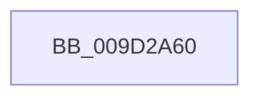

# CmGetDeviceMappedPropertyFromRegProp

- RVA: `0x009D2A60`–`0x009D2AD6` (길이 `118` bytes)
- VA: `0x00000001409D2A60`
- 실행 섹션: `PAGE`
- PDB 이름 있음: `예`; PDB Function 태그: `아니요`
- unwind 정보 RVA: `0x000A1470`
- 디코드: `31`개 명령, `118/118` bytes 표시
- 미해석 바이트: `0` (있으면 어셈블리에 `.byte`로 보존)

> 이 문서는 커널 이미지의 기계어와 PDB 기호를 분석해 생성했습니다. 4번과 5번은 함수 원형과 자료형을 바이너리 사용 방식에서 추정한 C 해석이며 원본 소스 복구 결과는 아닙니다.

## 1. Dependencies

- 직접 호출 지점: **0**; 고유 호출 대상: **0**
- 직접 호출자로 확인된 함수: **4**
- RIP 상대 이미지 참조: **1**

### Outgoing calls
- 직접 디코드된 call 명령이 없습니다.

### Direct callers
- [sub_008E1EE8](../8E/Unknown_function_008E1EE8.md) at `0x008E1F27`
- [_CmGetDeviceMappedPropertyKeys](_CmGetDeviceMappedPropertyKeys_function_009D0D78.md) at `0x009D0E27`
- [_CmGetDeviceCompoundFilters](_CmGetDeviceCompoundFilters_function_009D31C0.md) at `0x009D32D6`
- [CmGetDeviceCompoundFiltersWorker](../AF/CmGetDeviceCompoundFiltersWorker_function_00AF9CE8.md) at `0x00AF9ED4`
- [CmGetDeviceCompoundFiltersWorker](../AF/CmGetDeviceCompoundFiltersWorker_function_00AF9CE8.md) at `0x00AFA1E5`

### Static image references
- `0x009D2A76` → RVA `0x00E0A740` (`.data`; read)

## 2. Other-region calls and transfers

- 다른 실행 섹션으로 향하는 call: **0**
- call이 아닌 외부 분기/꼬리 이동: **1**
  - `0x009D2AD0` → [sub_009D2CE0](Unknown_function_009D2CE0.md) (`tail-transfer`)

## 3. Assembly (complete function range)

```asm
009D2A60  40 55                           push rbp
009D2A62  53                              push rbx
009D2A63  56                              push rsi
009D2A64  41 55                           push r13
009D2A66  41 56                           push r14
009D2A68  41 57                           push r15
009D2A6A  48 8D 6C 24 F9                  lea rbp, [rsp - 7]
009D2A6F  48 81 EC F8 00 00 00            sub rsp, 0xf8
009D2A76  48 8B 05 C3 7C 43 00            mov rax, qword ptr [rip + 0x437cc3]
009D2A7D  48 33 C4                        xor rax, rsp
009D2A80  48 89 45 EF                     mov qword ptr [rbp - 0x11], rax
009D2A84  44 8B 5D 7F                     mov r11d, dword ptr [rbp + 0x7f]
009D2A88  49 8B D8                        mov rbx, r8
009D2A8B  4C 8B 6D 5F                     mov r13, qword ptr [rbp + 0x5f]
009D2A8F  0F 57 C0                        xorps xmm0, xmm0
009D2A92  4C 8B 75 67                     mov r14, qword ptr [rbp + 0x67]
009D2A96  0F 57 C9                        xorps xmm1, xmm1
009D2A99  4C 8B 7D 77                     mov r15, qword ptr [rbp + 0x77]
009D2A9D  48 89 4C 24 48                  mov qword ptr [rsp + 0x48], rcx
009D2AA2  33 C9                           xor ecx, ecx
009D2AA4  48 89 5C 24 68                  mov qword ptr [rsp + 0x68], rbx
009D2AA9  48 89 54 24 50                  mov qword ptr [rsp + 0x50], rdx
009D2AAE  89 4C 24 44                     mov dword ptr [rsp + 0x44], ecx
009D2AB2  89 4C 24 5C                     mov dword ptr [rsp + 0x5c], ecx
009D2AB6  89 4C 24 40                     mov dword ptr [rsp + 0x40], ecx
009D2ABA  89 4C 24 58                     mov dword ptr [rsp + 0x58], ecx
009D2ABE  48 89 4C 24 60                  mov qword ptr [rsp + 0x60], rcx
009D2AC3  0F 11 44 24 70                  movups xmmword ptr [rsp + 0x70], xmm0
009D2AC8  0F 11 4D 8F                     movups xmmword ptr [rbp - 0x71], xmm1
009D2ACC  66 45 85 DB                     test r11w, r11w
009D2AD0  0F 85 0A 02 00 00               jne 0x1409d2ce0
```

## 4. C-style interpretation (structured pseudocode)

```c
__int64 __fastcall CmGetDeviceMappedPropertyFromRegProp(__int64 a1, __int64 a2, __int64 a3, __int64 a4, __int64 a5, __int64 a6, __int64 a7, __int64 a8, unsigned int a9)
{
    __int64 result;
    __int64 v_rsp;
    unsigned __int64 v_stack_m37;
    unsigned __int64 v_stack_m48;
    unsigned __int64 v_stack_mA8;
    unsigned __int64 v_stack_mB8;
    unsigned __int64 v_stack_mC0;
    unsigned __int64 v_stack_mC8;
    unsigned int v_stack_mCC;
    unsigned int v_stack_mD0;
    unsigned __int64 v_stack_mD8;
    unsigned __int64 v_stack_mE0;
    unsigned int v_stack_mE4;
    unsigned int v_stack_mE8;

    v_rsp = (v_rsp) - (248);
    result = (*(unsigned __int64 *)(v_rip + 4422851)) ^ (v_rsp);
    v_stack_m48 = result;
    v_stack_mE0 = a1;
    a1 = 0;
    v_stack_mC0 = a3;
    v_stack_mD8 = a2;
    v_stack_mE4 = 0;
    v_stack_mCC = 0;
    v_stack_mE8 = 0;
    v_stack_mD0 = 0;
    v_stack_mC8 = 0;
    v_stack_mB8 = v_xmm0;
    v_stack_mA8 = v_xmm1;
}
```

## 5. (Beta) C Style

```c
int64_t CmGetDeviceMappedPropertyFromRegProp(int64_t Arg1, int64_t Arg2, int64_t Arg3, int64_t Arg4, int64_t Arg5, int64_t Arg6, uint64_t Arg7, int64_t Arg8, uint32_t Arg9)
{
    int64_t result;
    int64_t local_rsp;
    uint64_t v_stack_m37;
    uint64_t v_stack_m48;
    uint64_t v_stack_mA8;
    uint64_t v_stack_mB8;
    uint64_t v_stack_mC0;
    uint64_t v_stack_mC8;
    uint32_t v_stack_mCC;
    uint32_t v_stack_mD0;
    uint64_t v_stack_mD8;
    uint64_t v_stack_mE0;
    uint32_t v_stack_mE4;
    uint32_t v_stack_mE8;

    local_rsp = (local_rsp) - (248);
    result = (*(uint64_t *)(v_rip + 0x437CC3)) ^ (local_rsp);
    v_stack_m48 = result;
    v_stack_mE0 = Arg1;
    Arg1 = 0;
    v_stack_mC0 = Arg3;
    v_stack_mD8 = Arg2;
    v_stack_mE4 = 0;
    v_stack_mCC = 0;
    v_stack_mE8 = 0;
    v_stack_mD0 = 0;
    v_stack_mC8 = 0;
    v_stack_mB8 = v_xmm0;
    v_stack_mA8 = v_xmm1;
}
```

## 6. Execution-region graph

[열기: 2D/3D 그래프와 함수 탐색 컨트롤 패널](../../../control-panel.html?section=page&rva=0x009D2A60&view=graph)

- 2D 그래프는 위에서 아래로 흐르고, 3D 그래프는 빈 공간을 드래그해 회전합니다. Shift+드래그는 이동, 휠은 확대·축소, 함수 노드 선택은 대상 보고서 이동입니다.

### Static fallback


