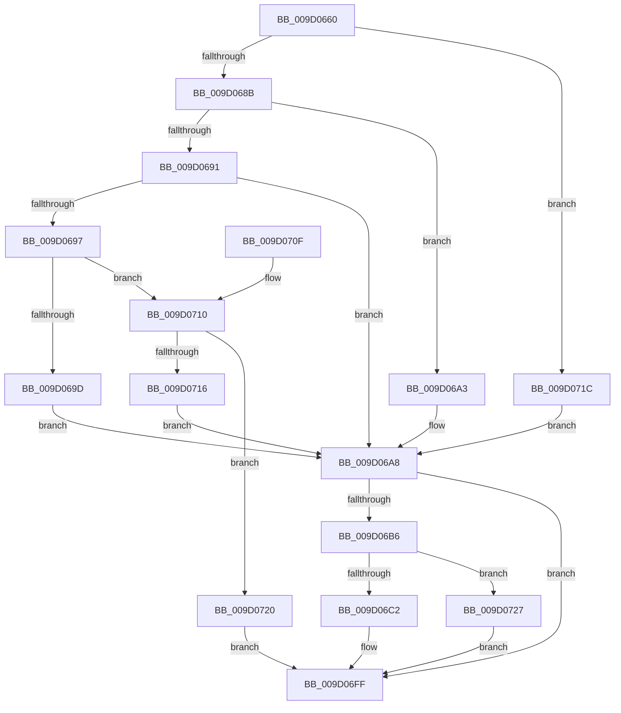

# CmGetDeviceRelationsList

- RVA: `0x009D0660`–`0x009D072E` (길이 `206` bytes)
- VA: `0x00000001409D0660`
- 실행 섹션: `PAGE`
- PDB 이름 있음: `예`; PDB Function 태그: `아니요`
- unwind 정보 RVA: `0x000A12F8`
- 디코드: `56`개 명령, `206/206` bytes 표시
- 미해석 바이트: `0` (있으면 어셈블리에 `.byte`로 보존)

> 이 문서는 커널 이미지의 기계어와 PDB 기호를 분석해 생성했습니다. 4번과 5번은 함수 원형과 자료형을 바이너리 사용 방식에서 추정한 C 해석이며 원본 소스 복구 결과는 아닙니다.

## 1. Dependencies

- 직접 호출 지점: **2**; 고유 호출 대상: **2**
- 직접 호출자로 확인된 함수: **3**
- RIP 상대 이미지 참조: **0**

### Outgoing calls
- `0x009D06AD` → [RtlInitUnicodeStringEx](../../text/46/RtlInitUnicodeStringEx_function_00463960.md) (function, `0x00463960`)
- `0x009D06ED` → [guard_dispatch_icall](../../text/6B/guard_dispatch_icall_function_006BAAD0.md) (function, `0x006BAAD0`)

### Direct callers
- [_CmGetDeviceMappedPropertyFromComposite](_CmGetDeviceMappedPropertyFromComposite_function_009D1684.md) at `0x009D2295`
- [CmGetMatchingFilteredDeviceListWorker](../A2/CmGetMatchingFilteredDeviceListWorker_function_00A2C2BC.md) at `0x00A2C42F`
- [sub_00B392DC](../B3/Unknown_function_00B392DC.md) at `0x00B393B1`

### Static image references
- 디코드된 RIP-relative 메모리 참조가 없습니다.

## 2. Other-region calls and transfers

- 다른 실행 섹션으로 향하는 call: **2**
  - `0x009D06AD` → [RtlInitUnicodeStringEx](../../text/46/RtlInitUnicodeStringEx_function_00463960.md) (`PAGE` → `.text`)
  - `0x009D06ED` → [guard_dispatch_icall](../../text/6B/guard_dispatch_icall_function_006BAAD0.md) (`PAGE` → `.text`)
- 별도 외부 분기/꼬리 이동을 확인하지 못했습니다.

## 3. Assembly (complete function range)

```asm
009D0660  48 89 5C 24 08                  mov qword ptr [rsp + 8], rbx
009D0665  48 89 74 24 10                  mov qword ptr [rsp + 0x10], rsi
009D066A  57                              push rdi
009D066B  48 83 EC 50                     sub rsp, 0x50
009D066F  BB 04 00 00 00                  mov ebx, 4
009D0674  0F 57 C0                        xorps xmm0, xmm0
009D0677  49 8B F1                        mov rsi, r9
009D067A  48 8B F9                        mov rdi, rcx
009D067D  0F 11 44 24 40                  movups xmmword ptr [rsp + 0x40], xmm0
009D0682  44 3B C3                        cmp r8d, ebx
009D0685  0F 84 91 00 00 00               je 0x1409d071c
009D068B  41 83 F8 20                     cmp r8d, 0x20
009D068F  74 12                           je 0x1409d06a3
009D0691  41 83 F8 40                     cmp r8d, 0x40
009D0695  74 11                           je 0x1409d06a8
009D0697  41 83 F8 08                     cmp r8d, 8
009D069B  75 73                           jne 0x1409d0710
009D069D  41 8D 58 F9                     lea ebx, [r8 - 7]
009D06A1  EB 05                           jmp 0x1409d06a8
009D06A3  BB 03 00 00 00                  mov ebx, 3
009D06A8  48 8D 4C 24 40                  lea rcx, [rsp + 0x40]
009D06AD  E8 AE 32 A9 FF                  call 0x140463960
009D06B2  85 C0                           test eax, eax
009D06B4  78 49                           js 0x1409d06ff
009D06B6  48 8B 87 18 01 00 00            mov rax, qword ptr [rdi + 0x118]
009D06BD  48 85 C0                        test rax, rax
009D06C0  74 65                           je 0x1409d0727
009D06C2  48 8B 8C 24 88 00 00 00         mov rcx, qword ptr [rsp + 0x88]
009D06CA  48 8D 54 24 40                  lea rdx, [rsp + 0x40]
009D06CF  83 64 24 30 00                  and dword ptr [rsp + 0x30], 0
009D06D4  4C 8B CE                        mov r9, rsi
009D06D7  48 89 4C 24 28                  mov qword ptr [rsp + 0x28], rcx
009D06DC  44 8B C3                        mov r8d, ebx
009D06DF  8B 8C 24 80 00 00 00            mov ecx, dword ptr [rsp + 0x80]
009D06E6  89 4C 24 20                     mov dword ptr [rsp + 0x20], ecx
009D06EA  48 8B CF                        mov rcx, rdi
009D06ED  E8 DE A3 CE FF                  call 0x1406baad0
009D06F2  3D 05 00 00 80                  cmp eax, 0x80000005
009D06F7  B9 23 00 00 C0                  mov ecx, 0xc0000023
009D06FC  0F 44 C1                        cmove eax, ecx
009D06FF  48 8B 5C 24 60                  mov rbx, qword ptr [rsp + 0x60]
009D0704  48 8B 74 24 68                  mov rsi, qword ptr [rsp + 0x68]
009D0709  48 83 C4 50                     add rsp, 0x50
009D070D  5F                              pop rdi
009D070E  C3                              ret
009D070F  CC                              int3
009D0710  41 83 F8 10                     cmp r8d, 0x10
009D0714  75 0A                           jne 0x1409d0720
009D0716  41 8D 58 F2                     lea ebx, [r8 - 0xe]
009D071A  EB 8C                           jmp 0x1409d06a8
009D071C  33 DB                           xor ebx, ebx
009D071E  EB 88                           jmp 0x1409d06a8
009D0720  B8 0D 00 00 C0                  mov eax, 0xc000000d
009D0725  EB D8                           jmp 0x1409d06ff
009D0727  B8 02 00 00 C0                  mov eax, 0xc0000002
009D072C  EB D1                           jmp 0x1409d06ff
```

## 4. C-style interpretation (structured pseudocode)

```c
__int64 __fastcall CmGetDeviceRelationsList(__int64 a1, __int64 a2, __int64 a3, __int64 a4, unsigned int a5, __int64 a6)
{
    __int64 result;
    __int64 v_rbx;
    __int64 v_rsp;
    unsigned __int64 v_stack_m18;
    unsigned int v_stack_m28;
    unsigned __int64 v_stack_m30;
    unsigned int v_stack_m38;
    unsigned __int64 v_stack_p10;
    unsigned __int64 v_stack_p8;

    v_stack_p8 = v_rbx;
    v_stack_p10 = v_rsi;
    v_rsp = (v_rsp) - (80);
    v_stack_m18 = v_xmm0;
    if (((unsigned int)(a3)) == 4) goto loc_009D071C;
    if (((unsigned int)(a3)) == 32) goto loc_009D06A3;
    if (((unsigned int)(a3)) == 64) goto loc_009D06A8;
    if (((unsigned int)(a3)) != 8) goto loc_009D0710;
    goto loc_009D06A8;
loc_009D06A3:
loc_009D06A8:
    result = RtlInitUnicodeStringEx(v_stack_m18, a2, a3, a4);
    if (sign_flag) goto loc_009D06FF;
    if (*(unsigned __int64 *)(a1 + 280) == 0) goto loc_009D0727;
    v_stack_m30 = a6;
    v_stack_m38 = (unsigned int)((unsigned int)(a5));
    result = guard_dispatch_icall(a1, v_stack_m18, 3, a4);
    if (((unsigned int)(result)) == 0x80000005ULL) { result = (unsigned int)((unsigned int)(0xC0000023ULL)); }
loc_009D06FF:
    v_rsp = (v_rsp) + (80);
    return result;
loc_009D0710:
    if (3 != 16) goto loc_009D0720;
    goto loc_009D06A8;
loc_009D071C:
    v_rbx = 0;
    goto loc_009D06A8;
loc_009D0720:
    goto loc_009D06FF;
loc_009D0727:
    goto loc_009D06FF;
}
```

## 5. (Beta) C Style

```c
int64_t CmGetDeviceRelationsList(void *Arg1, int64_t Arg2, int64_t Arg3, int64_t Arg4, uint32_t Arg5, int64_t Arg6)
{
    uint8_t *arg1 = (uint8_t *)Arg1;

    int64_t result;
    int64_t local_rbx;
    int64_t local_rsp;
    uint64_t v_stack_m18;
    uint32_t v_stack_m28;
    uint64_t v_stack_m30;
    uint32_t v_stack_m38;
    uint64_t v_stack_p10;
    uint64_t v_stack_p8;

    v_stack_p8 = local_rbx;
    v_stack_p10 = local_rsi;
    local_rsp = (local_rsp) - (80);
    v_stack_m18 = v_xmm0;
    if (((uint32_t)(Arg3)) == 4) goto loc_009D071C;
    if (((uint32_t)(Arg3)) == 32) goto loc_009D06A3;
    if (((uint32_t)(Arg3)) == 64) goto loc_009D06A8;
    if (((uint32_t)(Arg3)) != 8) goto loc_009D0710;
    goto loc_009D06A8;
loc_009D06A3:
loc_009D06A8:
    result = RtlInitUnicodeStringEx(v_stack_m18, Arg2, Arg3, Arg4);
    if (sign_flag) goto loc_009D06FF;
    if (*(uint64_t *)(arg1 + 0x118) == 0) goto loc_009D0727;
    v_stack_m30 = Arg6;
    v_stack_m38 = (uint32_t)((uint32_t)(Arg5));
    result = guard_dispatch_icall(Arg1, v_stack_m18, 3, Arg4);
    if (((uint32_t)(result)) == 0x80000005ULL) { result = (uint32_t)((uint32_t)(0xC0000023ULL)); }
loc_009D06FF:
    local_rsp = (local_rsp) + (80);
    return result;
loc_009D0710:
    if (3 != 16) goto loc_009D0720;
    goto loc_009D06A8;
loc_009D071C:
    local_rbx = 0;
    goto loc_009D06A8;
loc_009D0720:
    goto loc_009D06FF;
loc_009D0727:
    goto loc_009D06FF;
}
```

### 관측된 메모리 오프셋

구조체 형식이 확인되지 않은 접근은 인자 기준의 오프셋으로만 기록했습니다.

| 기준 인자 | 오프셋 표현 | 폭 (bit) | 접근 |
|---|---:|---:|---|
| `Arg1` | `+ 0x118` | `64` | `R` |

## 6. Execution-region graph

[열기: 2D/3D 그래프와 함수 탐색 컨트롤 패널](../../../control-panel.html?section=page&rva=0x009D0660&view=graph)

- 2D 그래프는 위에서 아래로 흐르고, 3D 그래프는 빈 공간을 드래그해 회전합니다. Shift+드래그는 이동, 휠은 확대·축소, 함수 노드 선택은 대상 보고서 이동입니다.

### Static fallback


